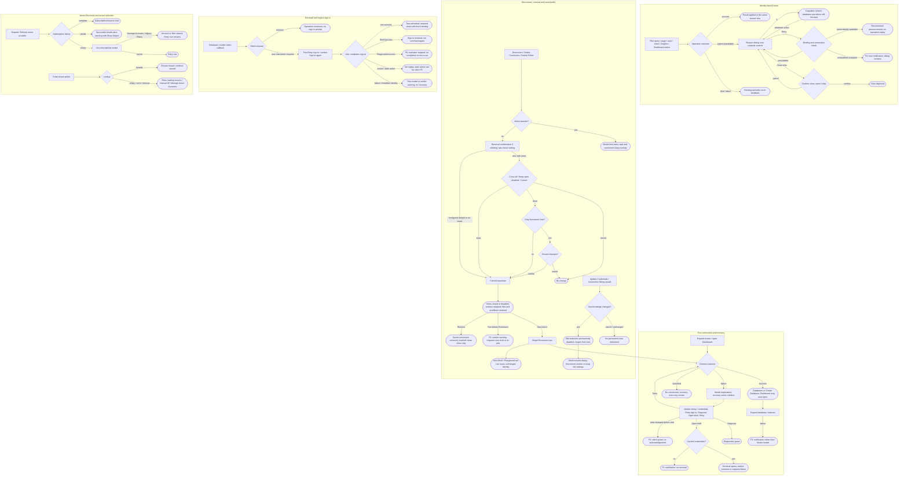

# Connection lifecycle — UX Review Pack

> **Who this is for:** the operator doing the hands-on connection-lifecycle review and
> anyone triaging its findings.
> **What this is:** a code-verified pre-assessment of the DocumentDB extension for Visual
> Studio Code, followed by a running ledger of runtime observations. Suspected priorities
> are ordered P0 → P3; recommendations are suggestions, not decisions.

- **Feature area:** connection-tree recovery; Disconnect / Reconnect; saved credential
  and destination edits; Collection, Document and Dashboard views; Interactive Shell;
  Query Playground; Azure Discovery account / tenant flows.
- **PR / branch:** [#1136](https://github.com/microsoft/vscode-documentdb/pull/1136) ·
  `feature/connection-lifecycle` · draft.
- **Code snapshot:** [`402b8e052`](https://github.com/microsoft/vscode-documentdb/commit/402b8e05251a5e2e688ac5d4a8eba8e8ce520139).
  This iteration is evidence about that revision, not a promise of current behavior.
- **Related design docs:** [feature overview](../README.md),
  [accepted decisions](../decisions.md), [implementation plan](./01-implementation-plan.md).
- **User-facing reference:** [connection and recovery manual](../../../../user-manual/connecting-to-databases.md).
- **Scope:** interaction, feedback, recoverability, retained work, identity continuity,
  and cancellation. Internals appear only to explain visible behavior. Infrastructure
  resilience beyond this PR, proactive account sign-out and stale-result indicators
  remain follow-ups #1105, #1119 and #1106, respectively.
- **Review date:** 2026-11-27.

**For a wording-and-message review, start with
[Appendix C: the scenario walkthrough](#appendix-c--message-walkthrough-what-the-user-sees-and-when).**
It follows a person from first connection through failure, repair, retained work and
removal, quoting the actual messages rather than only naming their surfaces.

## How this review was run

**Preparation followed by the operator's first hands-on feedback on 2026-11-27.**
The assistant read the manifest, command handlers, tree recovery paths, retained-view
components and controllers, worker recovery and Azure account flows. The original six
Flags were code-derived seeds. Their bodies now distinguish the operator's observations,
accepted changes, remaining suggestions and version-uncertain reproduction requests.
No product fixes have been implemented in this review.

Appendix C continues to quote **current source wording**, not pretend approved wording
has shipped. Decisions below and notes beside the relevant scenarios identify the
requested replacements. Operator transcripts omit the supplied server hostname;
that identifier is unnecessary to understand the observed behavior.

During the live pass, the person drives the extension and dictates observations; the
assistant verifies each observation against the source and updates this ledger and the
todo list. Each item has **Observation / Finding / Suggestion / Status**. Significant
choices require the operator's decision and reason before implementation. Design
trade-offs belong in [Open ideas](#open-ideas--options-pros--cons).

This is **Case 1**, not a ready-for-review handoff. Full Case 2 checks, including
`prettier-fix`, are deferred while #1136 remains a draft. This pack does not satisfy
the packaged-VSIX or telemetry operator gates, or substitute for the AI code review.
Preparation validation: `npm run build` passed and local reference targets resolved.
No runtime tests ran because this preparation changes documentation only.

## Legend

### Priority

| Priority | Meaning                                            |
| -------- | -------------------------------------------------- |
| **P0**   | Blocking — the user gets stuck                     |
| **P1**   | Broken / misleading, or a consistency & safety gap |
| **P2**   | Polish, expectation, or a smaller feature gap      |
| **P3**   | Nice-to-have / cosmetic / acknowledged             |

### Status

| Status             | Meaning                                                                 |
| ------------------ | ----------------------------------------------------------------------- |
| 🟠 **Open**        | Recorded + analyzed; carries a recommendation but stays a _suggestion_  |
| 🟡 **Open (soft)** | Open, but the recommendation depends on an investigation or is "as-is"   |
| ✅ **Implemented** | A change was made on this branch and verified (Decision + commit link)  |
| 🚫 **Closed**      | Won't fix — with a mandatory one-line reason                            |
| 🔗 **Tracked**     | Deferred to a repo issue (linked); dropped from the active priority list |

> Anything unresolved carries forward to the next iteration. An item leaves the active
> list only as Implemented, Closed with a reason, or Tracked with an issue link.

### Markers (inline)

| Marker            | Meaning                                                 |
| ----------------- | ------------------------------------------------------- |
| ⚠️ **Flag**       | Confirmed gap or bug                                    |
| 💡 **Suggestion** | A design/wording recommendation to react to             |
| 🔍 **Answered**   | A "how does this work?" question answered from the code |

> **For the operator:** no recommendation below is an approved change. Hands-on
> confirmation can change the priority or close an item with a reason.

---

## User interaction map

Explicit terminal nodes distinguish a completed action from a modal, retained state,
notification, or silent cancellation. F1–F6 refer to the priority index.



### Interaction inventory

The primary tree source is
[ClusterItemBase.ts](../../../../../src/tree/documentdb/ClusterItemBase.ts);
the command surface and gating are in [the manifest](../../../../../package.json#L1349)
and [command registration](../../../../../src/documentdb/ClustersExtension.ts#L1014).

| # | User action / entry | Implementation reference | Terminal states / feedback |
| --- | --- | --- | --- |
| I1 | Expand cluster in Connections, Discovery or Azure Resources | [connect and expand](../../../../../src/tree/documentdb/ClusterItemBase.ts#L153) | Cancellable progress; databases; modal + repair rows; cancellation without an error dialog |
| I2 | Click Create Database / Create Collection in an empty tree | [cluster empty state](../../../../../src/tree/documentdb/ClusterItemBase.ts#L649), [database empty state](../../../../../src/tree/documentdb/DatabaseItem.ts#L97) | Creation wizard, result/refresh or command error; cancel leaves the empty state |
| I3 | Expand an existing database or Indexes node | [database](../../../../../src/tree/documentdb/DatabaseItem.ts#L72), [indexes](../../../../../src/tree/documentdb/IndexesItem.ts#L66) | Collections/indexes or provider error feedback; F3 |
| I4 | Refresh view/node or click Retry | [Retry](../../../../../src/commands/retryAuthentication/retryAuthentication.ts#L63) | Error cache reset and fresh expansion; some stale-state guards are silent, F5 |
| I5 | Click Retry for a rejected Azure RU key | [key replacement](../../../../../src/commands/retryAuthentication/retryAuthentication.ts#L92) | Explicit fresh ARM key read; reconnect on refresh; modal on key-read failure |
| I6 | Click Retry sign-in under failed Entra cluster | [sign-in](../../../../../src/commands/signInAgain/signInAgain.ts#L74) | Interactive authentication; tree refresh; translated failure modal; cancel/stale guard |
| I7 | Click Diagnose connection… or invoke Diagnose from the palette | [diagnose command](../../../../../src/commands/diagnoseConnection/diagnoseConnection.ts#L27) | Read-only diagnostics panel; palette first picks a stored cluster |
| I8 | Click Open shell in failure rows / cluster context menu | [shell command](../../../../../src/commands/openInteractiveShell/openInteractiveShell.ts#L45) | Terminal and connection banner, or missing-credentials notification with no terminal, F1 |
| I9 | Click Update connection string… / Update credentials… | [destination edit](../../../../../src/commands/updateConnectionString/updateConnectionString.ts#L77), [credential edit](../../../../../src/commands/updateCredentials/updateCredentials.ts#L147) | Wizard; save feedback; changed settings retire webviews; error-node credential wizard asks whether to reconnect |
| I10 | Respond to old-Shell-settings notice after an edit | [Shell choice](../../../../../src/commands/saveConnectionEdit.ts#L136) | Modal; Disconnect stops workers; dismissal keeps running workers on previous settings |
| I11 | Right-click connected cluster → Disconnect | [Disconnect](../../../../../src/commands/disconnect/disconnect.ts#L18), [tab choice](../../../../../src/documentdb/connectionTeardown.ts#L55) | Hidden from palette; connected-only menu; task block, tab choice, dirty warning, or teardown |
| I12 | Click Reconnect under a disconnected cluster | [Reconnect](../../../../../src/commands/disconnect/disconnect.ts#L32) | Unlatch and tree refresh; connection result follows expansion; stale guard is silent |
| I13 | Delete one/multiple saved connections or a folder | [connection removal](../../../../../src/commands/removeConnection/removeConnection.ts#L23), [folder removal](../../../../../src/commands/connections-view/deleteFolder/ExecuteStep.ts#L22) | Shared destructive confirmation + teardown; refresh; configured summary; failures surfaced |
| I14 | Collection View: run, page, refresh, manipulate documents | [Collection View](../../../../../src/webviews/documentdb/collectionView/CollectionView.tsx#L179) | Current results or typed unavailable dialog; stale replies ignored; failed operations not replayed |
| I15 | Collection View: Indexes and Query Insights actions | [Indexes tab](../../../../../src/webviews/documentdb/collectionView/indexesTab/IndexesTab.tsx), [Query Insights tab](../../../../../src/webviews/documentdb/collectionView/queryInsightsTab/QueryInsightsTab.tsx) | Shared parent lifecycle blocking; results retained; repair through tree + Retry |
| I16 | Document View: edit, Save, Refresh | [Document View](../../../../../src/webviews/documentdb/documentView/documentView.tsx#L90) | Dirty draft tracked; server actions blocked when unavailable; close/discard confirmation |
| I17 | Dashboard: refresh, create/drop, open views, copy/export | [Dashboard](../../../../../src/webviews/documentdb/clusterDashboard/ClusterDashboard.tsx), [row commands](../../../../../src/webviews/documentdb/clusterDashboard/clusterDashboardController.ts#L254) | Busy state and results; unavailable dialog; no pending delete replay; retained namespace reference can be copied |
| I18 | Unavailable webview: Retry / Close view / X | [overlay](../../../../../src/webviews/components/DisconnectedOverlay.tsx#L37), [recovery hook](../../../../../src/webviews/documentdb/useBoundViewRecovery.ts#L93) | Same-binding recovery without replay; typed reason remains in dialog; exception notification, F4; confirmed close; X permits copying |
| I19 | Import, export, copy/paste while attempting teardown/edit | [import lease](../../../../../src/commands/importDocuments/importDocuments.ts#L161), [export lease](../../../../../src/commands/exportDocuments/exportDocuments.ts#L57), [task guard](../../../../../src/services/taskService/resourceUsageHelper.ts#L19) | Registered task/lease blocks teardown in modal; running transfer is not interrupted |
| I20 | Retained Shell: run after disconnect/reconnect; Sign in again | [worker evaluation](../../../../../src/documentdb/shell/ShellSessionManager.ts#L340), [sign-in action](../../../../../src/documentdb/shell/DocumentDBShellPty.ts#L941) | Same-settings worker restart; bounded failure output; warning action; successful sign-in has a rerun cue; F2/F5 |
| I21 | Playground: Run All / Run Selected; unbound connect-on-run | [execution](../../../../../src/commands/playground/executePlaygroundCode.ts#L101) | Database picker if unbound; progress + result document; latch warning; cancellation without execution |
| I22 | Playground CodeLens/status connection choice; Sign in again | [connection picker](../../../../../src/commands/playground/connectDatabase.ts#L35), [recovery](../../../../../src/commands/playground/executePlaygroundCode.ts#L367) | Confirm switching; picker cancellation preserves binding; sign-in stops evaluator without replay or completion cue, F6 |
| I23 | Azure provider Refresh/Retry; Manage Accounts; Adjust Filters | [provider root](../../../../../src/plugins/service-azure-mongo-vcore/discovery-tree/AzureServiceRootItem.ts#L38), [listing](../../../../../src/plugins/api-shared/azure/AzureSubscriptionProviderWithFilters.ts#L96) | Fresh listing; partial warning + Show Output; empty-state modal and actionable Retry |
| I24 | New/edit Entra connection: tenant, manual ID, Retry, Manage Azure Accounts | [new tenant picker](../../../../../src/commands/newConnection/PromptTenantStep.ts#L32), [edit tenant picker](../../../../../src/commands/updateCredentials/PromptTenantStep.ts) | Tenant selection/manual validation; recoverable lookup state; initial 5 s timeout and explicit retry up to 30 s |
| I25 | Show Connection Stats / Show Worker Stats during review | [connection stats](../../../../../src/commands/showConnectionStats/showConnectionStats.ts#L32) | Output channel; client state/generation and token expiry; worker stats are a separate surface |

### Failure and feedback surface matrix

These are the lifecycle-relevant foreground failure branches, not every unrelated
database-operation error. Silent background count/metadata failures and obsolete replies
are intentionally not treated as user-action failures.

| Event | Current feedback / termination | Source | Assessment |
| --- | --- | --- | --- |
| First cluster startup failure | Output detail + translated modal; recovery rows | [first-connect helper](../../../../../src/documentdb/showClusterConnectFailure.ts#L36), [stored startup](../../../../../src/tree/connections-view/DocumentDBClusterItem.ts#L273) | Expected baseline |
| Cached connect / listDatabases failure | Modal with explanation and detail; action-only children | [expansion failure](../../../../../src/tree/documentdb/ClusterItemBase.ts#L443) | Expected baseline |
| Explained database/index child-expansion failure | Non-modal error with cause appended | [provider catch](../../../../../src/tree/BaseExtendedTreeDataProvider.ts#L606) | F3: sibling tree divergence |
| Open shell after cache eviction | Non-modal “Not signed in”; no terminal | [credential guard](../../../../../src/commands/openInteractiveShell/openInteractiveShell.ts#L63) | F1: offered recovery can dead-end |
| Azure replacement-key read failure | Modal “Azure sign-in needed” or key-read failure | [key read](../../../../../src/commands/retryAuthentication/retryAuthentication.ts#L107) | Targeted recovery |
| Tree sign-in fails / cloud provider changed / connection closed mid-sign-in | Translated or dedicated modal | [sign-in flow](../../../../../src/commands/signInAgain/signInAgain.ts#L114) | Explicit action reports failure |
| Bound-view unavailable reason | In-view modal over retained content; Retry and/or Close view | [reason map](../../../../../src/webviews/_integration/describeUnavailableConnection.ts#L11) | Accepted design, not a passive tree row |
| Bound-view Retry throws an unclassified error | Host non-modal error; previous dialog remains | [recovery catch](../../../../../src/webviews/documentdb/useBoundViewRecovery.ts#L125) | F4: feedback split |
| Close-view confirmation RPC fails | In-dialog alert; view remains open | [close confirmation](../../../../../src/webviews/components/DisconnectedOverlay.tsx#L48) | Explicit failure with retry path |
| Worker sign-in expires | Shell bounded output or Playground result; non-modal Sign in again when safe | [Shell](../../../../../src/documentdb/shell/DocumentDBShellPty.ts#L907), [Playground](../../../../../src/commands/playground/executePlaygroundCode.ts#L313) | Deliberate worker surface; not automatically a modal inconsistency |
| Worker sign-in action fails | Bounded non-modal warning; original operation not replayed | [Shell action](../../../../../src/documentdb/shell/DocumentDBShellPty.ts#L979), [Playground action](../../../../../src/commands/playground/executePlaygroundCode.ts#L402) | Confirm actionable next-step wording |
| Run while user-disconnected / identity changed | Shell error output; Playground warning before run or result after failure | [Shell reason](../../../../../src/documentdb/shell/DocumentDBShellPty.ts#L895), [Playground latch](../../../../../src/commands/playground/executePlaygroundCode.ts#L127) | F2: unnecessary new-shell/re-pick guidance for unchanged settings |
| Save fails / persisted state uncertain | Save-error notification; possible incomplete-update warning; old views remain safely disabled | [save reconciliation](../../../../../src/commands/saveConnectionEdit.ts#L76), [credential save](../../../../../src/commands/updateCredentials/ExecuteStep.ts#L106) | Do not confuse “saved” with “usable” |
| Removal partly/all fails | Output details; partial-success summary respects summary setting; all-failed error is non-modal | [removal feedback](../../../../../src/commands/removeConnection/removeConnection.ts#L117) | Existing summary policy; confirm restored Reconnect state on storage failure |
| Transfer blocks disconnect/remove/edit | Modal lists conflicting tasks; nothing stopped | [task guard](../../../../../src/services/taskService/resourceUsageHelper.ts#L19) | Safety check |
| Azure partial listing | Successful subscriptions plus one warning with Show Output per listing | [partial listing](../../../../../src/plugins/api-shared/azure/AzureSubscriptionProviderWithFilters.ts#L107) | Accepted partial-result policy |
| Azure empty listing | Informational modal with Manage Accounts / Adjust Filters; Retry child | [empty-state helper](../../../../../src/plugins/api-shared/azure/askToConfigureCredentials.ts#L26) | Actionable first-run state |
| Tenant lookup empty / error / timeout | Picker Retry row with reason, plus manual ID and account management | [tenant alternatives](../../../../../src/commands/newConnection/PromptTenantStep.ts#L76) | No wizard dead end |
| User cancellation | No error; no automatic operation replay | [connect cancellation](../../../../../src/tree/documentdb/ClusterItemBase.ts#L173) | Expected |
| Stale action becomes invalid before click | Some handlers return silently | [Reconnect](../../../../../src/commands/disconnect/disconnect.ts#L32), [Retry](../../../../../src/commands/retryAuthentication/retryAuthentication.ts#L85) | F5: distinguish safety guard from missing feedback |

---

## The story in one paragraph

The extension aims to recover silently when the connection identity has not changed,
and to preserve work rather than replay interrupted operations or silently change
permissions. Explicit Disconnect offers a tab choice and a single tree Reconnect;
changed saved settings permanently retire old webviews, while workers have separately
documented restart rules. The live pass confirms that Shell and Playground can recover after tree Reconnect
without a new terminal or connection pick, despite their wording. The operator wants
unauthenticated Shell access from failure rows, modal errors for tree-originated actions,
simpler retained-view labels and readable, consistent debugging output. A missing
Disconnect menu item after credential repair still needs current-version reproduction;
Retry/stale-action feedback choices remain open. The lack of a dedicated Playground
sign-in completion message is accepted as-is.

---

## Priority index

| # | Priority | Item | Status |
| --- | --- | --- | --- |
| F1 | **P1** | Offer unauthenticated Shell from failure rows; choose a clear label | 🟠 Open |
| F2 | **P1** | Worker recovery wording requests unnecessary new Shell / connection pick | 🟠 Open |
| F3 | **P1** | Use modal failure feedback for tree-originated actions | 🟠 Open |
| F7 | **P1** | Disconnect missing after credential repair; version uncertain | 🟡 Open (soft) |
| F4 | **P2** | Retry exceptions appear outside the retained-view dialog | 🟠 Open |
| F5 | **P2** | State-drift guards silently terminate explicit recovery clicks | 🟠 Open |
| F8 | **P2** | Shell Disconnected output looks like text entered at the prompt | 🟠 Open |
| F9 | **P2** | Shorten Keep open (disabled) to Keep open | 🟠 Open |
| F10 | **P2** | Explain that decoded-password confirmation saves the correctly formatted password | 🟠 Open |
| F11 | **P2** | X label should describe access, not only copying | 🟠 Open |
| F12 | **P2** | Unify connection/worker debug-stat format for human readability | 🟠 Open |
| F6 | **P2** | Playground sign-in succeeds without a completion or rerun cue | 🚫 Closed |

## P0 — Blocking (the user gets stuck)

No P0 seeded. Promote an item only after confirming that no usable recovery path exists.

## P1 — Broken / misleading, or consistency & safety

### F1. Error-recovery Shell should not retry the failing authentication ⚠️

**Priority:** P1 · **Status:** 🟠 Open

**Observation (operator, 2026-11-27):** a No Authentication connection opened the Shell
and showed a prompt. An invalid key/password opened a Shell that attempted the saved
authentication and failed. Relevant output, with the host omitted:

```text
Connected to: {test host}
Authentication: No Authentication | Database: test
Type "help" for available commands.
test>
```

```text
Failed to connect: Invalid key
Run a command to try connecting again, or close this terminal.
test>
```

> **TN leans towards always offering Shell without authentication from error rows.**
> The label should make that difference explicit; “Open shell (w/o auth)” was offered
> as a possible name, not a final wording decision.

**Finding:**

- ⚠️ [Every cluster failure offers Open shell](../../../../../src/tree/documentdb/ClusterItemBase.ts#L431).
  The [current command uses ordinary Shell startup](../../../../../src/commands/openInteractiveShell/openInteractiveShell.ts#L60);
  [the worker builds Native authentication from cached credentials](../../../../../src/documentdb/shell/ShellSessionManager.ts#L435),
  rather than selecting an unauthenticated diagnostic session for failure rows.
  This supports the reported NoAuth-versus-invalid-key behavior.
- [Failed startup evicts non-recoverable credentials](../../../../../src/tree/documentdb/ClusterItemBase.ts#L324);
  [the stored connection calls that cleanup](../../../../../src/tree/connections-view/DocumentDBClusterItem.ts#L386)
  before returning its recovery children. The user can therefore receive “Not signed in”
  instead of the promised diagnostic terminal. This original pre-assessment branch
  remains conditional; it does **not** mean every invalid-key click fails to open.
  The operator's tested branch opened and then failed authentication instead.
- 🔍 This conflicts with the stated intent that experts can open a Shell on every failure
  in the [tree architecture guidance](../../../../../.github/skills/tree-cluster-architecture/SKILL.md#failure-presentation-actions-only).
  It is a command precondition gap, not evidence that Shell automatically repairs authentication.

💡 **Suggestion:** For error-row entry only, open a separately unauthenticated Shell
without changing saved credentials or the existing connection identity. Do not silently
fall back to saved credentials after a server rejects anonymous operations. A Shell
opening without authentication is not a promise that database commands are authorized.
Normal context-menu Open Shell should keep its existing authenticated behavior.

| Name option | Pros | Cons |
| --- | --- | --- |
| **Open shell without authentication** | Recommended; explicit, plain language, no abbreviation | Longer tree row |
| Open unauthenticated shell | Accurate and shorter | More technical vocabulary |
| Open shell (no authentication) | Consistent with the No Authentication method label | Parenthetical is less readable in a narrow tree |
| Open shell (w/o auth) | Short | Two abbreviations; least clear for non-experts |

**Decision state:** operator's preferred recovery direction recorded; final label and
implementation are still open. No anonymous-startup behavior has been added.

### F2. Retained-worker guidance overstates when reopening or re-picking is required ⚠️

**Priority:** P1 · **Status:** 🟠 Open

**Observation (operator, 2026-11-27):** the disconnected Shell requested a tree reconnect
and a new Shell, but after reconnecting the **same terminal** ran the query successfully.
The disconnected Playground warned:

> This connection is unavailable. Reconnect from the tree, then re-pick it here.

After tree Reconnect, running the retained Playground recovered without a connection
pick. The operator found “re-pick it here” difficult to interpret. The other two
observations reported with F2 are tracked separately as [F7](#f7-disconnect-menu-missing-after-credential-repair)
and [F8](#f8-disconnected-is-written-beside-the-active-shell-prompt).

**Finding:**

- ⚠️ [Shell user-disconnected output](../../../../../src/documentdb/shell/DocumentDBShellPty.ts#L895)
  says to reconnect and open a new shell. [Playground's generic unavailable guidance](../../../../../src/commands/playground/executePlaygroundCode.ts#L356)
  says to reconnect and re-pick.
- 🔍 Same-settings reuse is supported: teardown stops workers but preserves the
  [terminal](../../../../../src/documentdb/shell/DocumentDBShellPty.ts#L273);
  the [next Shell evaluation restarts its worker](../../../../../src/documentdb/shell/ShellSessionManager.ts#L340).
  [Playground checks the original fingerprint when spawning](../../../../../src/documentdb/playground/PlaygroundEvaluator.ts#L276)
  and can use the retained binding.
- The [manual explicitly describes reuse without a new terminal or pick](../../../../user-manual/connecting-to-databases.md#disconnect-and-reconnect).
  Source behavior supports that intent; the error wording is the mismatch. Identity or
  destination changes still require the stricter guidance.

> **Decision (Iteration 1):** for an unchanged disconnected connection, direct the person
> to reconnect from the tree and run the command/script again, not open a new Shell or
> re-pick the Playground. **Reason:** the operator verified in-place recovery; “re-pick
> it here” is not easy to follow.

💡 **Proposed copy:** Shell:
**“Disconnected. Reconnect from the tree, then run your command again.”**
Playground:
**“This connection is disconnected. Reconnect from the tree, then run the script again.”**
These are proposed exact strings for the approved direction, not current source copy.
Preserve separate guidance when the connection was removed or its host/identity changed;
do not promise recovery or preservation of worker-local variables in those cases.

### F3. Sibling tree expansion failures use modal versus notification feedback ⚠️

**Priority:** P1 · **Status:** 🟠 Open

**Observation / direction (operator, 2026-11-27):**
“yes, modal all the way please, that's our ux guideline.”
The later clarification is: **“I meant modals for tree actions.”**
This is a policy decision; the operator did not supply a new reproduction transcript
for each descendant failure.

**Finding:**

- ⚠️ [Cluster expansion renders a modal](../../../../../src/tree/documentdb/ClusterItemBase.ts#L527)
  with translated heading and separate detail.
- [Database](../../../../../src/tree/documentdb/DatabaseItem.ts#L81) and
  [index](../../../../../src/tree/documentdb/IndexesItem.ts#L121) failures propagate to
  [the shared provider catch](../../../../../src/tree/BaseExtendedTreeDataProvider.ts#L606),
  which renders an explanation and cause in a non-modal notification.
- The [error-translation guidance](../../../../../.github/skills/error-translation/SKILL.md#adding-a-call-site)
  shows modal-plus-detail tree presentation. The shared catch is an inherited boundary,
  not a newly introduced renderer; code wins for current behavior, while the discrepancy
  should be resolved explicitly rather than silently treating the guidance as implemented.

> **Decision (Iteration 1):** failures of tree-originated actions, including expansion
> and tree commands, use modal feedback. **Reason:** this is the operator's stated UX
> guideline. Keep tree children as recovery actions, not error paragraphs.

This does **not** make every worker or webview failure a host modal. It supersedes the
earlier suggestion here to leave tree database-command notification policy separate.
Use a translated heading and separate error detail consistently; avoid two modals for
one action. [O1](#o1-tree-modal-policy-and-in-view-feedback-are-separate-f3f4)
records the same scoped decision.

### F7. Disconnect menu missing after credential repair

**Priority:** P1 · **Status:** 🟡 Open (soft)

**Observation (operator, 2026-11-27):** failed connect → Update Credentials → allow
reconnect with fresh credentials → the cluster context menu did not offer Disconnect.
The operator explicitly questioned whether an older version was being tested.
After restart and a fresh healthy connection, Disconnect was available.

**Finding:**

- 🔍 [The manifest gates Disconnect](../../../../../package.json#L1355) on a cluster
  tree item with the `connected` context tag and no multi-selection.
- [The tag is emitted when a cached client exists and no latch applies](../../../../../src/tree/documentdb/ClusterItemBase.ts#L689);
  [the stored cluster uses that helper](../../../../../src/tree/connections-view/DocumentDBClusterItem.ts#L484).
- [Credential repair resets error state when reconnect was chosen, then refreshes](../../../../../src/commands/updateCredentials/updateCredentials.ts#L183).
  These are the current-code eligibility checks, **not a confirmed root cause**.

💡 **Suggestion:** reproduce that exact sequence in the current build before changing
the menu. Capture client existence/latch and the refreshed tree context tag. Do not
claim the old-version possibility has been ruled out or mark the feature fixed by restart.

## P2 — Polish, expectation, or feature gap

### F4. Retry exceptions leave the dialog intact but report elsewhere ⚠️

**Priority:** P2 · **Status:** 🟠 Open

**Observation:** Not yet observed live. Retry an unavailable view while the server remains
unreachable; compare a typed unavailable result and an unclassified thrown error.

**Finding:**

- 🔍 [Typed recovery failure updates the reason dialog](../../../../../src/webviews/documentdb/useBoundViewRecovery.ts#L112).
- ⚠️ [An unclassified exception instead sends a non-modal host error](../../../../../src/webviews/documentdb/useBoundViewRecovery.ts#L125)
  while retaining the previous dialog. This creates two different feedback locations for
  the same Retry interaction; whether the notification is missed requires runtime observation.
- [Close confirmation failure already stays in-context as an alert](../../../../../src/webviews/components/DisconnectedOverlay.tsx#L67).

💡 **Suggestion:** Walk this in all three retained views before deciding whether Retry
failure should update the dialog or remain a notification. Preserve the translated reason
and the ability to copy/close; never replay the failed operation.

**Operator request (Iteration 1):** provide options with pros/cons. Recommendation:
keep Retry failure **inside the existing in-view dialog**, without stacking a host modal.
[O2](#o2-where-should-a-failed-in-view-retry-be-explained-f4) gives the alternatives.
This remains a suggestion; F3's tree-modal decision does not decide F4 automatically.

### F5. Stale recovery actions can be safely rejected without explaining why ⚠️

**Priority:** P2 · **Status:** 🟠 Open

**Observation:** Not yet observed live. Leave a recovery row or Sign in again notification
available, change the connection's state elsewhere, then invoke the old action.

**Finding:**

- ⚠️ [Reconnect ignores an invalid target/state](../../../../../src/commands/disconnect/disconnect.ts#L32);
  [Retry ignores incompatible latches](../../../../../src/commands/retryAuthentication/retryAuthentication.ts#L85);
  [tree sign-in does the same](../../../../../src/commands/signInAgain/signInAgain.ts#L88).
- [Shell](../../../../../src/documentdb/shell/DocumentDBShellPty.ts#L949) and
  [Playground](../../../../../src/commands/playground/executePlaygroundCode.ts#L389)
  discard a stale sign-in notification choice when its epoch/owner no longer matches.
- 🔍 These guards correctly prevent recovery of the wrong connection. The code-level gap
  is acknowledgement, not the safety check. Whether a stale affordance remains visible
  long enough to confuse a person is still unverified.

💡 **Suggestion:** Distinguish user cancellation and obsolete background work, which
should stay quiet, from an explicit click on a still-visible stale action. Consider a
refresh or brief bounded next-step notice only for the latter.

**Operator request (Iteration 1):** provide options with pros/cons. Recommendation:
re-check and refresh on explicit stale clicks; show an actionable **modal for a failed
tree-originated action**, but keep cancellation/background disposal quiet and do not
report an already-completed action as an error. See
[O3](#o3-how-should-an-explicit-stale-action-end-f5). Decision remains open.

### F6. Playground sign-in has no equivalent of Shell's “run again” completion cue ⚠️

**Priority:** P2 · **Status:** 🚫 Closed

**Observation / comment (operator, 2026-11-27):** F6 is acceptable. The operator also did
not notice Shell's “Sign-in restored” line during testing, possibly because a `find()`
produced enough output to consume the visible scrollback. That explanation is a
possibility, not a verified cause.

**Finding:**

- [Playground writes the failed result before offering recovery](../../../../../src/commands/playground/executePlaygroundCode.ts#L276).
- ⚠️ [Successful sign-in only stops the evaluator](../../../../../src/commands/playground/executePlaygroundCode.ts#L397);
  this path does not replace the failed result or announce that the next run is available.
- [Shell explicitly prints “Sign-in restored. Run your command again.”](../../../../../src/documentdb/shell/DocumentDBShellPty.ts#L972).
  The authentication provider may show its own UI, but the Playground recovery handler
  supplies no equivalent completion/rerun cue.

> **Decision (Iteration 1):** leave the Playground completion behavior as-is.
> **Reason:** the operator accepts the lack of a dedicated completion/rerun cue.

**Closed reason:** accepted as-is; no implementation change and no commit claimed.
Shell's line is emitted only after the explicit Shell Sign in again route succeeds
([source](../../../../../src/documentdb/shell/DocumentDBShellPty.ts#L962)); ordinary
tree Reconnect/worker restart is not evidence that the line must have appeared.
See [Q1](#q1-can-the-shell-scrollback-buffer-be-configured) for the buffer question.

### F8. Disconnected is written beside the active Shell prompt

**Priority:** P2 · **Status:** 🟠 Open

**Observation (operator, 2026-11-27):**

```text
a11y-db>
a11y-db> Disconnected
a11y-db>
```

The system word looks like something the person entered at the prompt, rather than a
separate connection-state message.

**Finding:** [disconnect writes Disconnected without first moving off the current line](../../../../../src/documentdb/shell/DocumentDBShellPty.ts#L274);
[writeLine appends only a trailing CRLF](../../../../../src/documentdb/shell/DocumentDBShellPty.ts#L1120),
and [showPrompt leaves the cursor after the prompt](../../../../../src/documentdb/shell/DocumentDBShellPty.ts#L1081).
This directly supports the reported rendering.

> **Decision (Iteration 1):** render Disconnected on a separate system-output line
> before a fresh prompt. **Reason:** it must not look like user-entered input.

💡 **Suggestion:** verify idle, partially typed and evaluating states when implementing;
preserve input intentionally rather than blindly adding a newline in every output path.

### F9. Shorten the retained-tab choice

**Priority:** P2 · **Status:** 🟠 Open

**Observation / comment:** C0's host-modal option “Keep open (disabled)” is too complex;
the operator knows the state is disabled but finds the label unclear.

**Finding:** [the teardown modal currently uses Keep open (disabled)](../../../../../src/documentdb/connectionTeardown.ts#L78).
The choice controls retained webviews; it does not close the Shell terminal or Playground
file. The later overlay can explain unavailable database operations.

> **Decision (Iteration 1):** change the visible choice to **“Keep open”**, dropping
> “(disabled)”. **Reason:** the suffix is unclear and unnecessarily complex.

Retain disabled-operation behavior; this is a label change, not permission to execute.

### F10. Explain what the decoded-password save will store

**Priority:** P2 · **Status:** 🟠 Open

**Observation / comment:** after decoding succeeds, enhance
“Connected to "Orders" using the decoded password. Would you like to update your saved credentials?”
so it states that the saved credentials will receive the correctly formatted password.

**Finding:** [the current successful-retry prompt](../../../../../src/tree/connections-view/DocumentDBClusterItem.ts#L350)
offers “Update saved password” and saves the decoded password only on that explicit action.
It does not reveal the password in the prompt.

**Requested change (Iteration 1):** explicitly describe saving the correctly formatted
password into the connection's saved credentials. The operator specified the information
to add; no separate rationale or final exact sentence was supplied.

💡 **Proposed copy:**
**“Connected to "Orders" using the decoded password. Would you like to update your saved credentials with the correctly formatted password?”**
Keep the existing “Update saved password” action and do not include the secret value.

### F11. X should describe access to retained contents

**Priority:** P2 · **Status:** 🟠 Open

**Observation / comment:** C6's X accessible name should describe accessing contents,
not only copying them.

**Finding:** [the overlay's current accessible name](../../../../../src/webviews/components/DisconnectedOverlay.tsx#L105)
is “Dismiss dialog to copy view contents”; dismissal exposes the retained content while
database-operation guards remain in place.

> **Decision (Iteration 1):** use **“Dismiss dialog to access view contents”**.
> **Reason:** dismissing enables access/inspection, not just the narrower act of copying.

No change to recovery or close semantics is implied.

### F12. Make connection and worker debugging output use one readable format

**Priority:** P2 · **Status:** 🟠 Open

**Observation / comment:** Show Connection Stats and Show Worker Stats use different
formats. The operator requests unification and authorizes selecting the better format,
emphasizing that humans also read this debugging output.

**Finding:** [connection stats compress multiple fields onto one Client line](../../../../../src/commands/showConnectionStats/showConnectionStats.ts#L40);
[worker stats use ruled headings and one field per line](../../../../../src/commands/showWorkerStats/showWorkerStats.ts#L18).
These commands report different things: host cached clients versus worker/session state.

> **Decision (Iteration 1):** unify presentation for human-readable debugging.
> **Reason:** the operator explicitly prioritizes readability for human investigation.

**Selected format recommendation:** use the worker-style **multiline labeled record**
structure for both commands, with consistent indentation, headings and units; omit
decorative ruler lines. Do not flatten it into the host command's dense key/value line.
Preserve the separate facts and field availability. A cached client is not proof of a
live socket, and worker count is not necessarily connection count.
See [O4](#o4-shared-debug-stat-format-f12) for a concrete shape and trade-offs.

## P3 — Nice-to-have / cosmetic / acknowledged

### Q1. Can the Shell scrollback buffer be configured?

🔍 **Answered**

**Observation:** the operator printed 50 documents and could not scroll back through
all output. Document count is not the same as terminal line count: multiline/wrapped
documents can consume many more lines.

**Answer:** yes. The DocumentDB Shell uses a VS Code terminal; the live scrollback is
controlled by **`terminal.integrated.scrollback`**, whose documented default is **1000
lines**. For example, in **user** settings:

```json
{
    "terminal.integrated.scrollback": 10000
}
```

This is a suggestion, not a setting changed by this review. Increase it before reproducing
the long-output case; output already discarded from scrollback is not recovered.
`terminal.integrated.persistentSessionScrollback` is a separate restored-session setting,
not the primary live-buffer control. The Shell's `clear` handling explicitly clears
scrollback, so increasing the limit does not preserve output across that action.

Sources: [VS Code terminal buffer documentation](https://code.visualstudio.com/docs/terminal/basics#_navigating-the-buffer),
[persistent sessions](https://code.visualstudio.com/docs/terminal/advanced#_persistent-sessions),
[Shell clear](../../../../../src/documentdb/shell/DocumentDBShellPty.ts#L1002).
No new extension-specific scrollback setting is proposed.

## Implemented

No fixes implemented in this UX review. Existing feature behavior is described above,
not relabeled as a fix from this pass.

---

## Iteration log

### Preparation — before Iteration 1

| # | Item | Decision (why) | Outcome |
| --- | --- | --- | --- |
| F1–F3 | Recovery availability, worker guidance, sibling tree feedback | None; code-verified seeds only | 🟠 Open → hands-on Iteration 1 |
| F4–F6 | Retry feedback, stale clicks, Playground sign-in completion | None; code-verified seeds only | 🟠 Open → hands-on Iteration 1 |

### Iteration 1 — operator feedback recorded, implementation pending

| # | Operator outcome / reason | Current outcome |
| --- | --- | --- |
| F1 | Prefers anonymous Shell on error rows; invalid saved auth otherwise fails again | 🟠 Open; final label/implementation not decided |
| F2 | In-place worker recovery works; re-pick wording is unclear | 🟠 Open; rerun guidance approved |
| F3 / O1 | Modal errors for tree actions are the UX guideline | 🟠 Open; scoped policy approved |
| F4 / O2 | Wants guidance with pros/cons | 🟠 Open; recommendation recorded, no choice yet |
| F5 / O3 | Wants guidance with pros/cons | 🟠 Open; recommendation recorded, no choice yet |
| F6 | Acceptable as-is | 🚫 Closed; no code change |
| F7 | Possibly tested an older version | 🟡 Open (soft); current-build reproduction required |
| F8 | Disconnected must not look like entered input | 🟠 Open; separate output line approved |
| F9 | Disabled suffix is unclear/complex | 🟠 Open; Keep open approved |
| F10 | Wants the saved, correctly formatted password made explicit | 🟠 Open; proposed copy recorded |
| F11 | Access is broader than copying | 🟠 Open; accessible name approved |
| F12 | Debugging is also for humans; prioritize readability | 🟠 Open; shared multiline records recommended |
| Dashboard diagnostics link | Future work rather than widening this PR | 🔗 Tracked in [#1141](https://github.com/microsoft/vscode-documentdb/issues/1141) |
| Q1 | Asks how to increase Shell buffer capacity | 🔍 Answered; VS Code scrollback setting |

No product changes were requested for execution in this recording pass. Open items stay
in the ledger and carry to the next fix iteration; code, tests, localization and shipped
documentation have not been changed to pretend these choices are already implemented.

---

## Open ideas — options, pros & cons

### O1. Tree modal policy and in-view feedback are separate (F3/F4)

Accepted design already places typed unavailable webview reasons in a modal and keeps
worker failures in bounded output/notifications. The open question is the *sibling
failure branches*, not whether every error in the extension should block the user.

| Option | Pros | Cons |
| --- | --- | --- |
| **A. Keep current feedback boundaries** | Minimal change; preserves established command notifications | Sibling tree expansions and Retry outcomes remain asymmetric; guidance needs to describe this honestly |
| **B. Align tree-expansion errors; keep Retry failures inside their existing dialog** | One feedback location per journey; clearer relation between cause and recovery | Changes a shared tree boundary and needs explicit scope, accessibility and regression checks |
| **C. Make every lifecycle failure a host modal** | Prominent feedback everywhere | Can stack host/webview modals; disrupts workers and conflicts with deliberate surface-specific design |

> **Decision (Iteration 1):** B's tree-alignment direction is accepted, with the
> operator's clarification **“I meant modals for tree actions.”**
> **Reason:** modal feedback for tree-originated failures is the UX guideline (F3).

Tree-originated expansion and command failures should therefore be aligned to modal
feedback. This is not option C: do not impose host modals on all worker/webview errors.
The original B bundled tree alignment with in-dialog Retry feedback; F4 remains open
because the operator separately requests its pros/cons. O2 records that recommendation
without treating the tree decision as approval of a particular in-dialog implementation.

### O2. Where should a failed in-view Retry be explained? (F4)

| Option | Pros | Cons |
| --- | --- | --- |
| **A. Keep the current host notification** | Minimal implementation; existing error renderer and translated cause | May be missed while an old reason dialog remains; two feedback locations |
| **B. Show the Retry failure inside the existing unavailable dialog** | Recommended; keeps cause and actions together; no second modal; can announce the error once | Needs a clear distinction between the persistent unavailable reason and the failed attempt; detailed causes should not overwhelm the short explanation |
| **C. Open an additional host modal** | Prominent, hard to miss | Stacks host and webview modals; extra dismissal; does not follow from the tree-only modal policy |

💡 **Suggested:** B. Keep the existing reason and add a concise failure explanation,
for example **“Could not reconnect. Check the network or server, then try Retry again.”**
only when that cause is supported; otherwise use a bounded **“Unable to recover the connection.”**
Keep translated technical detail available without replacing the user's next step with
a raw stack. Retry/Close/X become usable again after failure; no operation replay.
Use an alert/live announcement so a keyboard/screen-reader user notices the failed attempt.
Exact wording and detail disclosure remain proposals, not approved behavior.

**Decision state:** awaiting the operator's choice. Modal **inside** the webview is
already the current unavailable presentation; the recommendation is to keep subsequent
failure feedback there, not open a new host modal.

### O3. How should an explicit stale action end? (F5)

| Option | Pros | Cons |
| --- | --- | --- |
| **A. Preserve every silent early return** | Least intrusive; no accidental startup or identity changes | Person can click an apparent action and see nothing happen |
| **B. Show a modal for every stale event** | Uniformly visible | Noisy for background replies, cancellation and already-completed actions; can show obsolete errors |
| **C. Classify the outcome of an explicit click, refresh, then explain only a failed user action** | Recommended; keeps safety guards; consistent with tree-modal guideline; silence remains appropriate for non-actions | Requires precise classification of missing/changed/already-completed state and foreground ownership |

💡 **Suggested:** C, with these separate endings:

- **Explicit tree click, removed/changed target:** refresh relevant tree state, then a
  bounded modal with a next step; proposed examples:
  **“This connection was removed. Choose another connection.”** or
  **“This connection changed. Refresh the tree and try again.”**
  Use the actual reason, not an inferred generic network failure.
- **Already healthy/completed:** refresh/reveal the current state; do not call a successful
  or no-longer-needed recovery an error. Any completion acknowledgement is optional.
- **Worker Sign in again notification became stale:** explain only if the terminal/file
  still exists and that person actually chose the action; use that worker's existing
  bounded surface, not the tree's host-modal rule by accident.
- **User cancelled, view disposed, obsolete background reply:** remain silent.

Do not auto-connect another identity or restart a disposed worker to make a stale click
look successful. **Decision state:** awaiting operator choice.

### O4. Shared debug-stat format (F12)

| Format | Pros | Cons |
| --- | --- | --- |
| **Multiline labeled blocks** | Recommended; scan and compare fields; explicit units; works in Output without column alignment | More vertical space |
| Dense key/value lines | Compact; easy to grep a whole record | Existing host format is harder for humans to scan |
| Aligned tables | Compact comparison for a small set of common columns | Long IDs wrap; host/worker fields differ; missing cells can look like real zero values |

**Recommended shape**, illustrative rather than current output:

```text
[Connection Stats]
  Entries: 1
  Connection 1:
    Source: Extension host
    Client state: cached
    Generation: 4
    Age (ms): 32000
    Auth method: NativeAuth
    Startup ID: {startup ID}

[Worker Stats]
  Shell sessions: 1
  Shell 1:
    Terminal: {terminal title}
    Worker state: ready
    Initialized: true
    Evaluating: false
    Database: test
    Auth method: NativeAuth
```

Use the same record/field conventions for Playground workers, include the existing
counts, held/pending states, Entra expiry, session IDs and init-duration facts where
available, and choose one explicit missing-value representation. Preserve truthful
labels: client state `cached` is not equivalent to a successful ping; a pending startup
is not a live client. Keep existing redaction boundaries and do not add credential values.
This is the selected recommendation under the operator's request to choose a readable
format; no debug command has yet been changed.

### O5. Dashboard link to Connection Diagnostics

**Status:** 🔗 Tracked in [#1141](https://github.com/microsoft/vscode-documentdb/issues/1141).

The operator requested future work to make Connection Diagnostics reachable from the
Dashboard for its own connection. It is distinct from View Raw Diagnostics, which
exports different information. The issue asks for discoverable navigation and reuse
of the existing diagnostics flow, without silently selecting another connection.
It is not an active implementation item in #1136.

---

## Appendix A — current flow (reference)

### Retained-view state and action availability


The [reason map](../../../../../src/webviews/_integration/describeUnavailableConnection.ts#L11)
offers Retry for sign-in required, credential rejection/missing/updating, user Disconnect
and unreachable. Changed identity/settings and removal are close-only. Dismissing the
dialog clears only render state, not the
[blocking ref](../../../../../src/webviews/documentdb/useBoundViewRecovery.ts#L67).
[Host recovery](../../../../../src/webviews/documentdb/boundViewOperations.ts#L19)
resolves the original binding and does not rerun the interrupted operation.

**Intentional asymmetries to confirm, not automatically flag:**

- Saved edits retire webviews even for password-only changes; workers follow different
  restart rules. See decisions 0018 and the manual.
- Reconnect can auto-retry an existing same-identity Dashboard when auto-open brings it
  forward; other retained views still require Retry. See
  [Dashboard reveal](../../../../../src/webviews/documentdb/clusterDashboard/clusterDashboardController.ts#L410).
- Tab choice covers registered webviews, not closing Shell terminals or Playground files.
  Their database workers stop; scrollback/text remains.
- Tree explicit sign-in and worker sign-in differ in permitted account-change handling.
  [Workers require the exact original identity](../../../../../src/commands/signInAgain/signInAgain.ts#L51);
  old views must not silently inherit another account.
- Silence for token renewal, user cancellation, background counts and stale replies is
  deliberate. Do not “fix” it by prompting from a callback.

## Appendix B — hands-on run order and setup

Use a dedicated development window and scratch database/connections owned by the
operator. Do not change shared accounts, cloud settings, services or real datasets just
to trigger a failure. This preparation did not launch servers or manipulate live data.

Have a Native-auth or credential-free local test connection and an Azure DocumentDB
Entra test connection available. Open Collection View, a dirty Document View, Dashboard,
Shell and a Playground against the same scratch connection. Keep token-expiry/account
checks separate from network failure checks; use the stats commands for observation,
not as proof that renewal worked.

| Phase | Exercise | Confirm before moving on |
| --- | --- | --- |
| 1. First-run and entry parity | Expand; directly open Dashboard/Shell before expanding; empty DB/collection; cancel auth; fail initial auth; click each recovery row | Entries are actionable; no passive error rows; correct repair order; F1 and F3 |
| 2. Normal and silent recovery | Read/query in tree, views, Shell and Playground after idle/token expiry; observe Dashboard/background work | No surprise sign-in; same identity; actual operations still succeed; no interrupted write replay |
| 3. Explicit authentication repair | Tree Retry sign-in; worker Sign in again; cancel; wrong identity; Azure key Retry; stale notification | Failure explanation and next step; F5/F6; identity remains pinned where required |
| 4. Disconnect and retained work | `ask`, `closeAll`, `keepOpenDisabled`; dirty discard/cancel; X-copy and repeated blocked actions; reconnect and Retry | Modal choices match settings; no data loss on cancel; F2/F4; workers restart only on a new run; Dashboard exception is legible |
| 5. Saved edits | Cancel, unchanged save, password-only change, destination/account change; Shell keep/disconnect choice | Old webviews never resume after a changed save; unchanged save does not permanently lock them; copied drafts preserved; workers obey the documented distinction |
| 6. Transfers and destructive actions | Start scratch import/export/copy; attempt disconnect/remove/folder delete; later remove with retained views; cancel pending Dashboard delete across disconnect | Conflicting transfer continues; shared confirmation respected; no old delete replay; removal is distinct from Disconnect |
| 7. Discovery and accessibility | No accounts; filters hide results; partial listing; tenant lookup retry/manual ID; keyboard-only modal use in light/dark/high contrast | Account/filter exits work; Show Output is reachable; modal title/detail announced; focus and X-copy route usable |

During Phase 4, also check whether long Retry waits have a perceivable busy signal:
[the overlay disables actions while recovering](../../../../../src/webviews/components/DisconnectedOverlay.tsx#L115),
but its labels do not change to a progress message. Record actual wait durations before
assigning a progress defect. Escape dismissal is currently ignored by
[the controlled dialog handler](../../../../../src/webviews/components/DisconnectedOverlay.tsx#L82);
confirm the keyboard journey rather than assuming the X requires a mouse.

Optional fixture-only previews already exist in
[browser scenarios](../../../../../build/verification/browser/scenarios.ts#L2435):
Document View `disconnected-dirty` / `stale-save-after-reconnect`, Dashboard `disconnected`, and
Collection View `disconnected-signInRequired` / `stale-page-after-disconnect`. They help
inspect retained-content presentation but do not verify real sign-in, tree menus, workers
or packaged extension behavior. Follow the
[L2-dev runner recipe](../../../../../build/verification/README.md#l2-dev-source-scenarios);
do not treat fixture success as the hands-on review.

After merge, add a reconciliation note pointing to the current manual and final
pre-merge review so this snapshot is not mistaken for current behavior.

## Appendix C — message walkthrough: what the user sees, and when

This is the **source-based script for the hands-on review**; runtime observations and
decisions from Iteration 1 are recorded in the F-items above, not retroactively substituted
for the current source wording here.
The source snapshot is unchanged from the preparation above. Quoted wording is the
English source wording; `Orders`, `inventory` and `reviews` are fictional display
names used to instantiate templates. `{error}`, `{host}` and similar placeholders
mean variable content, not literal words the user sees. Driver error text, timestamps,
account labels and authentication-provider/browser prompts vary; examples of these
are explicitly identified rather than presented as guaranteed screenshots.

Repeated families are grouped, but each group includes concrete examples. The inventory
covers the PR's lifecycle journeys and representative adjacent feedback encountered
along them, not every pre-existing database, index or diagnostics message in the extension.
Links identify the renderer or caller that selects each message.

### C0. Know which surface you are reviewing

| Surface | What the person experiences | Example in this walkthrough |
| --- | --- | --- |
| Notification | VS Code information/warning/error message; does not block the whole window | “Could not sign in again. Open a new shell from the tree.” |
| Progress notification | Cancellable progress, possibly delayed; not a success or error toast | `Connecting to "Orders"…` |
| Host modal | A VS Code dialog with a heading, optional detail and buttons; interrupts the window | “Disconnect?” / “Close all” / “Keep open (disabled)” |
| Tree recovery action | Clickable child under a failed/disconnected node; not a paragraph explaining the failure | “Retry sign-in”, “Diagnose connection…”, “Reconnect” |
| In-view overlay/dialog | Modal **inside** a Collection, Document or Dashboard webview; existing contents stay mounted behind it | “Connection changed” with “Close view” |
| Persistent inline message | MessageBar or panel error that stays in the view, rather than a transient notification | “Failed to read cluster information: {error}” with “Retry” |
| Picker/input validation | Quick Pick title, row, detail or input validation inside an ongoing wizard | “Retry loading tenants” / “Loading tenants timed out after 5 seconds.” |
| Terminal output | Shell scrollback, connection banner, prompt and spinner; separate from host notifications | “Sign-in restored. Run your command again.” |
| Playground result document | Read-only execution output next to the source file; survives a dismissed notification | “Error executing query” plus a bounded recovery message |
| Badge, CodeLens, tooltip or accessible name | Smaller state and action cues; some are read aloud rather than shown as prose | “Disconnected”, “Running…”, “Dismiss dialog to copy view contents” |
| Screen-reader announcement | Live-region message; **not** necessarily visible text or a toast | “Reconnected”, “Lost connection to the cluster.” |
| Output channel only | Detail is available if the person opens Output; not an acknowledgement on its own | “Skipped an Azure tenant because its subscriptions could not be listed.” |
| Deliberate silence | No new message on successful silent renewal, cancellation or obsolete replies | A successful operation simply continues after token renewal |

“Error nodes” in the lifecycle tree are the action rows above, sometimes internally
tagged `error`. They are **not** passive error-summary rows. Read the failure modal
first, then review whether the surviving action labels are enough to guide recovery.

**Iteration 1 wording decision:** the host-modal choice quoted above is still the current
**“Keep open (disabled)”**; the approved replacement is **“Keep open”** ([F9](#f9-shorten-the-retained-tab-choice)).
The retained-view behavior stays unavailable for database operations.

### C1. “I expand Orders and connect for the first time”

Start with a saved scratch connection. Expand it, then repeat with a connection slow
enough to expose progress. Finally repeat with an empty server.

1. **While connecting:** after the operation has lasted about **2 seconds**, a
   cancellable progress notification can appear:

   > Connecting to "Orders"…

   A fast connection shows no such notification. Cancelling it does not produce an
   error dialog just to report the cancellation.
   Sources: [tree progress](../../../../../src/tree/documentdb/ClusterItemBase.ts#L263)
   and [delay helper](../../../../../src/utils/withProgress.ts#L8).
2. **When it succeeds:** the tree shows databases. If none exist, the child is
   **“Create Database…”**, not “No databases found”. Inside an empty database the
   equivalent action is **“Create Collection…”**. Those entries start creation
   wizards, rather than merely explaining the empty state.
3. **A Dashboard may open automatically:** its status badge reads **“Connecting…”**,
   **“Connected”** or **“Disconnected”**, based on ping samples. Its tooltip says:

   > Connection status based on periodic ping commands to this cluster.

   The initial successful connection does not have a dedicated lifecycle “Connected
   successfully” toast. Tree contents, the optional Dashboard and its badge are the
   visible completion.
4. **If the person checks Output:** examples include
   `Loading cluster details for "Orders"`, `Reusing active connection for "Orders".`
   and `Could not connect to "Orders".` These are Output messages, not three separate
   pop-ups.

Sources: [tree success/empty state](../../../../../src/tree/documentdb/ClusterItemBase.ts#L626),
[database empty state](../../../../../src/tree/documentdb/DatabaseItem.ts#L97),
[Dashboard badge](../../../../../src/webviews/documentdb/clusterDashboard/components/DashboardHeader.tsx#L271).

**Review checkpoint:** did the operation feel complete without a toast? Was the
automatic Dashboard opening expected? Was cancellation quiet without leaving the
person unsure what the remaining recovery rows mean?

### C2. “The server rejects my connection; now what do I read?”

Use an intentionally incorrect password on a scratch connection. Read the modal before
dismissing it, then inspect the tree and try its recovery actions.

**First failure, no provider-specific explanation:** the host error modal uses:

> **Failed to connect to "Orders"**
>
> Revisit connection details and try again.
>
> Error: {driver message}

The heading has no period in this template. `{driver message}` is the actual variable
error, not a normalized friendly summary. On a cached-connection failure the fallback
heading is also `Failed to connect to "Orders"`; if connection acquisition succeeded
but database enumeration failed, it is `Failed to load databases for "Orders"`.
That cached/expansion path normally places the raw error directly in the detail,
without the first-connect “Revisit connection details…” preface.

**An explanation can replace the heading.** For example, a failed connection to a
managed local instance can say:

> DocumentDB Local does not appear to be running. Start it from the Connections view, then try again.

If that container was removed, another heading is:

> We cannot find the DocumentDB Local container. It was very likely removed outside VS Code. You can create it again from the Connections view.

These are existing infrastructure explanations reused by the lifecycle, not new
automatic repair steps. In the first-connect modal the raw failure remains in detail.
Sources: [modal composition](../../../../../src/documentdb/showClusterConnectFailure.ts#L81),
[cached expansion](../../../../../src/tree/documentdb/ClusterItemBase.ts#L503),
[local explanations](../../../../../src/services/localQuickStart/QuickStartErrorExplainer.ts#L38).

**After dismissing the modal, review the action rows.** Examples:

| Failed state | Example children, in order | Important absence |
| --- | --- | --- |
| Stored Native credentials rejected | “Update connection string…”, “Update credentials…”, “Diagnose connection…”, “Open shell” | No ordinary Retry while the stored-credential rejection latch requires editing |
| Recoverable verified Entra sign-in failure on a stored connection | Provider repair rows when applicable, then “Retry sign-in”, “Diagnose connection…”, “Open shell” | No ordinary Retry beside Retry sign-in |
| Ordinary retryable failure | Provider repair rows when applicable, then “Diagnose connection…”, “Open shell”, “Retry” | No passive row containing the full driver error |
| Explicit user Disconnect | “Reconnect” | Not the failed-authentication repair block |

Sources: [base recovery rows](../../../../../src/tree/documentdb/ClusterItemBase.ts#L402),
[stored repair rows](../../../../../src/tree/connections-view/ConnectionsBranchDataProvider.ts#L124),
[canonical Retry](../../../../../src/tree/api/retryNode.ts#L45).

For an already-unavailable acquisition, the expansion modal can use a bounded detail
instead of the raw rejection:

| Condition | Detail text |
| --- | --- |
| Sign-in required | “Sign in again to continue using this connection.” |
| Verified Entra credentials rejected | “The database rejected the credentials. Choose Retry sign-in to continue.” |
| Azure replacement-key path | “The database rejected the key. Choose Retry to read the key from Azure again.” |
| Stored credentials need editing | “The database rejected the credentials. Choose Update credentials to continue.” |
| Other reloadable credentials | “The database rejected the credentials. Choose Retry to reload them.” |

Source: [credential rejection wording](../../../../../src/tree/documentdb/ClusterItemBase.ts#L374).
These details are conditional branches, not five messages shown in succession.

**Now click Open shell.** If the failed startup already evicted cached credentials,
a non-modal error says **“Not signed in to Orders. Please authenticate first.”**
and no terminal opens ([Shell entry guard](../../../../../src/commands/openInteractiveShell/openInteractiveShell.ts#L63)).
This is F1: compare what the action promises with what it actually lets the person do.

**Optional password-encoding branch:** if a Native password appears URL-encoded, the
failure modal adds this detail and a **“Try with decoded password”** button:

> 💡 Your password appears to contain URL-encoded characters (e.g. %40 instead of @). This often happens when copying a password from a connection string URL. Would you like to retry with the decoded version?

Only accepting the button attempts the decoded value. If that works, a non-modal
information message asks:

> Connected to "Orders" using the decoded password. Would you like to update your saved credentials?

The action is **“Update saved password”**.
Sources: [decoding offer](../../../../../src/documentdb/auth/urlEncodedPassword.ts#L101),
[successful retry](../../../../../src/tree/connections-view/DocumentDBClusterItem.ts#L350).

**Iteration 1 comment:** make this explicit about storing the correctly formatted
password. [F10](#f10-explain-what-the-decoded-password-save-will-store) proposes:
**“Connected to "Orders" using the decoded password. Would you like to update your saved credentials with the correctly formatted password?”**
The source sentence above remains unchanged until implementation.

**Review checkpoint:** read the modal, dismiss it, and explain the next step using only
the remaining rows. Compare a cluster failure with a database/Indexes expansion failure:
the latter's explained failure is a **notification**, formatted as
`{explanation} ({cause})`, not the same modal (F3;
[provider catch](../../../../../src/tree/BaseExtendedTreeDataProvider.ts#L606)).

### C3. “My Microsoft sign-in expires while I am working”

First distinguish the two stories: **silent renewal succeeds**, so no authentication
message appears and the operation continues; or **interactive recovery is needed**, so
the person gets a surface-specific message. Authentication/browser consent UI comes
from VS Code's configured provider; its precise wording is not owned by this extension.

| Where the failure is encountered | Exact extension wording | Where / next action |
| --- | --- | --- |
| Tree, typed expired sign-in explanation | “Your Microsoft sign-in for this connection expired. Sign in again to continue.” | Explanation heading in failure modal; tree offers “Retry sign-in” when the verified identity can recover |
| Tree, unexpected identity returned | “A different Microsoft account was returned for this connection. Sign in with the account you originally used for this connection, then try again.” | Explanation heading in failure modal |
| Existing webview | “Sign-in required” / “Sign in from the connection tree, then click Retry.” | In-view dialog, not a Sign in again button; repair is in the tree |
| Shell, explicit worker recovery available | “Microsoft sign-in expired for this shell. Sign in again to continue.” | Terminal error **and** warning notification with “Sign in again” |
| Playground, explicit worker recovery available | “Microsoft sign-in expired for this playground. Sign in again to continue.” | Failed result document **and** warning notification with “Sign in again” |

Sources: [typed Entra explanation](../../../../../src/documentdb/auth/entraErrors/EntraSignInRequiredErrorExplainer.ts#L24),
[Shell auth feedback](../../../../../src/documentdb/shell/DocumentDBShellPty.ts#L907),
[Playground auth feedback](../../../../../src/commands/playground/executePlaygroundCode.ts#L313),
[provider invocation](../../../../../src/documentdb/auth/entraSession.ts#L30).

**Accept sign-in once, then stop and look for the ending:**

- **Tree:** successful recovery refreshes the tree; no dedicated “Sign-in restored”
  notification is issued by this command. Retained tabs still check their bindings.
- **Shell:** terminal output explicitly says
  **“Sign-in restored. Run your command again.”**
- **Playground:** successful recovery stops the old evaluator but supplies no
  equivalent completion/rerun message; the failed result is still there (F6).
- **Cancel:** the interrupted command is not replayed. A stale warning action may
  produce no additional feedback if its original connection has changed (F5).

If interactive recovery fails, the tree fallback heading is **“Could not sign in again.”**
unless an explanation replaces it. Shell warns
**“Could not sign in again. Open a new shell from the tree.”**;
Playground warns
**“Could not sign in again. Re-pick the playground connection from the tree.”**
Sources: [tree action](../../../../../src/commands/signInAgain/signInAgain.ts#L181),
[Shell completion/failure](../../../../../src/documentdb/shell/DocumentDBShellPty.ts#L959),
[Playground completion/failure](../../../../../src/commands/playground/executePlaygroundCode.ts#L393).

**Other bounded worker-authentication branches** use the following messages. These are
alternatives selected by the failure reason, not extra generic driver errors appended
to every failure:

| Reason | Shell terminal message | Playground result message |
| --- | --- | --- |
| Expired, no safe in-place sign-in action | “Microsoft sign-in expired for this shell. Open a new shell from the tree.” | “Microsoft sign-in expired for this playground. Re-pick its connection from the tree.” |
| Different account | “This shell is bound to a different Microsoft account. Open a new shell from the tree.” | “This playground is bound to a different Microsoft account. Re-pick its connection from the tree.” |
| Destination not trusted | “This shell is not allowed to sign in to this connection. Review the trusted server settings, then reconnect from the tree.” | “This connection is not allowed for Microsoft sign-in. Review the trusted server settings, then re-pick the playground connection.” |
| Token refresh failed for another reason | “The sign-in token could not be refreshed. Run the next command to reconnect with the same connection.” | “The sign-in token could not be refreshed. Run the query again to reconnect with the same connection.” |

Two **tree sign-in modal exceptions** are worth a separate read:

- **“The connection was closed while you were signing in.”** when a sign-in attempt
  finishes against a superseded connection.
- Heading **“The Azure cloud or sign-in provider changed.”**, detail:
  **“Restore "microsoft-sovereign-cloud.environment" to the setting used when this connection was established, then choose Retry sign-in. If it used the Azure public cloud, reset the setting.”**

Source: [sign-in race and provider checks](../../../../../src/commands/signInAgain/signInAgain.ts#L114).

For an untrusted destination on the host's connect path, the modal instead says:

> **Microsoft Entra ID isn't allowed for this server.**
>
> Microsoft Entra ID is available only for Azure DocumentDB
> or servers allowed by the trusted-server setting.
>
> Server: {host}

It offers **“Learn More”**; multiple hosts use **“Server: {host} and {count} more”**.
If the link cannot open, the follow-up warning is **“We couldn't open this link.”**
([destination modal](../../../../../src/documentdb/showClusterConnectFailure.ts#L40)).

**Review checkpoint:** can the person tell whether to use the tree, the warning's
Sign in again button, or the tab's Retry? Does each successful route visibly end?
Do not deliberately change shared accounts or cloud configuration for this test.

### C4. “The server or network stops answering”

On an operator-owned scratch server, compare the **same cause** across a tree expand,
a view operation and a worker command. Do not expect every network error to become a
“Connection lost” overlay: classification and call site decide whether it is an
unavailable state or an ordinary operation error.

- **Tree:** the modal from C2, with a translated heading when applicable.
- **Retained view:** a mapped unavailable reason can show
  **“Connection lost”** / **“Check the network or server, then click Retry.”**
  Other failures keep the existing operation-specific error handling.
- **Shell initial connection, ordinary error:** terminal text starts
  **“Failed to connect: {error}”**, can add an infrastructure explanation, and ends
  **“Run a command to try connecting again, or close this terminal.”**
  A non-modal error also says `Failed to connect to "Orders": {error}`, or uses the
  explanation instead. Typed worker/lifecycle failures take their bounded paths in C3/C8
  rather than necessarily displaying this generic notification too.
- **Playground ordinary execution failure:** the result document retains the error;
  a non-modal error uses the explanation or
  **“Query playground execution failed: {error}”**.
- **Kubernetes explanation example, missing tunnel:** the shared text template is
  **“We cannot find an active port-forward tunnel to {target}, so localhost:{port} very likely does not reach the cluster right now. Collapse and expand the connection again to re-establish the tunnel.”**
  `{target}` expands like `"reviews" in namespace "dev"`; the port varies. This is
  diagnostic wording, not a promise of broader tunnel recovery in this PR.

Sources: [Shell ordinary startup failure](../../../../../src/documentdb/shell/DocumentDBShellPty.ts#L634),
[Playground ordinary failure](../../../../../src/commands/playground/executePlaygroundCode.ts#L286),
[tunnel explanation](../../../../../src/plugins/service-kubernetes/KubernetesErrorExplainer.ts#L89),
[typed view operation boundary](../../../../../src/documentdb/runWithClient.ts#L25).

**The Dashboard has additional, non-overlay ways to say something is wrong:**

| When | Message / affordance | Where it remains |
| --- | --- | --- |
| Periodic health samples fail | Badge becomes “Disconnected” after two consecutive failed samples; one failed sample does not immediately switch it to Disconnected | Header; screen-reader announcement “Lost connection to the cluster.” |
| Initial cluster-information read fails ordinarily | “Failed to read cluster information: {error}” with “Retry” | Persistent inline MessageBar |
| Storage read fails but previous database rows exist | “Failed to read storage statistics: {error}” with “Retry” | Persistent inline MessageBar above retained inventory |
| Manual storage refresh throws | “Failed to read storage statistics.” plus the cause | Non-modal host error; also an accessible failure announcement |
| Another Dashboard action throws | For example “Failed to open the interactive shell.”, “Failed to copy the connection string.” or “Failed to export diagnostics.”, plus cause | Non-modal host error |

Sources: [health polling](../../../../../src/webviews/documentdb/clusterDashboard/ClusterDashboard.tsx#L348),
[threshold](../../../../../src/webviews/documentdb/clusterDashboard/ClusterDashboard.tsx#L62),
[inline errors](../../../../../src/webviews/documentdb/clusterDashboard/ClusterDashboard.tsx#L879),
[manual refresh](../../../../../src/webviews/documentdb/clusterDashboard/ClusterDashboard.tsx#L248).
The shared [notification renderer](../../../../../src/webviews/_integration/appRouter.ts#L248)
appends a non-empty cause in parentheses; for example, an illustrative raw cause gives
`Failed to read storage statistics. (ECONNREFUSED)`. The cause is not always that short.

**Review checkpoint:** compare the modal, toast, persistent banner, badge and retained
result. Which is still visible after attention moves elsewhere? Can “Disconnected”
from failed pings be distinguished from an explicit user Disconnect?

### C5. “I choose Disconnect, but I need to keep my work”

Open the three view types, edit a scratch document without saving, and keep a Shell
and Playground open. Right-click the connected cluster and choose **“Disconnect”**.

1. **If a transfer is active, stop here:** C10's task-blocking modal appears first.
   The tab-choice modal is not shown and the task is not stopped.
2. **With open registered views and `openTabsOnDisconnect=ask`:** a warning modal:

   > **Disconnect?**
   >
   > What should happen to the open tabs for this connection?

   Choices: **“Close all”**, **“Keep open (disabled)”**, or VS Code's dismissal/cancel.
   With a configured `closeAll` or `keepOpenDisabled` default, this question is skipped.
   With no registered views, there is no tab-choice question even if workers exist.
3. **Choose Close all while a Document View is dirty:** a second warning modal:

   > **Discard unsaved document changes?**
   >
   > Closing these tabs will discard their unsaved changes.

   Explicit action: **“Discard changes”**. Cancelling leaves the teardown uncommitted.
   The configured tab default does **not** bypass this warning.
4. **Choose Keep open (disabled) instead:** each retained webview gets C6's
   **“Disconnected”** dialog. The tree's child becomes **“Reconnect”**.
   Shell prints **“Disconnected”** and keeps its terminal; the Playground file remains
   open. Their workers stop regardless of the webview tab choice.
5. **Observe completion:** there is no separate “Disconnected successfully” toast.
   The action row, retained dialogs and Shell line are the completion cues.
6. **Reconnect in the tree:** it resumes the tree connection flow from C1. Other
   retained views require Retry; auto-opening the existing same-identity Dashboard
   can retry that Dashboard automatically. No interrupted query or write is replayed.

Sources: [tab/discard questions](../../../../../src/documentdb/connectionTeardown.ts#L55),
[surface/worker teardown](../../../../../src/documentdb/connectionTeardown.ts#L147),
[Reconnect](../../../../../src/commands/disconnect/disconnect.ts#L32),
[Dashboard reveal retry](../../../../../src/webviews/documentdb/clusterDashboard/clusterDashboardController.ts#L410).

**Review checkpoint:** does “open tabs” sound like it includes the Shell terminal or
Playground file, even though neither closes? Is the two-modal Close all → Discard
sequence understandable? Capture what the person thinks Reconnect will resume.

### C6. “There is a dialog over my old results or unsaved document”

This is the shared **in-view** modal for Collection View, Document View and Dashboard.
It is not a host notification. It shades/blocks the mounted contents while open.
Here is the complete reason-to-copy inventory, including repeated titles:

| Trigger / reason | Title | Detail | Footer buttons |
| --- | --- | --- | --- |
| Sign-in must be repaired | “Sign-in required” | “Sign in from the connection tree, then click Retry.” | Retry; Close view |
| Database rejected credentials | “Authentication failed” | “Repair the connection in the tree, then click Retry.” | Retry; Close view |
| Credentials are unavailable | “Disconnected” | “Connect from the connection tree, then click Retry.” | Retry; Close view |
| Person explicitly disconnected | “Disconnected” | “Reconnect from the connection tree, then click Retry.” | Retry; Close view |
| Connection edit is in progress | “Connection update in progress” | “Wait for the update to finish, then click Retry.” | Retry; Close view |
| Saved settings changed | “Connection changed” | “This view is tied to the previous connection settings. Close it and reopen it from the tree.” | Close view |
| Bound identity changed | “Connection changed” | “This view is tied to the previous connection settings. Close it and reopen it from the tree.” | Close view |
| Saved connection was removed | “Connection removed” | “This connection is no longer in the tree. Close this view.” | Close view |
| Bound connection is unreachable | “Connection lost” | “Check the network or server, then click Retry.” | Retry; Close view |

Source: [all mapped titles/details](../../../../../src/webviews/_integration/describeUnavailableConnection.ts#L11).
These are available mappings, not a promise that each reason can be reproduced by
every surface or that every low-level error is mapped.

**Now walk all three actions:**

- **X:** its accessible label is **“Dismiss dialog to copy view contents”**. Dismissing
  is not reconnecting. The contents become accessible for copying; attempting another
  database operation reveals the reason again. Confirm this distinction without
  assuming a visible disabled toolbar persists after dismissal.
  **Iteration 1 approved replacement:** **“Dismiss dialog to access view contents”**,
  because access/inspection is broader than copying ([F11](#f11-x-should-describe-access-to-retained-contents)).
- **Retry:** while pending, Retry, Close view and the X are disabled/focusable.
  Their labels do not change to “Retrying…” and this component adds no recovery spinner.
  On success the overlay disappears and a live region announces **“Reconnected”**;
  this is not a success toast and does not mean the old operation ran again.
  A typed failure updates/retains the dialog. An unclassified exception keeps the old
  dialog and raises the non-modal **“Unable to recover the connection”** or an
  infrastructure explanation, followed by the cause in parentheses (F4).
- **Close view:** this first asks a **host confirmation**, even for a clean view:

  > **Close this view?**
  >
  > Dismiss the connection dialog instead if you need to copy anything from the view.

  Explicit action: **“Close view”**. For a dirty Document View the detail instead is
  **“Closing this view discards unsaved changes.”** The same dirty warning also appears
  as a paragraph inside the overlay before closing. If the confirmation request itself
  fails, an inline alert in the overlay reads
  **“Unable to confirm closing the view. Try again.”**

Sources: [overlay controls and confirmations](../../../../../src/webviews/components/DisconnectedOverlay.tsx#L37),
[Retry outcomes](../../../../../src/webviews/documentdb/useBoundViewRecovery.ts#L100),
[recovery success text](../../../../../src/webviews/documentdb/boundViewOperations.ts#L39),
[host confirmation contract](../../../../../src/webviews/_integration/appRouter.ts#L266).

**Review checkpoint:** can the person copy without accidentally closing or reconnecting?
Can they hear the title/detail, reach X by keyboard, and distinguish “Retry the binding”
from “rerun the query”? Try Escape: the controlled overlay only accepts the explicit
trigger-click dismissal, not every close request.

### C7. “I save changed credentials or a new connection string”

Start an edit with dirty/open views and an existing Shell. Repeat with cancel,
unchanged values, a password-only edit, and changed destination/identity.

1. The credential wizard asks **“Select an authentication method”**. From an error
   state it also asks **“Would you like to reconnect with the updated credentials?”**:
   **“Yes”** / **“Reconnect now with the updated credentials”** versus
   **“No”** / **“Save credentials without reconnecting”**.
   These are picker rows, not a post-save notification.
2. A successful save can show an information **operation summary**:
   **“Credentials updated successfully.”** or **“Connection updated successfully.”**
   The summary respects `showOperationSummaries`; hiding summaries does not suppress
   every warning or modal in this journey.
3. When saved settings actually changed, old webviews receive **“Connection changed”**
   from C6, including password-only changes. There is **no** Disconnect-style
   Close all / Keep open question for this edit path.
4. If Shell terminals exist, a separate information **modal** says:

   > Open shells are still using the previous connection settings.

   Its explicit action is **“Disconnect”**. Dismissing it leaves those workers running
   on their previous settings. Accepting it prints **“Disconnected”** in the terminals.
5. An unchanged/cancelled edit does not permanently retire existing views. Distinguish
   transient “Connection update in progress” from permanent “Connection changed”.

Sources: [authentication picker](../../../../../src/commands/updateCredentials/PromptAuthMethodStep.ts#L57),
[reconnect picker](../../../../../src/commands/updateCredentials/PromptReconnectStepForErrorNodes.ts#L22),
[credential save](../../../../../src/commands/updateCredentials/ExecuteStep.ts#L106),
[string save](../../../../../src/commands/updateConnectionString/ExecuteStep.ts#L94),
[edit reconciliation and Shell notice](../../../../../src/commands/saveConnectionEdit.ts#L76).

**Failure and special-case copy to read on this journey:**

| Condition | Exact message | Surface |
| --- | --- | --- |
| Cannot read original saved connection | “The connection could not be read from storage.” | Error notification |
| Credential save fails | “Failed to save credentials.” | Error notification; technical detail goes to Output |
| Connection-string save fails | “Failed to update the connection.” | Error notification; technical detail goes to Output |
| Cannot verify what persisted | “Could not verify the saved connection settings.” | Output warning only |
| Persisted settings differ but save is incomplete/unverified | “The connection update may be incomplete. Check the saved settings before reconnecting.” | Warning notification; old views may still be disabled for safety |
| New destination no longer supports the selected Entra method | “Connection updated. Microsoft Entra ID isn't available for the new server, so choose another method when you connect.” | Information notification instead of the ordinary string-update summary |
| Concurrent edit/removal already owns the connection | “A connection is already being updated or removed. Try again when it finishes.” | Thrown error, reported by caller/command handling |

**Review checkpoint:** can “updated successfully” be mistaken for “old tabs are usable”?
Does the later Shell modal explain why Shell and webviews differ? Save success, reconnect
success and permission/identity continuity are three separate facts.

### C8. “I keep my Shell open and try the next command”

Before any failures, review the Shell's ordinary state cues. Its initial terminal spinner
says **“Connecting and authenticating...”**. A successful banner includes, for example:

```text
Connected to: Orders ({host})
Identity: {identity} | Authentication: Username and Password (SCRAM) | Database: inventory
Type "help" for available commands.
```

Line wrapping varies with terminal width; absent identity omits that field. Other
authentication labels are **“Microsoft Entra ID (Account)”**,
**“Microsoft Entra ID (Managed Identity)”**, and **“No Authentication”**.
Worker restart can change the spinner label to **“Reconnecting...”**.
Source: [Shell banner/spinner](../../../../../src/documentdb/shell/DocumentDBShellPty.ts#L549).

**Then disconnect and type before reconnecting.** The bounded terminal messages are:

| State when the command is attempted | Shell terminal wording |
| --- | --- |
| Explicitly disconnected | “Disconnected. Reconnect from the tree, then open a new shell.” |
| Different identity/settings binding | “This shell is bound to the previous connection. Open a new shell from the tree.” |
| Other typed unavailable state | “This connection is unavailable. Reconnect from the tree, then open a new shell.” |

Source: [lifecycle worker failure](../../../../../src/documentdb/shell/DocumentDBShellPty.ts#L889).
These are output lines, not full-view overlays or necessarily host toasts. C3 lists
the separate authentication variants.

After reconnecting with unchanged settings, try the **same** terminal: a new worker can
start without opening a new Shell. The more restrictive wording above is F2, not the
intended rule. Scrollback and the selected database remain; worker-local variables and
cursors are not preserved. An unexpected worker exit can instead print
**“Shell session ended unexpectedly.”**

**Review checkpoint:** does the person trust the text or discover the less restrictive
working path? Are initial-connect error, explicit Disconnect, renewal failure and
worker restart distinguishable in scrollback?

### C9. “I run the Playground before and after a connection problem”

1. **Before a connection exists**, the top CodeLens reads **“Connect”**; its tooltip is
   **“Connect this playground to a database”**. Run All on an unbound file also starts
   the picker: **“Select a database to connect this playground to”**.
   Cancelling does not execute the code.
2. **Once bound**, the CodeLens shows a display string such as `Orders / inventory`
   and its tooltip says **“Connected to Orders / inventory”**. This describes the
   retained binding, not a live health probe.
3. **Click that connection display:** an information modal reads:

   > **This playground is connected to Orders / inventory.**
   >
   > Disconnect and connect this playground to a different database?

   Action: **“Connect to a different database…”**. Cancelling the following picker
   preserves the original binding.
4. **Run:** a cancellable **“Query Playground”** progress notification reports
   **“Initializing…”**, **“Authenticating…”**, **“Running query…”** as the evaluator
   reaches those phases. The CodeLens changes from **“Run All”** / **“Run”** to
   **“Running…”**; its busy tooltip says
   **“The worker for this cluster is busy executing a playground”**.
   Another run on that cluster can produce the information notification
   **“A playground is already running on this cluster. Wait for it to finish.”**
5. **If failure happens during execution**, a read-only result document shows this
   shape (timestamp, query preview and duration vary):

   ```text
   // Orders / inventory
   // {timestamp}
   //
   // ▶ {query preview}
   // ❌ Error executing query
   // Executed in {duration}ms
   // ─────────────────────────

   Microsoft sign-in expired for this playground. Sign in again to continue.
   ```

   That example uses C3's explicit sign-in path; its warning also offers
   **“Sign in again”**. Other bounded result messages include:
   **“This playground is bound to the previous connection. Re-pick its connection from the tree.”**
   and **“This connection is unavailable. Reconnect from the tree, then re-pick it here.”**
6. **If it is already latched as unavailable before the run starts**, the bounded
   message is a **warning notification**, and that early exit does not create the
   execution-error result document. This matters when comparing seemingly identical
   failures: the previous result can remain on screen.
7. **Recover and look again before rerunning:** sign-in does not replace the error
   result or rerun the source. Same-settings reconnect can use the retained Playground
   without a new pick; its generic message still requests a re-pick (F2/F6).

Sources: [CodeLens](../../../../../src/documentdb/playground/PlaygroundCodeLensProvider.ts#L85),
[display-name meaning](../../../../../src/documentdb/playground/PlaygroundService.ts#L339),
[connection modal/picker](../../../../../src/commands/playground/connectDatabase.ts#L35),
[preflight and execution progress](../../../../../src/commands/playground/executePlaygroundCode.ts#L106),
[phase text](../../../../../src/documentdb/playground/PlaygroundEvaluator.ts#L265),
[result formatting](../../../../../src/documentdb/playground/resultFormatter.ts#L87).

**Review checkpoint:** read the connection CodeLens, old result and current warning
together. Do they tell a consistent story about binding versus live connectivity?
Can a person tell whether the latest click executed any code?

### C10. “I disconnect or remove while work is running, then remove for real”

Start a scratch transfer and try Disconnect, a saved edit, or removal. The task guard
shows a **host error modal**, for example:

```text
Cannot disconnect this connection

The following tasks are currently using connection "{clusterId}":
 • {taskName} ({taskType})

Please stop these tasks first before proceeding.
```

The connection-level resource description currently uses the **cluster ID**, not
necessarily the friendly `Orders` label. The title varies to
**“Cannot remove this connection”** or **“Cannot update this connection”** for those
operations. The modal tells the person to stop tasks; it does not itself stop them.
Source: [task guard](../../../../../src/services/taskService/resourceUsageHelper.ts#L19).

After the transfer finishes, remove a saved connection:

1. **Destructive confirmation first:** title **“Are you sure?”**, message
   `Delete "Orders"?` followed by **“This cannot be undone.”** For multiple selections,
   the message is, for example, **“Delete 2 connections?”**.
2. **The confirmation-style setting changes the surface.** The default word input adds:
   **“Please enter the word "delete" to confirm the operation.”** and
   **“Note: This confirmation type can be configured in the extension settings.”**
   Challenge mode uses a warning modal with **“Pick "{number}" to confirm and continue.”**
   and three numeric buttons. Button mode uses a warning modal with a **Yes** action.
   Incorrect word input repeats the word instruction as validation.
3. **Then the retained-tab choice can appear:** same detail/buttons as Disconnect,
   but the heading is **“Remove the connection?”**. A Close all choice can still lead
   to the separate unsaved-document discard modal. These are sequential questions,
   not alternative wording for the destructive confirmation.
4. **Success:** information summary **“The selected connection has been removed.”**
   or, for example, **“All 2 connections have been removed.”** Retained views show
   **“Connection removed”** / **“This connection is no longer in the tree. Close this view.”**
   They do not offer Retry.
5. **Partial failure:** a summary can say
   **“Removed 1 of 2 connections. 1 failed.”**; per-connection detail is in Output as
   `Failed to remove connection "Orders": {error}`.
6. **All failed:** an error notification says
   **“Failed to remove the selected connection. See the output channel for details.”**
   or `Failed to remove all 2 connections. See the output channel for details.`
   Success/partial summaries respect `showOperationSummaries`; this all-failed error
   does not go through that summary switch.

Sources: [removal sequence and feedback](../../../../../src/commands/removeConnection/removeConnection.ts#L57),
[confirmation styles](../../../../../src/utils/dialogs/getConfirmation.ts#L55),
[summary switch](../../../../../src/utils/dialogs/showConfirmation.ts#L9).

**Folder variant:** the confirmation message can be
`Delete folder "reviews"?`, then `This will also delete 2 connections.`, then
**“This cannot be undone.”** It uses the same confirmation styles and descendant
teardown/tab choice. On success the summary is
**“The selected folder has been removed.”**
Sources: [folder confirmation](../../../../../src/commands/connections-view/deleteFolder/ConfirmDeleteStep.ts#L18),
[folder summary](../../../../../src/commands/connections-view/deleteFolder/deleteFolder.ts#L63).

**Review checkpoint:** count the prompts a person actually encounters. Is each asking a
different understandable question? Are partial failures visible with summaries disabled?
Do not interpret “delete connection” as deleting the database service itself.

### C11. “Azure Discovery is empty or only some subscriptions appear”

Expand/refresh the Azure provider without changing shared account state just to force
a test. Separate “nothing returned”, “partial results” and “tenant-picker lookup failed”.

**Nothing returned:** an information **modal** says:

> **No Azure Subscriptions Found**
>
> To connect to Azure resources, you need to sign in to Azure accounts.
>
> If you are already signed in, your subscription or tenant filters may be hiding results.

Actions: **“Manage Accounts”**, **“Adjust Filters”**; dismissal leaves a **“Retry”** row.
The filtering wizard can suppress Adjust Filters to avoid a loop, in which case only
the sign-in paragraph is used.
Sources: [empty-state modal](../../../../../src/plugins/api-shared/azure/askToConfigureCredentials.ts#L26),
[provider continuation](../../../../../src/plugins/service-azure-mongo-vcore/discovery-tree/AzureServiceRootItem.ts#L51).

**Some account/tenant listings fail:** successful subscriptions remain visible and a
non-modal warning says:

> Some Azure accounts or tenants could not be listed, so some subscriptions may be missing.

Action: **“Show Output”**. There the corresponding sanitized warnings are
**“Skipped an Azure account because its tenants could not be listed.”** and
**“Skipped an Azure tenant because its subscriptions could not be listed.”**
These intentionally do not name which account/tenant.
Source: [partial listing](../../../../../src/plugins/api-shared/azure/AzureSubscriptionProviderWithFilters.ts#L107).

**Manage Accounts:** the picker placeholder is **“Azure accounts used for service discovery”**,
with loading text **“Loading Azure Accounts Used for Service Discovery…”**.
With no accounts it offers **“Sign in to Azure to continue…”**, detail
**“Not signed in to Azure”**, and **“Exit”**. With accounts, examples include
**“1 tenant available (0 signed in)”** and **“Sign in with a different account…”**.
Inside an account, tenant rows say **“Signed in”** or **“Select to sign in”**
(with codicons). An empty tenant list has **“No tenants available for this account”**
as a separator and actionable **“Back to account selection”** / **“Exit”**.
Successful explicit tenant authentication notifies, for example,
**“Successfully signed in to {tenantName}”**.
Sources: [account picker](../../../../../src/plugins/api-shared/azure/credentialsManagement/SelectAccountStep.ts#L49),
[tenant picker](../../../../../src/plugins/api-shared/azure/credentialsManagement/AccountTenantsStep.ts#L41).

**New/edit Entra connection tenant selection:** a different picker says
**“Select a tenant for Microsoft Entra ID authentication”**, initially
**“Loading Tenants…”**. Both keep **“Manually enter a custom tenant ID”** available,
but their account-management rows currently use different wording: new connections
show **“Manage Azure Accounts…”**, detail
**“Sign in to additional accounts or authenticate with other tenants to see more options.”**;
credential edits show **“Sign in to other Azure accounts to access more tenants”**.
When no tenants load, an actionable
**“Retry loading tenants”** row carries one of:

- **“Loading tenants timed out after 5 seconds.”** initially, or
  **“Loading tenants timed out after 30 seconds.”** after explicit retry.
- **“Unable to load tenants. See the DocumentDB output for details.”**
- **“No tenants were returned for the available Azure accounts.”**

Manual input asks **“Enter the tenant ID (GUID)”**. Empty input validates as
**“Tenant ID cannot be empty”**; invalid format says
**“Please enter a valid tenant ID in GUID format (e.g., 12345678-1234-1234-1234-123456789012 or 12345678123412341234123456789012)”**.
Sources: [new-connection tenant step](../../../../../src/commands/newConnection/PromptTenantStep.ts#L32),
[edit tenant step](../../../../../src/commands/updateCredentials/PromptTenantStep.ts).

**Separate Azure RU key-recovery branch:** clicking Retry after a rejected key can
produce either **“Azure sign-in needed”** / **“Sign in to Azure and try Retry again.”**
or **“Could not read the database key from Azure.”** /
**“Check access to the Azure resource and try again.”**, both host error modals
([key read](../../../../../src/commands/retryAuthentication/retryAuthentication.ts#L107)).
This is Azure resource access, not necessarily expired database sign-in from C3.

**Review checkpoint:** can the person tell missing resources from hidden filters,
failed discovery and expired database authentication? Does Show Output provide enough
detail to act without disclosing account identities in the warning itself?

### C12. “I choose Diagnose, copy a report, or rely on assistive feedback”

These are adjacent surfaces the person can reach while following the recovery story.

- **Diagnose opens a separate panel**, headed **“Connection Diagnostics”**, subtitle
  **“Check a connection step by step and review the results.”** During a run, status
  can say **“Checking the connection…”**, **“Diagnosis cancelled”** or
  **“Diagnosis did not finish”**. The principal run controls are **“Cancel”** and
  **“Re-run”**; completed reports offer **“Show report”** and **“Share report”**.
- **Opening an already-open completed diagnostics panel** can produce an inline
  information bar: **“Connection Diagnostics is already open for this connection. Run the diagnosis again?”**
  with **“Re-run”** and a dismiss action. This is not a connection-error modal.
- **Report sharing with identifiers included** asks a host warning confirmation:
  **“This report includes host and identity details.”**, detail
  **“Host names, addresses and the username are not hidden. To hide them, cancel, select Hide identifiers in the report, and then share again.”**,
  action **“Copy report”** or **“Save report”**.
  The panel itself says **“Review the report before sharing.”** and, depending on the
  selection, **“The report will replace host and identity details with placeholders.”**
  or **“The report will include host and identity details.”**
- **Report-action failure** stays as an inline error, for example
  **“Could not copy the report: {error}”**; successful copying announces
  **“Report copied”** through a live region.

Source: [diagnostics UI and sharing](../../../../../src/webviews/documentdb/connectionDiagnostics/ConnectionDiagnostics.tsx#L420).
Detailed check/result wording belongs to the diagnostics feature, not a second full
diagnostics review in this PR.

**Messages a sighted reviewer may not notice:** successful retained-view Retry
announces **“Reconnected”**. Dashboard transitions announce
**“Connected to the cluster.”** / **“Lost connection to the cluster.”**; manual storage
refresh can announce **“Refreshing storage statistics…”**, then, for example,
**“Storage statistics refreshed. 2 databases.”** These are live-region messages,
not guaranteed visible banners. Check them with a real screen reader; source ARIA or
a browser accessibility tree does not establish what is actually spoken.
Sources: [recovery announcement](../../../../../src/webviews/documentdb/useBoundViewRecovery.ts#L122),
[Dashboard announcements](../../../../../src/webviews/documentdb/clusterDashboard/ClusterDashboard.tsx#L210).

**Output/debug-only examples:** Show Connection Stats opens Output and begins
`[Connection Stats] Extension-host cache entries: {count}`. It also explains
**“Each cached client can own multiple sockets. Socket counts are not tracked here. For Shell and Playground, use Show Worker Stats.”**
Generation, held state and token-expiry diagnostics are evidence for the operator;
they are not normal end-user lifecycle notifications
([stats command](../../../../../src/commands/showConnectionStats/showConnectionStats.ts#L32)).

### C13. Capture the story, not just isolated strings

For each scenario, dictate a short sequence using this review card:

| Question | What to record |
| --- | --- |
| What did I click / what changed externally? | Entry point, connection type, open views/workers, relevant setting |
| What appeared first, second, and after dismissal? | Exact title/detail/action labels; notification vs modal vs inline vs Output |
| Did two surfaces disagree? | For example, a bound Playground CodeLens, a failed old result and a current sign-in warning |
| Could I explain the next action without opening docs? | Which button/row I expected to use, and what it actually did |
| How did I know it finished? | View enabled, result changed, live announcement, tree refreshed, or no visible completion |
| What was preserved or lost? | Draft, result, query text, scrollback, worker variables; whether anything unexpectedly replayed |
| Is this observed or only inferred? | Runtime evidence versus a source-only branch; link an existing F-item where applicable |

This appendix preserves the message inventory from the source snapshot. Iteration 1
decisions and observations are explicit in the ledger above; unresolved suggestions
remain open, F6 is closed as accepted, and none of the requested fixes has shipped merely
because it was recorded here.
