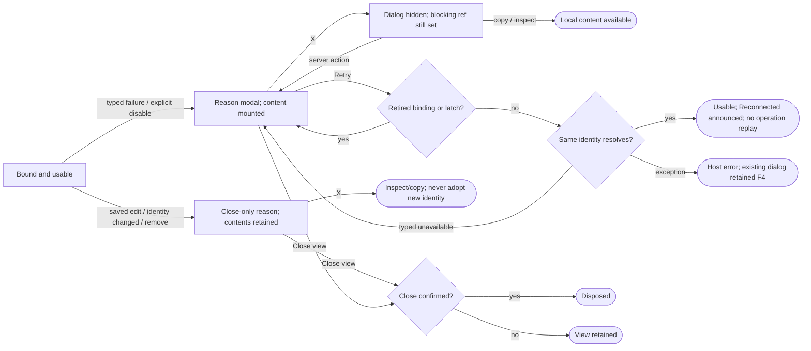

# Connection lifecycle — UX Review Pack

> **Who this is for:** the operator doing the hands-on connection-lifecycle review and
> anyone triaging its findings.
> **What this is:** a code-verified pre-assessment of the DocumentDB extension for Visual
> Studio Code, followed by a running ledger of runtime observations. Suspected priorities
> are ordered P0 → P3; recommendations are suggestions, not decisions.

- **Feature area:** connection-tree recovery; Disconnect / Reconnect; saved credential
  and destination edits; Collection, Document and Dashboard views; Interactive Shell;
  Query Playground; Azure Discovery account / tenant flows.
- **PR / branch:** [#1136](https://github.com/microsoft/vscode-documentdb/pull/1136) ·
  `feature/connection-lifecycle` · draft.
- **Code snapshot:** [`402b8e052`](https://github.com/microsoft/vscode-documentdb/commit/402b8e05251a5e2e688ac5d4a8eba8e8ce520139).
  This iteration is evidence about that revision, not a promise of current behavior.
- **Related design docs:** [feature overview](../README.md),
  [accepted decisions](../decisions.md), [implementation plan](./01-implementation-plan.md).
- **User-facing reference:** [connection and recovery manual](../../../../user-manual/connecting-to-databases.md).
- **Scope:** interaction, feedback, recoverability, retained work, identity continuity,
  and cancellation. Internals appear only to explain visible behavior. Infrastructure
  resilience beyond this PR, proactive account sign-out and stale-result indicators
  remain follow-ups #1105, #1119 and #1106, respectively.
- **Review date:** 2026-11-27.

## How this review was run

**Preparation only so far. No hands-on observations have been made in this review.**
The assistant read the manifest, command handlers, tree recovery paths, retained-view
components and controllers, worker recovery and Azure account flows. The six seeded
Flags describe confirmed code-path gaps or divergences; their severity and actual
runtime impact still need the operator's confirmation.

During the live pass, the person drives the extension and dictates observations; the
assistant verifies each observation against the source and updates this ledger and the
todo list. Each item has **Observation / Finding / Suggestion / Status**. Significant
choices require the operator's decision and reason before implementation. Design
trade-offs belong in [Open ideas](#open-ideas--options-pros--cons).

This is **Case 1**, not a ready-for-review handoff. Full Case 2 checks, including
`prettier-fix`, are deferred while #1136 remains a draft. This pack does not satisfy
the packaged-VSIX or telemetry operator gates, or substitute for the AI code review.
Preparation validation: `npm run build` passed and local reference targets resolved.
No runtime tests ran because this preparation changes documentation only.

## Legend

### Priority

| Priority | Meaning                                            |
| -------- | -------------------------------------------------- |
| **P0**   | Blocking — the user gets stuck                     |
| **P1**   | Broken / misleading, or a consistency & safety gap |
| **P2**   | Polish, expectation, or a smaller feature gap      |
| **P3**   | Nice-to-have / cosmetic / acknowledged             |

### Status

| Status             | Meaning                                                                 |
| ------------------ | ----------------------------------------------------------------------- |
| 🟠 **Open**        | Recorded + analyzed; carries a recommendation but stays a _suggestion_  |
| 🟡 **Open (soft)** | Open, but the recommendation depends on an investigation or is "as-is"   |
| ✅ **Implemented** | A change was made on this branch and verified (Decision + commit link)  |
| 🚫 **Closed**      | Won't fix — with a mandatory one-line reason                            |
| 🔗 **Tracked**     | Deferred to a repo issue (linked); dropped from the active priority list |

> Anything unresolved carries forward to the next iteration. An item leaves the active
> list only as Implemented, Closed with a reason, or Tracked with an issue link.

### Markers (inline)

| Marker            | Meaning                                                 |
| ----------------- | ------------------------------------------------------- |
| ⚠️ **Flag**       | Confirmed gap or bug                                    |
| 💡 **Suggestion** | A design/wording recommendation to react to             |
| 🔍 **Answered**   | A "how does this work?" question answered from the code |

> **For the operator:** no recommendation below is an approved change. Hands-on
> confirmation can change the priority or close an item with a reason.

---

## User interaction map

Explicit terminal nodes distinguish a completed action from a modal, retained state,
notification, or silent cancellation. F1–F6 refer to the priority index.

### Interaction inventory

The primary tree source is
[ClusterItemBase.ts](../../../../../src/tree/documentdb/ClusterItemBase.ts);
the command surface and gating are in [the manifest](../../../../../package.json#L1349)
and [command registration](../../../../../src/documentdb/ClustersExtension.ts#L1014).

| # | User action / entry | Implementation reference | Terminal states / feedback |
| --- | --- | --- | --- |
| I1 | Expand cluster in Connections, Discovery or Azure Resources | [connect and expand](../../../../../src/tree/documentdb/ClusterItemBase.ts#L153) | Cancellable progress; databases; modal + repair rows; cancellation without an error dialog |
| I2 | Click Create Database / Create Collection in an empty tree | [cluster empty state](../../../../../src/tree/documentdb/ClusterItemBase.ts#L649), [database empty state](../../../../../src/tree/documentdb/DatabaseItem.ts#L97) | Creation wizard, result/refresh or command error; cancel leaves the empty state |
| I3 | Expand an existing database or Indexes node | [database](../../../../../src/tree/documentdb/DatabaseItem.ts#L72), [indexes](../../../../../src/tree/documentdb/IndexesItem.ts#L66) | Collections/indexes or provider error feedback; F3 |
| I4 | Refresh view/node or click Retry | [Retry](../../../../../src/commands/retryAuthentication/retryAuthentication.ts#L63) | Error cache reset and fresh expansion; some stale-state guards are silent, F5 |
| I5 | Click Retry for a rejected Azure RU key | [key replacement](../../../../../src/commands/retryAuthentication/retryAuthentication.ts#L92) | Explicit fresh ARM key read; reconnect on refresh; modal on key-read failure |
| I6 | Click Retry sign-in under failed Entra cluster | [sign-in](../../../../../src/commands/signInAgain/signInAgain.ts#L74) | Interactive authentication; tree refresh; translated failure modal; cancel/stale guard |
| I7 | Click Diagnose connection… or invoke Diagnose from the palette | [diagnose command](../../../../../src/commands/diagnoseConnection/diagnoseConnection.ts#L27) | Read-only diagnostics panel; palette first picks a stored cluster |
| I8 | Click Open shell in failure rows / cluster context menu | [shell command](../../../../../src/commands/openInteractiveShell/openInteractiveShell.ts#L45) | Terminal and connection banner, or missing-credentials notification with no terminal, F1 |
| I9 | Click Update connection string… / Update credentials… | [destination edit](../../../../../src/commands/updateConnectionString/updateConnectionString.ts#L77), [credential edit](../../../../../src/commands/updateCredentials/updateCredentials.ts#L147) | Wizard; save feedback; changed settings retire webviews; error-node credential wizard asks whether to reconnect |
| I10 | Respond to old-Shell-settings notice after an edit | [Shell choice](../../../../../src/commands/saveConnectionEdit.ts#L136) | Modal; Disconnect stops workers; dismissal keeps running workers on previous settings |
| I11 | Right-click connected cluster → Disconnect | [Disconnect](../../../../../src/commands/disconnect/disconnect.ts#L18), [tab choice](../../../../../src/documentdb/connectionTeardown.ts#L55) | Hidden from palette; connected-only menu; task block, tab choice, dirty warning, or teardown |
| I12 | Click Reconnect under a disconnected cluster | [Reconnect](../../../../../src/commands/disconnect/disconnect.ts#L32) | Unlatch and tree refresh; connection result follows expansion; stale guard is silent |
| I13 | Delete one/multiple saved connections or a folder | [connection removal](../../../../../src/commands/removeConnection/removeConnection.ts#L23), [folder removal](../../../../../src/commands/connections-view/deleteFolder/ExecuteStep.ts#L22) | Shared destructive confirmation + teardown; refresh; configured summary; failures surfaced |
| I14 | Collection View: run, page, refresh, manipulate documents | [Collection View](../../../../../src/webviews/documentdb/collectionView/CollectionView.tsx#L179) | Current results or typed unavailable dialog; stale replies ignored; failed operations not replayed |
| I15 | Collection View: Indexes and Query Insights actions | [Indexes tab](../../../../../src/webviews/documentdb/collectionView/indexesTab/IndexesTab.tsx), [Query Insights tab](../../../../../src/webviews/documentdb/collectionView/queryInsightsTab/QueryInsightsTab.tsx) | Shared parent lifecycle blocking; results retained; repair through tree + Retry |
| I16 | Document View: edit, Save, Refresh | [Document View](../../../../../src/webviews/documentdb/documentView/documentView.tsx#L90) | Dirty draft tracked; server actions blocked when unavailable; close/discard confirmation |
| I17 | Dashboard: refresh, create/drop, open views, copy/export | [Dashboard](../../../../../src/webviews/documentdb/clusterDashboard/ClusterDashboard.tsx), [row commands](../../../../../src/webviews/documentdb/clusterDashboard/clusterDashboardController.ts#L254) | Busy state and results; unavailable dialog; no pending delete replay; retained namespace reference can be copied |
| I18 | Unavailable webview: Retry / Close view / X | [overlay](../../../../../src/webviews/components/DisconnectedOverlay.tsx#L37), [recovery hook](../../../../../src/webviews/documentdb/useBoundViewRecovery.ts#L93) | Same-binding recovery without replay; typed reason remains in dialog; exception notification, F4; confirmed close; X permits copying |
| I19 | Import, export, copy/paste while attempting teardown/edit | [import lease](../../../../../src/commands/importDocuments/importDocuments.ts#L161), [export lease](../../../../../src/commands/exportDocuments/exportDocuments.ts#L57), [task guard](../../../../../src/services/taskService/resourceUsageHelper.ts#L19) | Registered task/lease blocks teardown in modal; running transfer is not interrupted |
| I20 | Retained Shell: run after disconnect/reconnect; Sign in again | [worker evaluation](../../../../../src/documentdb/shell/ShellSessionManager.ts#L340), [sign-in action](../../../../../src/documentdb/shell/DocumentDBShellPty.ts#L941) | Same-settings worker restart; bounded failure output; warning action; successful sign-in has a rerun cue; F2/F5 |
| I21 | Playground: Run All / Run Selected; unbound connect-on-run | [execution](../../../../../src/commands/playground/executePlaygroundCode.ts#L101) | Database picker if unbound; progress + result document; latch warning; cancellation without execution |
| I22 | Playground CodeLens/status connection choice; Sign in again | [connection picker](../../../../../src/commands/playground/connectDatabase.ts#L35), [recovery](../../../../../src/commands/playground/executePlaygroundCode.ts#L367) | Confirm switching; picker cancellation preserves binding; sign-in stops evaluator without replay or completion cue, F6 |
| I23 | Azure provider Refresh/Retry; Manage Accounts; Adjust Filters | [provider root](../../../../../src/plugins/service-azure-mongo-vcore/discovery-tree/AzureServiceRootItem.ts#L38), [listing](../../../../../src/plugins/api-shared/azure/AzureSubscriptionProviderWithFilters.ts#L96) | Fresh listing; partial warning + Show Output; empty-state modal and actionable Retry |
| I24 | New/edit Entra connection: tenant, manual ID, Retry, Manage Azure Accounts | [new tenant picker](../../../../../src/commands/newConnection/PromptTenantStep.ts#L32), [edit tenant picker](../../../../../src/commands/updateCredentials/PromptTenantStep.ts) | Tenant selection/manual validation; recoverable lookup state; initial 5 s timeout and explicit retry up to 30 s |
| I25 | Show Connection Stats / Show Worker Stats during review | [connection stats](../../../../../src/commands/showConnectionStats/showConnectionStats.ts#L32) | Output channel; client state/generation and token expiry; worker stats are a separate surface |

### Failure and feedback surface matrix

These are the lifecycle-relevant foreground failure branches, not every unrelated
database-operation error. Silent background count/metadata failures and obsolete replies
are intentionally not treated as user-action failures.

| Event | Current feedback / termination | Source | Assessment |
| --- | --- | --- | --- |
| First cluster startup failure | Output detail + translated modal; recovery rows | [first-connect helper](../../../../../src/documentdb/showClusterConnectFailure.ts#L36), [stored startup](../../../../../src/tree/connections-view/DocumentDBClusterItem.ts#L273) | Expected baseline |
| Cached connect / listDatabases failure | Modal with explanation and detail; action-only children | [expansion failure](../../../../../src/tree/documentdb/ClusterItemBase.ts#L443) | Expected baseline |
| Explained database/index child-expansion failure | Non-modal error with cause appended | [provider catch](../../../../../src/tree/BaseExtendedTreeDataProvider.ts#L606) | F3: sibling tree divergence |
| Open shell after cache eviction | Non-modal “Not signed in”; no terminal | [credential guard](../../../../../src/commands/openInteractiveShell/openInteractiveShell.ts#L63) | F1: offered recovery can dead-end |
| Azure replacement-key read failure | Modal “Azure sign-in needed” or key-read failure | [key read](../../../../../src/commands/retryAuthentication/retryAuthentication.ts#L107) | Targeted recovery |
| Tree sign-in fails / cloud provider changed / connection closed mid-sign-in | Translated or dedicated modal | [sign-in flow](../../../../../src/commands/signInAgain/signInAgain.ts#L114) | Explicit action reports failure |
| Bound-view unavailable reason | In-view modal over retained content; Retry and/or Close view | [reason map](../../../../../src/webviews/_integration/describeUnavailableConnection.ts#L11) | Accepted design, not a passive tree row |
| Bound-view Retry throws an unclassified error | Host non-modal error; previous dialog remains | [recovery catch](../../../../../src/webviews/documentdb/useBoundViewRecovery.ts#L125) | F4: feedback split |
| Close-view confirmation RPC fails | In-dialog alert; view remains open | [close confirmation](../../../../../src/webviews/components/DisconnectedOverlay.tsx#L48) | Explicit failure with retry path |
| Worker sign-in expires | Shell bounded output or Playground result; non-modal Sign in again when safe | [Shell](../../../../../src/documentdb/shell/DocumentDBShellPty.ts#L907), [Playground](../../../../../src/commands/playground/executePlaygroundCode.ts#L313) | Deliberate worker surface; not automatically a modal inconsistency |
| Worker sign-in action fails | Bounded non-modal warning; original operation not replayed | [Shell action](../../../../../src/documentdb/shell/DocumentDBShellPty.ts#L979), [Playground action](../../../../../src/commands/playground/executePlaygroundCode.ts#L402) | Confirm actionable next-step wording |
| Run while user-disconnected / identity changed | Shell error output; Playground warning before run or result after failure | [Shell reason](../../../../../src/documentdb/shell/DocumentDBShellPty.ts#L895), [Playground latch](../../../../../src/commands/playground/executePlaygroundCode.ts#L127) | F2: unnecessary new-shell/re-pick guidance for unchanged settings |
| Save fails / persisted state uncertain | Save-error notification; possible incomplete-update warning; old views remain safely disabled | [save reconciliation](../../../../../src/commands/saveConnectionEdit.ts#L76), [credential save](../../../../../src/commands/updateCredentials/ExecuteStep.ts#L106) | Do not confuse “saved” with “usable” |
| Removal partly/all fails | Output details; partial-success summary respects summary setting; all-failed error is non-modal | [removal feedback](../../../../../src/commands/removeConnection/removeConnection.ts#L117) | Existing summary policy; confirm restored Reconnect state on storage failure |
| Transfer blocks disconnect/remove/edit | Modal lists conflicting tasks; nothing stopped | [task guard](../../../../../src/services/taskService/resourceUsageHelper.ts#L19) | Safety check |
| Azure partial listing | Successful subscriptions plus one warning with Show Output per listing | [partial listing](../../../../../src/plugins/api-shared/azure/AzureSubscriptionProviderWithFilters.ts#L107) | Accepted partial-result policy |
| Azure empty listing | Informational modal with Manage Accounts / Adjust Filters; Retry child | [empty-state helper](../../../../../src/plugins/api-shared/azure/askToConfigureCredentials.ts#L26) | Actionable first-run state |
| Tenant lookup empty / error / timeout | Picker Retry row with reason, plus manual ID and account management | [tenant alternatives](../../../../../src/commands/newConnection/PromptTenantStep.ts#L76) | No wizard dead end |
| User cancellation | No error; no automatic operation replay | [connect cancellation](../../../../../src/tree/documentdb/ClusterItemBase.ts#L173) | Expected |
| Stale action becomes invalid before click | Some handlers return silently | [Reconnect](../../../../../src/commands/disconnect/disconnect.ts#L32), [Retry](../../../../../src/commands/retryAuthentication/retryAuthentication.ts#L85) | F5: distinguish safety guard from missing feedback |

---

## The story in one paragraph

The extension aims to recover silently when the connection identity has not changed,
and to preserve work rather than replay interrupted operations or silently change
permissions. Explicit Disconnect offers a tab choice and a single tree Reconnect;
changed saved settings permanently retire old webviews, while workers have separately
documented restart rules. The strongest suspected P1 gaps are an offered Shell recovery
that may not open, unnecessarily restrictive worker recovery wording, and inconsistent
feedback between cluster and descendant tree failures. Three P2 Flags cover Retry
feedback placement, stale-action silence, and Playground sign-in completion feedback.
None has yet been confirmed through hands-on use in this review.

---

## Priority index

| # | Priority | Item | Status |
| --- | --- | --- | --- |
| F1 | **P1** | Open shell recovery is offered when cache eviction can block opening | 🟠 Open |
| F2 | **P1** | Worker recovery wording requests unnecessary new Shell / connection pick | 🟠 Open |
| F3 | **P1** | Cluster and descendant tree failures use different feedback surfaces | 🟠 Open |
| F4 | **P2** | Retry exceptions appear outside the retained-view dialog | 🟠 Open |
| F5 | **P2** | State-drift guards silently terminate explicit recovery clicks | 🟠 Open |
| F6 | **P2** | Playground sign-in succeeds without a completion or rerun cue | 🟠 Open |

## P0 — Blocking (the user gets stuck)

No P0 seeded. Promote an item only after confirming that no usable recovery path exists.

## P1 — Broken / misleading, or consistency & safety

### F1. Open shell recovery can end before a terminal opens ⚠️

**Priority:** P1 · **Status:** 🟠 Open

**Observation:** Not yet observed live. Fail an initial stored Native-auth connection,
dismiss the modal, and click its Open shell recovery row.

**Finding:**

- ⚠️ [Every cluster failure offers Open shell](../../../../../src/tree/documentdb/ClusterItemBase.ts#L431),
  but [the Shell command refuses to open without cached credentials](../../../../../src/commands/openInteractiveShell/openInteractiveShell.ts#L63).
- [Failed startup evicts non-recoverable credentials](../../../../../src/tree/documentdb/ClusterItemBase.ts#L324);
  [the stored connection calls that cleanup](../../../../../src/tree/connections-view/DocumentDBClusterItem.ts#L386)
  before returning its recovery children. The user can therefore receive “Not signed in”
  instead of the promised diagnostic terminal.
- 🔍 This conflicts with the stated intent that experts can open a Shell on every failure
  in the [tree architecture guidance](../../../../../.github/skills/tree-cluster-architecture/SKILL.md#failure-presentation-actions-only).
  It is a command precondition gap, not evidence that Shell automatically repairs authentication.

💡 **Suggestion:** Confirm the failed-auth and failed-network variants separately, then
make the offered action usable or accurately gate/explain it. Do not introduce automatic
sign-in or execution merely to make the row work.

### F2. Retained-worker guidance overstates when reopening or re-picking is required ⚠️

**Priority:** P1 · **Status:** 🟠 Open

**Observation:** Not yet observed live. Disconnect with unchanged settings, try the
retained Shell/Playground while disconnected, reconnect in the tree, then run again
without opening a new terminal or selecting a connection.

**Finding:**

- ⚠️ [Shell user-disconnected output](../../../../../src/documentdb/shell/DocumentDBShellPty.ts#L895)
  says to reconnect and open a new shell. [Playground's generic unavailable guidance](../../../../../src/commands/playground/executePlaygroundCode.ts#L356)
  says to reconnect and re-pick.
- 🔍 Same-settings reuse is supported: teardown stops workers but preserves the
  [terminal](../../../../../src/documentdb/shell/DocumentDBShellPty.ts#L273);
  the [next Shell evaluation restarts its worker](../../../../../src/documentdb/shell/ShellSessionManager.ts#L340).
  [Playground checks the original fingerprint when spawning](../../../../../src/documentdb/playground/PlaygroundEvaluator.ts#L276)
  and can use the retained binding.
- The [manual explicitly describes reuse without a new terminal or pick](../../../../user-manual/connecting-to-databases.md#disconnect-and-reconnect).
  Source behavior supports that intent; the error wording is the mismatch. Identity or
  destination changes still require the stricter guidance.

💡 **Suggestion:** Separate unchanged-connection recovery wording from removed/changed
connection wording. Confirm worker-local variables/cursors are lost and interrupted
commands are not replayed; do not promise state preservation beyond text and scrollback.

### F3. Sibling tree expansion failures use modal versus notification feedback ⚠️

**Priority:** P1 · **Status:** 🟠 Open

**Observation:** Not yet observed live. Compare expanding the cluster and an already
visible database/Indexes node after the same infrastructure failure.

**Finding:**

- ⚠️ [Cluster expansion renders a modal](../../../../../src/tree/documentdb/ClusterItemBase.ts#L527)
  with translated heading and separate detail.
- [Database](../../../../../src/tree/documentdb/DatabaseItem.ts#L81) and
  [index](../../../../../src/tree/documentdb/IndexesItem.ts#L121) failures propagate to
  [the shared provider catch](../../../../../src/tree/BaseExtendedTreeDataProvider.ts#L606),
  which renders an explanation and cause in a non-modal notification.
- The [error-translation guidance](../../../../../.github/skills/error-translation/SKILL.md#adding-a-call-site)
  shows modal-plus-detail tree presentation. The shared catch is an inherited boundary,
  not a newly introduced renderer; code wins for current behavior, while the discrepancy
  should be resolved explicitly rather than silently treating the guidance as implemented.

💡 **Suggestion:** Confirm the practical recovery path at both hierarchy levels and choose
a consistent tree policy. Keep worker and database-command notification policy separate;
see [O1](#o1-which-failures-need-a-modal-versus-in-context-feedback-f3f4).

## P2 — Polish, expectation, or feature gap

### F4. Retry exceptions leave the dialog intact but report elsewhere ⚠️

**Priority:** P2 · **Status:** 🟠 Open

**Observation:** Not yet observed live. Retry an unavailable view while the server remains
unreachable; compare a typed unavailable result and an unclassified thrown error.

**Finding:**

- 🔍 [Typed recovery failure updates the reason dialog](../../../../../src/webviews/documentdb/useBoundViewRecovery.ts#L112).
- ⚠️ [An unclassified exception instead sends a non-modal host error](../../../../../src/webviews/documentdb/useBoundViewRecovery.ts#L125)
  while retaining the previous dialog. This creates two different feedback locations for
  the same Retry interaction; whether the notification is missed requires runtime observation.
- [Close confirmation failure already stays in-context as an alert](../../../../../src/webviews/components/DisconnectedOverlay.tsx#L67).

💡 **Suggestion:** Walk this in all three retained views before deciding whether Retry
failure should update the dialog or remain a notification. Preserve the translated reason
and the ability to copy/close; never replay the failed operation.

### F5. Stale recovery actions can be safely rejected without explaining why ⚠️

**Priority:** P2 · **Status:** 🟠 Open

**Observation:** Not yet observed live. Leave a recovery row or Sign in again notification
available, change the connection's state elsewhere, then invoke the old action.

**Finding:**

- ⚠️ [Reconnect ignores an invalid target/state](../../../../../src/commands/disconnect/disconnect.ts#L32);
  [Retry ignores incompatible latches](../../../../../src/commands/retryAuthentication/retryAuthentication.ts#L85);
  [tree sign-in does the same](../../../../../src/commands/signInAgain/signInAgain.ts#L88).
- [Shell](../../../../../src/documentdb/shell/DocumentDBShellPty.ts#L949) and
  [Playground](../../../../../src/commands/playground/executePlaygroundCode.ts#L389)
  discard a stale sign-in notification choice when its epoch/owner no longer matches.
- 🔍 These guards correctly prevent recovery of the wrong connection. The code-level gap
  is acknowledgement, not the safety check. Whether a stale affordance remains visible
  long enough to confuse a person is still unverified.

💡 **Suggestion:** Distinguish user cancellation and obsolete background work, which
should stay quiet, from an explicit click on a still-visible stale action. Consider a
refresh or brief bounded next-step notice only for the latter.

### F6. Playground sign-in has no equivalent of Shell's “run again” completion cue ⚠️

**Priority:** P2 · **Status:** 🟠 Open

**Observation:** Not yet observed live. Let a Playground run fail because sign-in is
required, choose Sign in again, complete authentication, then inspect the retained result
and connection affordances without rerunning.

**Finding:**

- [Playground writes the failed result before offering recovery](../../../../../src/commands/playground/executePlaygroundCode.ts#L276).
- ⚠️ [Successful sign-in only stops the evaluator](../../../../../src/commands/playground/executePlaygroundCode.ts#L397);
  this path does not replace the failed result or announce that the next run is available.
- [Shell explicitly prints “Sign-in restored. Run your command again.”](../../../../../src/documentdb/shell/DocumentDBShellPty.ts#L972).
  The authentication provider may show its own UI, but the Playground recovery handler
  supplies no equivalent completion/rerun cue.

💡 **Suggestion:** Confirm whether the surrounding VS Code UI is sufficient. If not, add
a small success/next-step signal rather than automatically executing the query.

## P3 — Nice-to-have / cosmetic / acknowledged

No cosmetic items seeded. Inspect layout, wording, themes and focus during the live pass;
do not turn this preparation into a pixel-level review.

## Implemented

No fixes implemented in this UX review. Existing feature behavior is described above,
not relabeled as a fix from this pass.

---

## Iteration log

### Preparation — before Iteration 1

| # | Item | Decision (why) | Outcome |
| --- | --- | --- | --- |
| F1–F3 | Recovery availability, worker guidance, sibling tree feedback | None; code-verified seeds only | 🟠 Open → hands-on Iteration 1 |
| F4–F6 | Retry feedback, stale clicks, Playground sign-in completion | None; code-verified seeds only | 🟠 Open → hands-on Iteration 1 |

### Iteration 1 — hands-on pass pending

Work one journey at a time using Appendix B. Record the operator's observation before
adjusting a Flag. Capture each approved choice and its reason before coding; commit fixes
individually and link verification. Everything unresolved carries to Iteration 2.

---

## Open ideas — options, pros & cons

### O1. Which failures need a modal versus in-context feedback? (F3/F4)

Accepted design already places typed unavailable webview reasons in a modal and keeps
worker failures in bounded output/notifications. The open question is the *sibling
failure branches*, not whether every error in the extension should block the user.

| Option | Pros | Cons |
| --- | --- | --- |
| **A. Keep current feedback boundaries** | Minimal change; preserves established command notifications | Sibling tree expansions and Retry outcomes remain asymmetric; guidance needs to describe this honestly |
| **B. Align tree-expansion errors; keep Retry failures inside their existing dialog** | One feedback location per journey; clearer relation between cause and recovery | Changes a shared tree boundary and needs explicit scope, accessibility and regression checks |
| **C. Make every lifecycle failure a host modal** | Prominent feedback everywhere | Can stack host/webview modals; disrupts workers and conflicts with deliberate surface-specific design |

> 💡 **Suggested:** B if the live pass confirms missed or confusing feedback. Preserve
> worker output and silent background recovery. This is not an approved design change.

---

## Appendix A — current flow (reference)

### Retained-view state and action availability

The [reason map](../../../../../src/webviews/_integration/describeUnavailableConnection.ts#L11)
offers Retry for sign-in required, credential rejection/missing/updating, user Disconnect
and unreachable. Changed identity/settings and removal are close-only. Dismissing the
dialog clears only render state, not the
[blocking ref](../../../../../src/webviews/documentdb/useBoundViewRecovery.ts#L67).
[Host recovery](../../../../../src/webviews/documentdb/boundViewOperations.ts#L19)
resolves the original binding and does not rerun the interrupted operation.

**Intentional asymmetries to confirm, not automatically flag:**

- Saved edits retire webviews even for password-only changes; workers follow different
  restart rules. See decisions 0018 and the manual.
- Reconnect can auto-retry an existing same-identity Dashboard when auto-open brings it
  forward; other retained views still require Retry. See
  [Dashboard reveal](../../../../../src/webviews/documentdb/clusterDashboard/clusterDashboardController.ts#L410).
- Tab choice covers registered webviews, not closing Shell terminals or Playground files.
  Their database workers stop; scrollback/text remains.
- Tree explicit sign-in and worker sign-in differ in permitted account-change handling.
  [Workers require the exact original identity](../../../../../src/commands/signInAgain/signInAgain.ts#L51);
  old views must not silently inherit another account.
- Silence for token renewal, user cancellation, background counts and stale replies is
  deliberate. Do not “fix” it by prompting from a callback.

## Appendix B — hands-on run order and setup

Use a dedicated development window and scratch database/connections owned by the
operator. Do not change shared accounts, cloud settings, services or real datasets just
to trigger a failure. This preparation did not launch servers or manipulate live data.

Have a Native-auth or credential-free local test connection and an Azure DocumentDB
Entra test connection available. Open Collection View, a dirty Document View, Dashboard,
Shell and a Playground against the same scratch connection. Keep token-expiry/account
checks separate from network failure checks; use the stats commands for observation,
not as proof that renewal worked.

| Phase | Exercise | Confirm before moving on |
| --- | --- | --- |
| 1. First-run and entry parity | Expand; directly open Dashboard/Shell before expanding; empty DB/collection; cancel auth; fail initial auth; click each recovery row | Entries are actionable; no passive error rows; correct repair order; F1 and F3 |
| 2. Normal and silent recovery | Read/query in tree, views, Shell and Playground after idle/token expiry; observe Dashboard/background work | No surprise sign-in; same identity; actual operations still succeed; no interrupted write replay |
| 3. Explicit authentication repair | Tree Retry sign-in; worker Sign in again; cancel; wrong identity; Azure key Retry; stale notification | Failure explanation and next step; F5/F6; identity remains pinned where required |
| 4. Disconnect and retained work | `ask`, `closeAll`, `keepOpenDisabled`; dirty discard/cancel; X-copy and repeated blocked actions; reconnect and Retry | Modal choices match settings; no data loss on cancel; F2/F4; workers restart only on a new run; Dashboard exception is legible |
| 5. Saved edits | Cancel, unchanged save, password-only change, destination/account change; Shell keep/disconnect choice | Old webviews never resume after a changed save; unchanged save does not permanently lock them; copied drafts preserved; workers obey the documented distinction |
| 6. Transfers and destructive actions | Start scratch import/export/copy; attempt disconnect/remove/folder delete; later remove with retained views; cancel pending Dashboard delete across disconnect | Conflicting transfer continues; shared confirmation respected; no old delete replay; removal is distinct from Disconnect |
| 7. Discovery and accessibility | No accounts; filters hide results; partial listing; tenant lookup retry/manual ID; keyboard-only modal use in light/dark/high contrast | Account/filter exits work; Show Output is reachable; modal title/detail announced; focus and X-copy route usable |

During Phase 4, also check whether long Retry waits have a perceivable busy signal:
[the overlay disables actions while recovering](../../../../../src/webviews/components/DisconnectedOverlay.tsx#L115),
but its labels do not change to a progress message. Record actual wait durations before
assigning a progress defect. Escape dismissal is currently ignored by
[the controlled dialog handler](../../../../../src/webviews/components/DisconnectedOverlay.tsx#L82);
confirm the keyboard journey rather than assuming the X requires a mouse.

Optional fixture-only previews already exist in
[browser scenarios](../../../../../build/verification/browser/scenarios.ts#L2435):
Document View `disconnected-dirty` / `stale-save-after-reconnect`, Dashboard `disconnected`, and
Collection View `disconnected-signInRequired` / `stale-page-after-disconnect`. They help
inspect retained-content presentation but do not verify real sign-in, tree menus, workers
or packaged extension behavior. Follow the
[L2-dev runner recipe](../../../../../build/verification/README.md#l2-dev-source-scenarios);
do not treat fixture success as the hands-on review.

After merge, add a reconciliation note pointing to the current manual and final
pre-merge review so this snapshot is not mistaken for current behavior.
