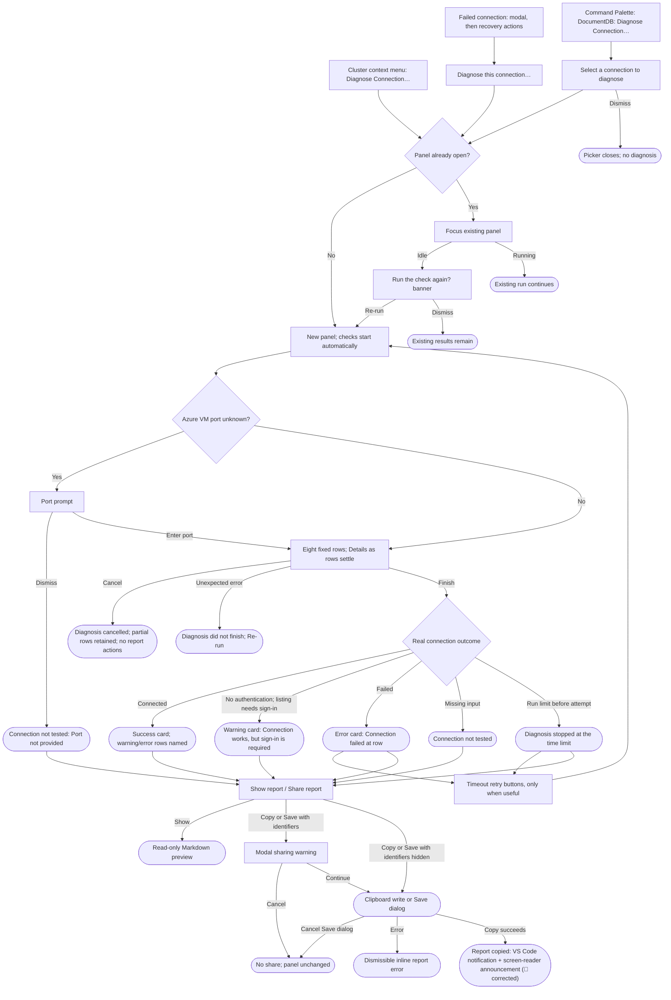

# Connection Diagnostics: UX Review Pack

> **Who this is for:** the operator reviewing what end users of the DocumentDB extension for
> Visual Studio Code will see in connection diagnosis, including failures that are difficult
> to reproduce.
>
> **What this is:** a source-verified review deck, an exhaustive finding-copy catalogue, and
> an initial language evaluation. It is not a record of a completed hands-on review.
> Suggestions are deliberately placed **beside the affected presentation**, not just in
> the findings chapter. No suggested wording has been implemented.

- **PR / branch:** [#1066](https://github.com/microsoft/vscode-documentdb/pull/1066) ·
  `dev/tnaum/connectivity-troubleshooter`
- **Source snapshot:** `b2d64709`, 2026-11-06. Recheck this pack if the implementation changes.
- **Feature area:** [diagnostic checks and wording](../../../../../src/connectionDiagnostics/),
  [webview](../../../../../src/webviews/documentdb/connectionDiagnostics/),
  [command](../../../../../src/commands/diagnoseConnection/diagnoseConnection.ts),
  [probe package](../../../../../packages/documentdb-js-connection-diagnostics/).
- **Related intent:** [feature README](../README.md), [design](../design.md),
  [decisions](../decisions.md), [user manual](../../../../user-manual/diagnose-connection.md).
- **Scope:** entry points, progress, all summary-card branches and optional messages,
  warning combinations, expanded Details, sovereign/custom clouds, SRV failures, report
  sharing, and language consistency. No production changes or decisions are made here.
- **Start here:** [presentation deck](#appendix-a-presentation-deck-and-current-flow).
  Then use the [complete copy catalogue](#appendix-b-complete-finding-copy-catalogue)
  to compare alternatives without needing a live cloud or broken DNS.

## How this review was run

The assistant traced the current source, not just the PR description. Exact finding text
in Appendix B is evaluated from the extension's own message functions with synthetic,
non-secret example data. The stable finding keys and source links are reviewer annotations;
they are **not** text shown in the panel. Every finding key has a catalogue entry, including
input-dependent alternatives. Placeholder host names, accounts, durations and addresses in
the presentation deck are illustrative, not measurements.

**Reading the presentations:** a quoted sentence is current UI copy. Tables reproduce the
labels and types of values shown, not pixel-exact layouts. **OR** means an alternative,
not several simultaneous messages. Expanded findings are ordered Error → Warning →
Information, followed by facts. Identical findings for multiple hosts can be merged into
one message naming those hosts.

**Evidence boundaries:** government/China/custom-cloud and SRV-failure presentations are
source-derived, not proof that those services were contacted. The existing server on port
18080 answered, but its route index did not contain Connection Diagnostics; opening the
government-cloud route returned “Unknown L2-dev route.” That pre-existing process was not
restarted or replaced. Browser scenario links below are launch instructions for a current
`npm run watch:views` process, not a claim that those routes worked in this session.

**Verification:** catalogue coverage and local Markdown links are checked mechanically.
Focused existing message/projection/card tests are run as a cross-check; results are recorded
in the [evaluation pass](#appendix-e-evaluation-pass-and-hands-on-handoff).
This is UX preparation, not a request to mark the PR ready for review: **Case 1**, not
Case 2. No full handover suite or ready-state change is implied.

## Legend

### Priority

| Priority | Meaning |
| --- | --- |
| **P0** | Blocking: the user gets stuck |
| **P1** | Broken / misleading, or a consistency & safety gap |
| **P2** | Polish, expectation, or a smaller feature gap |
| **P3** | Nice-to-have / cosmetic / acknowledged |

### Status

| Status | Meaning |
| --- | --- |
| 🟠 **Open** | Recorded + analyzed; a recommendation, not a decision |
| 🟡 **Open (soft)** | Recommendation depends on investigation or may remain as-is |
| ✅ **Implemented** | Changed and verified; requires a decision and commit reference |
| 🚫 **Closed** | Won't fix, with a reason |
| 🔗 **Tracked** | Deferred to a linked issue |

### Markers

| Marker | Meaning |
| --- | --- |
| ⚠️ **Flag** | Source-confirmed gap; proposed priority still needs operator triage |
| 💡 **Suggestion** | Wording/design recommendation, not an operator decision |
| 🔍 **Answered** | Behavior established from source |
| 🧭 **Verification** | Second-pass source check of a finding (2026-11-06, `b2d64709`): verdict, priority override, alternative fix with pros and cons. Not an operator decision. |

## User interaction map

### Interaction inventory and feedback-surface sweep

| Entry/action | Terminal state and current surface | Source / review note |
| --- | --- | --- |
| Cluster context menu in Connections, Discovery or Azure | New panel, automatic check; existing panel is focused instead | [manifest](../../../../../package.json#L1340), [controller](../../../../../src/webviews/documentdb/connectionDiagnostics/connectionDiagnosticsController.ts#L23). Not on Local Quick Start instance nodes. |
| Failed connect / database-list expansion | Existing modal explains failure; tree children are actions, including diagnosis and shell | [cluster recovery](../../../../../src/tree/documentdb/ClusterItemBase.ts#L240), [modal](../../../../../src/tree/documentdb/ClusterItemBase.ts#L339). Diagnosis does not replace the ordinary connect modal. |
| Command Palette | Saved-connection picker → panel, or picker cancellation | [command](../../../../../src/commands/diagnoseConnection/diagnoseConnection.ts#L39). Unlike the context menu, it browses the Connections tree, not all discovery resources. |
| Reopen idle / running panel | Idle: informational rerun banner / running: existing run continues | [controller](../../../../../src/webviews/documentdb/connectionDiagnostics/connectionDiagnosticsController.ts#L29), [panel](../../../../../src/webviews/documentdb/connectionDiagnostics/ConnectionDiagnostics.tsx#L526). |
| Expand Details | Findings then facts inline; multiple rows may stay expanded | [Details](../../../../../src/webviews/documentdb/connectionDiagnostics/DiagnosticsRowDetails.tsx#L610). Re-run collapses them. |
| Re-run / timeout retry | Reset rows; new run; connection's own timeouts are not removed | [panel](../../../../../src/webviews/documentdb/connectionDiagnostics/ConnectionDiagnostics.tsx#L381), [card](../../../../../src/webviews/documentdb/connectionDiagnostics/DiagnosticsResultCard.tsx#L366). |
| Cancel / close panel | Partial settled rows remain / panel disposal cancels host work | [view state](../../../../../src/webviews/documentdb/connectionDiagnostics/diagnosticsViewState.ts#L113), [controller](../../../../../src/webviews/documentdb/connectionDiagnostics/connectionDiagnosticsController.ts#L74). No export for a cancelled run. |
| Show / Copy / Save report | Markdown preview / consent modal then clipboard or Save dialog; failures inline | [report actions](../../../../../src/webviews/documentdb/connectionDiagnostics/ConnectionDiagnostics.tsx#L442). **UX-10:** copy success is not visibly acknowledged. 🧭 *False alarm: the host shows a “The report was copied to the clipboard.” notification; see UX-10.* |
| Hide / Show identifiers | Changes report and open preview, not panel Details | [footer](../../../../../src/webviews/documentdb/connectionDiagnostics/ConnectionDiagnostics.tsx#L594). Deliberate scope, not a redaction failure. |
| Give Feedback | Existing feedback surface; host handles opening errors | [header](../../../../../src/webviews/documentdb/connectionDiagnostics/ConnectionDiagnostics.tsx#L514). Only when feedback is permitted. |

**Surface conclusion:** ordinary tree failures are modal; diagnosis results and report-action
errors are inline; sharing consent is modal; user cancellations are quiet. Those differences
serve different tasks and are not, on their own, defects. The exceptions to inspect are the
report link offered before it exists (**UX-9**) and invisible copy acknowledgement (**UX-10**).
🧭 *UX-10 does not hold: copy success shows a VS Code notification, the same surface as every
other copy action in the extension. UX-9 holds, but only on a rare fallback path.*
No destructive database action is introduced. Preparation can start a shared Kubernetes
tunnel that intentionally stays open; see A5 and B2.

## The story in one paragraph

The feature answers whether the extension can make a real connection, while showing the
evidence from eight independently useful diagnostic rows. A failed probe is not necessarily
a failed connection, and missing sign-in input is not a rejected identity. Most wording
carefully preserves those distinctions. The highest-value review targets are cloud
configuration being presented as sign-in state, managed-identity guidance that names the
wrong control, and “this computer” in remote checks. The remaining flags are about counts,
scope, repetition and recovery discoverability.

## Priority index

| # | Priority | 🧭 Verified | Item | Status |
| --- | --- | --- | --- | --- |
| UX-1 | **P1** | **P1** · confirmed; also affects the connect-path error | Configured cloud described as an actual VS Code sign-in | ✅ Implemented `b65d52d5` |
| UX-2 | **P1** | **P1** · confirmed; two conflicting instructions on one card | Managed-identity token failure can recommend an irrelevant setting | ✅ Implemented `1c2d8fb9` |
| UX-3 | **P1** | **P2** · confirmed, narrower: titles and evidence only | “This computer” can point at the wrong machine in remote sessions | ✅ Implemented `f6b41761` |
| UX-4 | **P2** | **P3** · confirmed; title matches the visible bullets | “Warnings” counts affected rows, not individual findings | ✅ Implemented `9e2ae302` |
| UX-5 | **P2** | **P3** · confirmed for skipped rows; informational findings are not a defect | “All checks passed” includes skipped checks and informational advice | ✅ Implemented `9e2ae302` |
| UX-6 | **P2** | **P2** · confirmed; worst on token failure, not success | Expanded authentication omits cloud/resource facts available in report | ✅ Implemented `1047d7a1` |
| UX-7 | **P2** | **P3** · confirmed; pick “username”, not “user name” | Retry and sign-in terminology needs a small consistency pass | ✅ Implemented `828beb89` |
| UX-8 | **P2** | **P2** for Entra ID and SRV pairs · C1 note overstated | Provider paragraphs repeat or strengthen the main explanation | ✅ Implemented `fd179a89` |
| UX-9 | **P2** | **P3** · confirmed; defensive fallback path only | Live generic Details can direct users to unavailable Show report | ✅ Implemented `72269aa3` |
| UX-10 | **P2** | **Close** · false alarm: host shows a notification | Copy report has no visible success confirmation | 🚫 Closed (false alarm) |

## P0: Blocking (the user gets stuck)

None established by this preparation. This is not a claim that all real journeys have passed.

## P1: Broken / misleading, or consistency & safety

### UX-1. Configured cloud is not signed-in cloud ⚠️

**Priority:** P1 · **Status:** 🟠 Open

**Observation:** source-derived A7, not a live government-cloud observation.

**Finding:** the mismatch row says “VS Code signed in to Azure,” using
`configuredCloud`, even though cloud resolution can fail before requesting a token or
obtaining an account. [Projection](../../../../../src/connectionDiagnostics/panelRows.ts#L511),
[formatter](../../../../../src/webviews/documentdb/connectionDiagnostics/formatEvidence.ts#L217),
[failure origin](../../../../../src/connectionDiagnostics/checks/authenticate.ts#L804).

💡 **Suggestion:** “VS Code configured for Azure,” paired with “Cluster in Azure US
Government.” Preserve the actual sign-in state as unknown.

> 🧭 **Verification: confirmed · keep P1**
>
> The `signedInCloud` segment is filled from the finding's `configuredCloud`
> ([panelRows.ts](../../../../../src/connectionDiagnostics/panelRows.ts#L510)) and rendered as
> “VS Code signed in to {0}” ([formatEvidence.ts](../../../../../src/webviews/documentdb/connectionDiagnostics/formatEvidence.ts#L219)).
> The mismatch is raised in `resolveInteractiveTokenResource` before any token request
> ([documentdbTokenResource.ts](../../../../../src/documentdb/auth/documentdbTokenResource.ts#L156)).
> The check's own technical text says “sign-in is configured for … No token was requested”
> ([authenticate.ts](../../../../../src/connectionDiagnostics/checks/authenticate.ts#L812)).
> The user may not be signed in at all, so the line states something that was not observed.
>
> **Missed by the review:** the ordinary connect path uses the same wording in the error it throws:
> “This cluster is in {clusterCloud}, but VS Code is signed in to {signedInCloud}”
> ([documentdbTokenResource.ts](../../../../../src/documentdb/auth/documentdbTokenResource.ts#L159)).
> Users see that text in the tree's failure modal. Fixing only the panel would leave the modal and
> the panel describing the same state differently.
>
> **Why P1 stays:** the Next step is already correct, so the user still gets the right action.
> The priority stays because the operator's rule for this feature is “no wrong answers”
> ([04 review](04-parallel-pr-review.md#proposed-resolutions-guiding-rule)), and the fix is cheap.
>
> **My suggestion:** “Sign-in set to Azure” beside “Cluster in Azure US Government”.
> Use the same wording in the connect-path error: “This cluster is in {clusterCloud}, but VS Code
> sign-in is set to {signedInCloud}. …”.

| Option | Pros | Cons |
| --- | --- | --- |
| **Review: “VS Code configured for Azure”** | Accurate; no new concept | “Configured for Azure” is vague: it does not say *what* is configured, and can read as general Azure tooling. Leaves the modal's “signed in to” unchanged |
| **Mine: “Sign-in set to Azure” in the panel and connect error** | Names what the setting controls (the sign-in cloud). Pairs with “Cluster in …”. One term across modal, panel and the finding's own “selected for sign-in” | Touches one more string in a shared auth file (`documentdbTokenResource.ts`), with its tests |
| **Omit the second segment, keep only “Cluster in …”** | Shortest; nothing can be wrong | The user then has to open Details or read the finding to learn which cloud is selected; the mismatch is less visible at a glance |

> **Done (2026-11-06), commits `b65d52d5`, `77acde3c`:** the collapsed evidence reads “Sign-in set to {cloud}”, and the connect-path error says “… but VS Code sign-in is set to {cloud}”; the user manual quotes were updated. Leader decision (95%): same wording on both surfaces, per the verification note. The custom-cloud error “VS Code is signed in to a custom cloud …” was not in scope and is unchanged. Tests: existing wording tests updated; `77acde3c` fixes a sovereign-auth integration assertion that Case 1 found. Model: terra.

### UX-2. Managed identity receives interactive-cloud advice ⚠️

**Priority:** P1 · **Status:** 🟠 Open

**Observation:** source-derived A8 and catalogue `auth.entraTokenFailed`.

**Finding:** `resourceNotInTenant` uses the same diagnostic Next step for interactive
Entra ID and managed identity: “Check microsoft-sovereign-cloud.environment.” Managed
identity deliberately does **not** use that setting to select its resource. The provider
paragraph already has a managed-identity alternative, so both instructions can appear
together. [Finding text](../../../../../src/connectionDiagnostics/findingMessages.ts#L103),
[managed-identity resolution](../../../../../src/documentdb/auth/documentdbTokenResource.ts#L173),
[provider alternative](../../../../../src/documentdb/auth/entraErrors/entraErrorRules.ts#L38).

💡 **Suggestion:** make this diagnostic guidance method-aware too: inspect the resource
override, VM cloud and cluster cloud for managed identity. Do not prescribe an interactive
setting that cannot change the failing token request.

> 🧭 **Verification: confirmed · keep P1 (rare, but wrong next action)**
>
> `entraTokenFailedFinding` stores only `ruleId` and `aadstsCode`
> ([authenticate.ts](../../../../../src/connectionDiagnostics/checks/authenticate.ts#L824)), so
> `tokenFailureMessage` cannot branch by method
> ([findingMessages.ts](../../../../../src/connectionDiagnostics/findingMessages.ts#L102)).
> `resolveManagedIdentityTokenResource` uses the override, then the host cloud, then IMDS, and
> never reads the setting ([documentdbTokenResource.ts](../../../../../src/documentdb/auth/documentdbTokenResource.ts#L181)).
> The `entra-sign-in` provider *is* method-aware
> ([entraErrorRules.ts](../../../../../src/documentdb/auth/entraErrors/entraErrorRules.ts#L39)).
> A managed-identity card therefore shows **two different instructions**: the Next step names
> `microsoft-sovereign-cloud.environment`, and the paragraph below it names `ossrdbmsEndpoint`
> and the VM cloud.
>
> **Wider than reported:** `applicationNotInDirectory`, `tenantNotFound` and `accountNotInTenant`
> also recommend the cloud setting and/or **Update Credentials**. Neither one applies to a token
> from IMDS. These AADSTS codes are unlikely for managed identity, so the default text is a
> safe answer there.
>
> **My suggestion:** follow the review, using a pattern this check already has. `credentialsUnavailableFinding`
> already puts `authMethod` in its finding data
> ([authenticate.ts](../../../../../src/connectionDiagnostics/checks/authenticate.ts#L848)).
> Add the same field to `auth.entraTokenFailed`. For managed identity, `resourceNotInTenant` then reads:
> “The managed identity token may target a different Azure cloud than the cluster.” /
> **Next:** “If documentDB.customEnvironment.ossrdbmsEndpoint is set, check or clear it. Then check
> that the virtual machine and the cluster are in the same Azure cloud.” Managed identity uses the
> default message for the interactive-only rules. Do this together with the Entra ID part of UX-8.

| Option | Pros | Cons |
| --- | --- | --- |
| **Review / mine: method-aware finding (`authMethod` in data)** | Correct in the card, Details and report; follows an existing pattern; `authMethod` is a safe enum for report and telemetry | Two more localized strings; finding-message tests need a managed-identity case |
| **Alternative: drop the Next step for managed identity and rely on the provider paragraph** | No new strings | The provider paragraph is optional (it needs a recorded token failure). Details and the report would then have no instruction, and the card's structure would differ by method |

> **Done (2026-11-06), commit `1c2d8fb9`:** `auth.entraTokenFailed` now records `authMethod`. For managed identity, `resourceNotInTenant` names the resource override and the VM cloud; `applicationNotInDirectory`, `tenantNotFound` and `accountNotInTenant` fall back to the generic message. Interactive text is unchanged. Tests: 19 cases in `findingMessages.test.ts` and `authenticate.test.ts`. Model: terra.

### UX-3. Remote checks say “this computer” ⚠️

**Priority:** P1 · **Status:** 🟠 Open

**Observation:** source-derived A4 and A6.

**Finding:** setup explicitly locates checks on SSH/WSL/container/Codespaces, but loopback
uses “Host points to this computer,” and clock findings/evidence say “This computer's
clock …”. On SSH this can direct attention to the laptop instead of the remote host.
[Finding text](../../../../../src/connectionDiagnostics/findingMessages.ts#L612),
[clock finding](../../../../../src/connectionDiagnostics/findingMessages.ts#L791),
[clock evidence](../../../../../src/webviews/documentdb/connectionDiagnostics/formatEvidence.ts#L291).

💡 **Suggestion:** “Host points to the host running these checks” and “The clock on the
host running these checks …”; keep “this computer” only when the execution location is local.

> 🧭 **Verification: confirmed, narrower than stated · P1 → P2**
>
> `package.json` has no `extensionKind`. The extension runs as a workspace extension, so on SSH,
> WSL, containers and Codespaces the checks run remotely. The wrong viewpoint is limited to
> three strings: the loopback **title**
> ([findingMessages.ts](../../../../../src/connectionDiagnostics/findingMessages.ts#L607)), the
> clock **explanation** ([findingMessages.ts](../../../../../src/connectionDiagnostics/findingMessages.ts#L789))
> and the clock **evidence** ([formatEvidence.ts](../../../../../src/webviews/documentdb/connectionDiagnostics/formatEvidence.ts#L274)).
> The loopback explanation (“on the host running these checks”), its Next step (“especially in
> remote VS Code sessions”) and the clock Next step are already location-neutral.
>
> **Why lower:** both findings are Information. Each one corrects itself in its own body, and the
> setup row says “Running on remote host SSH, not this computer.” The defect is a visible
> contradiction inside one panel, not a wrong instruction. It is still worth fixing; it is cheap.
>
> **My suggestion:** use location-neutral, factual wording instead of switching wording by location:
> title “Host name resolves to localhost”; clock explanation “The clock where these checks ran is
> {0} min behind the server.”; evidence “Clock {0} min behind the server”.
> Leave Atlas's “this machine's IP address” (C2) alone: that provider text is shared with the
> tree modal, and “machine” is not wrong for a remote host.

| Option | Pros | Cons |
| --- | --- | --- |
| **Review: location-aware (“this computer” locally, “host running these checks” remotely)** | Friendliest wording in the common local case | Needs the remote kind passed to `findingMessages` *and* the webview formatter, plus two strings per message. Every renderer, including the report, must receive that context, or it shows the wrong variant |
| **Mine: location-neutral wording** | Correct everywhere (panel, report, local, remote); no new code path; fewer strings | Slightly less personal locally; “localhost” is mild jargon (it is already the user's own word in most of these connection strings) |

## P2: Polish, expectation, or feature gap

> **Done (2026-11-06), commits `f6b41761`, `8a14a397`:** loopback title “Host name resolves to localhost”; clock text “The clock where these checks ran is {0} min behind the server …”; clock evidence “Clock {0} min behind the server”. Setup-row “this computer” wording is unchanged (it is correct there). Atlas provider text (C2) unchanged. Model: luna.

### UX-4. Warning count means rows, not findings ⚠️

**Priority:** P2 · **Status:** 🟠 Open

**Observation:** source-derived A2.

**Finding:** the card lists one most-severe finding per warning/error row. Two warnings
inside Connection settings can produce “with 1 warning.”
[Card aggregation](../../../../../src/webviews/documentdb/connectionDiagnostics/DiagnosticsResultCard.tsx#L37).

💡 **Suggestion:** “with warnings in 1 check” / “with warnings in 2 checks,” or keep
the current title but make the unit explicit. Details must still contain every finding.

> 🧭 **Verification: confirmed, low impact · P2 → P3**
>
> `cardIssues` returns one entry per warning/error row
> ([DiagnosticsResultCard.tsx](../../../../../src/webviews/documentdb/connectionDiagnostics/DiagnosticsResultCard.tsx#L37)),
> and the card's bullet list has one bullet per row. “With 1 warning” therefore matches the
> one bullet the user can see. The difference appears only after expanding Details. The real
> inconsistency is in `successTitle`: all three branches count rows, but name them “checks
> failed”, “warnings” and “checks need attention”.
>
> **My suggestion:** make the unit “check” in every branch. Warning-only uses the mixed-branch
> wording: “Connection successful, but 1 check needs attention”. Keep “but 1 check failed” for
> errors. The bullet icons still show severity.

| Option | Pros | Cons |
| --- | --- | --- |
| **Review: “with warnings in 1 check”** | Accurate unit; keeps the word “warning” | New, slightly clumsy phrasing; plural “warnings” for a single warning |
| **Mine: “but 1 check needs attention”** | Reuses existing wording; one unit in all three branches; no plural trap | The title no longer says “warning”; severity comes only from the icon and screen-reader prefix |
| **Count findings instead** | Number matches Details | The title count would disagree with the visible bullets: worse than today |

> **Done (2026-11-06), commit `9e2ae302`:** warning-only titles read “Connection successful, but 1 check needs attention” / “… {0} checks need attention”, so every branch counts checks. Tests: 6 new card cases (shared with UX-5). Model: terra.

### UX-5. Unqualified all-clear wording ⚠️

**Priority:** P2 · **Status:** 🟠 Open

**Observation:** source-derived A1 and A4.

**Finding:** no warning/error rows produces “All checks passed,” even when DNS/TLS was
not applicable or informational findings exist (proxy, clock, zero databases, remote host,
SRV workaround). This is broader than “all checks that ran.”
[Success text](../../../../../src/webviews/documentdb/connectionDiagnostics/DiagnosticsResultCard.tsx#L234),
[skipped text](../../../../../src/webviews/documentdb/connectionDiagnostics/formatEvidence.ts#L151).

💡 **Suggestion:** “The connection succeeded. No blocking issues were found.” Alternatively
“All applicable checks passed,” without implying an audit of every configuration or permission.

> 🧭 **Verification: partly confirmed · P2 → P3**
>
> **Skipped rows: confirmed.** In the `ip-address-tls-off` fixture, DNS and TLS are `skipped`
> and the card still says “All checks passed”
> ([scenarios.ts](../../../../../build/verification/browser/scenarios.ts#L1493)). The skipped rows
> say “Not needed …” / “Not used …” directly above the card, so the user is not misled
> about what ran.
>
> **Informational findings: not a defect.** Information is not a failure, so “passed” is still
> true. Changing the all-clear because of a proxy or clock note would make Information look like
> a warning.
>
> **My suggestion:** use the review's second option, but only when a row was skipped: “All
> applicable checks passed. Sign-in succeeded and the database answered.” Keep the current
> sentence otherwise.

| Option | Pros | Cons |
| --- | --- | --- |
| **Review A: “The connection succeeded. No blocking issues were found.”** | Avoids claiming anything about skipped checks | Repeats the title (“Connection successful”). “Blocking” is new jargon and suggests that *non-blocking* issues exist. It drops the useful “Sign-in succeeded and the database answered” |
| **Review B: “All applicable checks passed” (always)** | One-word change; accurate | “Applicable” is unnecessary when nothing was skipped (the most common case) |
| **Mine: B only when a row was skipped** | Accurate and minimal in every case | One more string and one condition in `connectedLines` |

> **Done (2026-11-06), commit `9e2ae302`:** when any row is skipped, the all-clear reads “All applicable checks passed. …”; otherwise it is unchanged. Informational findings do not change it. Model: terra.

### UX-6. Government-cloud Details is thinner than the report ⚠️

**Priority:** P2 · **Status:** 🟠 Open

**Observation:** source-derived A7; this is also explicitly an operator check in the
[feature's known limits](../README.md#open-gaps).

**Finding:** expanded authentication includes method, mechanism, identity and stages, but
not selected cloud, cluster cloud, token-resource category or selection reason. Those
facts exist in the report. Raw resource URLs/custom domains are intentionally not retained
in the safe resolution facts.
[Details layout](../../../../../src/webviews/documentdb/connectionDiagnostics/DiagnosticsRowDetails.tsx#L493),
[safe facts](../../../../../src/connectionDiagnostics/checks/authenticate.ts#L743).

💡 **Suggestion:** consider a few human-readable configuration facts in Details, with a
clear pointer to the full report. Do not promise to show an exact token audience URL when
the retained fact is only a cloud category. Options: [O1](#o1-how-much-cloud-configuration-belongs-in-details).

> 🧭 **Verification: confirmed · keep P2; the review looks at the wrong scenario**
>
> The gap matters most for a **token failure**, not for a success. With `auth.entraTokenFailed`,
> the evidence line returns “Microsoft Entra ID · Sign-in failed” *before* the cloud segment is
> added ([panelRows.ts](../../../../../src/connectionDiagnostics/panelRows.ts#L530) vs
> [L576](../../../../../src/connectionDiagnostics/panelRows.ts#L576)). The auth Details also have
> no cloud fact ([DiagnosticsRowDetails.tsx](../../../../../src/webviews/documentdb/connectionDiagnostics/DiagnosticsRowDetails.tsx#L493)).
> The finding then says “The selected Azure cloud may not match the cluster”, but the panel
> shows neither cloud. On success, the cloud appears in the collapsed line only for interactive
> Entra ID outside the public cloud, which is enough there.
>
> It is a missing detail, not a wrong answer (the report has the facts), so P2 is right.
>
> **My suggestion:** O1-B, limited to two facts in auth Details, shown only when recorded:
> **Sign-in cloud** (interactive: `configuredCloud`; managed identity: the token-resource cloud
> category) and **Cluster cloud** (`hostCloud`, when the host names are recognized). Leave the
> selection reason (`setting`/`host`/`imds`/`armMetadata`/…) in the report. It needs a glossary
> to be useful, and mostly helps support with custom clouds.

> **Done (2026-11-06), commit `1047d7a1` (O1.B, in Details only):** the expanded Authentication row shows **Sign-in cloud** and **Cluster cloud** for Microsoft Entra ID and managed identity, only when recorded. Interactive uses the configured cloud; managed identity uses the token resource's cloud category; the cloud-mismatch finding data is the fallback. The collapsed line and the report are unchanged; the selection reason stays report-only. Tests: 18 cases in `panelDetails.test.ts` and `ConnectionDiagnostics.test.tsx`. Model: terra.

### UX-7. Small glossary and action-copy pass ⚠️

**Priority:** P2 · **Status:** 🟠 Open

**Observation:** source-derived A8–A11 and the catalogue.

**Finding:** the same journey uses “Connection Diagnostics,” “diagnosis,” “diagnostic page,”
“check,” and “run”; “run the check again,” “connect again,” “run the diagnosis again,”
“Re-run,” and “Retry …” have overlapping but not identical meanings. “Username and password”
names the method, while “user name” appears in its instructions. “Try Retry with longer
timeouts” is grammatical but awkward.
[Timeout wording](../../../../../src/connectionDiagnostics/findingMessages.ts#L373),
[rerun banner](../../../../../src/webviews/documentdb/connectionDiagnostics/ConnectionDiagnostics.tsx#L529).

💡 **Suggestion:** use “diagnosis” for the whole run, “check” for a row, “Re-run” for
the actual default-profile button, and reserve “Connect …” for the normal connection flow.
Keep the exact command “Update Credentials…” when naming it. Prefer one spelling of
“user name.” Do not replace technical option names or protocol names.

> 🧭 **Verification: confirmed · P2 → P3 (polish), with one choice made concrete**
>
> The strings exist as quoted: “Try Retry with longer timeouts …”
> ([findingMessages.ts](../../../../../src/connectionDiagnostics/findingMessages.ts#L380)) and
> “This diagnostic page was already open. Run the check again?”
> ([ConnectionDiagnostics.tsx](../../../../../src/webviews/documentdb/connectionDiagnostics/ConnectionDiagnostics.tsx#L530)).
>
> **Spelling, which the review leaves open:** the rest of the extension says **username** in 32
> localized strings: the method label in [AuthMethod.ts](../../../../../src/documentdb/auth/AuthMethod.ts#L48),
> the connect and Local Quick Start prompts, validation messages and sign-in errors. Only these five
> diagnostics strings say “user name”. (The case of the method label is already inconsistent
> across the extension, “Username and Password” vs “Username and password”, so that is not a
> diagnostics-only issue.) The Microsoft style guide prefers “user name”, but matching the
> product's own UI matters more here.
>
> **My suggestion:** adopt the review's glossary and choose **“username”**. Rewrite the rerun
> banner as “Connection Diagnostics is already open for this connection. Run the diagnosis
> again?” and the timeout Next step as “Choose Retry with longer timeouts, …”.

| Option | Pros | Cons |
| --- | --- | --- |
| **“username” (match the extension)** | Matches the connect wizard, method label, validation and notifications; 5 strings change | Differs from the Microsoft style-guide default |
| **“user name” (style guide)** | Style-guide default | Changes 32 existing strings outside this feature, or leaves the extension inconsistent |

> **Done (2026-11-06), commit `828beb89`:** “username” in the 5 diagnostics strings and the sharing warning; “Choose Retry with longer timeouts …”; rerun banner “Connection Diagnostics is already open for this connection. Run the diagnosis again?”. Leader decision (90%): left the 27 “run the check again” Next steps alone, because the review named only the banner; the consistency review proposed below may revisit them. Model: luna.

### UX-8. Stacked advice can repeat or change certainty ⚠️

**Priority:** P2 · **Status:** 🟠 Open

**Observation:** source-derived A3, A8 and Appendix C.

**Finding:** the result card appends a provider paragraph after its own title, explanation
and Next step. Exact duplicate firewall prose is suppressed, but similar SRV, Entra ID or
network advice is not. Some provider text says “very likely” where the main finding says
“may”; it can also introduce a second route to recovery.
[Composition](../../../../../src/webviews/documentdb/connectionDiagnostics/DiagnosticsResultCard.tsx#L204),
[context hints](../../../../../src/connectionDiagnostics/checks/contextHints.ts#L205).

💡 **Suggestion:** distinguish “What the check observed” from “Service-specific guidance,”
and review each pair together. Preserve uncertainty; do not make a suspected firewall,
private-access setting or cloud mismatch sound proven.

> 🧭 **Verification: partly confirmed · P2 for two concrete pairs, the rest P3**
>
> The card adds `providerHint` as plain text after the headline
> ([DiagnosticsResultCard.tsx](../../../../../src/webviews/documentdb/connectionDiagnostics/DiagnosticsResultCard.tsx#L202),
> [result.ts](../../../../../src/connectionDiagnostics/result.ts#L280)). Two pairs are real problems:
>
> 1. **Entra ID, `resourceNotInTenant` (interactive):** the Next step says “Check
>    microsoft-sovereign-cloud.environment. If it matches the cluster, ask your tenant administrator …”.
>    The `entra-sign-in` paragraph then repeats that advice, but with “very likely” instead of “may”
>    ([findingMessages.ts](../../../../../src/connectionDiagnostics/findingMessages.ts#L102),
>    [entraErrorRules.ts](../../../../../src/documentdb/auth/entraErrors/entraErrorRules.ts#L46)).
>    Both come from the **same classifier rule**, so the second paragraph adds no evidence.
> 2. **SRV workaround disabled:** the finding says “Remove the DOCUMENTDB_DISABLE_SRV_FALLBACK
>    environment variable …”. The `srv-dns` paragraph says “Use a non-SRV `mongodb://` connection
>    string, or a different DNS server” ([SrvDnsErrorExplainer.ts](../../../../../src/documentdb/srv/SrvDnsErrorExplainer.ts#L35)).
>    These are two different fixes, and the cheaper one is in the finding.
>
> **Overstated:** the C1 notes say “very likely” for all five DocumentDB Local states. Only
> `missing` and `foreign` say that. `stopped`, `dockerUnreachable` and `unavailable` say “does not
> appear” / “cannot reach”. Local, Kubernetes and Atlas paragraphs add facts the probes cannot
> know (container state, tunnel state). They are useful, not repetition.
>
> **Missed by the review (P3):** provider text written for modals shows literal backticks and
> a URL that cannot be clicked in the card.
>
> **My suggestion:** do not show the provider paragraph when its provider uses the same evidence
> as the headline finding. `entra-sign-in` overlaps `auth.entraTokenFailed`; `srv-dns` overlaps
> `srv.compressedReplyRejected`. `providerId` is already in the `contextHints` facts. Keep the
> sovereign-cloud and SRV troubleshooting links as a real link under the card. Keep every other
> provider paragraph.

| Option | Pros | Cons |
| --- | --- | --- |
| **Review: label two sections (“What the check observed” / “Service-specific guidance”)** | Keeps all information; makes the source clear | The card gets longer and gains two headings, but the repetition and certainty gap stay. It treats a duplication bug as a labelling problem |
| **Mine: drop same-evidence provider paragraphs; keep a docs link** | No repeated advice; one level of certainty; shorter card; the link becomes clickable | Loses “report this on GitHub” from the Entra ID paragraph unless it moves into the finding. Needs a small provider-to-finding map in `result.ts`, with tests |
| **Align wording only (“may” in both, no repeated setting)** | Smallest text change | Still two paragraphs telling the user the same thing; any future rule change has to update two places |

> **Done (2026-11-06), commit `fd179a89`:** `contextHints` stores the provider text and the private-access hint as separate facts. The card leaves out the `entra-sign-in` paragraph when the headline is `auth.entraTokenFailed`, and the `srv-dns` paragraph when the headline is an `srv.*` finding, and shows a clickable link to the matching user-manual page instead. Other providers and the private-access hint are unchanged; the report keeps every fact. Tests: 20 cases in `result.test.ts` and `DiagnosticsResultCard.test.tsx`. Model: sol.

### UX-9. Show report can be recommended before it is available ⚠️

**Priority:** P2 · **Status:** 🟠 Open

**Observation:** source-derived A10.

**Finding:** a settled live row with no specific finding can show “Choose Show report
for the technical details of this check.” Show report exists only after a finished run;
cancelled/unexpected-failure runs do not expose it either.
[Generic fallback](../../../../../src/connectionDiagnostics/panelDetails.ts#L176),
[footer guard](../../../../../src/webviews/documentdb/connectionDiagnostics/ConnectionDiagnostics.tsx#L475).

💡 **Suggestion:** qualify availability (“When the diagnosis finishes, choose Show report …”)
and consider a different fallback for a run that never produces an exportable report.

> 🧭 **Verification: confirmed text, rare path · P2 → P3**
>
> `fallbackFinding` is used only when a row is warning/error but has **no finding of that
> severity** ([panelDetails.ts](../../../../../src/connectionDiagnostics/panelDetails.ts#L176)).
> That is a defensive path: check failures normally carry a mapped finding, and timeouts carry
> `check.timeout`. A run usually takes seconds, so the “not available yet” window is short. The
> lasting problem is after Cancel or an unexpected failure, when no report is ever offered.
>
> **My suggestion:** word it so it is true in every state: explanation “No further explanation
> is available here.” / **Next:** “Run the diagnosis to the end, then choose Show report for
> the technical details.”

| Option | Pros | Cons |
| --- | --- | --- |
| **Review: “When the diagnosis finishes, choose Show report …”** | Small change | Still a dead end after Cancel or an unexpected failure, because that diagnosis never “finishes” with a report |
| **Mine: “Run the diagnosis to the end, then …”** | True in running, cancelled and failed states; one string | Slightly indirect while the run is already about to finish |
| **Offer a report for cancelled runs** | Removes the dead end everywhere | Feature change (partial-report semantics, redaction, tests) for a rare defensive path; not justified by this finding |

> **Done (2026-11-06), commit `72269aa3`:** the fallback Next step reads “Run the diagnosis to the end, then choose Show report for the technical details.” Model: luna.

### UX-10. Copy confirmation is screen-reader-only ⚠️

**Priority:** P2 · **Status:** 🚫 Closed (false alarm)

**Observation:** source-derived A11.

**Finding:** a successful copy increments an announcer but adds no visible “Report copied”
state. The operator cannot visually distinguish a successful copy from a quiet no-op.
[Copy completion](../../../../../src/webviews/documentdb/connectionDiagnostics/ConnectionDiagnostics.tsx#L455),
[announcement](../../../../../src/webviews/documentdb/connectionDiagnostics/ConnectionDiagnostics.tsx#L505).

💡 **Suggestion:** a brief inline “Report copied” acknowledgement, reusing the existing
localized phrase and leaving keyboard focus in place. Keep cancelling Save/consent quiet.

> 🧭 **Verification: false alarm · close (🚫)**
>
> The review traced only the webview. After writing to the clipboard, the host's `copyReport`
> procedure shows a VS Code notification: “The report was copied to the clipboard.”
> ([connectionDiagnosticsRouter.ts](../../../../../src/webviews/documentdb/connectionDiagnostics/connectionDiagnosticsRouter.ts#L541)).
> Other copy actions in the extension do the same, for example
> [copyConnectionString.ts](../../../../../src/commands/copyConnectionString/copyConnectionString.ts#L246)
> and [collectionViewRouter.ts](../../../../../src/webviews/documentdb/collectionView/collectionViewRouter.ts#L669).
> Sighted users already get a visible confirmation.
>
> **Possible P3 (unverified):** VS Code announces notifications to screen readers, so the
> webview's extra `Announcer` (“Report copied”) may be heard twice. Check this with a screen
> reader before removing either announcement.

| Option | Pros | Cons |
| --- | --- | --- |
| **Review: inline “Report copied” in the webview** | Confirmation next to the button | Adds a third confirmation; does not match every other copy action in the extension |
| **Mine: close; optionally drop the webview announcer after a screen-reader check** | Matches existing extension behavior; no new UI | The notification appears away from the button (bottom right), as it does for every other copy action |

> **Closed (2026-11-06), no code change:** false alarm, verified above; the host already shows a notification after copying.

## P3: Nice-to-have / cosmetic / acknowledged

No separate P3 items seeded. Theme, spacing and narrow-width checks remain on the live checklist.

## Implemented

UX-1 to UX-9 were implemented on 2026-11-06; see the done note under each finding. UX-10 was closed as a false alarm.

Also done on 2026-11-06, at the operator's request (“no emdashes please”): commit `22264901` removes em dashes from the Markdown diagnostic report. Headings put the target in parentheses, the summary uses ` · `, and empty values read “(none)”. Commit `c538241b` removes em dashes from this document.

## Iteration log

### Preparation pass

All ten flags are source-confirmed observations with suggested priorities. They await operator
triage in live iteration 1. No operator decisions or rationales have been invented, and no
wording has been changed. Unresolved items carry forward; they are not silently dropped.

### Verification pass (2026-11-06, `b2d64709`)

Each flag was rechecked against source; the 🧭 notes sit under each finding. Outcome: **UX-10 is a
false alarm** (the host already shows a copy notification). UX-1 and UX-2 are confirmed at P1;
both are wider than reported (the connect-path error has the same wording; other Entra ID rules
are also blind to managed identity). UX-3 is narrowed to P2. UX-4, UX-5, UX-7 and UX-9 are lowered
to P3. UX-6 is confirmed at P2, but its main case is a token failure, not a success. UX-8 is
confirmed for two concrete pairs (Entra ID `resourceNotInTenant`, SRV workaround disabled), and
its C1 note is overstated. These are recommendations only. Priorities and fixes still need the
operator's triage.

## Open ideas: options, pros & cons

### O1. How much cloud configuration belongs in Details?

Related: **UX-6**. The report already holds the safe technical evidence.

| Option | Pros | Cons |
| --- | --- | --- |
| **A. Keep report-only facts; add a clear pointer** | Small surface, preserves current intent | Extra step precisely when the user cannot sign in |
| **B. Add selected/cluster cloud, token-resource cloud and selection reason** | Makes government/custom-cloud failure understandable in place | Needs plain labels and careful handling of unknown facts |
| **C. Mirror the whole report** | No context switch | Overwhelming; exposes internal keys and duplicates the report |

💡 **Suggested:** B with a small, deliberately selected fact set; otherwise A.
This is not an approved design change. Capture the operator's choice and reason before implementation.

## Appendix A: presentation deck and current flow

### A0. How to use this deck

Every example uses the same eight rows:

1. Diagnosis setup
2. Connection settings
3. Server address (DNS)
4. Network connection (TCP)
5. Secure connection (TLS)
6. Server greeting (hello)
7. Authentication
8. Database access

The header remains **Connection Diagnostics** / “Check a connection step by step and review
the results.” The connection has its own heading. Pending → in progress → done / warning /
failed / skipped is communicated by the row state; a settled row that actually ran also gets
a duration badge. The summary card appears **below** the rows, not in place of them.

**Summary composition rule:** on a working connection, only warning/error rows are listed,
one finding per row, chosen at the row's highest severity. Informational findings remain in
Details. On a failed/not-tested connection, the card shows the chosen cause's full title,
explanation and Next step, with optional supporting/provider/timeout text. It is not a list
of every finding. All findings remain available through Details and the report.

### A1. Clean success, authenticated OR no authentication

**Current card (success):**

> **Connection successful**
>
> All checks passed. Sign-in succeeded and the database answered.

**OR**, when `authenticated` is false:

> **Connection successful**
>
> All checks passed. The database answered.

Expanded healthy rows can show the facts in A12. The card deliberately does not repeat server
versions, ping or answering host. There is no support footer on a successful card.

**Inline evaluation (UX-5):** “All checks passed” does not distinguish an intentionally
skipped TLS/DNS check from one that ran, and does not promise that there are no informational
findings. Prefer an all-clear scoped to the real connection, not to an exhaustive audit.

### A2. Successful connection with warnings OR failed probes OR both

These are **all** success-title branches:

| Situation | Current title |
| --- | --- |
| One warning row | **Connection successful, with 1 warning** |
| Two or more warning rows | **Connection successful, with 2 warnings** (count varies) |
| One error row, no warning rows | **Connection successful, but 1 check failed** |
| Two or more error rows, no warning rows | **Connection successful, but 2 checks failed** (count varies) |
| Warning and error rows together | **Connection successful, but 3 checks need attention** (count varies) |

**Example mixed card (still success intent):**

> **Connection successful, but 3 checks need attention**
>
> The connection works, but these checks need attention:
>
> - Certificate checks weakened · Connection settings
> - Name lookups disagree · Server address (DNS)
> - Network connection refused · Network connection (TCP)
>
> Select Details on a row to see why and what to do.

**Expanded, same run (representative combination):**

| Row | What the user can read after selecting Details | Inline evaluation |
| --- | --- | --- |
| Connection settings | **Warning: Certificate checks weakened**; “Connection options disable certificate or host name verification.” **Next:** “Restore certificate verification and configure a trusted CA and matching server host name.” **OR/AND Warning: Deprecated connection option**, with the relevant option and replacement. | **UX-4:** two findings here still contribute only one warning to the card. Other same-row findings are not lost, but their titles are absent from the card. |
| Server address (DNS) | **Warning: Name lookups disagree**, then both lookup answers. Full alternatives in B3. | Preserve “can cause this”; do not assert that a VPN is broken. |
| Network connection (TCP) | **Error: Network connection refused** plus failed host/address attempts. Authentication can nevertheless succeed through another driver-selected server. | Keep “Connection successful” distinct from “this probe failed”; the mixed title is accurate, not contradictory. |

Any warning/error row from Appendix B can occupy the corresponding slot. Do not model a
full Cartesian product. A single row can contain several warning/error/information messages;
the card still lists that row once. A failed row uses its first error title rather than
a less severe warning title. Informational-only findings do **not** create a summary bullet.

### A3. Failed connection: the main cause plus optional supporting messages

**Example current card (error):**

> **Connection failed at Network connection (TCP)**
>
> **Network connection refused (db.example.test:27017)**
>
> The TCP connection was refused. The service may be stopped or listening on a different port.
>
> **Next:** Check the port and that the database service or tunnel is running. A firewall or
> IP allowlist may be blocking this connection. Check access from the computer or remote host
> where these checks ran, including VPN and network rules.
>
> The driver also could not reach a server.
>
> Contacting support? Use Share report at the bottom of the page to copy or save the report.

The cause can instead be any applicable failure in Connection settings / Server address
(DNS) / Secure connection (TLS) / Server greeting (hello) / Authentication / Database access.
The card can say **Connection failed** without a named row when no `stoppedAtRow` exists.
The compressor-after-sign-in special case fails at Database access while explaining
**Compressor unavailable**, not “bad password.”

**Optional inserts, in actual display order, after the main cause/Next:**

| Condition | Exact extra text | Inline evaluation |
| --- | --- | --- |
| Driver transport failure corroborates the earlier probe | “The driver also could not reach a server.” **OR** “The driver's connection attempt also did not finish in time.” | Good: corroboration is not presented as a second cause. |
| Separate supporting failure | “Also detected: {finding title}” with optional “({target})” | Only the supporting title is shown, not its explanation. Its row's Details contains the rest. |
| Infrastructure provider has context | One paragraph from Appendix C; possibly followed by the private-access hint | **UX-8:** check this paragraph next to the main Next step; different guidance is easy to miss in a long card. |
| Transport evidence warrants firewall advice, not already included verbatim | “A firewall or IP allowlist may be blocking this connection. Check access from the computer or remote host where these checks ran, including VPN and network rules.” | Good uncertainty. The identical sentence is shown once, not repeated. |
| Whole-run limit before sign-in | “The time limit was reached before sign-in was attempted. This does not show that the server is unreachable.” | This condition normally belongs to the not-tested time-limit card in A9. Do not combine it with a real credential rejection. |
| Earlier sign-in failure recorded in the session | “A sign-in for this connection failed earlier. Show report has the details.” | Good temporal distinction; do not make the earlier failure the current verdict. |
| Retry would help | “Retry without diagnostic timeouts removes the diagnosis time limits. This may wait until you cancel it.” | See A9. |
| Connection timeout constrained the check | “A timeout configured on the connection limited this check. Change that connection setting to allow more time.” | See A9; removing diagnostic limits does not change this setting. |

Non-connected finished cards end with the support sentence after retry notes. Cancelled and
unexpected-error cards take separate paths and do not have that support footer.

### A4. Informational findings, remote hosts, IP literals and TLS off

**Possible row evidence (alternatives):**

> Diagnosis setup: Running on this computer · Linux · x64
>
> **OR** Running on remote host SSH, not this computer · Linux · x64
>
> **OR** Running on remote host WSL / Dev Container / Codespaces, not this computer
>
> Server address (DNS): Not needed: the host is an IP address
>
> Secure connection (TLS): Not used: TLS is off for this connection

The slash-separated remote names above are **OR** alternatives, not a literal slash-delimited
UI label. Unknown remote types use “Running on a remote host, not this computer.”

**Details can contain Information messages even with a clean success card:**
Proxy settings detected; Known DNS issue in this VS Code version; Checks run on a remote
host; DNS workaround used for the server list; Private/Public address for this Azure host
name; Host points to this computer; Clock difference detected; No databases visible;
Read role reported; Port-forward tunnel stays open. See Appendix B for exact bodies/Next.

**Inline evaluation (UX-3 / UX-5):** location-aware setup wording is good. Loopback and clock
copy must not switch back to the laptop's viewpoint. An informational clock problem can
recommend action without changing “All checks passed”; inspect that combination deliberately.
Proxy detection is informational too: it does not prove that the configured proxy carries
database traffic.

### A5. Connection settings and preparation fail before the real attempt

**Card:** **Connection failed at Connection settings**, followed by the relevant full
finding from B2; later rows explain their dependency skip.

| OR scenario | Current lead finding / expanded evidence | Inline evaluation |
| --- | --- | --- |
| Removed saved connection / deleted Azure resource / deleted Kubernetes service | Connection not found / Azure resource not found / Kubernetes service not found | Action says which view to refresh; do not describe an access-denied resource as deleted. |
| Azure session expired / resource access denied / ARM unreachable | Azure sign-in needed / Azure access denied / Azure unreachable | Clearly distinguishes reading connection details from database authentication. |
| Kubernetes credentials rejected / API unreachable / details unreadable | Kubernetes access denied / Kubernetes API unreachable / Kubernetes details unavailable | Keep kubeconfig jargon in Details, but preserve an actionable next step. |
| Atlas paused/provisioning / other details failure | Atlas cluster not available / Atlas details unavailable | The code says “for example”; do not claim a paused state was positively observed. |
| Pending external address / no reachable address / no connection string | Service address pending / No reachable service address / Connection string unavailable | Full source-specific alternatives in B2. |
| Malformed URI / SRV explicit port / multiple SRV hosts / conflicting TLS options / direct connection with multiple hosts / unencoded credentials | Specific connection-string finding; options/hosts if parsing yielded them | Good use of one concrete corrective action per failure. Password remains hidden. |
| Local Kubernetes port held by another tunnel OR another program | Local port in use; the explanation names `27017` when known | The autoSelect setting name is long; retain exact spelling but consider a shorter lead instruction (**UX-7**). |
| Preparation failed without a mapped finding | This check did not succeed; No further explanation is available here; Show report pointer | **UX-9:** Details can be opened while the rest of the run is still in progress. |

**Non-failing side effect in Details:**

> **Information: Port-forward tunnel stays open**
>
> This check started a port-forward tunnel. It is shared with other connections to this
> service and stays open after the check.

**OR:** “This check used a port-forward tunnel that was already open. It stays open after
the check.”

🔍 This is an intentional shared tunnel, not an orphan that Cancel promises to remove.
Because it is Information, it does not create a summary warning.

**Azure VM port prompt dismissed:** instead of a failure, the finished card says
**Connection not tested**, with **Port not provided** / “The port prompt was closed without
a value, so nothing was tested.” / **Next:** “Run the check again and enter the port the server
listens on.” This is different from cancelling the entire run.

### A6. SRV / DNS / TCP / TLS / hello: hard-to-reproduce alternatives

| Layer and OR scenarios | What the collapsed row/card can name | What expanded Details additionally shows | Inline evaluation |
| --- | --- | --- | --- |
| SRV lookup returned no usable addresses | **Server addresses not found** | **Service record (SRV)**, Query, Hosts listed: No answer; DNS servers if recorded | “No usable” does not necessarily mean a nonexistent domain. |
| VS Code cannot read compressed SRV reply; workaround succeeds OR disabled OR also fails | **DNS workaround used for the server list** (Information; pass) **OR Server list could not be read** (Error) | Query, hosts or No answer, TXT options if available; **Lookup: Read with the extension's DNS workaround** only when actually used | All three full alternatives are in B3. Successful fallback is not a warning or failed connection. Provider SRV prose can duplicate this explanation (**UX-8**). |
| SRV TXT options invalid OR target outside parent domain | **DNS connection options invalid** **OR DNS target outside the expected domain** | Available query/targets/TXT facts, not an invented successful host lookup | Keep the explicit “Do not bypass the domain check.” |
| Host not found OR temporary DNS failure | **Host name not found** **OR DNS lookup temporarily failed** | Host section; Your system's lookup and Direct DNS query, each with addresses or No answer | A probe error does not decide the final connection result by itself. |
| System/direct lookup disagree OR direct DNS has no answer | **Name lookups disagree** (Warning) | Both answers; IPv4/IPv6 plus public/private/loopback/link-local class; CNAME alias chain | Good plain wording: resolver library names are report-only. |
| Azure private-link alias resolves privately OR publicly | **Private address for this Azure host name** **OR Public address for this Azure host name** (Information) | Alias chain (CNAME); actual returned address class | Public resolution is explicitly normal outside the private network. “Private endpoint” in collapsed evidence is stronger than the explanatory caveat; prefer “Private address” if that shortcut is revisited. |
| Loopback | **Host points to this computer** (Information) | `127.0.0.1 (IPv4, loopback)` or IPv6 equivalent | **UX-3:** on SSH, “this computer” is the wrong viewpoint. |
| TCP refused OR timed out OR no route OR reset | **Network connection refused / Network connection timed out / Network route unavailable / Network connection reset** | Per host: Connected to / No address accepted; Could not connect to; per-attempt timings where multiple addresses were tried | All four preserve uncertainty about firewall causes. |
| Non-TLS endpoint OR handshake closed before certificate | **Endpoint did not speak TLS** **OR Secure handshake closed** | Whatever certificate/protocol evidence was actually obtained; absent facts stay absent | Do not fill certificate dates or issuer when no certificate arrived. |
| Self-signed / untrusted issuer / wrong host / expired / not-yet-valid certificate | Respective certificate finding | Protocol; Certificate for; Issued by; Valid until; Host name; Certificate | Without exceptions, error; with configured exceptions, the underlying problem can be Warning and **Certificate exception used** Information. Never present this as restored trust. |
| No greeting OR wrong protocol OR closed before complete reply OR inconclusive reply | **No server response / Unexpected server protocol / Server closed without a reply / Server greeting inconclusive** | Available host evidence, not a manufactured server type/version | Plaintext-close alternative says it **may** require TLS, not that it certainly does. |
| Mechanism not advertised OR negotiated compressor unavailable | **Authentication mechanism not offered** (Warning) **OR Compressor unavailable** (Error at greeting) | Available mechanisms and server/API facts | A compressor error can later fail Database access even after authentication; see A3. |
| Clock ahead OR behind | **Clock difference detected** (Information) | Estimated clock difference in the finding, server facts | **UX-3:** use the clock of the execution host, not necessarily the laptop. |
| Driver cannot reach advertised members | **Advertised members unreachable** | Evidence stays in the corresponding host rows/report | `directConnection=true` advice is explicitly only for a local single-node setup and notes changed failover. |

**Expanded DNS example (synthetic values, current labels):**

| Field | Example value |
| --- | --- |
| Service record (SRV) → Query | `_mongodb._tcp.cluster.example.test` |
| Hosts listed | `db1.example.test:27017` **OR** No answer |
| Not shown | 2 more hosts (only if records were omitted) |
| TXT options | `authSource=admin` |
| Lookup | Read with the extension's DNS workaround (fallback only) |
| DNS servers | `192.0.2.53` |
| `db1.example.test` → Alias chain (CNAME) | `alias.example.test` |
| Your system's lookup | `10.0.0.4 (IPv4, private)` |
| Direct DNS query | `203.0.113.4 (IPv4, public)` **OR** No answer |
| Took | 31 ms (only when multiple host sections make it useful) |

When the lookup answers agree, Details shows **Addresses**, not the two lookup headings.
Dates and durations follow the user's locale. A failed-host finding can name several
hosts after deduplication; it is not necessarily repeated once per host.

### A7. Public / US Government / China / custom-cloud authentication

**Successful collapsed Authentication evidence, OR alternatives:**

> Microsoft Entra ID · reviewer@example.test
>
> Microsoft Entra ID · reviewer@example.test · Azure US Government
>
> Microsoft Entra ID · reviewer@example.test · Azure China
>
> Microsoft Entra ID · reviewer@example.test · Custom cloud
>
> Managed identity · System-assigned **OR** Managed identity · User-assigned

The public-cloud Entra ID line does not append “Azure.” Managed identity does not append
the same configured-cloud label. An available account label can also appear on its line.

**Expanded successful Authentication:**

| Field | Current example |
| --- | --- |
| Method | Microsoft Entra ID **OR** Managed identity |
| Mechanism | `MONGODB-OIDC` |
| Signed in as | `reviewer@example.test` (only when retained) |
| Steps | Get a token from Microsoft Entra ID **done**; Give the token to the cluster **done** |

“Prepare Microsoft Entra ID sign-in” appears only when configuration is where the run
failed. Successful preparation is intentionally omitted from the expanded stage list.
The same “Get a token from Microsoft Entra ID” stage label is used for managed identity;
the token request happens from the remote/Azure VM host, not an interactive laptop sign-in.

**Cloud mismatch, before token acquisition:**

> Authentication: Microsoft Entra ID · Cluster in Azure US Government · VS Code signed in to Azure
>
> **Connection failed at Authentication**
>
> **Azure cloud mismatch**
>
> The Azure cloud selected for sign-in does not match the cluster cloud.
>
> **Next:** Set microsoft-sovereign-cloud.environment to the cluster cloud, then connect again.

Expanded: **Error: Azure cloud mismatch**, same explanation/Next; Method and Mechanism
when known; **Prepare Microsoft Entra ID sign-in failed**. Later recorded stages can say
**not run**. Do not show “Get a token … done” for this example.

**Inline evaluation (UX-1):** “VS Code signed in to Azure” is the source-confirmed misleading
line; the known fact is configuration, not a successful sign-in.

**Mixed domains warning (independent of the eventual authentication outcome):**

> **Warning: Host names in different Azure clouds**
>
> The host names belong to different Azure clouds (Azure (public cloud), Azure US Government).
> One connection can't use more than one cloud.
>
> **Next:** Check the host names in the connection string.

**OR:**

> **Warning: Host names outside the Azure domains**
>
> Some host names are in Azure US Government, others are outside the built-in Azure domains.
> Microsoft Entra ID sends tokens only to recognized or trusted hosts, and the cloud check can't
> use the other names.
>
> **Next:** If they are private names for this cluster, set
> documentDB.customEnvironment.hostnameSuffix to their trusted suffix.

This warning lives in **Server address (DNS)** for Entra ID/managed identity, is connection-wide
(no single culprit host appended), and never stops the checks. Custom trusted suffixes can
avoid the outside-domain warning; a suffix does not select a token audience.

**Inline evaluation (UX-7):** “Azure (public cloud)” here versus “Azure” in row evidence is
a small naming inconsistency. “One connection can't use more than one cloud” is definitive
configuration guidance; the warning itself must not be presented as a proven failed sign-in.

**Custom-cloud configuration fails, OR alternatives:**
Sign-in resource unavailable → correct the resource override **OR** repair/select the custom
cloud definition **OR** ask the cloud administrator for the resource **OR** confirm the VM
cloud when managed identity cannot determine it. Host not allowed for sign-in → verify
and trust only the actual service suffix in User settings. Full exact bodies and setting
names are adjacent in B7; no government cloud is needed to read them.

**Expanded panel versus report (important for this review):**

| Question | Expanded panel today | Report today |
| --- | --- | --- |
| Which method/mechanism and identity? | Yes, when known | Yes |
| Which token/configuration/server-authentication stage failed? | Plain stage labels and outcomes | Structured stage results, findings and timings |
| Which cloud is selected or recognized from hosts? | Sometimes in the collapsed mismatch/cloud evidence; not a configuration fact table in Details | Safe fields such as `configuredCloud`, `hostCloud`, `cloudCategory` |
| Which resource was selected and why? | Not in Details | `tokenResource` as a known-cloud category or `custom`; `tokenResourceReason` such as `setting`, `host`, `imds`, `customOverride`, `customLoginHost`, `armMetadata` |
| Exact custom resource URL, token or full token claims? | No | No raw token; safe summarized claims and categories only, not a reconstruction of omitted secrets/custom URLs |
| Which host-trust/custom/metadata path was used? | Not in Details | Allowlisted flags such as `allHostsAllowed`, `customHostnameSuffixSet`, `customHostnameSuffixSource`, `armMetadata`, `imdsAzEnvironment`, when recorded |

**Inline evaluation (UX-6):** do not promise cloud/resource details inside the expansion
when the operator must actually choose Show report. The README already calls this an open
operator question. The catalogue distinguishes panel text from report-only text.

### A8. Missing sign-in input OR failed token request OR cluster rejection

| OR scenario | Current row / card | Expanded details and inline evaluation |
| --- | --- | --- |
| No method chosen | **Connection not tested** → **Choose an authentication method** | “No authentication method has been chosen. Network checks can still run.” Next asks for a normal connection first. |
| Password not stored | **Connection not tested** → **Stored password unavailable** | “No stored password is available. Network checks can still run.” Not a rejected password. |
| No silent Entra ID session | **Microsoft Entra ID · No sign-in available without a prompt**; **Connection not tested** → **Sign-in needed** | “No Microsoft Entra ID sign-in is available without a prompt.” Next: “Connection diagnosis doesn't open sign-in. Connect to the cluster once, then run the check again.” Report explains silent lookup's consent ambiguity. |
| Token request fails | **Microsoft Entra ID · Sign-in failed**; **Connection failed at Authentication** → **Microsoft Entra ID sign-in failed** | Explanation/Next varies by classifier: preauthorization / resource / tenant / account / app / cross-cloud / policy / verification / broker / unknown. Every alternative is in B7; provider additions in C4. |
| Token acquired, cluster rejects it | **Token obtained · The cluster rejected the token**; **Authentication rejected** | “Sign-in succeeded, but the cluster did not accept this identity.” Next: “Check that this identity is added as a user on the cluster.” Steps distinguish token **done** from token-to-cluster **rejected**. |
| Native credentials rejected | **The cluster rejected the user name or password**; **Authentication rejected** | “The server rejected the selected authentication credentials.” Next checks user name/password/authentication database. |
| Wrong mechanism | **Authentication mechanism mismatch** | Requested mechanism named when available; choose one supported by user and cluster. |
| Driver reaches no server | **Could not reach a server · Sign-in not tested**; **No server selected**, unless an earlier probe supplies a better headline | “This does not show that credentials were rejected.” Good distinction. Expanded native stage still uses the task label “Send user name and password to the cluster”; do not interpret a failed task label as proof that credentials were actually sent. |
| Driver rejects options before network I/O | **Connection options rejected** | “The driver rejected the connection options before connecting, so nothing was sent to the server.” |
| Unclassified real connection failure | **Connection attempt failed** | Says diagnosis could not identify a more specific cause; points to earlier steps/report rather than inventing one. |

**Example token-failure card, shared by interactive and managed-identity token requests:**

> **Connection failed at Authentication**
>
> **Microsoft Entra ID sign-in failed**
>
> The selected Azure cloud may not match the cluster, or the sign-in resource may be unavailable
> in this tenant.
>
> **Next:** Check microsoft-sovereign-cloud.environment. If it matches the cluster, ask your
> tenant administrator to check resource availability.

**Inline evaluation (UX-2):** that Next step is appropriate for the interactive selector,
not for managed identity. The managed-identity provider paragraph in C4 can append a different
instruction to inspect `documentDB.customEnvironment.ossrdbmsEndpoint` and VM/cluster cloud.
Read them as a pair: this is not just stylistic duplication.

**Possible warnings after a token was acquired:** **Sign-in token targets another resource**
**OR** **Sign-in token belongs to another tenant**, each explicitly an **unverified hint
from the token claims**. These can coexist with a successful connection and yield one
Authentication summary bullet even if there are two findings (**UX-4**). Keep the caveat;
do not describe decoding claims as verifying the token.

### A9. Timeouts, cancellation and unexpected failure

| OR state | Current card/body/actions | Inline evaluation |
| --- | --- | --- |
| Whole-run limit before real attempt | **Diagnosis stopped at the time limit**; “The time limit was reached before sign-in was attempted. This does not show that the server is unreachable.” Support footer; retry controls if useful | Correctly avoids a false unreachable diagnosis. |
| Generic step timeout | **Step timed out**; “This step did not finish within the time limit. This alone does not show that the server is unreachable.” | TCP/hello probe timeouts use their specific network/no-response wording instead, unless the whole-run limit ended the step. |
| Timed-out run with usable retry | “Retry without diagnostic timeouts removes the diagnosis time limits. This may wait until you cancel it.” Buttons **Retry with longer timeouts** and **Retry without diagnostic timeouts** | The same optional notes/buttons can appear on a connected card when an independent diagnostic probe was limited. |
| Connection's configured timeout was the limit | “A timeout configured on the connection limited this check. Change that connection setting to allow more time.” | Can coexist with diagnostic retry controls if another limit was also hit; do not imply those controls override connection settings. |
| User presses Cancel | **Diagnosis cancelled**; “You cancelled the diagnosis. The results so far are kept.” **Re-run**, no report/share actions | Results are retained in the panel, not as an exportable partial report. This is an intentional limitation to confirm, not a completed export. |
| Unexpected runner/transport error | **Diagnosis did not finish**; “Something went wrong while running the checks. Re-run to try again.” **Re-run** | Does not claim the connection failed; does not show raw errors. No report/share actions on this branch. |

**Expanded timeout Next step:**

> Try Retry with longer timeouts, or Retry without diagnostic timeouts, which may wait until
> cancelled. If a connection timeout limited this step, change that connection setting first.

Network-operation generic timeouts additionally get the firewall/VPN sentence. A
connection-limited TCP/hello timeout can retain the specific explanation but use the generic
Next step, to mention the connection setting.

**Inline evaluation (UX-7):** use “Choose Retry with longer timeouts …” instead of
“Try Retry …”; keep the literal button names. “Re-run” means the default profile, not a
promise to reuse longer/no-timeout settings.

### A10. Generic fallback, missing facts, and skipped rows

**Current Details fallback (OR):**

> **Error: This check did not succeed**
>
> No further explanation is available here.
>
> **Next:** Choose Show report for the technical details of this check.

> **Warning: This check reported a warning**
>
> No further explanation is available here.
>
> **Next:** Choose Show report for the technical details of this check.

**Inline evaluation (UX-9):** a settled row is expandable before the run finishes, but
Show report is not yet a button. It never becomes available after Cancel/unexpected failure.
Qualify that recommendation rather than making it look like a missing control.

**All skip/evidence alternatives:**

| Condition | Current evidence line |
| --- | --- |
| Dependency failed or skipped, known row | Not checked: Connection settings did not succeed (row label varies) |
| Dependency failed/skipped, row unknown | Not checked |
| Authentication input unavailable fallback | Not checked: no stored credentials |
| Whole-run limit before row started | Not started: time limit reached |
| Not run | Not checked |
| IP literal | Not needed: the host is an IP address |
| TLS disabled | Not used: TLS is off for this connection |
| Other not-applicable step | Not needed for this connection |
| Active | Checking… |
| Timed out | Did not finish in time |

Some authentication-specific findings replace the generic no-credentials line. Facts that
were not observed are omitted; an absent certificate/account/version is not populated with
an invented value. Healthy setup has no Details when it would only repeat its evidence line.

### A11. Reopen, report and sharing messages

**Reopen idle panel:**

> This diagnostic page was already open. Run the check again?
>
> **Re-run** · **Dismiss**

Running panel: focus it and keep the current run; do not automatically discard it.

**Footer, identifiers included (default):**

> The report will include host and identity details. **Hide identifiers in the report**.
> Review the report before sharing.

**OR identifiers hidden:**

> The report will replace host and identity details with placeholders. **Show identifiers
> in the report**. Review the report before sharing.

Both settings leave the panel's own host names/accounts visible. Passwords and tokens are
not restored by “Show identifiers.” The wording scopes hiding to **the report**.

**Share report menu:** **Copy report to clipboard** OR **Save report to file…**

**Current modal before either action with identifiers included:**

> **This report includes host and identity details.**
>
> Host names, addresses and the user name are not hidden. To hide them, cancel, select
> Hide identifiers in the report, and then share again.
>
> **Copy report** OR **Save report**, plus **Cancel**

Hide identifiers bypasses that warning; Show report does not ask for sharing consent.
Cancelling the warning writes nothing; cancelling Save is quiet.

**Report-action failures (dismissible inline error, OR):**

> Could not show the report: {message}
>
> Could not copy the report: {message}
>
> Could not save the report: {message}

The substituted message can be **This report is no longer available. Run the check again.**
if the requested snapshot is gone. Other details come from the failing action; the pack
does not invent a finite list of arbitrary filesystem/clipboard errors.

**Copy success:** “Report copied” is announced to assistive technology only.
🧭 *Incorrect: the host also shows the VS Code notification “The report was copied to the clipboard.”
([connectionDiagnosticsRouter.ts](../../../../../src/webviews/documentdb/connectionDiagnostics/connectionDiagnosticsRouter.ts#L541)).*

**Inline evaluation (UX-7 / UX-10):** “diagnostic page” could simply be “diagnosis”; copying
needs a visible acknowledgement as well as an accessible one. The consent/report failure
surfaces are otherwise appropriately different from a connection error modal.
🧭 *The UX-7 part stands. The UX-10 part is already met by the notification.*

### A12. Expanded fact layouts: all eight rows

These are actual field labels. A layout lists **possible** facts, not a promise that every
failed run obtains all of them. Findings always precede these facts.

| Expanded row | Example presentation / OR alternatives | Inline evaluation |
| --- | --- | --- |
| Diagnosis setup | **Checks ran:** Running on remote host SSH, not this computer; **Operating system:** Linux 6.x; **Architecture:** x64 | Shown only when setup has findings; healthy setup intentionally has no disclosure. |
| Connection settings | **Scheme:** `mongodb+srv`; **Host/Hosts:** `cluster.example.test`; **User:** `reviewer`; **Password:** (hidden); **Authentication method:** Username and password; **Authentication database:** `admin` (default); **Options:** `tls = true` | Unknown/secret-bearing option values show **(hidden)**. No options → **None**. Auth source can say **(from DNS TXT record)** or **(from the database in the connection string)**; URI source has no suffix. |
| Server address (DNS) | **Service record (SRV):** Query, Hosts listed, Not shown, TXT options, Lookup, DNS servers; per host: **Alias chain (CNAME)**; **Addresses** OR **Your system's lookup / Direct DNS query**; **Took** | See A6 for success/failure alternatives, address classes, fallback and truncation. |
| Network connection (TCP) | Host heading `db.example.test:27017`; **Connected to:** `203.0.113.10:27017 in 23 ms` OR **No address accepted**; **Could not connect to:** `[2001:db8::10]:27017 after 3 s`; **Took:** 3 s | Attempt timings shown for multiple attempts; host timings shown for multiple hosts. Durations are neutral, not “slow” ratings. |
| Secure connection (TLS) | **Protocol:** TLS 1.3; **Certificate for:** `db.example.test`; **Issued by:** Example CA; **Valid until:** locale-formatted date; **Host name:** Matches the certificate OR Does not match the certificate; **Certificate:** Trusted OR Not verified as trusted; **Took** | Failed/no-certificate cases omit unavailable facts. The trust wording is appropriately cautious. |
| Server greeting (hello) | Lead: “The server answered before sign-in. No password or token was sent.” **Commands run:** `hello` (or actual legacy greeting) **answered without sign-in**; **Server type:** DocumentDB gateway / Replica set / Sharded cluster router / Load balanced / Standalone server; **Replica set:** `rs0`; **Member role:** Primary OR Not the primary; **DocumentDB version**; **API compatibility:** MongoDB API 8.0 (wire 25), or the corresponding supported release; **Password sign-in offered:** `SCRAM-SHA-256`; **Took** | API compatibility is not the engine version. The lead appears only with evidence of a greeting command. Do not invent a primary/member role for every router. |
| Authentication | **Method**, **Mechanism** (`SCRAM-SHA-256 (negotiated)` or `MONGODB-OIDC`), **User** OR **Signed in as**, **Authentication database**, **Steps** | Native step: **Send user name and password to the cluster**. Entra/managed identity: **Prepare Microsoft Entra ID sign-in** (failed preparation only), **Get a token from Microsoft Entra ID**, **Give the token to the cluster**. Outcomes: **done / rejected / failed / not run**. Cloud configuration gap: **UX-6**. |
| Database access | **Commands run:** `ping succeeded`, `connectionStatus succeeded`, `listDatabases not allowed`, `buildInfo succeeded` (actual recorded commands only); **Ping:** 31 ms; **Databases visible:** 2; **Server version:** 8.x; **Answered by:** `db.example.test` | Command outcomes can instead be **requires sign-in / not supported / did not finish in time / failed**. Not supported is not the same as bad credentials. No write operation or full permission audit is performed. |

### A13. Database access warnings OR no-auth sign-in requirement

**Successful connection, insufficient list permission:**

> **Connection successful, with 1 warning**
>
> The connection works, but these checks need attention:
>
> - Listing databases denied · Database access
>
> Select Details on a row to see why and what to do.

Expanded:

> **Warning: Listing databases denied**
>
> The connection succeeded, but the server denied the database-list request used by the extension.
>
> **Next:** Ask the cluster administrator for permission to list the databases you need.
> The connection itself is working.

**OR, connection configured as No authentication:**

> **Connection works, but sign-in is required**
>
> The server answered, but it requires sign-in to list or read databases. This connection is
> set to No authentication.
>
> **Next:** Choose an authentication method for this connection (Update Credentials…), then
> run the diagnosis again.

This card has **warning** intent, not success or connection failure. Its Database access
finding is the headline and is not listed again. If other rows have issues, it adds:

> These checks also need attention:
>
> - {most severe finding title} · {row label}
>
> Select Details on a row to see why and what to do.

**OR**, the server lists zero databases / reports a read role:
**No databases visible** and **Read role reported** are **Information**, not warnings.
They can live under a clean success card. Their complete instructions in B8 avoid promising
that a write was attempted or that permissions were exhaustively audited.

**Inline evaluation (UX-4 / UX-5):** keep the difference between usability, authentication,
and informational access results; do not convert every empty list into a failed connection.
The all-clear should not obscure the actionable “No databases visible” explanation.

## Appendix B: complete finding-copy catalogue

**Coverage:** 69 stable finding keys; all are included below. Input-dependent
branches are grouped with **OR**. Data-unavailable variants document the message mapper’s
defensive wording, not a claim that every such input is currently produced by a check.
Host/account/option/role values are examples. Severity labels come from the emitting
check, not the title: the same certificate problem can be Error or Warning with a
configured exception. “Information” is still displayed inside Details but does not
automatically create a summary issue. Main-card composition is in A0–A3.

### B1. Diagnosis setup and cross-cutting timeouts

#### `check.timeout`: [source](../../../../../src/connectionDiagnostics/findingMessages.ts#L377)

| OR scenario | Current displayed text (title, explanation, Next) | Inline evaluation |
| --- | --- | --- |
| Unspecified/non-network step OR Data unavailable / generic alternative | **Step timed out** This step did not finish within the time limit. This alone does not show that the server is unreachable. **Next:** Try Retry with longer timeouts, or Retry without diagnostic timeouts, which may wait until cancelled. If a connection timeout limited this step, change that connection setting first. | **UX-7:** “Try Retry …” is awkward. Keep diagnostic limits separate from connection-configured limits. |
| Generic network timeout, e.g. DNS/TLS/authentication OR Whole-run limit while probing TCP | **Step timed out** This step did not finish within the time limit. This alone does not show that the server is unreachable. **Next:** Try Retry with longer timeouts, or Retry without diagnostic timeouts, which may wait until cancelled. If a connection timeout limited this step, change that connection setting first. A firewall or IP allowlist may be blocking this connection. Check access from the computer or remote host where these checks ran, including VPN and network rules. | **UX-7:** “Try Retry …” is awkward. Keep diagnostic limits separate from connection-configured limits. |
| TCP probe deadline | **Network connection timed out** The TCP connection attempt timed out without connecting. This does not identify what blocked it. **Next:** Check the endpoint and network path, then try again. A firewall or IP allowlist may be blocking this connection. Check access from the computer or remote host where these checks ran, including VPN and network rules. | **UX-7:** “Try Retry …” is awkward. Keep diagnostic limits separate from connection-configured limits. |
| TCP connection-configured deadline | **Network connection timed out** The TCP connection attempt timed out without connecting. This does not identify what blocked it. **Next:** Try Retry with longer timeouts, or Retry without diagnostic timeouts, which may wait until cancelled. If a connection timeout limited this step, change that connection setting first. A firewall or IP allowlist may be blocking this connection. Check access from the computer or remote host where these checks ran, including VPN and network rules. | **UX-7:** “Try Retry …” is awkward. Keep diagnostic limits separate from connection-configured limits. |
| Greeting probe deadline | **No server response** No handshake reply arrived before the reply deadline. This alone does not show that the server is unreachable. **Next:** Confirm that the endpoint accepts MongoDB API connections and try a longer timeout. A firewall or IP allowlist may be blocking this connection. Check access from the computer or remote host where these checks ran, including VPN and network rules. | **UX-7:** “Try Retry …” is awkward. Keep diagnostic limits separate from connection-configured limits. |
| Greeting connection-configured deadline | **No server response** No handshake reply arrived before the reply deadline. This alone does not show that the server is unreachable. **Next:** Try Retry with longer timeouts, or Retry without diagnostic timeouts, which may wait until cancelled. If a connection timeout limited this step, change that connection setting first. A firewall or IP allowlist may be blocking this connection. Check access from the computer or remote host where these checks ran, including VPN and network rules. | **UX-7:** “Try Retry …” is awkward. Keep diagnostic limits separate from connection-configured limits. |

#### `env.proxyConfigured`: [source](../../../../../src/connectionDiagnostics/findingMessages.ts#L399)

| OR scenario | Current displayed text (title, explanation, Next) | Inline evaluation |
| --- | --- | --- |
| This finding | **Proxy settings detected** Proxy environment variables are set. They and the VS Code proxy setting do not automatically apply to database traffic. **Next:** Check how database traffic should reach this cluster from the host running these checks. | Information only. This does not claim that a proxy carries database traffic; can coexist with clean success (**UX-5**). |

#### `env.caresRejectsCompressedSrv`: [source](../../../../../src/connectionDiagnostics/findingMessages.ts#L410)

| OR scenario | Current displayed text (title, explanation, Next) | Inline evaluation |
| --- | --- | --- |
| This finding | **Known DNS issue in this VS Code version** Some DNS servers send server list (SRV) replies that this VS Code version can't read. The extension works around this automatically. | Information about a runtime limitation, not proof this run failed. No corrective action is required while fallback works. |

#### `env.remoteExtensionHost`: [source](../../../../../src/connectionDiagnostics/findingMessages.ts#L812)

| OR scenario | Current displayed text (title, explanation, Next) | Inline evaluation |
| --- | --- | --- |
| wsl | **Checks run on a remote host** Database checks run in WSL, not on this computer. **Next:** Check network access, DNS and certificates on that remote host. VS Code sign-in runs on your local computer. | Good explicit execution location. Keep subsequent host/clock wording consistent (**UX-3**). |
| ssh | **Checks run on a remote host** Database checks run on the SSH host, not on this computer. **Next:** Check network access, DNS and certificates on that remote host. VS Code sign-in runs on your local computer. | Good explicit execution location. Keep subsequent host/clock wording consistent (**UX-3**). |
| devContainer | **Checks run on a remote host** Database checks run in the development container, not on this computer. **Next:** Check network access, DNS and certificates on that remote host. VS Code sign-in runs on your local computer. | Good explicit execution location. Keep subsequent host/clock wording consistent (**UX-3**). |
| codespaces | **Checks run on a remote host** Database checks run in Codespaces, not on this computer. **Next:** Check network access, DNS and certificates on that remote host. VS Code sign-in runs on your local computer. | Good explicit execution location. Keep subsequent host/clock wording consistent (**UX-3**). |
| Data unavailable / generic alternative | **Checks run on a remote host** Database checks run on the remote extension host, not on this computer. **Next:** Check network access, DNS and certificates on that remote host. VS Code sign-in runs on your local computer. | Good explicit execution location. Keep subsequent host/clock wording consistent (**UX-3**). |

### B2. Connection settings, source lookup and preparation

#### `cs.unparseable`: [source](../../../../../src/connectionDiagnostics/findingMessages.ts#L416)

| OR scenario | Current displayed text (title, explanation, Next) | Inline evaluation |
| --- | --- | --- |
| This finding | **Connection string not recognized** The connection string could not be read as a valid MongoDB API connection string. **Next:** Check the connection string scheme, host names, ports and option syntax. | No separate wording flag seeded; confirm the stated cause and next action against the actual row outcome. |

#### `cs.srvWithPort`: [source](../../../../../src/connectionDiagnostics/findingMessages.ts#L421)

| OR scenario | Current displayed text (title, explanation, Next) | Inline evaluation |
| --- | --- | --- |
| This finding | **Port not allowed with SRV** The SRV connection string includes an explicit port. **Next:** Remove the port. SRV records supply the server ports. | No separate wording flag seeded; confirm the stated cause and next action against the actual row outcome. |

#### `cs.srvMultipleHosts`: [source](../../../../../src/connectionDiagnostics/findingMessages.ts#L426)

| OR scenario | Current displayed text (title, explanation, Next) | Inline evaluation |
| --- | --- | --- |
| This finding | **SRV requires one host** The SRV connection string lists more than one seed host. **Next:** Use the single SRV host name supplied for the cluster. | No separate wording flag seeded; confirm the stated cause and next action against the actual row outcome. |

#### `cs.unknownOption`: [source](../../../../../src/connectionDiagnostics/findingMessages.ts#L431)

| OR scenario | Current displayed text (title, explanation, Next) | Inline evaluation |
| --- | --- | --- |
| Option known, suggested correction | **Unsupported connection option** The driver does not recognize the connection option serverSelectionTimeout. **Next:** Check whether you meant serverSelectionTimeoutMS, or remove the unsupported option. | Clear corrective action. A suggested option is a possibility, not an automatic correction. |
| Option known, no suggested correction | **Unsupported connection option** The driver does not recognize the connection option unknownOption. **Next:** Remove the unsupported option or correct its spelling. | Clear corrective action. A suggested option is a possibility, not an automatic correction. |
| Data unavailable / generic alternative | **Unsupported connection option** The connection string contains an option the driver does not recognize. **Next:** Remove the unsupported option or correct its spelling. | Clear corrective action. A suggested option is a possibility, not an automatic correction. |

#### `cs.optionIgnoredByDriver`: [source](../../../../../src/connectionDiagnostics/findingMessages.ts#L446)

| OR scenario | Current displayed text (title, explanation, Next) | Inline evaluation |
| --- | --- | --- |
| Option and replacement known | **Deprecated connection option** The connection option ssl is deprecated. This does not establish that the driver ignores it. **Next:** Use tls instead of the deprecated option. | The internal code name is stronger than the UI: the UI correctly does not assert that a deprecated option is ignored. |
| Option known, no replacement supplied | **Deprecated connection option** The connection option legacyOption is deprecated. This does not establish that the driver ignores it. **Next:** Review the driver documentation and remove or replace the deprecated option. | The internal code name is stronger than the UI: the UI correctly does not assert that a deprecated option is ignored. |
| Data unavailable / generic alternative | **Deprecated connection option** The connection string uses a deprecated driver option. This does not establish that the driver ignores it. **Next:** Review the driver documentation and remove or replace the deprecated option. | The internal code name is stronger than the UI: the UI correctly does not assert that a deprecated option is ignored. |

#### `cs.conflictingTlsOptions`: [source](../../../../../src/connectionDiagnostics/findingMessages.ts#L466)

| OR scenario | Current displayed text (title, explanation, Next) | Inline evaluation |
| --- | --- | --- |
| This finding | **Conflicting secure connection settings** The ssl and tls options disagree. **Next:** Keep one tls option with the value required by your cluster. | No separate wording flag seeded; confirm the stated cause and next action against the actual row outcome. |

#### `cs.tlsVerificationDisabled`: [source](../../../../../src/connectionDiagnostics/findingMessages.ts#L471)

| OR scenario | Current displayed text (title, explanation, Next) | Inline evaluation |
| --- | --- | --- |
| This finding | **Certificate checks weakened** Connection options disable certificate or host name verification. **Next:** Restore certificate verification and configure a trusted CA and matching server host name. | Actionable warning, not a failed connection. Can coexist with TLS certificate findings (**UX-4**). |

#### `cs.directConnectionWithMultipleHosts`: [source](../../../../../src/connectionDiagnostics/findingMessages.ts#L478)

| OR scenario | Current displayed text (title, explanation, Next) | Inline evaluation |
| --- | --- | --- |
| This finding | **Direct connection has multiple hosts** A direct connection is requested with more than one seed host. **Next:** Use a single host for a direct connection, or remove directConnection to allow discovery. | No separate wording flag seeded; confirm the stated cause and next action against the actual row outcome. |

#### `cs.unencodedReservedCharacter`: [source](../../../../../src/connectionDiagnostics/findingMessages.ts#L485)

| OR scenario | Current displayed text (title, explanation, Next) | Inline evaluation |
| --- | --- | --- |
| username | **Credential character needs encoding** The user name contains a reserved character that is not percent-encoded. **Next:** Percent-encode reserved characters in connection-string credentials. | “Percent-encode” is technical but precise. Never show the actual password. |
| password | **Credential character needs encoding** The password contains a reserved character that is not percent-encoded. **Next:** Percent-encode reserved characters in connection-string credentials. | “Percent-encode” is technical but precise. Never show the actual password. |
| Data unavailable / generic alternative | **Credential character needs encoding** A credential contains a reserved character that is not percent-encoded. **Next:** Percent-encode reserved characters in connection-string credentials. | “Percent-encode” is technical but precise. Never show the actual password. |

#### `cs.authSourceUnusual`: [source](../../../../../src/connectionDiagnostics/findingMessages.ts#L498)

| OR scenario | Current displayed text (title, explanation, Next) | Inline evaluation |
| --- | --- | --- |
| Authentication database known | **Check the authentication database** The authentication database is applicationdb, rather than admin or $external. This may be intentional. **Next:** Confirm that authSource names the database where this user is defined. | Good “may be intentional” caveat. Do not frame non-admin authentication databases as invalid. |
| Data unavailable / generic alternative | **Check the authentication database** The authentication database is neither admin nor $external. This may be intentional. **Next:** Confirm that authSource names the database where this user is defined. | Good “may be intentional” caveat. Do not frame non-admin authentication databases as invalid. |

#### `cs.compressorUnavailable`: [source](../../../../../src/connectionDiagnostics/findingMessages.ts#L514)

| OR scenario | Current displayed text (title, explanation, Next) | Inline evaluation |
| --- | --- | --- |
| Compressor known | **Compressor unavailable** The connection requests snappy, but the extension cannot use it. **Next:** For snappy, remove it from the compressors option, or put zlib first. | Warning about requested configuration; distinguish from the negotiated compressor failing after sign-in. |
| Data unavailable / generic alternative | **Compressor unavailable** A requested compressor is not available in the extension. **Next:** Remove the unavailable compressor from the compressors option, or put zlib first. | Warning about requested configuration; distinguish from the negotiated compressor failing after sign-in. |

#### `target.notFound`: [source](../../../../../src/connectionDiagnostics/findingMessages.ts#L837)

| OR scenario | Current displayed text (title, explanation, Next) | Inline evaluation |
| --- | --- | --- |
| azure | **Azure resource not found** Azure reports that this resource no longer exists, or that it moved to another resource group or subscription. **Next:** Refresh the view, then run the check again from the resource. | No separate wording flag seeded; confirm the stated cause and next action against the actual row outcome. |
| kubernetes | **Kubernetes service not found** The Kubernetes API reports that this service no longer exists. **Next:** Refresh the Kubernetes view, then run the check again from the service. | No separate wording flag seeded; confirm the stated cause and next action against the actual row outcome. |
| other OR Data unavailable / generic alternative | **Connection not found** This connection no longer exists. It may have been removed. **Next:** Refresh the view, then run the check again from the connection. | No separate wording flag seeded; confirm the stated cause and next action against the actual row outcome. |

#### `target.inputCancelled`: [source](../../../../../src/connectionDiagnostics/findingMessages.ts#L838)

| OR scenario | Current displayed text (title, explanation, Next) | Inline evaluation |
| --- | --- | --- |
| This finding | **Port not provided** The port prompt was closed without a value, so nothing was tested. **Next:** Run the check again and enter the port the server listens on. | Not tested, not a failed connection. Distinguish closing the port prompt from cancelling the diagnosis. |

#### `target.sourceInaccessible`: [source](../../../../../src/connectionDiagnostics/findingMessages.ts#L843)

| OR scenario | Current displayed text (title, explanation, Next) | Inline evaluation |
| --- | --- | --- |
| Azure: signInRequired | **Azure sign-in needed** The connection details could not be read from Azure because the Azure sign-in is missing or expired. **Next:** Connection diagnosis doesn't open sign-in. Sign in to Azure in VS Code, then run the check again. | Good source-specific recovery. Azure sign-in for reading metadata is not database sign-in. |
| Azure: accessDenied | **Azure access denied** Azure denied access to this resource's connection details. **Next:** Ask for read access to the resource, or sign in with an account that has it, then run the check again. | Good source-specific recovery. Azure sign-in for reading metadata is not database sign-in. |
| Azure: unreachable | **Azure unreachable** The connection details could not be read because Azure Resource Manager could not be reached from this host. **Next:** Check the network connection and proxy settings, then run the check again. | Good source-specific recovery. Azure sign-in for reading metadata is not database sign-in. |
| Azure: other | **Azure details unavailable** The connection details could not be read from Azure. **Next:** Review the error name in the diagnostic report, refresh the view, then run the check again. | Good source-specific recovery. Azure sign-in for reading metadata is not database sign-in. |
| Kubernetes: signInRequired OR Kubernetes: accessDenied | **Kubernetes access denied** The Kubernetes API rejected the request for this service's details. **Next:** Check the credentials of the kubeconfig context and its permission to read services, endpoints and secrets in the namespace. | Good source-specific recovery. Azure sign-in for reading metadata is not database sign-in. |
| Kubernetes: unreachable | **Kubernetes API unreachable** The Kubernetes API server could not be reached to read this service's details. **Next:** Check that the cluster is running and that the kubeconfig context points to a reachable API server. | Good source-specific recovery. Azure sign-in for reading metadata is not database sign-in. |
| Kubernetes: other | **Kubernetes details unavailable** The service's connection details could not be read from Kubernetes. **Next:** Check the kubeconfig source and context, review the error name in the diagnostic report, then run the check again. | Good source-specific recovery. Azure sign-in for reading metadata is not database sign-in. |
| Atlas paused/provisioning/not connectable | **Atlas cluster not available** MongoDB Atlas reports that this cluster cannot accept connections right now, for example while it is paused or being created. **Next:** Check the cluster state in MongoDB Atlas, then run the check again. | Good source-specific recovery. Azure sign-in for reading metadata is not database sign-in. |
| Other Atlas lookup failure | **Atlas details unavailable** The connection details could not be read from MongoDB Atlas. **Next:** Refresh the MongoDB Atlas view, then run the check again. | Good source-specific recovery. Azure sign-in for reading metadata is not database sign-in. |
| Data unavailable / generic alternative | **Connection details unavailable** The connection details could not be read. **Next:** Review the error name in the diagnostic report, then run the check again. | Good source-specific recovery. Azure sign-in for reading metadata is not database sign-in. |

#### `target.endpointMissing`: [source](../../../../../src/connectionDiagnostics/findingMessages.ts#L844)

| OR scenario | Current displayed text (title, explanation, Next) | Inline evaluation |
| --- | --- | --- |
| Kubernetes external address pending | **Service address pending** Kubernetes has not assigned an external address to this service yet. **Next:** Wait until the service has an external address, then run the check again. | No separate wording flag seeded; confirm the stated cause and next action against the actual row outcome. |
| Kubernetes service address unreachable | **No reachable service address** This service type has no address that can be reached from this host. **Next:** Expose the service with a load balancer or node port, or use a ClusterIP service, which the extension reaches through port forwarding. | No separate wording flag seeded; confirm the stated cause and next action against the actual row outcome. |
| Azure did not return a string | **Connection string unavailable** Azure did not return a connection string for this resource. **Next:** Check that the resource is fully provisioned and that its connection details are complete, then run the check again. | No separate wording flag seeded; confirm the stated cause and next action against the actual row outcome. |
| Atlas did not return a string | **Connection string unavailable** MongoDB Atlas did not return a connection string for this cluster. **Next:** Check that the resource is fully provisioned and that its connection details are complete, then run the check again. | No separate wording flag seeded; confirm the stated cause and next action against the actual row outcome. |
| Data unavailable / generic alternative | **Connection string unavailable** This connection has no connection string. **Next:** Check that the resource is fully provisioned and that its connection details are complete, then run the check again. | No separate wording flag seeded; confirm the stated cause and next action against the actual row outcome. |

#### `cs.credentialsMissing`: [source](../../../../../src/connectionDiagnostics/findingMessages.ts#L845)

| OR scenario | Current displayed text (title, explanation, Next) | Inline evaluation |
| --- | --- | --- |
| method | **Choose an authentication method** No authentication method has been chosen. Network checks can still run. **Next:** Connect to the cluster and choose an authentication method, then run the check again. | Information in Connection settings; the Authentication skip controls “Connection not tested.” Do not count as a summary warning. |
| password | **Stored password unavailable** No stored password is available. Network checks can still run. **Next:** Connect to the cluster and enter the password, then run the check again. | Information in Connection settings; the Authentication skip controls “Connection not tested.” Do not count as a summary warning. |
| Data unavailable / generic alternative | **Authentication input unavailable** Required authentication input is unavailable without a prompt. **Next:** Connect to the cluster once, then run the check again. | Information in Connection settings; the Authentication skip controls “Connection not tested.” Do not count as a summary warning. |

#### `prepare.localPortInUse`: [source](../../../../../src/connectionDiagnostics/findingMessages.ts#L846)

| OR scenario | Current displayed text (title, explanation, Next) | Inline evaluation |
| --- | --- | --- |
| Another program, port known | **Local port in use** Local port 27017 is used by another program, so the tunnel could not start. **Next:** Free the port, then run the check again. For a service in the Discovery view, setting documentDB.serviceDiscovery.kubernetes.portForward.localPortStrategy to autoSelect picks a free port. Connection diagnosis never uses a port another program holds. | **UX-7:** long setting path is useful evidence but makes the Next step dense. Short instruction first. |
| Another tunnel, port known | **Local port in use** Local port 27017 is used by another Kubernetes tunnel, so the tunnel could not start. **Next:** Free the port, then run the check again. For a service in the Discovery view, setting documentDB.serviceDiscovery.kubernetes.portForward.localPortStrategy to autoSelect picks a free port. Connection diagnosis never uses a port another program holds. | **UX-7:** long setting path is useful evidence but makes the Next step dense. Short instruction first. |
| Another tunnel, port not retained | **Local port in use** The local port for the port-forward tunnel is used by another Kubernetes tunnel. **Next:** Free the port, then run the check again. For a service in the Discovery view, setting documentDB.serviceDiscovery.kubernetes.portForward.localPortStrategy to autoSelect picks a free port. Connection diagnosis never uses a port another program holds. | **UX-7:** long setting path is useful evidence but makes the Next step dense. Short instruction first. |
| Data unavailable / generic alternative | **Local port in use** The local port for the port-forward tunnel is used by another program. **Next:** Free the port, then run the check again. For a service in the Discovery view, setting documentDB.serviceDiscovery.kubernetes.portForward.localPortStrategy to autoSelect picks a free port. Connection diagnosis never uses a port another program holds. | **UX-7:** long setting path is useful evidence but makes the Next step dense. Short instruction first. |

#### `prepare.sharedTunnel`: [source](../../../../../src/connectionDiagnostics/findingMessages.ts#L868)

| OR scenario | Current displayed text (title, explanation, Next) | Inline evaluation |
| --- | --- | --- |
| Tunnel started by this run | **Port-forward tunnel stays open** This check started a port-forward tunnel. It is shared with other connections to this service and stays open after the check. | Information, not a leak or cleanup failure. This side effect intentionally survives the run. |
| Existing tunnel reused OR Data unavailable / generic alternative | **Port-forward tunnel stays open** This check used a port-forward tunnel that was already open. It stays open after the check. | Information, not a leak or cleanup failure. This side effect intentionally survives the run. |

### B3. Server address (SRV and DNS)

#### `srv.notFound`: [source](../../../../../src/connectionDiagnostics/findingMessages.ts#L515)

| OR scenario | Current displayed text (title, explanation, Next) | Inline evaluation |
| --- | --- | --- |
| This finding | **Server addresses not found** DNS returned no usable SRV server addresses for this connection. **Next:** Check the SRV host name and the DNS configuration on this network, including VPN access. | No usable addresses is an observation, not proof that the domain does not exist. |

#### `srv.compressedReplyRejected`: [source](../../../../../src/connectionDiagnostics/findingMessages.ts#L522)

| OR scenario | Current displayed text (title, explanation, Next) | Inline evaluation |
| --- | --- | --- |
| Workaround succeeded: Information, not a warning | **DNS workaround used for the server list** This VS Code version couldn't read your DNS server's reply for the server list (SRV record), so the extension read it another way. Nothing needs to change. | Successful fallback is Information. Disabled/failed fallback is Error. Compare the extra SRV provider text (**UX-8**). |
| Workaround disabled: Error | **Server list could not be read** This VS Code version couldn't read your DNS server's reply for the server list (SRV record), and the extension's workaround is turned off. **Next:** Remove the DOCUMENTDB_DISABLE_SRV_FALLBACK environment variable, restart VS Code, then run the check again. | Successful fallback is Information. Disabled/failed fallback is Error. Compare the extra SRV provider text (**UX-8**). |
| Workaround also failed: Error OR Data unavailable / generic alternative | **Server list could not be read** This VS Code version couldn't read your DNS server's reply for the server list (SRV record), and the extension's workaround could not read it either. **Next:** Check that the computer or remote host running these checks can reach its DNS servers, including over VPN, then run the check again. | Successful fallback is Information. Disabled/failed fallback is Error. Compare the extra SRV provider text (**UX-8**). |

#### `srv.txtUnsupportedOption`: [source](../../../../../src/connectionDiagnostics/findingMessages.ts#L553)

| OR scenario | Current displayed text (title, explanation, Next) | Inline evaluation |
| --- | --- | --- |
| This finding | **DNS connection options invalid** The DNS TXT record contains unsupported or invalid connection options. **Next:** Ask the DNS or cluster administrator to correct the TXT record. | No separate wording flag seeded; confirm the stated cause and next action against the actual row outcome. |

#### `srv.targetOutsideDomain`: [source](../../../../../src/connectionDiagnostics/findingMessages.ts#L558)

| OR scenario | Current displayed text (title, explanation, Next) | Inline evaluation |
| --- | --- | --- |
| This finding | **DNS target outside the expected domain** An SRV target does not meet the parent-domain rule for this connection. **Next:** Check the cluster SRV record with your DNS administrator. Do not bypass the domain check. | Keep the safety instruction not to bypass the domain rule. |

#### `dns.notFound`: [source](../../../../../src/connectionDiagnostics/findingMessages.ts#L565)

| OR scenario | Current displayed text (title, explanation, Next) | Inline evaluation |
| --- | --- | --- |
| This finding | **Host name not found** The system DNS resolver could not find this host name. **Next:** Check the host name and the DNS settings used by the computer or remote host running these checks. | No separate wording flag seeded; confirm the stated cause and next action against the actual row outcome. |

#### `dns.temporaryFailure`: [source](../../../../../src/connectionDiagnostics/findingMessages.ts#L572)

| OR scenario | Current displayed text (title, explanation, Next) | Inline evaluation |
| --- | --- | --- |
| This finding | **DNS lookup temporarily failed** The system DNS resolver reported a temporary lookup failure. **Next:** Check your DNS server and VPN connection, then run the check again. | No separate wording flag seeded; confirm the stated cause and next action against the actual row outcome. |

#### `dns.resolversDisagree`: [source](../../../../../src/connectionDiagnostics/findingMessages.ts#L577)

| OR scenario | Current displayed text (title, explanation, Next) | Inline evaluation |
| --- | --- | --- |
| Direct query failed with no addresses | **Name lookups disagree** Your system found this host name, but a direct query to your DNS servers did not. A VPN, split DNS or a hosts file entry can cause this. **Next:** If the connection fails or reaches the wrong server, check your hosts file, VPN and split DNS settings. Connections use your system's answer for host names; the server list of a mongodb+srv connection comes from a direct DNS query. | Good distinction between system lookup and direct DNS. Keep library names report-only. Multiple causes are possibilities. |
| Data unavailable / generic alternative | **Name lookups disagree** Your system and a direct query to your DNS servers returned different addresses for this host name. A VPN, split DNS or a hosts file entry can cause this. **Next:** If the connection fails or reaches the wrong server, check your hosts file, VPN and split DNS settings. Connections use your system's answer for host names; the server list of a mongodb+srv connection comes from a direct DNS query. | Good distinction between system lookup and direct DNS. Keep library names report-only. Multiple causes are possibilities. |

#### `dns.privateEndpoint`: [source](../../../../../src/connectionDiagnostics/findingMessages.ts#L593)

| OR scenario | Current displayed text (title, explanation, Next) | Inline evaluation |
| --- | --- | --- |
| This finding | **Private address for this Azure host name** The name goes through Azure's private-link alias and resolves to a private address. This does not prove how the cluster is configured. **Next:** Make sure this host has access to the private network or VPN used by the endpoint. | Information. Good caveat that address/alias observations do not prove cluster configuration. |

#### `dns.privateEndpointPublicAddress`: [source](../../../../../src/connectionDiagnostics/findingMessages.ts#L600)

| OR scenario | Current displayed text (title, explanation, Next) | Inline evaluation |
| --- | --- | --- |
| This finding | **Public address for this Azure host name** The name goes through Azure's private-link alias and resolves to a public address. That is normal outside the cluster's private network. | Information, not a broken-private-endpoint verdict. Public resolution can be normal. |

#### `dns.loopback`: [source](../../../../../src/connectionDiagnostics/findingMessages.ts#L606)

| OR scenario | Current displayed text (title, explanation, Next) | Inline evaluation |
| --- | --- | --- |
| This finding | **Host points to this computer** The host name resolves to a loopback address on the host running these checks. **Next:** Confirm that the database or local tunnel is running on that host, especially in remote VS Code sessions. | **UX-3:** “this computer” can mean the wrong machine on SSH/WSL/container hosts. |

#### `dns.mixedHostDomains`: [source](../../../../../src/connectionDiagnostics/findingMessages.ts#L613)

| OR scenario | Current displayed text (title, explanation, Next) | Inline evaluation |
| --- | --- | --- |
| Public + government hosts | **Host names in different Azure clouds** The host names belong to different Azure clouds (Azure (public cloud), Azure US Government). One connection can't use more than one cloud. **Next:** Check the host names in the connection string. | Warning in DNS, not a proven failed sign-in. **UX-7:** public-cloud name differs from “Azure” elsewhere; trusted suffix does not choose token resource. |
| Cloud names unavailable | **Host names in different Azure clouds** The host names belong to different Azure clouds. One connection can't use more than one cloud. **Next:** Check the host names in the connection string. | Warning in DNS, not a proven failed sign-in. **UX-7:** public-cloud name differs from “Azure” elsewhere; trusted suffix does not choose token resource. |
| Government + unrecognized hosts | **Host names outside the Azure domains** Some host names are in Azure US Government, others are outside the built-in Azure domains. Microsoft Entra ID sends tokens only to recognized or trusted hosts, and the cloud check can't use the other names. **Next:** If they are private names for this cluster, set documentDB.customEnvironment.hostnameSuffix to their trusted suffix. | Warning in DNS, not a proven failed sign-in. **UX-7:** public-cloud name differs from “Azure” elsewhere; trusted suffix does not choose token resource. |
| Public + unrecognized hosts | **Host names outside the Azure domains** Some host names are in Azure (public cloud), others are outside the built-in Azure domains. Microsoft Entra ID sends tokens only to recognized or trusted hosts, and the cloud check can't use the other names. **Next:** If they are private names for this cluster, set documentDB.customEnvironment.hostnameSuffix to their trusted suffix. | Warning in DNS, not a proven failed sign-in. **UX-7:** public-cloud name differs from “Azure” elsewhere; trusted suffix does not choose token resource. |
| Data unavailable / generic alternative | **Host names outside the Azure domains** Some host names are in an Azure cloud, others are outside the built-in Azure domains. Microsoft Entra ID sends tokens only to recognized or trusted hosts, and the cloud check can't use the other names. **Next:** If they are private names for this cluster, set documentDB.customEnvironment.hostnameSuffix to their trusted suffix. | Warning in DNS, not a proven failed sign-in. **UX-7:** public-cloud name differs from “Azure” elsewhere; trusted suffix does not choose token resource. |

### B4. Network connection (TCP)

#### `tcp.refused`: [source](../../../../../src/connectionDiagnostics/findingMessages.ts#L652)

| OR scenario | Current displayed text (title, explanation, Next) | Inline evaluation |
| --- | --- | --- |
| This finding | **Network connection refused** The TCP connection was refused. The service may be stopped or listening on a different port. **Next:** Check the port and that the database service or tunnel is running. A firewall or IP allowlist may be blocking this connection. Check access from the computer or remote host where these checks ran, including VPN and network rules. | Good “may be” rather than a proven stopped service. Exact firewall prose is deduplicated; similar provider advice may still repeat (**UX-8**). |

#### `tcp.timeout`: [source](../../../../../src/connectionDiagnostics/findingMessages.ts#L659)

| OR scenario | Current displayed text (title, explanation, Next) | Inline evaluation |
| --- | --- | --- |
| This finding | **Network connection timed out** The TCP connection attempt timed out without connecting. This does not identify what blocked it. **Next:** Check the endpoint and network path, then try again. A firewall or IP allowlist may be blocking this connection. Check access from the computer or remote host where these checks ran, including VPN and network rules. | Good explicit uncertainty. Do not equate elapsed time with rejected credentials or a confirmed firewall. |

#### `tcp.unreachable`: [source](../../../../../src/connectionDiagnostics/findingMessages.ts#L666)

| OR scenario | Current displayed text (title, explanation, Next) | Inline evaluation |
| --- | --- | --- |
| This finding | **Network route unavailable** The host or its network could not be reached through the current route. **Next:** Check routing and whether the required VPN or private network is connected. A firewall or IP allowlist may be blocking this connection. Check access from the computer or remote host where these checks ran, including VPN and network rules. | Names routing as the observation; VPN advice remains a check, not an assertion. |

#### `tcp.reset`: [source](../../../../../src/connectionDiagnostics/findingMessages.ts#L673)

| OR scenario | Current displayed text (title, explanation, Next) | Inline evaluation |
| --- | --- | --- |
| This finding | **Network connection reset** The TCP connection was reset by the peer or something on the network path. **Next:** Check that the endpoint and port accept database connections. A firewall or IP allowlist may be blocking this connection. Check access from the computer or remote host where these checks ran, including VPN and network rules. | Does not assume which peer/network component caused the reset. |

### B5. Secure connection (TLS)

#### `tls.notTlsServer`: [source](../../../../../src/connectionDiagnostics/findingMessages.ts#L678)

| OR scenario | Current displayed text (title, explanation, Next) | Inline evaluation |
| --- | --- | --- |
| This finding | **Endpoint did not speak TLS** The endpoint returned a non-TLS reply to the secure handshake. **Next:** Check the endpoint, port and TLS requirements. Use the secure endpoint supplied by the cluster administrator. | No separate wording flag seeded; confirm the stated cause and next action against the actual row outcome. |

#### `tls.handshakeRejectedByServer`: [source](../../../../../src/connectionDiagnostics/findingMessages.ts#L685)

| OR scenario | Current displayed text (title, explanation, Next) | Inline evaluation |
| --- | --- | --- |
| This finding | **Secure handshake closed** The server closed the TLS handshake before sending a certificate. **Next:** Check the endpoint and its secure connection requirements. A firewall or IP allowlist may be blocking this connection. Check access from the computer or remote host where these checks ran, including VPN and network rules. | Closed handshake is an observation; firewall remains a possibility. |

#### `tls.selfSigned`: [source](../../../../../src/connectionDiagnostics/findingMessages.ts#L690)

| OR scenario | Current displayed text (title, explanation, Next) | Inline evaluation |
| --- | --- | --- |
| This finding | **Self-signed certificate detected** The certificate or its chain contains a self-signed certificate. **Next:** Obtain the trusted CA certificate from your administrator and configure tlsCAFile. Do not disable certificate checks. | Preserve “Do not disable certificate checks.” A configured bypass changes severity, not the underlying certificate issue. |

#### `tls.untrustedIssuer`: [source](../../../../../src/connectionDiagnostics/findingMessages.ts#L697)

| OR scenario | Current displayed text (title, explanation, Next) | Inline evaluation |
| --- | --- | --- |
| This finding | **Certificate issuer not trusted** The certificate issuer could not be verified using the configured trust store. **Next:** Check the CA bundle and any corporate TLS inspection certificate with your administrator. | No separate wording flag seeded; confirm the stated cause and next action against the actual row outcome. |

#### `tls.hostnameMismatch`: [source](../../../../../src/connectionDiagnostics/findingMessages.ts#L704)

| OR scenario | Current displayed text (title, explanation, Next) | Inline evaluation |
| --- | --- | --- |
| This finding | **Certificate host name mismatch** The certificate does not match the host name used for the connection. **Next:** Use the host name covered by the certificate, or ask the administrator to correct the certificate. | No separate wording flag seeded; confirm the stated cause and next action against the actual row outcome. |

#### `tls.expired`: [source](../../../../../src/connectionDiagnostics/findingMessages.ts#L711)

| OR scenario | Current displayed text (title, explanation, Next) | Inline evaluation |
| --- | --- | --- |
| This finding | **Certificate expired** A certificate in the server certificate chain has expired. **Next:** Check the clock on the host running these checks and ask the administrator to renew the expired certificate. | Correctly tells the user to check the clock on the execution host, not necessarily the laptop. |

#### `tls.notYetValid`: [source](../../../../../src/connectionDiagnostics/findingMessages.ts#L718)

| OR scenario | Current displayed text (title, explanation, Next) | Inline evaluation |
| --- | --- | --- |
| This finding | **Certificate not yet valid** A certificate in the server certificate chain has a validity date in the future. **Next:** Check the clock on the host running these checks and the certificate validity dates with your administrator. | Good host-specific clock advice; certificate validity is not authentication failure. |

#### `tls.verificationBypassed`: [source](../../../../../src/connectionDiagnostics/findingMessages.ts#L725)

| OR scenario | Current displayed text (title, explanation, Next) | Inline evaluation |
| --- | --- | --- |
| This finding | **Certificate exception used** A configured TLS exception allowed the connection despite a certificate verification problem. **Next:** Correct the certificate or trust configuration, then remove the verification exception. | Information accompanying the actual certificate warning. Do not treat successful transport as verified trust. |

### B6. Server greeting and driver-discovered members

#### `hello.noReply`: [source](../../../../../src/connectionDiagnostics/findingMessages.ts#L734)

| OR scenario | Current displayed text (title, explanation, Next) | Inline evaluation |
| --- | --- | --- |
| This finding | **No server response** No handshake reply arrived before the reply deadline. This alone does not show that the server is unreachable. **Next:** Confirm that the endpoint accepts MongoDB API connections and try a longer timeout. A firewall or IP allowlist may be blocking this connection. Check access from the computer or remote host where these checks ran, including VPN and network rules. | Careful deadline wording. A probe timeout is not proof the real connection cannot work. |

#### `hello.notWireProtocol`: [source](../../../../../src/connectionDiagnostics/findingMessages.ts#L743)

| OR scenario | Current displayed text (title, explanation, Next) | Inline evaluation |
| --- | --- | --- |
| This finding | **Unexpected server protocol** The endpoint replied, but not using the MongoDB API wire protocol. **Next:** Check that the host and port belong to the database endpoint, not a web or management endpoint. | No separate wording flag seeded; confirm the stated cause and next action against the actual row outcome. |

#### `hello.closedWithoutReply`: [source](../../../../../src/connectionDiagnostics/findingMessages.ts#L750)

| OR scenario | Current displayed text (title, explanation, Next) | Inline evaluation |
| --- | --- | --- |
| Plaintext handshake closed; TLS may be needed | **Server closed without a reply** The endpoint closed before a complete reply to the plaintext handshake. It may require TLS. **Next:** Check whether this endpoint requires TLS and enable it when required. | No separate wording flag seeded; confirm the stated cause and next action against the actual row outcome. |
| Data unavailable / generic alternative | **Server closed without a reply** The endpoint closed before a complete handshake reply arrived. **Next:** Check the database endpoint and its connection requirements with your administrator. | No separate wording flag seeded; confirm the stated cause and next action against the actual row outcome. |

#### `hello.inconclusive`: [source](../../../../../src/connectionDiagnostics/findingMessages.ts#L763)

| OR scenario | Current displayed text (title, explanation, Next) | Inline evaluation |
| --- | --- | --- |
| This finding | **Server greeting inconclusive** The bounded handshake reply could not establish a successful server response. The reply may be incomplete, invalid or rejected. **Next:** Check the endpoint and review the reply evidence in the diagnostic report. The real connection attempt is tested separately. | **UX-7:** “bounded handshake” is support terminology; consider “The greeting check could not confirm a successful response.” |

#### `hello.mechanismNotOffered`: [source](../../../../../src/connectionDiagnostics/findingMessages.ts#L772)

| OR scenario | Current displayed text (title, explanation, Next) | Inline evaluation |
| --- | --- | --- |
| Requested mechanism known | **Authentication mechanism not offered** The server did not advertise SCRAM-SHA-256 for this user. **Next:** Check the user authentication mechanism and authentication database with the cluster administrator. | No separate wording flag seeded; confirm the stated cause and next action against the actual row outcome. |
| Data unavailable / generic alternative | **Authentication mechanism not offered** The server did not advertise the expected authentication mechanism for this user. **Next:** Check the user authentication mechanism and authentication database with the cluster administrator. | No separate wording flag seeded; confirm the stated cause and next action against the actual row outcome. |

#### `hello.compressorUnavailable`: [source](../../../../../src/connectionDiagnostics/findingMessages.ts#L785)

| OR scenario | Current displayed text (title, explanation, Next) | Inline evaluation |
| --- | --- | --- |
| Compressor negotiated | **Compressor unavailable** The server accepted snappy, but the extension cannot use it for commands after sign-in. **Next:** For snappy, remove it from the compressors option, or put zlib first. | Distinguish accepted compression from failed post-sign-in commands; result can stop at Database access. |
| Data unavailable / generic alternative | **Compressor unavailable** A requested compressor is not available in the extension. **Next:** Remove the unavailable compressor from the compressors option, or put zlib first. | Distinguish accepted compression from failed post-sign-in commands; result can stop at Database access. |

#### `hello.clockOffset`: [source](../../../../../src/connectionDiagnostics/findingMessages.ts#L786)

| OR scenario | Current displayed text (title, explanation, Next) | Inline evaluation |
| --- | --- | --- |
| Execution host 8 min behind | **Clock difference detected** This computer's clock is 8 min behind the server. The measurement is an estimate. **Next:** Synchronize the clock on the host running these checks. Clock differences can affect certificates and Microsoft Entra ID tokens. | **UX-3/UX-5:** “This computer” is ambiguous remotely. This actionable finding is Information and can appear under “All checks passed.” |
| Execution host 8 min ahead | **Clock difference detected** This computer's clock is 8 min ahead of the server. The measurement is an estimate. **Next:** Synchronize the clock on the host running these checks. Clock differences can affect certificates and Microsoft Entra ID tokens. | **UX-3/UX-5:** “This computer” is ambiguous remotely. This actionable finding is Information and can appear under “All checks passed.” |
| Data unavailable / generic alternative | **Clock difference detected** This computer's clock differs from the server clock. The measurement is an estimate. **Next:** Synchronize the clock on the host running these checks. Clock differences can affect certificates and Microsoft Entra ID tokens. | **UX-3/UX-5:** “This computer” is ambiguous remotely. This actionable finding is Information and can appear under “All checks passed.” |

#### `hello.advertisedMembersUnreachable`: [source](../../../../../src/connectionDiagnostics/findingMessages.ts#L879)

| OR scenario | Current displayed text (title, explanation, Next) | Inline evaluation |
| --- | --- | --- |
| Count known | **Advertised members unreachable** The driver reported 2 advertised server members that could not be reached. **Next:** Check that advertised member addresses are reachable from this host. For a local single-node setup only, directConnection=true can avoid discovery but changes failover behavior. A firewall or IP allowlist may be blocking this connection. Check access from the computer or remote host where these checks ran, including VPN and network rules. | Driver evidence can arrive with Authentication. Preserve single-node-only and failover caveats for directConnection=true. |
| Data unavailable / generic alternative | **Advertised members unreachable** The driver reported that advertised server members could not be reached. **Next:** Check that advertised member addresses are reachable from this host. For a local single-node setup only, directConnection=true can avoid discovery but changes failover behavior. A firewall or IP allowlist may be blocking this connection. Check access from the computer or remote host where these checks ran, including VPN and network rules. | Driver evidence can arrive with Authentication. Preserve single-node-only and failover caveats for directConnection=true. |

### B7. Authentication, clouds and tokens

#### `auth.failed`: [source](../../../../../src/connectionDiagnostics/findingMessages.ts#L897)

| OR scenario | Current displayed text (title, explanation, Next) | Inline evaluation |
| --- | --- | --- |
| Native authentication OR Data unavailable / generic alternative | **Authentication rejected** The server rejected the selected authentication credentials. **Next:** Check the user name and password, and the authentication database. | Useful native versus identity distinction. Token acquisition succeeded does not mean the cluster accepted it. |
| Entra ID OR managed identity | **Authentication rejected** Sign-in succeeded, but the cluster did not accept this identity. **Next:** Check that this identity is added as a user on the cluster. | Useful native versus identity distinction. Token acquisition succeeded does not mean the cluster accepted it. |

#### `auth.mechanismMismatch`: [source](../../../../../src/connectionDiagnostics/findingMessages.ts#L910)

| OR scenario | Current displayed text (title, explanation, Next) | Inline evaluation |
| --- | --- | --- |
| Requested mechanism known | **Authentication mechanism mismatch** The server does not offer the requested authentication mechanism SCRAM-SHA-256. **Next:** Choose an authentication mechanism supported by this user and cluster. | No separate wording flag seeded; confirm the stated cause and next action against the actual row outcome. |
| Data unavailable / generic alternative | **Authentication mechanism mismatch** The selected authentication mechanism does not match what the server offers. **Next:** Choose an authentication mechanism supported by this user and cluster. | No separate wording flag seeded; confirm the stated cause and next action against the actual row outcome. |

#### `auth.credentialsUnavailable`: [source](../../../../../src/connectionDiagnostics/findingMessages.ts#L921)

| OR scenario | Current displayed text (title, explanation, Next) | Inline evaluation |
| --- | --- | --- |
| method | **Choose an authentication method** No authentication method has been chosen. Network checks can still run. **Next:** Connect to the cluster and choose an authentication method, then run the check again. | Missing input, not rejection. “Connect …” means leave diagnosis and use the normal connection flow (**UX-7**). |
| password | **Stored password unavailable** No stored password is available. Network checks can still run. **Next:** Connect to the cluster and enter the password, then run the check again. | Missing input, not rejection. “Connect …” means leave diagnosis and use the normal connection flow (**UX-7**). |
| entraSession | **Sign-in needed** No Microsoft Entra ID sign-in is available without a prompt. **Next:** Connection diagnosis doesn't open sign-in. Connect to the cluster once, then run the check again. | Missing input, not rejection. “Connect …” means leave diagnosis and use the normal connection flow (**UX-7**). |
| Data unavailable / generic alternative | **Authentication input unavailable** Required authentication input is unavailable without a prompt. **Next:** Connect to the cluster once, then run the check again. | Missing input, not rejection. “Connect …” means leave diagnosis and use the normal connection flow (**UX-7**). |

#### `auth.serverSelectionTimeout`: [source](../../../../../src/connectionDiagnostics/findingMessages.ts#L922)

| OR scenario | Current displayed text (title, explanation, Next) | Inline evaluation |
| --- | --- | --- |
| Extension local/emulator fail-fast policy | **No server selected** The driver could not select a server within the short time limit the extension uses for emulator and local connections. This does not show that credentials were rejected. **Next:** Review the per-server errors in the diagnostic report, and check that the server is running and listening on the configured host and port. A firewall or IP allowlist may be blocking this connection. Check access from the computer or remote host where these checks ran, including VPN and network rules. | Good explicit non-rejection caveat. The local/emulator limit is extension policy, not a user-editable timeout. |
| Data unavailable / generic alternative | **No server selected** The driver could not select a server before its time limit. This does not show that credentials were rejected. **Next:** Review the per-server errors in the diagnostic report and check the cluster endpoints. If a connection timeout limited the attempt, change that connection setting before retrying. A firewall or IP allowlist may be blocking this connection. Check access from the computer or remote host where these checks ran, including VPN and network rules. | Good explicit non-rejection caveat. The local/emulator limit is extension policy, not a user-editable timeout. |

#### `auth.driverOptionsRejected`: [source](../../../../../src/connectionDiagnostics/findingMessages.ts#L949)

| OR scenario | Current displayed text (title, explanation, Next) | Inline evaluation |
| --- | --- | --- |
| This finding | **Connection options rejected** The driver rejected the connection options before connecting, so nothing was sent to the server. **Next:** Check the option values in the connection string, such as true or false for switches and numbers for timeouts, then connect again. | Good temporal precision: no data was sent to the server. |

#### `auth.connectFailed`: [source](../../../../../src/connectionDiagnostics/findingMessages.ts#L958)

| OR scenario | Current displayed text (title, explanation, Next) | Inline evaluation |
| --- | --- | --- |
| This finding | **Connection attempt failed** The connection attempt failed, and the diagnosis could not identify a more specific cause. **Next:** Review the earlier steps and the error name in the diagnostic report, check the connection settings, then connect again. | No separate wording flag seeded; confirm the stated cause and next action against the actual row outcome. |

#### `auth.cloudMismatch`: [source](../../../../../src/connectionDiagnostics/findingMessages.ts#L967)

| OR scenario | Current displayed text (title, explanation, Next) | Inline evaluation |
| --- | --- | --- |
| This finding | **Azure cloud mismatch** The Azure cloud selected for sign-in does not match the cluster cloud. **Next:** Set microsoft-sovereign-cloud.environment to the cluster cloud, then connect again. | **UX-1:** body says selected cloud correctly; the collapsed row incorrectly says VS Code is signed in to it. |

#### `auth.tokenResourceUnresolved`: [source](../../../../../src/connectionDiagnostics/findingMessages.ts#L972)

| OR scenario | Current displayed text (title, explanation, Next) | Inline evaluation |
| --- | --- | --- |
| invalidCustomOverride | **Sign-in resource unavailable** The sign-in resource could not be determined from the cloud configuration. **Next:** Correct documentDB.customEnvironment.ossrdbmsEndpoint with your cloud administrator. | **UX-6:** expanded stage details omit configuration facts; the report retains safe categories, not an exact custom URL. |
| customCloudDefinitionInvalid | **Sign-in resource unavailable** The sign-in resource could not be determined from the cloud configuration. **Next:** Check the custom cloud definition in microsoft-sovereign-cloud.customEnvironment and select it with microsoft-sovereign-cloud.environment. | **UX-6:** expanded stage details omit configuration facts; the report retains safe categories, not an exact custom URL. |
| customCloudUnresolved | **Sign-in resource unavailable** The sign-in resource could not be determined from the cloud configuration. **Next:** Ask your cloud administrator for the DocumentDB sign-in resource and configure documentDB.customEnvironment.ossrdbmsEndpoint. | **UX-6:** expanded stage details omit configuration facts; the report retains safe categories, not an exact custom URL. |
| managedIdentityCloudUnknown | **Sign-in resource unavailable** The sign-in resource could not be determined from the cloud configuration. **Next:** Confirm the Azure VM cloud and configure documentDB.customEnvironment.ossrdbmsEndpoint when the cloud cannot be determined. | **UX-6:** expanded stage details omit configuration facts; the report retains safe categories, not an exact custom URL. |
| Data unavailable / generic alternative | **Sign-in resource unavailable** The sign-in resource could not be determined from the cloud configuration. **Next:** Check microsoft-sovereign-cloud.environment and the custom cloud settings with your cloud administrator. | **UX-6:** expanded stage details omit configuration facts; the report retains safe categories, not an exact custom URL. |

#### `auth.oidcHostNotAllowed`: [source](../../../../../src/connectionDiagnostics/findingMessages.ts#L1005)

| OR scenario | Current displayed text (title, explanation, Next) | Inline evaluation |
| --- | --- | --- |
| This finding | **Host not allowed for sign-in** The driver does not allow this cluster host for Microsoft Entra ID authentication. **Next:** Verify the trusted service domain with your cloud administrator and set documentDB.customEnvironment.hostnameSuffix in user settings. Only trust your service domain. | No separate wording flag seeded; confirm the stated cause and next action against the actual row outcome. |

#### `auth.entraTokenFailed`: [source](../../../../../src/connectionDiagnostics/findingMessages.ts#L1014)

| OR scenario | Current displayed text (title, explanation, Next) | Inline evaluation |
| --- | --- | --- |
| firstPartyPreauthorization | **Microsoft Entra ID sign-in failed** Microsoft Entra ID sign-in appears to require Microsoft to preauthorize VS Code. **Next:** Only Microsoft can change this. Use native DocumentDB authentication or managed identity on an Azure VM, and report this on GitHub. | **UX-2/UX-8:** resourceNotInTenant advice is not method-aware here. Compare provider guidance; never promise a government-cloud preauthorization rollout. |
| resourceNotInTenant | **Microsoft Entra ID sign-in failed** The selected Azure cloud may not match the cluster, or the sign-in resource may be unavailable in this tenant. **Next:** Check microsoft-sovereign-cloud.environment. If it matches the cluster, ask your tenant administrator to check resource availability. | **UX-2/UX-8:** resourceNotInTenant advice is not method-aware here. Compare provider guidance; never promise a government-cloud preauthorization rollout. |
| invalidResource | **Microsoft Entra ID sign-in failed** The requested sign-in resource does not appear to be valid for this cloud. **Next:** Check documentDB.customEnvironment.ossrdbmsEndpoint with your cloud administrator. If no override is set, report this on GitHub. | **UX-2/UX-8:** resourceNotInTenant advice is not method-aware here. Compare provider guidance; never promise a government-cloud preauthorization rollout. |
| accountNotInTenant | **Microsoft Entra ID sign-in failed** This account does not appear to belong to the cluster's organization. **Next:** Use Update Credentials to choose another account or tenant, or ask the organization administrator to grant access. | **UX-2/UX-8:** resourceNotInTenant advice is not method-aware here. Compare provider guidance; never promise a government-cloud preauthorization rollout. |
| applicationNotInDirectory | **Microsoft Entra ID sign-in failed** The sign-in application could not be found in the selected directory. **Next:** Check microsoft-sovereign-cloud.environment and use Update Credentials to choose the cluster tenant. If both are correct, contact your tenant administrator. | **UX-2/UX-8:** resourceNotInTenant advice is not method-aware here. Compare provider guidance; never promise a government-cloud preauthorization rollout. |
| tenantNotFound | **Microsoft Entra ID sign-in failed** The tenant does not appear to exist in the selected Azure cloud. **Next:** Check microsoft-sovereign-cloud.environment and use Update Credentials to select the right tenant. | **UX-2/UX-8:** resourceNotInTenant advice is not method-aware here. Compare provider guidance; never promise a government-cloud preauthorization rollout. |
| crossCloudNotAllowed | **Microsoft Entra ID sign-in failed** Sign-in appears to be blocked because the account belongs to another Azure cloud. **Next:** Use an account from the cluster cloud, or ask your administrator to check cross-cloud access settings. | **UX-2/UX-8:** resourceNotInTenant advice is not method-aware here. Compare provider guidance; never promise a government-cloud preauthorization rollout. |
| conditionalAccess | **Microsoft Entra ID sign-in failed** Your organization policy appears to have blocked sign-in. **Next:** Contact your IT help desk with the diagnostic report and the time of the failure. | **UX-2/UX-8:** resourceNotInTenant advice is not method-aware here. Compare provider guidance; never promise a government-cloud preauthorization rollout. |
| additionalVerification | **Microsoft Entra ID sign-in failed** Microsoft Entra ID appears to require additional verification. **Next:** Connect to the cluster and complete the verification requested by your organization. Contact your IT help desk if you cannot complete it. | **UX-2/UX-8:** resourceNotInTenant advice is not method-aware here. Compare provider guidance; never promise a government-cloud preauthorization rollout. |
| oidcHostNotAllowed | **Host not allowed for sign-in** The driver does not allow this cluster host for Microsoft Entra ID authentication. **Next:** Verify the trusted service domain with your cloud administrator and set documentDB.customEnvironment.hostnameSuffix in user settings. Only trust your service domain. | **UX-2/UX-8:** resourceNotInTenant advice is not method-aware here. Compare provider guidance; never promise a government-cloud preauthorization rollout. |
| brokerOpaque | **Microsoft Entra ID sign-in failed** The sign-in service reported an error without further details. **Next:** Open Developer: Show Logs… and check Microsoft Authentication or Microsoft Sovereign Cloud Authentication for your selected cloud. Ask your IT help desk for help interpreting the error. | **UX-2/UX-8:** resourceNotInTenant advice is not method-aware here. Compare provider guidance; never promise a government-cloud preauthorization rollout. |
| unknownAadsts OR Data unavailable / generic alternative | **Microsoft Entra ID sign-in failed** Microsoft Entra ID could not provide a sign-in token. **Next:** Review the sign-in details in the diagnostic report with your tenant administrator or IT help desk. | **UX-2/UX-8:** resourceNotInTenant advice is not method-aware here. Compare provider guidance; never promise a government-cloud preauthorization rollout. |

#### `auth.entraAudienceMismatch`: [source](../../../../../src/connectionDiagnostics/findingMessages.ts#L1015)

| OR scenario | Current displayed text (title, explanation, Next) | Inline evaluation |
| --- | --- | --- |
| This finding | **Sign-in token targets another resource** The token audience differs from the requested sign-in resource. This is an unverified hint from the token claims. **Next:** Check the selected cloud and sign-in resource with your administrator, then connect again. | Keep “unverified hint.” Multiple token warnings count as one Authentication issue on the card (**UX-4**). |

#### `auth.entraTenantMismatch`: [source](../../../../../src/connectionDiagnostics/findingMessages.ts#L1024)

| OR scenario | Current displayed text (title, explanation, Next) | Inline evaluation |
| --- | --- | --- |
| This finding | **Sign-in token belongs to another tenant** The token tenant differs from the tenant configured for the connection. This is an unverified hint from the token claims. **Next:** Use Update Credentials to choose the cluster tenant and the correct account. | Keep “unverified hint.” “Update Credentials” is an action in the normal connection flow, not a button on this card. |

### B8. Database access

#### `access.listDatabasesDenied`: [source](../../../../../src/connectionDiagnostics/findingMessages.ts#L1031)

| OR scenario | Current displayed text (title, explanation, Next) | Inline evaluation |
| --- | --- | --- |
| This finding | **Listing databases denied** The connection succeeded, but the server denied the database-list request used by the extension. **Next:** Ask the cluster administrator for permission to list the databases you need. The connection itself is working. | Correctly preserves a successful connection; does not promise broad cluster permissions. |

#### `access.signInRequired`: [source](../../../../../src/connectionDiagnostics/findingMessages.ts#L1041)

| OR scenario | Current displayed text (title, explanation, Next) | Inline evaluation |
| --- | --- | --- |
| This finding | **Sign-in required to use this connection** The server answered, but it requires sign-in to list or read databases. This connection is set to No authentication. **Next:** Choose an authentication method for this connection (Update Credentials…), then run the diagnosis again. | Special warning card, not generic failure. Other warning/error rows can still be listed without repeating Database access. |

#### `access.noDatabasesVisible`: [source](../../../../../src/connectionDiagnostics/findingMessages.ts#L1050)

| OR scenario | Current displayed text (title, explanation, Next) | Inline evaluation |
| --- | --- | --- |
| This finding | **No databases visible** The connection succeeded, but the database-list request returned no databases visible to this user. **Next:** Confirm that databases exist and that this user has access to the ones you need. | Information; can appear beneath a clean success card (**UX-5**). Zero visible databases is not necessarily a failure. |

#### `access.readRoleReported`: [source](../../../../../src/connectionDiagnostics/findingMessages.ts#L1057)

| OR scenario | Current displayed text (title, explanation, Next) | Inline evaluation |
| --- | --- | --- |
| Known role/database | **Read role reported** The server reported the read role read on database applicationdb. This is not a full permissions audit. **Next:** Ask the cluster administrator if you need additional access. No write operation was tested. | Information, not a full permissions audit. Preserve the explicit statement that no write was tested. |
| Data unavailable / generic alternative | **Read role reported** The server reported a known read role. This is not a full permissions audit. **Next:** Ask the cluster administrator if you need additional access. No write operation was tested. | Information, not a full permissions audit. Preserve the explicit statement that no write was tested. |

### B9. Report-only resolver wording (not the expanded panel text)

The report uses the same finding title but deliberately adds resolver/library details.
These are the only three finding-message overrides; other finding bodies match the panel.

| OR situation | Current report finding | Inline evaluation |
| --- | --- | --- |
| Known c-ares issue | **Known DNS issue in this VS Code version** This VS Code version runs c-ares (Node.js's DNS resolver) 1.34.5, which rejects SRV replies with compressed target names. While the SRV fallback is on, which is the default, the extension resolves those replies itself. **Next:** No action is needed while the SRV fallback is on; DOCUMENTDB_DISABLE_SRV_FALLBACK=1 turns it off. A VS Code release with a corrected c-ares version removes the limitation. | Appropriate support detail. Compare to the plain panel wording; do not copy library names back into its summary. |
| Fallback succeeded | **DNS workaround used for the server list** c-ares (Node.js's DNS resolver) rejected the SRV reply (EBADRESP). The extension's SRV fallback queried the configured DNS servers directly and resolved it. | Appropriate support detail. Compare to the plain panel wording; do not copy library names back into its summary. |
| Fallback disabled | **Server list could not be read** c-ares (Node.js's DNS resolver) rejected the SRV reply (EBADRESP). The SRV fallback is turned off by DOCUMENTDB_DISABLE_SRV_FALLBACK=1. **Next:** Unset DOCUMENTDB_DISABLE_SRV_FALLBACK, restart VS Code and run the check again. | Appropriate support detail. Compare to the plain panel wording; do not copy library names back into its summary. |
| Fallback also failed | **Server list could not be read** c-ares (Node.js's DNS resolver) rejected the SRV reply (EBADRESP), and the extension's SRV fallback returned no server addresses. **Next:** Check that the host running these checks can reach its configured DNS servers, including over VPN. | Appropriate support detail. Compare to the plain panel wording; do not copy library names back into its summary. |
| Different address sets | **Name lookups disagree** The operating system resolver (getaddrinfo, which honours the hosts file, VPN and split DNS) and c-ares (Node.js's DNS resolver, which queries the DNS servers directly) returned different addresses (1 and 2). **Next:** Check the hosts file, VPN and split-DNS configuration. The driver connects to host names resolved by the operating system resolver, and reads mongodb+srv SRV and TXT records with c-ares. | Appropriate support detail. Compare to the plain panel wording; do not copy library names back into its summary. |
| Direct query failed | **Name lookups disagree** The operating system resolver (getaddrinfo, which honours the hosts file, VPN and split DNS) answered, but c-ares (Node.js's DNS resolver, which queries the DNS servers directly) failed with ENOTFOUND. **Next:** Check the hosts file, VPN and split-DNS configuration. The driver connects to host names resolved by the operating system resolver, and reads mongodb+srv SRV and TXT records with c-ares. | Appropriate support detail. Compare to the plain panel wording; do not copy library names back into its summary. |

**Other report-only summary notes, OR/AND as evidence permits:**

> Earlier in this session: a sign-in for this connection failed (rule {rule}, {minutes} minutes ago).

**OR**, if the rule was not retained:

> Earlier in this session: a sign-in for this connection failed ({minutes} minutes ago).

> The silent sign-in lookup cannot distinguish not being signed in from a consent or preauthorization failure. Open Developer: Show Logs… → Microsoft Authentication to check the sign-in error.

**OR** the log is **Microsoft Sovereign Cloud Authentication** for a non-public cloud.

**Inline evaluation (UX-6/UX-7):** the limitation is well qualified, but users need an explicit route to the report. The panel says “No … sign-in … without a prompt,” not that consent has definitely failed. Keep “earlier” separate from the current outcome. [source](../../../../../src/webviews/documentdb/connectionDiagnostics/connectionDiagnosticsRouter.ts#L258)

## Appendix C: extra provider paragraphs that can appear in the summary

These are **additional paragraphs**, not replacements for the primary finding. The service
returns the first applicable provider explanation, not every provider's explanation. The
private-public-access hint can be joined to it. Identifiers are synthetic here; report
redaction replaces recognized identifiers, while the panel remains unredacted.

### C1. DocumentDB Local infrastructure (OR)

🧭 *Verification: the repeated “Very likely” note below applies only to `missing` and `foreign`.
`stopped`, `dockerUnreachable` and `unavailable` already hedge with “does not appear” or
“cannot reach”. These paragraphs add container/Docker state the probes cannot observe, so they
are context, not repetition (see UX-8).*

| Observed infrastructure state | Current extra paragraph | Inline evaluation |
| --- | --- | --- |
| stopped · [source](../../../../../src/services/localQuickStart/QuickStartErrorExplainer.ts#L39) | DocumentDB Local does not appear to be running. Start it from the Connections view, then try again. | Clear provider context. “Very likely” remains a hypothesis; do not turn it into the main probe’s proven cause (**UX-8**). |
| missing · [source](../../../../../src/services/localQuickStart/QuickStartErrorExplainer.ts#L43) | We cannot find the DocumentDB Local container. It was very likely removed outside VS Code. You can create it again from the Connections view. | Clear provider context. “Very likely” remains a hypothesis; do not turn it into the main probe’s proven cause (**UX-8**). |
| foreign · [source](../../../../../src/services/localQuickStart/QuickStartErrorExplainer.ts#L47) | We found a container using the DocumentDB Local name, but it very likely was not created by this extension, so we cannot open it. | Clear provider context. “Very likely” remains a hypothesis; do not turn it into the main probe’s proven cause (**UX-8**). |
| dockerUnreachable · [source](../../../../../src/services/localQuickStart/QuickStartErrorExplainer.ts#L51) | Docker does not appear to be running, so DocumentDB Local cannot be reached. Start Docker, then try again. | Clear provider context. “Very likely” remains a hypothesis; do not turn it into the main probe’s proven cause (**UX-8**). |
| unavailable · [source](../../../../../src/services/localQuickStart/QuickStartErrorExplainer.ts#L55) | We cannot reach DocumentDB Local at the moment. Review its setup in the Connections view. | Clear provider context. “Very likely” remains a hypothesis; do not turn it into the main probe’s proven cause (**UX-8**). |

### C2. MongoDB Atlas TLS rejection

> MongoDB Atlas closed the TLS connection with an internal error. That is a transport-level rejection rather than a failed sign-in, so it is worth checking whether this machine’s IP address is on the project’s IP access list, and whether the cluster is paused.

**Inline evaluation (UX-3/UX-8):** “this machine’s IP address” should mean the execution host, including SSH/container. Do not interpret the IP-access-list suggestion as a confirmed cause. [source](../../../../../src/plugins/service-atlas-mongodb/atlasConnectionErrors.ts#L63)

### C3. Kubernetes tunnel OR SRV provider explanations

| OR situation | Current extra paragraph | Inline evaluation |
| --- | --- | --- |
| Tunnel not active · [source](../../../../../src/plugins/service-kubernetes/KubernetesErrorExplainer.ts#L87) | We cannot find an active port-forward tunnel to "db-service" in namespace "example-ns", so localhost:27017 very likely does not reach the cluster right now. Collapse and expand the connection again to re-establish the tunnel. | Service/namespace are identifiers, not credentials. The normal tree expand, not this provider, performs recovery. |
| Tunnel active, service did not answer · [source](../../../../../src/plugins/service-kubernetes/KubernetesErrorExplainer.ts#L99) | The port-forward tunnel to "db-service" in namespace "example-ns" looks active, but the service did not answer. The pod behind it may have restarted or been rescheduled. | Service/namespace are identifiers, not credentials. The normal tree expand, not this provider, performs recovery. |
| SRV unreadable reply (EBADRESP/EFORMERR) · [source](../../../../../src/documentdb/srv/SrvDnsErrorExplainer.ts#L37) | The SRV record for this connection could not be resolved: the DNS reply could not be read. This often happens with home routers and some VPN or corporate DNS servers. Use a non-SRV `mongodb://` connection string, or a different DNS server. See https://microsoft.github.io/vscode-documentdb/user-manual/troubleshooting-srv-dns for troubleshooting. | **UX-8:** can duplicate the primary SRV finding. Advice to switch DNS/URI is not the same as the primary instruction to re-enable fallback. Backticks in this paragraph are current text; the card renders it as text, not Markdown links/code. |
| SRV query refused · [source](../../../../../src/documentdb/srv/SrvDnsErrorExplainer.ts#L42) | The SRV record for this connection could not be resolved: the DNS server refused the query. Check your network's DNS settings, or use a non-SRV `mongodb://` connection string. See https://microsoft.github.io/vscode-documentdb/user-manual/troubleshooting-srv-dns for troubleshooting. | **UX-8:** can duplicate the primary SRV finding. Advice to switch DNS/URI is not the same as the primary instruction to re-enable fallback. Backticks in this paragraph are current text; the card renders it as text, not Markdown links/code. |

### C4. Entra ID classifier provider paragraphs (OR)

These can follow the shorter diagnostic token finding. They reuse existing translation rules, not a second token request. The broker branch depends on both recent-failure evidence and cloud category.

| OR classifier/context | Current extra paragraph | Inline evaluation |
| --- | --- | --- |
| `firstPartyPreauthorization`: This classifier · [source](../../../../../src/documentdb/auth/entraErrors/entraErrorRules.ts#L27) | Microsoft Entra ID sign-in for Azure DocumentDB appears to require Microsoft to preauthorize VS Code. Only Microsoft can change this, not you or your tenant administrator. Use native DocumentDB authentication or managed identity on an Azure VM as a workaround, and report this on GitHub. See https://microsoft.github.io/vscode-documentdb/user-manual/sovereign-clouds | **UX-8:** compare with the shorter finding above it; avoid repeated instructions or stronger certainty. External URLs are paragraph text here, not dedicated action buttons. |
| `resourceNotInTenant`: Interactive · [source](../../../../../src/documentdb/auth/entraErrors/entraErrorRules.ts#L36) | The selected Azure cloud very likely does not match the cluster. Check the "microsoft-sovereign-cloud.environment" setting. If it already matches, report this on GitHub or ask your tenant administrator to check whether the sign-in resource is available in your tenant. See https://microsoft.github.io/vscode-documentdb/user-manual/sovereign-clouds | **UX-2:** this provider is method-aware, unlike the shorter diagnostic Next step. Keep the two instructions consistent. |
| `resourceNotInTenant`: Managed identity · [source](../../../../../src/documentdb/auth/entraErrors/entraErrorRules.ts#L36) | The managed identity token very likely targets a different Azure cloud than the cluster. If "documentDB.customEnvironment.ossrdbmsEndpoint" is set, check its value or clear it. Then verify that the virtual machine and the cluster are in the same Azure cloud. If both are correct, report this on GitHub or ask your tenant administrator to check whether the resource is available in your tenant. See https://microsoft.github.io/vscode-documentdb/user-manual/sovereign-clouds | **UX-2:** this provider is method-aware, unlike the shorter diagnostic Next step. Keep the two instructions consistent. |
| `invalidResource`: This classifier · [source](../../../../../src/documentdb/auth/entraErrors/entraErrorRules.ts#L52) | The requested Microsoft Entra sign-in resource does not appear to be valid for this cloud. If "documentDB.customEnvironment.ossrdbmsEndpoint" is set, check its value with your cloud administrator. Otherwise, report this on GitHub so the extension maintainers can investigate. See https://microsoft.github.io/vscode-documentdb/user-manual/sovereign-clouds | **UX-8:** compare with the shorter finding above it; avoid repeated instructions or stronger certainty. External URLs are paragraph text here, not dedicated action buttons. |
| `accountNotInTenant`: This classifier · [source](../../../../../src/documentdb/auth/entraErrors/entraErrorRules.ts#L61) | This account does not appear to be a member or guest of the organization that owns the cluster. Use Update Credentials to choose another account or tenant, or ask that organization's administrator to grant access. See https://microsoft.github.io/vscode-documentdb/user-manual/sovereign-clouds | **UX-8:** compare with the shorter finding above it; avoid repeated instructions or stronger certainty. External URLs are paragraph text here, not dedicated action buttons. |
| `applicationNotInDirectory`: This classifier · [source](../../../../../src/documentdb/auth/entraErrors/entraErrorRules.ts#L70) | The sign-in application could not be found in the directory, usually because the wrong Azure cloud or tenant is selected. Check "microsoft-sovereign-cloud.environment" and use Update Credentials to choose the cluster's tenant. If both are correct, ask your tenant administrator or report this on GitHub. See https://microsoft.github.io/vscode-documentdb/user-manual/sovereign-clouds | **UX-8:** compare with the shorter finding above it; avoid repeated instructions or stronger certainty. External URLs are paragraph text here, not dedicated action buttons. |
| `tenantNotFound`: This classifier · [source](../../../../../src/documentdb/auth/entraErrors/entraErrorRules.ts#L79) | The tenant does not appear to exist in the selected Azure cloud. Check "microsoft-sovereign-cloud.environment" and use Update Credentials to select the right tenant. Your organization's administrator can confirm which cloud and tenant to use. See https://microsoft.github.io/vscode-documentdb/user-manual/sovereign-clouds | **UX-8:** compare with the shorter finding above it; avoid repeated instructions or stronger certainty. External URLs are paragraph text here, not dedicated action buttons. |
| `crossCloudNotAllowed`: This classifier · [source](../../../../../src/documentdb/auth/entraErrors/entraErrorRules.ts#L88) | Sign-in appears to be blocked because the account is from another Azure cloud. Sign in with an account from the cluster's cloud, or ask the organizations' administrators to check their cross-cloud access settings. See https://microsoft.github.io/vscode-documentdb/user-manual/sovereign-clouds | **UX-8:** compare with the shorter finding above it; avoid repeated instructions or stronger certainty. External URLs are paragraph text here, not dedicated action buttons. |
| `conditionalAccess`: This classifier · [source](../../../../../src/documentdb/auth/entraErrors/entraErrorRules.ts#L97) | Your organization's policy appears to have blocked this sign-in. Contact your IT help desk with code AADSTS53003 and the time of the failure so they can check the sign-in policy. See https://microsoft.github.io/vscode-documentdb/user-manual/sovereign-clouds | **UX-8:** compare with the shorter finding above it; avoid repeated instructions or stronger certainty. External URLs are paragraph text here, not dedicated action buttons. |
| `additionalVerification`: This classifier · [source](../../../../../src/documentdb/auth/entraErrors/entraErrorRules.ts#L106) | Microsoft Entra ID appears to require additional verification. Sign in again and complete the verification requested by your organization. If you cannot complete it, contact your IT help desk. See https://microsoft.github.io/vscode-documentdb/user-manual/sovereign-clouds | **UX-8:** compare with the shorter finding above it; avoid repeated instructions or stronger certainty. External URLs are paragraph text here, not dedicated action buttons. |
| `brokerOpaque`: Public / no recorded sovereign failure · [source](../../../../../src/documentdb/auth/entraErrors/entraErrorRules.ts#L115) | The sign-in window reported an error without details. Check the error code shown in that window, or open Developer: Show Logs... > Microsoft Authentication in VS Code. Your IT help desk can help interpret the code; if the problem persists, report it on GitHub. See https://microsoft.github.io/vscode-documentdb/user-manual/sovereign-clouds | **UX-8:** conditional preauthorization guidance must stay conditional. “Show Logs...” and `>` also differ from the diagnostic text’s “Show Logs…”/arrow (**UX-7**). |
| `brokerOpaque`: Sovereign cloud, no recorded token failure · [source](../../../../../src/documentdb/auth/entraErrors/entraErrorRules.ts#L115) | The sign-in window reported an error without details. Check the error code shown in that window, or open Developer: Show Logs... > Microsoft Sovereign Cloud Authentication in VS Code. Your IT help desk can help interpret the code; if the problem persists, report it on GitHub. See https://microsoft.github.io/vscode-documentdb/user-manual/sovereign-clouds | **UX-8:** conditional preauthorization guidance must stay conditional. “Show Logs...” and `>` also differ from the diagnostic text’s “Show Logs…”/arrow (**UX-7**). |
| `brokerOpaque`: Recent token failure in usgov · [source](../../../../../src/documentdb/auth/entraErrors/entraErrorRules.ts#L115) | Sign-in failed in Azure US Government. If the sign-in window showed AADSTS65002 ("must be configured via preauthorization"), Microsoft Entra ID sign-in for Azure DocumentDB is not enabled yet for VS Code in this cloud. Only Microsoft can change this, not you or your tenant administrator. Use native DocumentDB authentication or managed identity on an Azure VM as a workaround, and report this on GitHub. See https://microsoft.github.io/vscode-documentdb/user-manual/sovereign-clouds | **UX-8:** conditional preauthorization guidance must stay conditional. “Show Logs...” and `>` also differ from the diagnostic text’s “Show Logs…”/arrow (**UX-7**). |
| `brokerOpaque`: Recent token failure in china · [source](../../../../../src/documentdb/auth/entraErrors/entraErrorRules.ts#L115) | Sign-in failed in Azure China. If the sign-in window showed AADSTS65002 ("must be configured via preauthorization"), Microsoft Entra ID sign-in for Azure DocumentDB is not enabled yet for VS Code in this cloud. Only Microsoft can change this, not you or your tenant administrator. Use native DocumentDB authentication or managed identity on an Azure VM as a workaround, and report this on GitHub. See https://microsoft.github.io/vscode-documentdb/user-manual/sovereign-clouds | **UX-8:** conditional preauthorization guidance must stay conditional. “Show Logs...” and `>` also differ from the diagnostic text’s “Show Logs…”/arrow (**UX-7**). |
| `brokerOpaque`: Recent token failure in custom · [source](../../../../../src/documentdb/auth/entraErrors/entraErrorRules.ts#L115) | Sign-in failed in a custom cloud. If the sign-in window showed AADSTS65002 ("must be configured via preauthorization"), Microsoft Entra ID sign-in for Azure DocumentDB is not enabled yet for VS Code in this cloud. Only Microsoft can change this, not you or your tenant administrator. Use native DocumentDB authentication or managed identity on an Azure VM as a workaround, and report this on GitHub. See https://microsoft.github.io/vscode-documentdb/user-manual/sovereign-clouds | **UX-8:** conditional preauthorization guidance must stay conditional. “Show Logs...” and `>` also differ from the diagnostic text’s “Show Logs…”/arrow (**UX-7**). |
| `oidcHostNotAllowed`: This classifier · [source](../../../../../src/documentdb/auth/entraErrors/entraErrorRules.ts#L136) | The driver does not appear to allow this cluster host for Microsoft Entra ID authentication. For a custom DNS endpoint, verify the trusted DocumentDB service hostname suffix with your cloud administrator and set "documentDB.customEnvironment.hostnameSuffix" in user settings. Only trust your service's domain, then connect again. See https://microsoft.github.io/vscode-documentdb/user-manual/sovereign-clouds | **UX-8:** compare with the shorter finding above it; avoid repeated instructions or stronger certainty. External URLs are paragraph text here, not dedicated action buttons. |
| `unknownAadsts`: This classifier · [source](../../../../../src/documentdb/auth/entraErrors/entraErrorRules.ts#L145) | Microsoft Entra ID rejected the sign-in (AADSTS12345). See https://login.microsoftonline.com/error?code=12345 for details and ask your tenant administrator or IT help desk for help. Report this on GitHub if it persists. See https://microsoft.github.io/vscode-documentdb/user-manual/sovereign-clouds | **UX-8:** compare with the shorter finding above it; avoid repeated instructions or stronger certainty. External URLs are paragraph text here, not dedicated action buttons. |

### C5. Public resolution plus a failed private-access path

> This name resolved to a public address. If the cluster allows only private access, connect from its virtual network or a network that resolves the private endpoint (VPN, peering or a private DNS zone).

**Inline evaluation (UX-8):** good “If”; the checks do not prove the cluster’s private-access configuration. This hint can be joined to the selected provider paragraph. It is not shown for a successful real connection, an authentication rejection alone, or a failure correlated only to a different host. [source](../../../../../src/connectionDiagnostics/checks/contextHints.ts#L170)

## Appendix D: existing browser scenarios and manual sequence

Use the existing dev harness; no real government cloud or deliberately broken DNS is
needed for these fixtures. Start a current `npm run watch:views` process, then open
`http://localhost:18080/scenarios/`. Do not add query strings. The process already occupying
that port during preparation did not expose the current diagnostics routes; restart it only
with its owner's agreement.

Each route below is `http://localhost:18080/connectionDiagnostics/<scenario>/<theme>`, where
theme is `light`, `dark`, or `high-contrast`. Open **Details** yourself; many assertion steps
expand only selected rows. Fixtures render the real webview with synthetic host updates;
they are not live backend tests.

| Review group | Existing scenarios |
| --- | --- |
| Progress/lifecycle | `paced-run`, `running`, `default`, `cancelled` |
| Warnings/combinations | `several-findings`, `tls-warning`, `seed-refused-connected`, `listing-denied`, `no-auth-signin-required` |
| DNS/private network | `dns-failure`, `private-endpoint-public`, `private-endpoint-blocked`, `private-endpoint-report-identifiers-hidden`, `unreachable-host` |
| Remote/non-applicable | `remote-host`, `ip-address-tls-off` |
| Limits | `timeout-limited` |
| Entra ID/cloud | `entra-connected`, `entra-us-gov-connected`, `entra-no-silent-session`, `entra-cloud-mismatch`, `entra-token-failed`, `entra-server-rejected` |
| Other authentication | `managed-identity-connected`, `auth-rejected-native` |
| Compressor/network | `compressor-unavailable`, `network-refused` |
| Sharing | `report-identifiers-hidden`; the default scenario also declares report/copy/consent calls |

**Fixture gaps covered textually in this pack:** China/custom-cloud successes and resource
failures, all token-error classifier alternatives, SRV fallback failure/disabled/success,
invalid TXT/parent-domain findings, all certificate/TCP variants, earlier-session notes,
all summary-title/count branches and provider paragraphs. They are **not** new browser
scenarios added by this review. The grouped presentations and complete copy catalogue are
the review mechanism for those cases.

Suggested hands-on order:

1. Open a working connection from the tree; inspect all available Details, then Show report.
2. Compare the same eight rows in a failed connection; confirm headline versus supporting cause.
3. Use `several-findings` and `seed-refused-connected`; inspect **UX-4** and mixed success/error intent.
4. Use the government-cloud and mismatch fixtures; compare A7 to expanded Details/report.
5. Read B3 and B7 for untestable DNS/cloud alternatives, beside their inline evaluations.
6. Cancel during progress, rerun, reopen idle, reopen running; verify no unexpected fresh run.
7. Compare report preview with identifiers shown/hidden; test consent Cancel, Copy, Save Cancel
   and a real action failure. Confirm **UX-9/UX-10**.
8. Repeat the warning-heavy and expanded-authentication views in light/dark/high-contrast,
   at narrow width and with keyboard-only navigation. Do not treat source coverage as
   completion of these visual/accessibility checks.

## Appendix E: evaluation pass and hands-on handoff

### Language verdict

**Mostly consistent in structure, not yet fully consistent in viewpoint and recovery wording.**
The strongest parts are the separation of probe evidence from the real connection, the
non-accusatory timeout/certificate guidance, the distinction between absent sign-in input
and rejected credentials, and the explicit uncertainty of token-claim hints.

| Evaluation dimension | Verdict / operator focus |
| --- | --- |
| Evidence versus inference | Preserve existing uncertainty. Fix the configured/signed-in cloud assertion (**UX-1**). |
| Correct next action | Check managed identity separately from interactive sign-in (**UX-2**), and report availability (**UX-9**). |
| Local versus remote viewpoint | Setup is clear; loopback/clock/Atlas “this machine” wording is less consistent (**UX-3**, inline C2). |
| Summary/detail agreement | Counts are per row, not per finding (**UX-4**); “All checks passed” is too broad (**UX-5**). |
| Cloud observability | Expanded facts omit useful cloud/resource evidence; report categories must not be mistaken for exact URLs (**UX-6**). |
| Glossary | Standardize diagnosis/check/run and action references; retain actual command/option names (**UX-7**). |
| Density and repetition | Main diagnosis plus provider advice can repeat or differ in certainty; compare pairs, not sentences in isolation (**UX-8**). |
| Action feedback | Copy confirmation should serve sighted users too (**UX-10**). 🧭 *Already does: a VS Code notification is shown; UX-10 is a false alarm.* |
| Privacy scope | “In the report” is consistently explicit; do not silently extend that control to panel Details or imply hidden secrets are recoverable. |

### Verification record

- **Exact copy and coverage:** 69 stable finding keys; 142 distinct panel-message variants;
  6 report-only resolver variants. Every key has an entry, and every generated title,
  explanation and Next step was checked against the catalogue. The 12 Entra provider
  classifier rules, their method/broker/cloud alternatives, and the other registered
  infrastructure-provider paragraphs are included separately.
- **Document checks:** all 190 local links checked before the final metadata/cross-reference
  update resolved, source line references were within their files, and the review's internal
  heading links resolved. The final document set was checked again after that update.
- **Focused runtime cross-check:** **8 test files, 521 tests passed**:
  `findingMessages`, `panelWording`, `panelResolverWording`, `panelDetails`, `result`,
  `DiagnosticsResultCard`, `DiagnosticsResultCard.intent`, and `ConnectionDiagnostics`.
  These establish existing message/projection/card behavior; they are not live government-cloud
  or network-failure tests, and passing them does not resolve the UX flags.
- **Browser:** the already-running port-18080 harness rejected the current government-cloud
  scenario route. No actual rendered diagnostics screenshot or live service verdict is claimed.
  The existing process was left alone.
- **Change scope:** documentation only. The feature README links this pack; the design's stale
  “Nothing here is implemented” banner was corrected to point to current status, without
  changing design intent. No application strings, scenarios or production behavior changed.
  No localization generation, formatting, lint, packaging, full test suite or ready-for-review
  action was performed. This is **Case 1 UX preparation**, not Case 2 PR handover.

### Handoff

The pack is pre-seeded, not approved. Start the hands-on investigation and report what you
see; each observation can then be checked against its source and recorded with a suggested
priority. The ten open flags are recommendations for iteration 1, not implementation
instructions. Before a chosen change is implemented, record the operator's reason, then
verify that change independently.

## Appendix F: message consistency proposal (2026-11-06)

A read-only reviewer (Claude Opus 5.5) checked every user-facing message after UX-1 to UX-9 were
implemented. It looked at style and at how much information each level carries. **This is a
proposal; nothing in it is implemented or decided.**

🧭 **Leader check of the “Must” item:** confirmed. When every timeout came from the connection's
own setting, `retryWouldHelp` is false ([runner.ts](../../../../../packages/documentdb-js-connection-diagnostics/src/runner.ts#L448)),
so the card shows no Retry buttons, yet the `check.timeout` Next step tells the user to choose them.
The step's second sentence gives the right action, so this is a dead-end instruction like UX-9
rather than a wrong diagnosis. I would rate it P2, not P1.

### Proposal as returned

#### F.1 Verdict

**Mostly consistent. A full rewrite is not worth it, but about 15 targeted string changes are.** The card, Details and report all get their text from one function, `describeFinding`. Those three levels therefore can't contradict each other. The only exception is the report's technical wording for three DNS findings, which decision 0041 asks for. Most titles, explanations and Next steps already follow one clear house style, and the hedging is careful. The problems are a small set of outliers:

- **One wrong answer (must fix):** for timeouts that came from the connection's own setting, the Next step tells the user to choose Retry buttons. The card doesn't show those buttons, and the report says they won't help.
- **Two titles sound more certain than their explanations.**
- **"this host" is ambiguous** in four places.
- **Rerun wording is inconsistent.**
- **The collapsed line and Details describe the same fact differently** in a few places.

#### F.2 Style rules observed vs. broken

| Rule | Followed | Counter-examples |
|---|---|---|
| Titles in sentence case, no period | all ~85 | none |
| Title names what was observed (noun phrase, not an instruction) | ~83 | `cs.credentialsMissing` (method) “Choose an authentication method”; `cs.authSourceUnusual` “Check the authentication database” |
| Title is no more certain than its explanation | all but 2 | `auth.entraAudienceMismatch` “Sign-in token targets another resource” and `auth.entraTenantMismatch` “Sign-in token belongs to another tenant”. Both explanations say “This is an unverified hint” |
| Next step starts with an imperative, or “If …, <imperative>” | ~86 of ~90 | compressor “For {0}, remove it…”; `cs.credentialsMissing` (entraSession) and `target.sourceInaccessible` (azure/signInRequired) “Connection diagnosis doesn't open sign-in. …”; `firstPartyPreauthorization` “Only Microsoft can change this. …” |
| Where the checks ran is “the host running these checks” (or the firewall sentence) | ~12 | “this host”, which can be read as the database host: `dns.privateEndpoint` “Make sure this host has access…”; `target.sourceInaccessible` (unreachable), `target.endpointMissing` (unreachable), `hello.advertisedMembersUnreachable` “…from this host” |
| Rerun is “run the diagnosis again” (UX-7 glossary) | 1 (`access.signInRequired`) | 22× “then run the check again”; `target.inputCancelled` “Run the check again…”; `tcp.timeout` “then try again”. The 4× “then connect again” in `auth.*` are fine, because they mean the normal connect flow |
| The panel says “your system's lookup” and never names a resolver (0041) | Details, `dns.resolversDisagree` | `dns.notFound` “The system DNS resolver could not find…”; `dns.temporaryFailure` “The system DNS resolver reported…” |
| UI controls are named by their exact label, and only when they are shown | most | `access.signInRequired` “(Update Credentials…)” vs. 3× “Use Update Credentials to…”; `check.timeout` names Retry buttons that may be absent (see §4, Must) |
| Hedging uses may / appears / can cause | all findings | Provider paragraphs C1 (missing, foreign) and C3 (tunnel not active) use “very likely” and a “We” voice |
| No em dashes; “MongoDB API”, “MongoDB Atlas”; “username” | all | none |

I left these alone on purpose, because the variation does no harm:

- Titles range from 2 to 7 words.
- The limiting second sentences use different verbs (“does not show / identify / establish / prove”).
- Contractions are mixed (“can't” and “couldn't” in the strings decision 0041 wrote).
- All ~12 token-failure branches share the title “Microsoft Entra ID sign-in failed”.

#### F.3 Information per level

| Level | Typical | Outliers | Why it matters |
|---|---|---|---|
| (a) Collapsed evidence line | 2–4 short fragments of 5 words or fewer; warning/error rows reuse the finding title | “The cluster rejected the username or password”: a full clause, and narrower than `auth.failed` (“credentials”, plus authSource advice). “Token obtained · The cluster rejected the token”. Setup row “Running on remote host WSL, not this computer” vs. Details “Database checks run in WSL, not on this computer”, and “Dev Container” vs. “the development container”. The imperative title “Choose an authentication method” appears inside the auth line | The same fact is worded two ways across levels. The credentials segment can be wrong when the real cause is authSource |
| (b) Result card | Title, then a 1–2 sentence explanation, then a 1–2 sentence Next step | `check.timeout`: up to 4 sentences, and then the card adds both the retry note and the connection-timeout note, so it says the same thing twice. `prepare.localPortInUse`: 3 sentences. Card bullets and “Also detected:” show the title alone | When the title appears without its explanation, a suspicion can read as proven (the audience and tenant findings) |
| (c) Details | The same text as the card, plus facts | none. The generic fallback (“This check did not succeed”) is fine | Identical by construction |
| (d) Report | The same text, with technical versions of 3 DNS findings | The coverage text says Retry “does not change connection-configured timeouts”, which contradicts `check.timeout`'s Next step for connection-sourced timeouts | Cross-level contradiction |

#### F.4 Proposal

**Style guide**

1. A title states what was observed. Use a noun phrase in sentence case, with no period. Never an instruction.
2. A title can appear on its own (evidence line, card bullet, “Also detected”). If the explanation hedges, the title hedges too.
3. In an explanation, sentence 1 states the observation. An optional sentence 2 says what it does not prove.
4. A Next step starts with an imperative, or “If …, <imperative>”. Context that is not an action belongs in the explanation.
5. Call the execution host “the host running these checks”. Never write “this host”.
6. For rerunning, write “run the diagnosis again”. Use “connect again” only for the normal connection flow.
7. Name buttons and commands by their exact label, without quotes or ellipsis, and only when they are available.
8. For DNS, write “your system's lookup” and “a direct query to your DNS servers” (0041).
9. Evidence segments are short fragments with no leading article, using the same nouns as Details.

**Must**

| Key | Current | Proposed |
|---|---|---|
| `check.timeout`, and the tcp/hello-specific path, when `data.source === 'connection'` | “Choose Retry with longer timeouts, or Retry without diagnostic timeouts, which may wait until cancelled. If a connection timeout limited this step, change that connection setting first.” | “Increase the timeout configured on this connection, then run the diagnosis again.” Other sources: only the first sentence. Unknown source: unchanged. The firewall advice stays. This is a code branch with a test, not just a text change |

**Should**

| Key | Current | Proposed |
|---|---|---|
| `auth.entraAudienceMismatch` (title) | Sign-in token targets another resource | Sign-in token may target another resource |
| `auth.entraTenantMismatch` (title) | Sign-in token belongs to another tenant | Sign-in token may belong to another tenant |
| `cs.credentialsMissing` (method, title) | Choose an authentication method | No authentication method chosen |
| `dns.privateEndpoint` (Next) | Make sure this host has access to the private network or VPN used by the endpoint. | Make sure the host running these checks can reach the private network or VPN used by the endpoint. |
| 3× “…from this host” | …reached from this host. | …reached from the host running these checks. |
| `dns.notFound` / `dns.temporaryFailure` | The system DNS resolver could not find this host name. / …reported a temporary lookup failure. | Your system's lookup could not find this host name. / Your system's lookup reported a temporary failure. |
| entraSession | Expl.: “No Microsoft Entra ID sign-in is available without a prompt.” Next: “Connection diagnosis doesn't open sign-in. Connect to the cluster once, then run the check again.” | Expl.: “…without a prompt, and connection diagnosis does not open one.” Next: “Connect to the cluster once, then run the diagnosis again.” |
| azure/signInRequired | Next: “Connection diagnosis doesn't open sign-in. Sign in to Azure in VS Code, then…” | Move the first sentence to the end of the explanation. Next: “Sign in to Azure in VS Code, then run the diagnosis again.” |
| evidence `credentialsRejected` / `signedInNotAccepted` | The cluster rejected the username or password / Token obtained · The cluster rejected the token | Credentials rejected by the cluster / Token obtained · Token rejected by the cluster |
| 23× rerun, plus `tcp.timeout` “then try again” | run the check again / try again | run the diagnosis again |
| setup evidence; `env.remoteExtensionHost` (devContainer) | Running on remote host {WSL}, not this computer; “the development container” | Running in WSL / on the SSH host / in a dev container / in Codespaces, not on this computer; explanation says “a dev container” |

**Could**

| Key | Current | Proposed |
|---|---|---|
| compressor (Next) | For {0}, remove it from the compressors option, or put zlib first. | Remove {0} from the compressors option, or put zlib first. |
| `access.signInRequired` | Choose an authentication method for this connection (Update Credentials…), then… | Use Update Credentials to choose an authentication method for this connection, then run the diagnosis again. |
| `firstPartyPreauthorization` | Next begins “Only Microsoft can change this.” | Move that sentence into the explanation |
| `tls.hostnameMismatch`, `tls.expired` | the administrator | your administrator |
| `cs.authSourceUnusual` (title) | Check the authentication database | Uncommon authentication database (skip this if the instruction was chosen on purpose to soften the warning) |

Provider paragraphs C1 and C3 (the “We” voice and “very likely”) are owned by the `*ErrorExplainer` layer and are shared with the tree's error dialogs. Review them there, not in this pass.

#### F.5 Risks

- **Decisions:**
  - It agrees with 0041 (DNS vocabulary) and with 0038/0051 (“diagnosis” vocabulary). It does not touch the 0041 titles.
  - 0033: the firewall sentence must stay byte-identical in `firewallAdvice` and in the card's `firewallSentence()`, because the card uses that exact text to avoid showing it twice.
  - It revisits two recorded choices: the UX-3 location wording (`f6b41761`) and the UX-7 leader decision (90%) to keep “run the check again”.
  - 0031 makes English wording non-contractual, so the risk to API consumers is low.
- **Tests and pinned strings:**
  - `findingMessages.test.ts`, `panelWording.test.ts`, `formatEvidence.test.ts`, `DiagnosticsResultCard.test.tsx`, `connectionDiagnosticsRouter.test.ts`, `acceptance.test.ts`, `reportText.test.ts`.
  - `build/verification/browser/scenarios.ts`: lines 818, 1222 and 1489 (location), 1633 and 1641 (entraSession), 1997 (credentials rejected), and the DNS strings.
  - `docs/user-manual/diagnose-connection.md`, lines 43 and 102, plus any quoted titles.
- **l10n:** the repo has only `l10n/bundle.l10n.json`. Each change replaces a key, so run `npm run l10n` and `l10n:check`. “Choose an authentication method” is also used in `AtlasCredentialsView`, so that key stays.

### Implementation (2026-11-06)

The operator approved every Must, Should and Could row: “please be the lead and implement all the
must should and could ones”. One commit per theme:

| Commit | Rows | Notes |
| --- | --- | --- |
| `c3be4f95` | Must: `check.timeout` by source | `connection` → “Increase the timeout configured on this connection, then run the diagnosis again.”; `check`/`run` → only the Retry sentence; unknown source keeps the combined text. A check- or run-sourced TCP/hello timeout keeps its own specific Next step (the first attempt changed that too and was sent back). Model: terra. |
| `e647df97` | Should: rerun wording | “run the diagnosis again” everywhere, including `tcp.timeout` and the router's “report is no longer available”. “connect again” is unchanged. This supersedes the UX-7 leader decision to keep “run the check again”. Model: luna. |
| `d8dbb777` | Should: entraSession, Azure sign-in needed; Could: compressor, `access.signInRequired`, `firstPartyPreauthorization` | Next steps start with the action; “connection diagnosis does not open sign-in” and “Only Microsoft can change this” moved into the explanations. Model: luna. |
| `447bc4a6` | Should: token-claim titles, missing-method title; Could: `cs.authSourceUnusual` | “Sign-in token may target another resource”, “Sign-in token may belong to another tenant”, “No authentication method chosen”, “Uncommon authentication database”. Atlas Credentials keeps its own “Choose an authentication method”. Model: luna. |
| `bd22f341` | Should: “this host” ×4 | Now “the host running these checks”. Model: luna. |
| `8cab214c` | Should: DNS vocabulary (0041) | “Your system's lookup …” in the panel; report-only wording unchanged. Model: luna. |
| `2b9a4b18` | Could: TLS Next steps | “ask your administrator”. Model: luna. |
| `3d1afa2e` | Should: evidence segments, setup location | “Credentials rejected by the cluster”, “Token obtained · Token rejected by the cluster”, “Running in WSL / on the SSH host / in a dev container / in Codespaces, not on this computer”, and “a dev container” in the explanation. The report's location line is unchanged. Model: luna. |

Not done, as the proposal advised: the DocumentDB Local and Kubernetes provider paragraphs (C1, C3) are
shared with the tree's error dialogs and should be reviewed in the error-explanation layer. Also
not done: the card can show the retry note and the connection-timeout note together (§3); the
proposal raised it as an observation, with no rewrite row.
