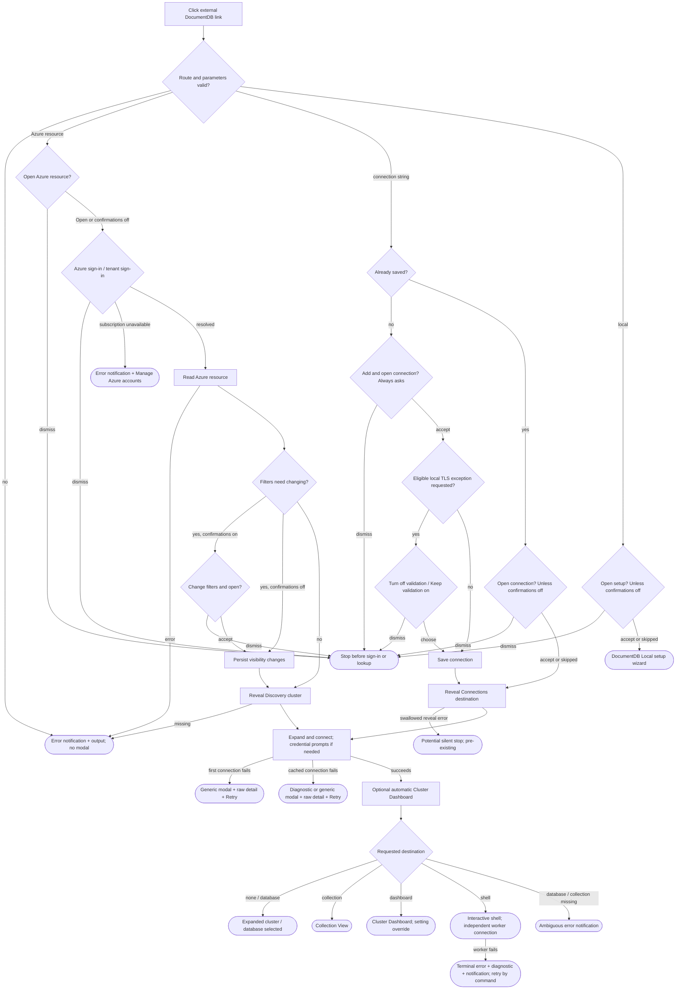

# Azure resource links and open targets - UX Review Pack

> **Start here:** [presentation walkthrough](#appendix-a---presentation-walkthrough).
> Every dialog's detail text is shown in full, not hidden behind a disclosure.
> Government/China and SRV variants are bundled with **OR**, rather than a mock for every
> combination. Evaluation notes sit **beside each presentation**, with a cross-cutting pass
> [at the end](#appendix-b---language-and-consistency-evaluation).
> All proposed wording is collected in [proposed message changes](#proposed-message-changes).

- **PR / branch:** [#1067](https://github.com/microsoft/vscode-documentdb/pull/1067) /
  `dev/tnaum/url-handler-improvmements`.
- **Reviewed source:** `d75d3eb57713926507a60604d06437e60457c49e`, 2026-11-06.
- **Feature area:** [URI handler](../../../../../src/vscodeUriHandler.ts),
  [Azure link flow](../../../../../src/deepLinks/handleAzureResourceLink.ts),
  [Discovery reveal](../../../../../src/tree/discovery-view/discoveryViewHelpers.ts).
- **Related intent:** [feature overview](../README.md), [decisions](../decisions.md),
  [public URL contract](../../../../user-manual/how-to-construct-url.md),
  [sovereign clouds](../../sovereign-clouds/README.md),
  [SRV fallback](../../srv-dns-fallback/README.md).
- **Scope:** external links, consent, sign-in, filters, progress, navigation, connection
  failures, expanded details, and recovery. Downstream dashboard/Collection View internals
  are not a full review of those features.

## How this review was run

This is a **source-backed preparation and language-evaluation pass**, not a report of
hands-on testing. No Azure resource, sovereign-cloud account, DNS failure, or installed
VS Code dialog was exercised. The source and relevant existing test cases were inspected;
the tests were not run for this documentation-only change.

**Reading the presentations:**

- Text blocks reproduce the extension's English strings with synthetic target values.
  `review-cluster`, `Review subscription`, `app`, `orders`, and the repeated-digit GUIDs
  below are examples, not real resources or account data.
- A field such as `<raw error.message>` is explicitly variable upstream text, **not**
  invented Microsoft/driver wording. Representative raw DNS errors are labeled as such.
- **OR** separates alternatives; it is not text the extension displays. Optional lines
  are described outside the text blocks.
- **Current** means wired to that exact call path. **Conditional diagnostic** means the
  wording exists, but appears only when a caller invokes the diagnostics service and a
  provider recognizes the failure. A first connection does **not** necessarily get it.
- The presentation labels "Title", "Detail", and "Primary action" are review annotations,
  not extra UI labels. VS Code supplies standard dismissal controls; their appearance and
  the rendering of long details still need a real-workbench check.
- Recommendations are **suggestions**, not approved wording or implemented changes.
  The operator has not made decisions on these items.

## Legend

### Priority

| Priority | Meaning                                            |
| -------- | -------------------------------------------------- |
| **P0**   | Blocking - the user gets stuck                     |
| **P1**   | Broken / misleading, or a consistency & safety gap |
| **P2**   | Polish, expectation, or a smaller feature gap      |
| **P3**   | Nice-to-have / cosmetic / acknowledged             |

### Status

| Status             | Meaning                                                  |
| ------------------ | -------------------------------------------------------- |
| 🟠 **Open**        | Recorded + analyzed; recommendation remains a suggestion |
| 🟡 **Open (soft)** | Open, but depends on an investigation or is "as-is"      |
| ✅ **Implemented** | Changed and verified, with a Decision and commit link    |
| 🚫 **Closed**      | Won't fix, with a mandatory reason                       |
| 🔗 **Tracked**     | Deferred to a linked repository issue                    |

### Markers

| Marker            | Meaning                                                                     |
| ----------------- | --------------------------------------------------------------------------- |
| ⚠️ **Flag**       | Confirmed gap or bug in the source; runtime impact still needs confirmation |
| 💡 **Suggestion** | Design/wording recommendation to react to                                   |
| 🔍 **Answered**   | A behavior question answered from the code                                  |

Open items remain in the ledger until fixed, explicitly closed, or moved to an issue.
Priority is provisional until the operator walks the journeys.

## User interaction map



### Interaction inventory

| Entry / action                                                | Terminal state and recovery                                                                               | Presentation                                                                                                                              |
| ------------------------------------------------------------- | --------------------------------------------------------------------------------------------------------- | ----------------------------------------------------------------------------------------------------------------------------------------- |
| Azure resource link, vCore **OR** RU                          | Discovery cluster expanded, not saved to Connections; optional destination                                | [A1](#a1---azure-resource-consent), [A10](#a10---success-and-cancellation-end-states)                                                     |
| New connection-string link, explicit **OR** legacy empty path | Consent, optional TLS decision, saved connection, tree/destination; save survives a later connect failure | [A2](#a2---new-connection-consent-always-shown), [A4](#a4---tls-exception)                                                                |
| Existing connection-string link                               | Reuse saved connection; one open confirmation unless disabled                                             | [A3](#a3---existing-connection-consent)                                                                                                   |
| Sign in / Sign in to tenant                                   | External authentication UI, then continue; dismiss stops                                                  | [A5](#a5---azure-account-and-tenant-sign-in)                                                                                              |
| Manage Azure accounts                                         | Opens the provider's account-management flow; does not automatically retry the URL                        | [A12](#a12---azure-lookup-and-access-failures)                                                                                            |
| Change filters and open                                       | Persistent provider/tenant/subscription visibility changes, then reveal                                   | [A6](#a6---filter-change-consent)                                                                                                         |
| Cancel Azure progress                                         | Stops at the next cancellation checkpoint; earlier effects can remain                                     | [A7](#a7---progress-and-cancel)                                                                                                           |
| Choose auth method / identity / username / password           | Shared connection wizard; supplied or cached values can skip prompts                                      | [A8](#a8---database-authentication-prompts)                                                                                               |
| Dashboard / shell / collection destination                    | Panel or terminal; database-scoped when requested                                                         | [A10](#a10---success-and-cancellation-end-states), [A17](#a17---shell-worker-failure-after-a-successful-tree-connect)                     |
| Malformed link / wrong Azure resource / missing destination   | Error notification, sometimes after partial successful work                                               | [A11](#a11---invalid-link-messages-bundled), [A12](#a12---azure-lookup-and-access-failures), [A13](#a13---missing-database-or-collection) |
| Failed connect / failed database listing                      | Modal and clickable Retry; extra recovery varies by view/phase                                            | [A14](#a14---connection-error-shells-and-recovery)                                                                                        |
| Click Retry / update credentials / open shell                 | Retry parent expansion / edit saved credentials / open terminal                                           | [A14](#a14---connection-error-shells-and-recovery)                                                                                        |
| SRV failure / Government or China sign-in failure             | Generic or explained message according to call path, not just error type                                  | [A15](#a15---srv-dns-failures-fully-expanded), [A16](#a16---government-china-and-other-entra-failures-fully-expanded)                     |
| Local link (regression control)                               | Existing setup wizard; no provisioning just from accepting the URL                                        | [A9](#a9---local-link-regression-control)                                                                                                 |

## The story in one paragraph

The PR lets a link identify an Azure resource without embedding a connection string and
lets either connect route request a dashboard or shell. The target-aware confirmations,
credential-free Azure locator, and explicit local TLS choice are good foundations.
The main risk is not one bad sentence: similar failures receive different explanation
quality and surfaces depending on whether this is a first connection, cached connection,
tree lookup, or shell startup. This pack shows those differences without requiring access
to Government/China or manufacturing every DNS failure.

## Priority index

**10 source-backed Flags: 3 P1, 7 P2.** No P0 established by this preparation; that is not
a claim that runtime testing found no blockers. Shared/pre-existing gaps are identified
so they do not silently become requirements for this PR.

| ID  | Priority | Verified                      | Item                                                                        | Origin                                             | Status         |
| --- | -------- | ----------------------------- | --------------------------------------------------------------------------- | -------------------------------------------------- | -------------- |
| F01 | **P1**   | ✅ **P1**, wider (9 sites)    | First-connect paths bypass readable SRV/Entra diagnostics                   | Shared/pre-existing, newly reached by Azure links  | ✅ Implemented |
| F02 | **P1**   | ✅ **P2**, + double toast     | Missing target message suggests a connection failure even after connecting  | New Azure path reuses inherited text               | ✅ Implemented |
| F03 | **P1**   | ◐ **P3**, fold into F01/F10   | Blocking failures alternate between modal, toast, and silent stop           | Mixed new/shared                                   | 🚫 Closed      |
| F04 | **P2**   | ✅ **P3**                     | Action labels, titles, and surface names drift                              | Mixed new/shared                                   | ✅ Implemented |
| F05 | **P2**   | ✅ **P2**                     | Filter prompt omits persistence and no-rollback consequences                | New presentation, intentional persistent design    | ✅ Implemented |
| F06 | **P2**   | ✅ **P3**, reframed           | Progress cancellation waits for operations; some waits have no status       | Mixed new/shared                                   | ✅ Implemented |
| F07 | **P2**   | ✅ **P2**, + D0013 drift      | "Opens: Shell/Collection View" omits automatic dashboard                    | Shared behavior exposed by new destinations        | ✅ Implemented |
| F08 | **P2**   | ✅ **P2**                     | Some failures lack a next step or overstate what was established            | New messages plus inherited validation wording     | ✅ Implemented |
| F09 | **P2**   | ◐ **P3**, convention          | Long diagnostic headings, jargon, and literal formatting reduce readability | Shared/pre-existing                                | ✅ Implemented |
| F10 | **P2**   | ✅ **P2**, worse with `open=` | Saved connection in a folder can silently fail to reveal                    | Explicitly acknowledged pre-existing limitation    | ✅ Implemented |
| F11 | —        | 🆕 **P2**                     | Link does not retry a cluster whose last expansion failed                   | New Azure path (and pre-existing Connections path) | ✅ Implemented |

> **🔎 Verification pass (2026-11-06, source `05901fe1`).** Each finding was rechecked against the
> code; the verdict and any priority override sit in a `🔎 Verification` block directly under the
> finding. ✅ confirmed, ◐ partly valid, 🆕 found during verification. Priorities in the
> **Priority** column are the review's; **Verified** is the override. Code reading only: nothing
> was exercised in a workbench. Options tables mark who proposed each option (**Review** or
> **Verification**).
>
> **Net effect:** 1 × P1 (F01, pre-existing, own PR), 5 × P2, 4 × P3, 1 new P2 (F11). Cheap,
> in-scope fixes for #1067: F02, F04 (new strings only), F05, F08, F11. Separate PR: F01. Decide:
> F07, F10.

## P0 - Blocking (the user gets stuck)

No P0 established. Real-workbench checks remain open, particularly cold tree activation,
focus, long dialogs, and error recovery.

## P1 - Broken / misleading, or consistency & safety

### F01. First connection can miss the helpful diagnosis ⚠️

**Priority:** P1 · **Status:** ✅ Implemented

**Observation:** Source-derived; [A14](#a14---connection-error-shells-and-recovery) shows
the generic first-connect modal, while [A15](#a15---srv-dns-failures-fully-expanded) and
[A16](#a16---government-china-and-other-entra-failures-fully-expanded) show richer text
available on diagnostic-aware paths.

**Finding:** The [saved-connection failure helper](../../../../../src/documentdb/auth/urlEncodedPassword.ts#L88),
[vCore connect catch](../../../../../src/plugins/service-azure-mongo-vcore/discovery-tree/documentdb/DocumentDBResourceItem.ts#L197),
and [RU connect catch](../../../../../src/plugins/service-azure-mongo-ru/discovery-tree/documentdb/MongoRUResourceItem.ts#L140)
do not call diagnostics. [Cached connect](../../../../../src/tree/documentdb/ClusterItemBase.ts#L298)
and [shell startup](../../../../../src/documentdb/shell/DocumentDBShellPty.ts#L609) do.
Having a saved connection is not the same as having cached credentials.

💡 **Suggestion:** Reuse the diagnostics service at those rendering sites, retaining raw
detail and the decoded-password retry. No provider should show UI or mutate the error.

> **🔎 Verification** · ✅ **Confirmed, wider than stated** · Priority **P1 kept** · Pre-existing,
> **not a #1067 blocker**; recommend its own PR.
>
> - Every first-connect catch renders the same generic modal with no `explain()` call. The
>   review names 3 sites, but there are **9**: the 3 named, plus the decoded-password retry
>   failure ([DocumentDBClusterItem.ts#L290](../../../../../src/tree/connections-view/DocumentDBClusterItem.ts#L290)),
>   the Azure Resources view vCore and RU items
>   ([VCoreResourceItem.ts#L185](../../../../../src/tree/azure-resources-view/documentdb/VCoreResourceItem.ts#L185),
>   [RUCoreResourceItem.ts#L129](../../../../../src/tree/azure-resources-view/mongo-ru/RUCoreResourceItem.ts#L129)),
>   [Atlas](../../../../../src/plugins/service-atlas-mongodb/discovery-tree/AtlasClusterItem.ts#L285),
>   [Kubernetes](../../../../../src/plugins/service-kubernetes/discovery-tree/documentdb/KubernetesResourceItem.ts#L336)
>   and [Azure VM](../../../../../src/plugins/service-azure-vm/discovery-tree/vm/AzureVMResourceItem.ts#L256).
>   Find them all with `grep -rn "Revisit connection details" src`.
> - None of these files is changed by #1067. The PR only makes the vCore/RU first connect the
>   default landing for Azure links. That is the path a Government/China user with Entra hits first.
> - **Ordering trap the review missed:** the Entra and Atlas providers read
>   `CredentialCache.getCredentials(clusterId)`
>   ([Entra#L37](../../../../../src/documentdb/auth/entraErrors/EntraDiagnosticsProvider.ts#L37),
>   [Atlas#L35](../../../../../src/plugins/service-atlas-mongodb/AtlasDiagnosticsProvider.ts#L35)),
>   and the vCore/RU catches evict that entry right after the modal
>   ([vCore#L210](../../../../../src/plugins/service-azure-mongo-vcore/discovery-tree/documentdb/DocumentDBResourceItem.ts#L210),
>   [RU#L153](../../../../../src/plugins/service-azure-mongo-ru/discovery-tree/documentdb/MongoRUResourceItem.ts#L153)).
>   `explain()` must run **before** `deleteCredentials`, or the Entra rule loses its auth
>   method and Atlas returns nothing.
> - The [error-translation skill](../../../../../.github/skills/error-translation/SKILL.md)
>   lists `ClusterItemBase` as covering "Cluster connect". That is only true for the cached path,
>   so the skill table should say so once this is fixed.
>
> | Option                                                                                                                                                                                                                                                               | Proposed by             | Pros                                                                                                                                                            | Cons                                                                                                                          |
> | -------------------------------------------------------------------------------------------------------------------------------------------------------------------------------------------------------------------------------------------------------------------- | ----------------------- | --------------------------------------------------------------------------------------------------------------------------------------------------------------- | ----------------------------------------------------------------------------------------------------------------------------- |
> | Add `explain()` inline at each site, diagnosis as heading                                                                                                                                                                                                            | Review                  | Matches the documented call-site pattern; each change is tiny                                                                                                   | 9 copies of the same block; the ordering trap above must be fixed 9 times; easy to drift again                                |
> | **One shared `showClusterConnectFailure({ clusterId, clusterName, error, extraDetail?, buttons? })`** that calls `explain()`, records `diagnosisProviderId`, renders the existing pattern and returns the chosen button; the decoded-password helper delegates to it | Verification            | One place for copy and ordering; the decoded-password retry keeps working through `extraDetail`/`buttons`; unit-testable once; the next plugin gets it for free | Touches 9 files in several plugins (one review); the helper needs a "caller evicts after" contract in its doc comment         |
> | Make `authenticateAndConnect()` throw and let `ClusterItemBase` render                                                                                                                                                                                               | Verification (rejected) | Single render site in theory                                                                                                                                    | Changes a contract every plugin implements; the decoded-password flow and plugin-specific cleanup do not fit; far larger diff |
>
> **Recommendation:** the shared helper, in a separate PR. Keep "Revisit connection details and
> try again." only as the fallback when no provider matches. Add one test per provider family
> showing that the first-connect path shows the diagnosis.

> **Done (2026-11-06), commit `70d5295e` (sol):** new `showClusterConnectFailure()` in `src/documentdb/showClusterConnectFailure.ts` asks the diagnostics service, records `diagnosisProviderId`, and shows the diagnosis as the heading with the raw error as detail. Without a diagnosis it falls back to the unchanged generic heading and "Revisit…" detail. All 9 first-connect sites use it, and each awaits it before evicting credentials or deleting the client. The decoded-password helper delegates to it through `extraDetail`/`buttons`. Decision (95%): an optional `fallbackHeading` keeps the Azure VM's existing `Failed to connect to VM "…"` heading rather than making an unspecified wording change. Behaviour difference: cleanup now runs after the modal is dismissed. Updated the error-translation skill's call-site table and ordering rule. Tests: 8 helper tests, 1 decoded-password delegation test.

<a id="f02"></a>

### F02. Missing target is reported as an uncertain connection failure ⚠️

**Priority:** P1 · **Status:** ✅ Implemented

**Observation:** [A13](#a13---missing-database-or-collection) can appear after the cluster
has connected and even after an automatic dashboard has opened.

**Finding:** [Azure database/collection lookup](../../../../../src/tree/discovery-view/discoveryViewHelpers.ts#L160)
checks for a connected client first, but then uses the same ambiguous text as the
[connection-string target checks](../../../../../src/vscodeUriHandler.ts#L686).

💡 **Suggestion:** Name the database or collection that could not be found and the parent
where it was sought. Say "could not find", not "does not exist", when permissions or a
failed child listing could also explain absence.

> **🔎 Verification** · ✅ **Confirmed** · Priority **P1 → P2** · In scope for #1067: the Azure
> lookup is new code that copied the old string.
>
> - On the Azure path, `ClustersClient.exists(clusterId)` is checked
>   ([discoveryViewHelpers.ts#L150](../../../../../src/tree/discovery-view/discoveryViewHelpers.ts#L150))
>   before the database lookup, so the "Connection was unsuccessful" half can never apply there.
> - **Why P2, not P1:** the sentence is an "A **or** B" and never asserts the wrong cause. It is
>   vague and machinery-flavoured ("URL handling aborted"), not false. The user still learns the
>   target was not reached.
> - **Missed by the review, and a real double surface:** if the connection succeeds but
>   `listDatabases` fails, `ClusterItemBase` shows its modal and returns retry children. The
>   client still exists, so the Azure flow continues, misses the database, and adds the A13 toast
>   **on top of** the modal. The node is already in error state
>   (`provider.hasNodeErrorState(clusterNode.id)`), so the flow can detect this.
> - On the connection-string path
>   ([vscodeUriHandler.ts#L686](../../../../../src/vscodeUriHandler.ts#L686)) the collection check
>   has no client check in front of it, so there the "connection unsuccessful" half **can** be
>   true. The string is less wrong there, and the two paths should not share one fix blindly.
>
> | Option                                                                                                                                                                                                            | Proposed by  | Pros                                                                                                                                        | Cons                                                                                                   |
> | ----------------------------------------------------------------------------------------------------------------------------------------------------------------------------------------------------------------- | ------------ | ------------------------------------------------------------------------------------------------------------------------------------------- | ------------------------------------------------------------------------------------------------------ |
> | Name the missing database/collection and its parent; say "could not find"                                                                                                                                         | Review       | Specific and honest; cheap (new strings)                                                                                                    | On its own it still fires after a `listDatabases` modal, so the user gets two messages for one failure |
> | **Review option + stop quietly when the cluster node is in error state** (return `undefined`, set `openTargetResult = 'skippedClusterError'`), same "node already explained" contract as the not-connected branch | Verification | Removes the double surface; the remaining toast only fires when listing succeeded and the name is really absent; mirrors an existing branch | One more branch and test; Connections path needs the same check against its own provider               |
>
> **Recommendation:** both, Azure path first. Suggested copy:
> `Could not find database "app" on review-cluster. Check the name and your access, then open the link again.`
> and `Could not find collection "orders" in database "app". …`. Drop "URL handling aborted".

> **Done (2026-11-06), commits `9c483325` (Discovery, terra) and `9ecb9b39` (connection string, sol):** both paths replace "URL handling aborted…" with `Could not find database "{0}" on {1}…` / `Could not find collection "{0}" in database "{1}"…`. Both stop quietly (`openTargetResult = 'skippedClusterError'`) when the cluster node is in error state after expansion, which removes the double message after a `listDatabases` failure. The connection-string collection branch also returns quietly without a client (`skippedNotConnected`). On a collection miss it looks up the database to pick the right message. Tests added on both paths.

### F03. Failure surface depends on implementation layer ⚠️

**Priority:** P1 · **Status:** 🚫 Closed (folded into F01, F10, F11)

**Observation:** See the [failure-surface comparison](#a18---failure-surface-comparison).

**Finding:** The [global handler](../../../../../src/vscodeUriHandler.ts#L141) uses the SDK's
non-modal error handling. Cluster connection failures use modals.
[Shared descendant diagnostics](../../../../../src/tree/BaseExtendedTreeDataProvider.ts#L618)
append the raw cause to a toast instead of using detail. Some Connections reveal errors
are [swallowed](../../../../../src/tree/api/revealConnectionsViewElement.ts#L13).

💡 **Suggestion:** Agree a rule for a user-blocking URL journey: actionable modal plus raw
detail/output, with tree children reserved for recovery actions. Treat deliberate
cancellation and background work separately. The shell's terminal-plus-toast is a useful
surface-specific exception, not necessarily something to turn into a modal.

> **🔎 Verification** · ◐ **Facts correct, conclusion overstated** · Priority **P1 → P3**;
> fold the actionable parts into F01 and F10 and close F03 as a standalone item.
>
> - Each observation checks out: the SDK path is non-modal and turns multiline messages into
>   "An error has occurred. Check output window…" (`@microsoft/vscode-azext-utils`
>   `callWithTelemetryAndErrorHandling.js`, `message.includes('\n')`); the base-provider
>   descendant path appends the cause in parentheses
>   ([BaseExtendedTreeDataProvider.ts#L618](../../../../../src/tree/BaseExtendedTreeDataProvider.ts#L618));
>   and `revealConnectionsViewElement` swallows errors into telemetry.
> - **But different surfaces are not a defect here.** Link validation (A11) fails _before_ the
>   user has committed to anything; a toast plus output is the standard VS Code answer and
>   matches every other command in this extension. The repository rule is narrower: a failed
>   **tree expansion** explains itself in a modal and leaves only actions as children. That
>   rule is already followed.
> - What remains is either F01 (first-connect explanation quality) or F10/F11 (silent stop).
>   Neither needs a new cross-surface "rule" to fix.
> - The multiline fallback is reachable only for upstream ARM/auth errors (A12, last row); every
>   message this PR writes is a single line. The descendant-toast format is shared and
>   pre-existing, owned by the error-translation feature.
>
> | Option                                                                                | Proposed by  | Pros                                                    | Cons                                                                                                                                                         |
> | ------------------------------------------------------------------------------------- | ------------ | ------------------------------------------------------- | ------------------------------------------------------------------------------------------------------------------------------------------------------------ |
> | Agree a surface rule for user-blocking URL journeys (modal + detail)                  | Review       | One mental model                                        | Would turn malformed-link toasts into modals that block the window for a link the user may not care about; touches the SDK error path; large for little gain |
> | **Close F03; track the silent stops under F10/F11 and explanation quality under F01** | Verification | No speculative policy; each concrete gap keeps an owner | The A18 comparison table loses its headline item (it stays useful as reference)                                                                              |

> **Closed (2026-11-06), no code:** as recommended, the concrete gaps were fixed under F01 (explanation quality), F10 (silent folder reveal) and F11 (no retry). Validation failures stay toasts by design.

## P2 - Polish, expectation, or feature gap

<a id="f04"></a>

### F04. The same action has several labels ⚠️

**Priority:** P2 · **Status:** ✅ Implemented

**Observation:** Inline comparisons in [A1](#a1---azure-resource-consent),
[A3](#a3---existing-connection-consent), and [A8](#a8---database-authentication-prompts).

**Finding:** `Open`, `Yes, open connection`, `Open setup`, `Shell`, and
`Open Interactive Shell` coexist. The auth wizard also mixes title case and sentence
case. Sources are linked beside those presentations.

💡 **Suggestion:** Use short verb actions (`Open`, `Add and open`, `Open setup`) and a
shared destination vocabulary (`Cluster Dashboard`, `Collection View`, `Interactive
Shell`). Preserve official Azure product names.

> **🔎 Verification** · ✅ **Confirmed** · Priority **P2 → P3** (cosmetic, no task is blocked).
>
> - `Shell` is **new in #1067** (both
>   [handleAzureResourceLink.ts#L64](../../../../../src/deepLinks/handleAzureResourceLink.ts#L64)
>   and [vscodeUriHandler.ts#L484](../../../../../src/vscodeUriHandler.ts#L484)); the command
>   title is `Open Interactive Shell`. `Yes, open connection`, `Open setup`,
>   `Connections View` and the Local title-as-sentence are all pre-existing on `main`.
> - Note `Yes, open connection` is built three times and compared by string
>   ([vscodeUriHandler.ts#L626-L632](../../../../../src/vscodeUriHandler.ts#L626)); hoist it to one
>   constant if it changes.
> - The A11 "Unknown action" string has an em dash, which the error-writing rules forbid.
>
> | Option                                                                                                                                                                                  | Proposed by  | Pros                                            | Cons                                                                                                                             |
> | --------------------------------------------------------------------------------------------------------------------------------------------------------------------------------------- | ------------ | ----------------------------------------------- | -------------------------------------------------------------------------------------------------------------------------------- |
> | Full vocabulary pass now (all buttons, auth-wizard case, Local title)                                                                                                                   | Review       | One consistent pass                             | Rewrites pre-existing strings and the shared auth wizard inside a deep-link PR; l10n churn; reviewers must check unrelated flows |
> | **Fix only what #1067 introduces or rewrites:** `Shell` → `Interactive Shell`; `Yes, open connection` → `Open` (that dialog's detail was rewritten in this PR anyway); drop the em dash | Verification | Small diff tied to the PR; A1 and A3 then match | Auth wizard and Local dialog stay inconsistent until a later copy pass                                                           |

> **Done (2026-11-06), commit `8997a6b2` (luna):** `Shell` → `Interactive Shell` in both consent builders; `Yes, open connection` → `Open` (one constant used for the button and both comparisons); em dash removed from the unknown-action message. The auth wizard and the Local dialog are unchanged (pre-existing, outside this PR). Pinned test strings updated.

### F05. Permanent filter changes sound like temporary navigation ⚠️

**Priority:** P2 · **Status:** ✅ Implemented

**Observation:** [A6](#a6---filter-change-consent) lists effects, but not their duration.

**Finding:** [Visibility writes](../../../../../src/deepLinks/azureVisibility.ts#L46) persist.
The [flow](../../../../../src/deepLinks/handleAzureResourceLink.ts#L194) has no rollback if a
later connection fails or progress is cancelled.

💡 **Suggestion:** State that changes remain until changed back, and where to undo them.
Keep the accepted persistent-filter design; this is a disclosure recommendation, not a
proposal to silently change that design.

> **🔎 Verification** · ✅ **Confirmed** · Priority **P2 kept** · In scope (new string).
>
> - [azureVisibility.ts](../../../../../src/deepLinks/azureVisibility.ts#L46) writes the provider
>   visibility, the local tenant filter and the shared `azureResourceGroups.selectedSubscriptions`
>   setting; nothing records or restores the previous values.
> - The undo locations exist and can be named precisely: the **Filter Entries…** (filter icon)
>   action on the Azure provider node in the Discovery view, and **Hide Provider**. The
>   subscription change also affects the Azure Resources extension's own filter.
>
> | Option                                              | Proposed by             | Pros                                        | Cons                                                                                                                                      |
> | --------------------------------------------------- | ----------------------- | ------------------------------------------- | ----------------------------------------------------------------------------------------------------------------------------------------- |
> | Add a persistence sentence plus the undo location   | Review                  | Honest; one line; keeps the accepted design | Dialog grows by one line                                                                                                                  |
> | Snapshot and auto-restore filters on cancel/failure | Verification (rejected) | Cancel would "really" cancel                | Contradicts the accepted persistent design; restoring a setting shared with another extension can clobber changes the user made meanwhile |
>
> **Recommendation:** the review's option. Suggested line:
> `These changes stay after the link opens. To undo them, use Filter Entries… on the provider in the Discovery view.`

> **Done (2026-11-06), commit `c6e76f53` (luna):** the filter dialog adds `These changes stay after the link opens. To undo them, use Filter Entries… or Hide Provider on the provider in the Discovery view.` as its own paragraph before the Note. Test asserts it. The [proposed message changes](#proposed-message-changes) chapter records an alternative that also covers cancel and failure.

### F06. Cancel is checkpoint-based, not an immediate abort ⚠️

**Priority:** P2 · **Status:** ✅ Implemented

**Observation:** [A7](#a7---progress-and-cancel) has a cancellable Azure notification.

**Finding:** The [outer flow](../../../../../src/deepLinks/handleAzureResourceLink.ts#L94)
checks its token after awaited phases; it does not pass that token into subscription
resolution, ARM reads, filter application, or reveal. The cluster has a separate connection
cancel mechanism. Readiness waits can also occur before the next stage message.

💡 **Suggestion:** Verify the latency with a slow request. Propagate cancellation where
supported; otherwise make waiting/stopping states honest. Do not promise rollback of
completed filter changes.

> **🔎 Verification** · ✅ **Confirmed** · Priority **P2 → P3**, and reframed.
>
> - The token is only checked between phases
>   ([handleAzureResourceLink.ts#L94-L224](../../../../../src/deepLinks/handleAzureResourceLink.ts#L94));
>   none of `resolveAzureSubscription`, `readAzureResource` or `revealInDiscoveryView` takes it.
> - **Why P3:** a late cancel does not cause harm. Filter writes are persistent by design (F05),
>   ARM calls have their own timeouts, and the explicit target is still skipped.
> - **The sharper problem is the connect phase.** While `revealInDiscoveryView` expands the
>   cluster, two cancellable notifications can be visible together: the outer
>   `Opening from Azure` and the inner `Connecting to "…"`
>   ([ClusterItemBase.ts#L191](../../../../../src/tree/documentdb/ClusterItemBase.ts#L191)).
>   Only the inner one aborts the connection. Cancelling the outer one lets the connection
>   finish (and the automatic dashboard open), then silently skips the requested target.
>
> | Option                                                                                                                                                                                                                                    | Proposed by  | Pros                                                                       | Cons                                                                                                                                                                                                      |
> | ----------------------------------------------------------------------------------------------------------------------------------------------------------------------------------------------------------------------------------------- | ------------ | -------------------------------------------------------------------------- | --------------------------------------------------------------------------------------------------------------------------------------------------------------------------------------------------------- |
> | Propagate the token into every phase                                                                                                                                                                                                      | Review       | Cancel is immediate                                                        | Most underlying Azure/auth APIs take no token; large plumbing for seconds of latency                                                                                                                      |
> | **End the outer progress before reveal/connect.** It then covers only the management-plane steps where a checkpoint cancel is meaningful; the tree's view progress and the inner, really-cancellable `Connecting…` notification take over | Verification | Only one Cancel on screen at a time, and it does what it says; no plumbing | The outer `Loading subscriptions…` / `Loading clusters…` / `Connecting…` stage text goes away (the view spinner stays). Needs a real-workbench check that the hand-off does not look like an early finish |
> | Keep outer progress but make it non-cancellable from reveal onward                                                                                                                                                                        | Verification | Keeps the stage text                                                       | VS Code cannot toggle `cancellable` mid-flight; would need two sequential progress calls anyway                                                                                                           |

> **Done (2026-11-06), commit `05f1d9fd` (terra):** the "Opening from Azure" notification now ends after the filter step. `revealInDiscoveryView` runs afterwards, with only the view spinner and the cancellable "Connecting to …" notification. Removed the `report` parameter and its five stage strings. The test that pinned those stage texts was removed, as required by the accepted option. A new test asserts reveal runs after the progress callback completes.

<a id="f07"></a>

### F07. The declared destination is not always the only surface opened ⚠️

**Priority:** P2 · **Status:** ✅ Implemented

**Observation:** [A10](#a10---success-and-cancellation-end-states) includes a default-on
automatic dashboard before a shell or Collection View.

**Finding:** [Cluster expansion](../../../../../src/tree/documentdb/ClusterItemBase.ts#L391)
opens the dashboard on a new successful connection when the setting is enabled; the
[URI handler](../../../../../src/vscodeUriHandler.ts#L218) opens the explicit target later.

💡 **Suggestion:** Either explain the additional dashboard or agree whether explicit
destinations should suppress it. The latter is a behavior/design decision, not a copy fix.
Check keyboard focus and the selected database scope, including whether the automatic
cluster-wide and requested database-scoped dashboard coexist.

> **🔎 Verification** · ✅ **Confirmed, and the open question is answered: they coexist** ·
> Priority **P2 kept** · Design decision, not copy.
>
> - Dashboard panels are keyed by `clusterId` **and** `selectedDatabaseName`
>   ([clusterDashboardController.ts#L173](../../../../../src/webviews/documentdb/clusterDashboard/clusterDashboardController.ts#L173)).
>   With auto-open on, `open=dashboard&database=app` therefore opens **two** panels: the
>   automatic cluster-wide one and the requested database-scoped one. A cluster-level
>   `open=dashboard` reuses one panel, as intended.
> - **Doc/code conflict:** [D0013](../decisions.md) reasons "the explicit open reuses the
>   existing panel (`panelReused`), so nothing opens twice". That holds only without
>   `database`. The code wins for behavior; D0013's reasoning should be corrected whichever
>   option is chosen.
> - `open=shell` and collection links: dashboard in the editor plus the terminal or Collection
>   View. The last opened surface takes focus, so this is noise rather than a misdirected user.
>
> | Option                                                                                                          | Proposed by  | Pros                                                                                                                                                           | Cons                                                                                                                                                                 |
> | --------------------------------------------------------------------------------------------------------------- | ------------ | -------------------------------------------------------------------------------------------------------------------------------------------------------------- | -------------------------------------------------------------------------------------------------------------------------------------------------------------------- |
> | Keep both and disclose ("Also opens: Cluster Dashboard" when the setting is on)                                 | Review (O1)  | No behavior change; honest                                                                                                                                     | Longer consent; still two panels for a database-scoped dashboard link                                                                                                |
> | Suppress auto-open for any explicit destination                                                                 | Review (O1)  | One predictable surface                                                                                                                                        | Needs a per-connection "skip auto-open once" hint into `ClusterItemBase` (the D0013 rejected-alternative cost); changes the preference's meaning in this one context |
> | **Suppress auto-open only when the link asks for a dashboard** (`open=dashboard`): the explicit one replaces it | Verification | Fixes the only real duplicate (two dashboards), keeps the bare/shell/collection behavior users already see from `/connect`; the cost is the same one-shot hint | Shell and collection links still show a dashboard first; still needs the hint plumbing                                                                               |
>
> **Recommendation:** fix D0013's wording now (doc-only). Choose between the two suppress
> options after one workbench run with the setting on; the dashboard-only option is the
> minimal fix for the double panel.

> **Done (2026-11-06), commit `2087c782` (sol, after one retry; the first sol run failed with a 401 before editing):** a link with `open=dashboard` suppresses the automatic dashboard during its own cluster expansion (`src/tree/documentdb/autoOpenDashboardSuppression.ts`, keyed by `clusterId`/`storageId`, released in `finally`). Only the requested dashboard opens. Shell, collection and bare links are unchanged. Decision (90%): this is the dashboard-only option, the minimal fix for the double panel; it was the recommended option the operator accepted with "fix all". D0013 in [decisions.md](../decisions.md) is amended. Tests: 17 across the module, `ClusterItemBase`, the Discovery helper, the Azure flow and the URI handler.

<a id="f08"></a>

### F08. Error wording is unevenly actionable and certain ⚠️

**Priority:** P2 · **Status:** ✅ Implemented

**Observation:** [A11](#a11---invalid-link-messages-bundled) and
[A12](#a12---azure-lookup-and-access-failures) contain both repair instructions and bare
diagnoses.

**Finding:** Resource/tenant ID validation has no format hint; not-found/unauthorized
resource errors have no next step. "None of your signed-in Azure accounts can access"
is inferred from no matching subscription in the selected environment, not a direct
test of every account's access in every cloud.

💡 **Suggestion:** Use "Could not find this subscription among your signed-in accounts"
and mention account, tenant, and selected Azure cloud. Add one concrete repair action
to bare validation/resource errors.

> **🔎 Verification** · ✅ **Confirmed** · Priority **P2 kept** · In scope (strings are new in #1067).
>
> - The subscription check is "no `getSubscriptions(false)` entry matched"
>   ([azureSubscription.ts#L82-L95](../../../../../src/deepLinks/azureSubscription.ts#L82)).
>   That is absence from the list, not an access test. A tenant that is not signed in yet, or the
>   wrong cloud, gives the same result.
> - **Sharper than the review states:** the _tenant prompt_
>   ([#L108](../../../../../src/deepLinks/azureSubscription.ts#L108)) says no account "can access"
>   the subscription, then asks the user to sign in to the tenant. The reason for that prompt is
>   that an account may well have access once it is signed in to that tenant. The two sentences
>   contradict each other. This is the copy fix with the most value.
> - `Azure discovery is not available.` is effectively unreachable: both providers are
>   registered at activation. Do not spend copy effort there.
> - Resource-ID and tenant-ID validation are for link authors. Naming the expected shape is
>   cheap and enough.
>
> | Option                                                                                                                                                                                                                                                                                                     | Proposed by  | Pros                                                                | Cons                                     |
> | ---------------------------------------------------------------------------------------------------------------------------------------------------------------------------------------------------------------------------------------------------------------------------------------------------------- | ------------ | ------------------------------------------------------------------- | ---------------------------------------- |
> | "Could not find this subscription among your signed-in accounts" + account/tenant/cloud hints                                                                                                                                                                                                              | Review       | Accurate; actionable                                                | Three hints in one toast is long         |
> | **Same wording, but context-specific hints:** tenant prompt → `We could not find subscription {0} with your current sign-in. The link names tenant {1}; signing in to it may give access.`; final error → keep `Manage Azure accounts` and add "Check that VS Code is signed in to the right Azure cloud." | Verification | Each message says only what applies at that point; no contradiction | Two strings instead of one shared string |
>
> Validation: `This DocumentDB link has an invalid Azure resource ID. Expected /subscriptions/<id>/resourceGroups/<group>/providers/Microsoft.DocumentDB/<mongoClusters|databaseAccounts>/<name>.`
> and `… invalid Azure tenant ID. Expected a GUID.` ARM not-found/forbidden: add "Check the link, or ask the resource owner for read access."

> **Done (2026-11-06), commit `684055a7` (terra):** all eight texts as proposed above: tenant prompt (no contradiction), final subscription error (account and cloud hint), resource-ID and tenant-ID shape, supported resource types, not found, forbidden, and RU wrong API. `Azure discovery is not available.` is unchanged (unreachable). Pinned tests updated.

### F09. Diagnostic content is useful but too heavy for a modal headline ⚠️

**Priority:** P2 · **Status:** ✅ Implemented

**Observation:** [SRV explanations](#a15---srv-dns-failures-fully-expanded) and
[Entra explanations](#a16---government-china-and-other-entra-failures-fully-expanded)
can occupy the entire main message.

**Finding:** [Cluster modals](../../../../../src/tree/documentdb/ClusterItemBase.ts#L321)
use the whole diagnosis as the main message and raw error as detail. SRV strings contain
literal backticks; these are plain VS Code message strings, not Markdown. Entra strings
mix "native DocumentDB authentication", "tenant", and "sign-in resource" with picker labels
such as "Username and Password".

💡 **Suggestion:** Front-load one plain-language sentence and one next step. Align
authentication names with the picker. Consider a separate structured presentation later;
do not truncate away the cause or invent unverified cloud advice.

> **🔎 Verification** · ◐ **Observations correct; the layout is a documented convention** ·
> Priority **P2 → P3** for #1067 · Owned by the error-translation, SRV and sovereign-cloud
> features, not by deep links.
>
> - "Diagnosis as the modal heading, raw error as detail" is the documented pattern on every
>   surface ([error-translation skill](../../../../../.github/skills/error-translation/SKILL.md),
>   "Adding a call site" and "Writing the message"). It is used the same way by the playground,
>   commands and webviews, so it is not a deep-link inconsistency. The skill already caps messages
>   at one paragraph for this reason.
> - Literal backticks in the two SRV strings
>   ([SrvDnsDiagnosticsProvider.ts#L41](../../../../../src/documentdb/srv/SrvDnsDiagnosticsProvider.ts#L41))
>   are real but cosmetic: replace `` `mongodb://` `` with "mongodb://" quotes in a copy pass.
> - "native DocumentDB authentication" versus the picker's `Username and Password` is a valid,
>   cheap alignment for the Entra rules owner.
>
> | Option                                                                                                 | Proposed by          | Pros                             | Cons                                                                                                                         |
> | ------------------------------------------------------------------------------------------------------ | -------------------- | -------------------------------- | ---------------------------------------------------------------------------------------------------------------------------- |
> | Short heading + diagnosis + raw detail everywhere                                                      | Review (O2 option 2) | Easier to scan                   | Reverses a documented convention across 6 surfaces; webview `displayErrorMessage` has the same shape; not a deep-link change |
> | **Leave the layout; do the small copy fixes (backticks, auth-method name) with the providers' owners** | Verification         | Keeps one convention; tiny diffs | Long Government/broker headings stay long                                                                                    |

> **Done (2026-11-06), commit `ed8da6fa` (luna):** SRV hints use "mongodb://" in plain quotes; the Entra rules say `Username and Password authentication`, matching the picker. Layout unchanged, per the documented convention. Two Entra test expectations updated.

### F10. A saved connection in a folder can look like nothing happened ⚠️

**Priority:** P2 · **Status:** ✅ Implemented

**Observation:** [A10](#a10---success-and-cancellation-end-states) includes a nested saved
connection as a separate regression check.

**Finding:** The [URI handler's own limitation note](../../../../../src/vscodeUriHandler.ts#L634)
acknowledges the flat reveal path. The
[reveal helper](../../../../../src/tree/api/revealConnectionsViewElement.ts#L13) catches
lookup/reveal failures and records telemetry without user feedback. A subsequent
`open=` can return when no client exists; a collection check can instead produce A13.

💡 **Suggestion:** Keep this explicitly separate as a pre-existing follow-up. At minimum,
confirm the destination was not reached rather than reporting successful navigation.

> **🔎 Verification** · ✅ **Confirmed, and #1067 makes it easier to hit** · Priority **P2 kept**.
>
> - `revealInConnectionsView` and both target checks build the flat path
>   (`buildConnectionsViewTreePath`), and `revealConnectionsViewElement` swallows the miss.
> - With the new `open=` on a connection inside a folder: never connected → silent return
>   ([vscodeUriHandler.ts#L681](../../../../../src/vscodeUriHandler.ts#L681)); connected earlier
>   in the session → the flat `findNodeById` misses and A13 says the connection may have failed,
>   which is **wrong** in that case.
> - **The fix is cheaper than "follow-up" suggests:** a folder-aware
>   [`buildFullTreePath(storageId, zone)`](../../../../../src/tree/connections-view/connectionsViewHelpers.ts#L95)
>   already exists and already adds `localEmulators`. Database and collection segments append to
>   it as they do now.
>
> | Option                                                                          | Proposed by  | Pros                                                                   | Cons                                                                                                                                          |
> | ------------------------------------------------------------------------------- | ------------ | ---------------------------------------------------------------------- | --------------------------------------------------------------------------------------------------------------------------------------------- |
> | Keep as a follow-up; at minimum report "not reached"                            | Review       | No risk to #1067                                                       | Still needs a new message; the wrong-cause A13 stays; folder users are exactly the "Local Connections (Legacy)" migrants this feature targets |
> | **Use `buildFullTreePath` in `revealInConnectionsView` and both target checks** | Verification | Removes the cause rather than reporting it; ~20 lines; existing helper | Recursive `findNodeById` across folders needs a test with a nested connection; adds one storage read per link                                 |
>
> **Recommendation:** fix with `buildFullTreePath`, in #1067 if the operator accepts the
> scope, otherwise as the very next PR. Remove the "Known limitation" comment with it.

> **Done (2026-11-06), commit `9ecb9b39` (sol):** new `buildConnectionsViewTargetPath()` (folder-aware via `buildFullTreePath`) is used by `revealInConnectionsView` and both target lookups. A test confirms root-level and emulator paths are identical to before. Removed the "Known limitation" comment.

<a id="f11"></a>

### F11. A link does not retry a cluster whose last expansion failed 🆕

**Priority:** P2 (added by verification) · **Status:** ✅ Implemented

**Finding:** A failed cluster expansion is cached in `failedChildrenCache` until the user
clicks Retry ([BaseExtendedTreeDataProvider.ts#L528](../../../../../src/tree/BaseExtendedTreeDataProvider.ts#L528)).
The Azure reveal resets that state for the **provider root** only
([discoveryViewHelpers.ts#L83-L88](../../../../../src/tree/discovery-view/discoveryViewHelpers.ts#L83)),
and a unit test pins "resets only the failed provider root". Opening the same link again after
a failed connect, for example after fixing a firewall rule, makes no new attempt: the expansion
returns the cached `Click here to retry`, no client exists, and the flow returns quietly
([#L150-L154](../../../../../src/tree/discovery-view/discoveryViewHelpers.ts#L150)). The user sees
the old retry row and no message. The Connections path has the same gap (pre-existing).
Source-derived, not exercised.

| Option                                                                                            | Proposed by  | Pros                                                                                | Cons                                                                                                                         |
| ------------------------------------------------------------------------------------------------- | ------------ | ----------------------------------------------------------------------------------- | ---------------------------------------------------------------------------------------------------------------------------- |
| **Reset the cluster node's error state before expanding**, as for the provider root               | Verification | Opening a link is an explicit "try again"; one call plus updating the existing test | One more auth attempt per click (user-initiated, so no lockout concern beyond clicking Retry); may re-prompt the auth wizard |
| Leave it, but show "review-cluster could not connect last time. Use Retry in the Discovery view." | Verification | No new connection attempt                                                           | Adds a message to work around state the link could simply clear                                                              |

**Recommendation:** reset, in #1067 for the Azure path. Mirror it on the Connections path in
the F10 change. The test name `resets only the failed provider root…` is not a `TDD:` contract,
but it records an intent, so confirm before changing it.

> **Done (2026-11-06), commits `9c483325` (Discovery, terra) and `9ecb9b39` (Connections, sol):** a failed cluster or connection node is reset and refreshed before the link reveals it, so opening the link again retries. Decision (92%): in two provider-root tests, the `hasNodeErrorState` exactly-once assertions became "first call is the root", and one mock was narrowed to the root id. The `resetNodeErrorState`/`refresh` exactly-once assertions that pin "only the root is reset" are unchanged. **Needs a workbench check:** `refresh` + `reveal(expand)` on an already expanded node should connect once (same pattern as the existing provider-root reset).

## P3 - Nice-to-have / cosmetic / acknowledged

No separate P3 items seeded. Small wording observations are kept inline with the relevant
screen rather than inflating the priority ledger.

## Implemented

All of F01-F11 were fixed in #1067 on 2026-11-06 (F03 closed without code). Each finding's
**Done** note lists its commit, model, decisions and tests. Runtime checks in a real workbench
are still open, notably F11's refresh-and-reveal on an already expanded node and F06's progress
hand-off.

## Iteration log

### Preparation pass

| Work                                                             | Outcome                                                         |
| ---------------------------------------------------------------- | --------------------------------------------------------------- |
| Interaction map and expanded message inventory                   | Source-backed; ready for operator walkthrough                   |
| Inline language/consistency pass                                 | F01-F10 open; no operator decisions invented                    |
| Live visual, keyboard, screen-reader, and sovereign-cloud checks | Not performed                                                   |
| Follow-on fixes                                                  | Await operator choices; record reasons before changing behavior |

### Verification pass

| Work                                             | Outcome                                                                              |
| ------------------------------------------------ | ------------------------------------------------------------------------------------ |
| Each finding rechecked against source `05901fe1` | Inline `🔎 Verification` blocks under F01-F10; priorities overridden where warranted |
| New finding                                      | F11, cluster error state not reset by the link                                       |
| Doc/code conflict                                | D0013 "nothing opens twice" is false for database-scoped dashboard links (F07)       |
| Runtime checks                                   | Still none; everything remains source-derived                                        |

## Open ideas - options, pros & cons

### O1. Explicit destination versus automatic dashboard (F07)

| Option                                            | Pros                                | Cons                                                            |
| ------------------------------------------------- | ----------------------------------- | --------------------------------------------------------------- |
| Keep both and disclose                            | Preserves current global preference | More UI than the link explicitly names                          |
| Suppress auto-open only for explicit destinations | One predictable destination         | Changes the meaning of the auto-open preference in this context |

💡 **Suggested:** Decide after exercising shell and Collection View with the setting on.
No accepted decision is changed by this preparation.

> **🔎 Verification:** a third option (suppress auto-open only for `open=dashboard`) and the
> two-panel evidence are in [F07](#f07).

### O2. Rich diagnosis versus generic connection heading (F01, F09)

| Option                                                    | Pros                                                 | Cons                                                            |
| --------------------------------------------------------- | ---------------------------------------------------- | --------------------------------------------------------------- |
| Use the existing diagnostic-as-heading pattern everywhere | Smallest consistency fix; guidance becomes available | Long main messages remain                                       |
| Introduce a short heading plus diagnosis and raw details  | Easier to scan                                       | Needs a shared presentation design, not just replacing a string |

💡 **Suggested:** First close the missing-diagnosis gap using existing mechanisms; assess
layout separately in the real workbench.

> **🔎 Verification:** agree with the order. Option 1 is the documented convention
> (error-translation skill), so option 2 is a cross-feature change, not a deep-link one. See the
> shared-helper proposal in F01 and the scope note in F09.

## Proposed message changes

This chapter collects every wording change proposed for the messages in
[Appendix A](#appendix-a---presentation-walkthrough), one table per walkthrough section, so the
operator can review them in one place. Proposals are suggestions until the operator accepts them.
**Status:** "Implemented (Fxx)" means #1067 changed that text under the named finding (see its Done note);
"Implemented (`sha`)" rows were applied on 2026-11-06 after the operator accepted all remaining proposals (/lead, items M1-M3). Example values match Appendix A.

### A1 changes

[A1 - Azure resource consent](#a1---azure-resource-consent)

| Where                                           | Current          | Proposed                   | Why                                                               | Status            |
| ----------------------------------------------- | ---------------- | -------------------------- | ----------------------------------------------------------------- | ----------------- |
| A1, modal detail                                | `Opens: Shell`   | `Opens: Interactive Shell` | Matches the `Open Interactive Shell` command title (F04).         | Implemented (F04) |
| A1, modal detail, bare cluster or database link | No `Opens:` line | `Opens: Discovery view`    | Says what `Open` does when no panel is requested (A1 evaluation). | Implemented (`d397035f`)     |

### A2 changes

[A2 - New connection consent](#a2---new-connection-consent-always-shown)

| Where            | Current                                                    | Proposed                                                   | Why                                            | Status            |
| ---------------- | ---------------------------------------------------------- | ---------------------------------------------------------- | ---------------------------------------------- | ----------------- |
| A2, modal detail | `Opens: Shell`                                             | `Opens: Interactive Shell`                                 | Same destination name as A1 (F04).             | Implemented (F04) |
| A2, modal detail | `A new connection will be added to your Connections View.` | `A new connection will be added to your Connections view.` | Same case as "Discovery view" elsewhere (F04). | Implemented (`49511f61`)     |

### A3 changes

[A3 - Existing connection consent](#a3---existing-connection-consent)

| Where            | Current                | Proposed                   | Why                                   | Status            |
| ---------------- | ---------------------- | -------------------------- | ------------------------------------- | ----------------- |
| A3, modal detail | `Opens: Shell`         | `Opens: Interactive Shell` | Same destination name as A1 (F04).    | Implemented (F04) |
| A3, button       | `Yes, open connection` | `Open`                     | Same action, same button as A1 (F04). | Implemented (F04) |

### A4 changes

No change proposed. The title already names certificate validation, and both buttons state the
choice; shortening or lengthening them adds churn without helping the decision.

### A5 changes

[A5 - Azure account and tenant sign-in](#a5---azure-account-and-tenant-sign-in)

| Where                           | Current                                                                                                                                                                                                      | Proposed                                                                                                                                                                                                | Why                                                                              | Status            |
| ------------------------------- | ------------------------------------------------------------------------------------------------------------------------------------------------------------------------------------------------------------ | ------------------------------------------------------------------------------------------------------------------------------------------------------------------------------------------------------- | -------------------------------------------------------------------------------- | ----------------- |
| A5, modal title, signed out     | `Sign in`                                                                                                                                                                                                    | `Sign in to Azure`                                                                                                                                                                                      | Says which sign-in, separate from database authentication in A8 (A5 evaluation). | Implemented (`d397035f`)     |
| A5, modal detail, tenant prompt | `None of your signed-in Azure accounts can access subscription 11111111-1111-1111-1111-111111111111.` then `The link names tenant 22222222-2222-2222-2222-222222222222. Sign in to that tenant to continue.` | `We could not find subscription 11111111-1111-1111-1111-111111111111 with your current sign-in. The link names tenant 22222222-2222-2222-2222-222222222222; signing in to that tenant may give access.` | The two current lines contradict each other (F08).                               | Implemented (F08) |

### A6 changes

[A6 - Filter-change consent](#a6---filter-change-consent)

| Where                                     | Current                                                                                                                               | Proposed                                                                                                                                | Why                                                                                                                                                                                                 | Status            |
| ----------------------------------------- | ------------------------------------------------------------------------------------------------------------------------------------- | --------------------------------------------------------------------------------------------------------------------------------------- | --------------------------------------------------------------------------------------------------------------------------------------------------------------------------------------------------- | ----------------- |
| A6, modal detail, new line before `Note:` | No line                                                                                                                               | `These changes stay after the link opens. To undo them, use Filter Entries… or Hide Provider on the provider in the Discovery view.`    | Discloses that filter changes persist, and where to undo them (F05). Alternative: `These changes stay even if the link does not open.` as the first sentence, which also covers cancel and failure. | Implemented (F05) |
| A6, modal detail                          | `• Subscription Review subscription will be added to your Azure subscription filter. This also shows it in the Azure Resources view.` | `• Subscription "Review subscription" will be added to your Azure subscription filter. This also shows it in the Azure Resources view.` | Quotes set the subscription name apart from the sentence (A6 evaluation).                                                                                                                           | Implemented (`d397035f`)     |

### A7 changes

[A7 - Progress and Cancel](#a7---progress-and-cancel)

| Where                                           | Current                                                                                                          | Proposed                                                                                                                                                            | Why                                                                                         | Status            |
| ----------------------------------------------- | ---------------------------------------------------------------------------------------------------------------- | ------------------------------------------------------------------------------------------------------------------------------------------------------------------- | ------------------------------------------------------------------------------------------- | ----------------- |
| A7, progress stage text in `Opening from Azure` | `Loading subscriptions…`, `Loading clusters…`, `Connecting…`, `Opening the database…`, `Opening the collection…` | Removed: the notification ends before the Discovery reveal and connect. The view spinner and the cancellable `Connecting to "review-cluster"…` notification remain. | One Cancel on screen at a time, and it does what it says (F06).                             | Implemented (F06) |
| A7, progress title                              | `Opening from Azure`                                                                                             | `Opening Azure resource…`                                                                                                                                           | Names what is opened, in the same form as `Opening DocumentDB connection…` (A7 evaluation). | Implemented (`d397035f`)     |

### A8 changes

[A8 - Database authentication prompts](#a8---database-authentication-prompts)

| Where            | Current                                                | Proposed                                               | Why                                                            | Status        |
| ---------------- | ------------------------------------------------------ | ------------------------------------------------------ | -------------------------------------------------------------- | ------------- |
| A8, wizard title | `Authenticate to Connect with Your DocumentDB Cluster` | `Authenticate to connect with your DocumentDB cluster` | Same sentence case as the prompt title in the same flow (F04). | Implemented (`da9e104c`) |

### A9 changes

[A9 - Local-link regression control](#a9---local-link-regression-control)

| Where            | Current                                                                             | Proposed                                                                                                   | Why                                                              | Status        |
| ---------------- | ----------------------------------------------------------------------------------- | ---------------------------------------------------------------------------------------------------------- | ---------------------------------------------------------------- | ------------- |
| A9, modal title  | `This link wants to open the DocumentDB Local setup in VS Code.`                    | `Open DocumentDB Local setup?`                                                                             | Same question title as A1 to A4 (F04).                           | Implemented (`49511f61`) |
| A9, modal detail | `Note: You can disable these URL handling confirmations in the extension settings.` | `A link wants to open the DocumentDB Local setup in VS Code.`, blank line, then the unchanged `Note:` line | The sentence moves from the title to the detail, as in A1 to A3. | Implemented (`49511f61`) |

### A10 changes

[A10 - Success and cancellation end states](#a10---success-and-cancellation-end-states)

| Where                                             | Current                                                                                                      | Proposed                                   | Why                                                       | Status            |
| ------------------------------------------------- | ------------------------------------------------------------------------------------------------------------ | ------------------------------------------ | --------------------------------------------------------- | ----------------- |
| A10, end state for `open=dashboard`, auto-open on | Behavior: the automatic cluster-wide Cluster Dashboard also opens; with `database=app` that makes two panels | Only the requested Cluster Dashboard opens | The link names one destination, so one panel opens (F07). | Implemented (F07) |

No new text for F10 or F11; both are behavior fixes.

### A11 changes

[A11 - Invalid-link messages](#a11---invalid-link-messages-bundled)

| Where                                 | Current                                                                                                                                                             | Proposed                                                                                                                                                                                     | Why                                                                     | Status            |
| ------------------------------------- | ------------------------------------------------------------------------------------------------------------------------------------------------------------------- | -------------------------------------------------------------------------------------------------------------------------------------------------------------------------------------------- | ----------------------------------------------------------------------- | ----------------- |
| A11, toast, unknown action            | `This DocumentDB link asks for an action the extension does not recognize. It may have been written for a newer version — check for an update, or verify the link.` | `This DocumentDB link asks for an action the extension does not recognize. It may have been written for a newer version. Check for an update, or verify the link.`                           | Removes the em dash (F04).                                              | Implemented (F04) |
| A11, toast, invalid resource ID       | `This DocumentDB link has an invalid Azure resource ID.`                                                                                                            | `This DocumentDB link has an invalid Azure resource ID. Expected /subscriptions/<id>/resourceGroups/<group>/providers/Microsoft.DocumentDB/mongoClusters/<name> or databaseAccounts/<name>.` | Names the expected shape for link authors (F08).                        | Implemented (F08) |
| A11, toast, unsupported resource type | `This link points to an Azure resource type the DocumentDB extension cannot open.`                                                                                  | `This link points to an Azure resource type the DocumentDB extension cannot open. Supported: Azure DocumentDB clusters and Azure Cosmos DB for MongoDB (RU) accounts.`                       | Names what is supported (F08).                                          | Implemented (F08) |
| A11, toast, invalid tenant            | `This DocumentDB link has an invalid Azure tenant ID.`                                                                                                              | `This DocumentDB link has an invalid Azure tenant ID. Expected a GUID.`                                                                                                                      | Names the expected format (F08).                                        | Implemented (F08) |
| A11, toast, missing connection string | `A DocumentDB deep-link was opened without a connection string. Ensure the link includes a connectionString query parameter.`                                       | `This DocumentDB link is missing a connection string. Add a connectionString query parameter to the link.`                                                                                   | "Link", not "deep-link", like its siblings; a direct repair (F04, F09). | Implemented (`49511f61`)     |
| A11, toast, missing resource ID       | `A DocumentDB Azure link was opened without a resource ID. Ensure the link includes a resourceId query parameter.`                                                  | `This DocumentDB link is missing a resource ID. Add a resourceId query parameter to the link.`                                                                                               | Same shape as the connection-string message.                            | Implemented (`49511f61`)     |
| A11, toast, wrong scheme              | `Invalid connection string format. It should start with "mongodb://" or "mongodb+srv://"`                                                                           | `Invalid connection string format. It should start with "mongodb://" or "mongodb+srv://".`                                                                                                   | Final period, like its siblings (F04).                                  | Implemented (`49511f61`)     |
| A11, toast, mixed arguments           | `This DocumentDB link combines arguments for different link types. Use connectionString with /connect, or resourceId and tenantId with /connect/azure.`             | `This DocumentDB link combines arguments for different link types. Use connectionString with /connect, or resourceId (and optionally tenantId) with /connect/azure.`                         | "and" reads as if tenantId were required (A11 evaluation).              | Implemented (`49511f61`)     |

No change to the other A11 messages, which already name a repair, or to the SDK's
`An error has occurred. Check output window for more details.`, which is dependency-owned.

### A12 changes

[A12 - Azure lookup and access failures](#a12---azure-lookup-and-access-failures)

| Where                                                                            | Current                                                                                               | Proposed                                                                                                                                                                                     | Why                                                                                            | Status            |
| -------------------------------------------------------------------------------- | ----------------------------------------------------------------------------------------------------- | -------------------------------------------------------------------------------------------------------------------------------------------------------------------------------------------- | ---------------------------------------------------------------------------------------------- | ----------------- |
| A12, toast, subscription not returned (button `Manage Azure accounts` unchanged) | `None of your signed-in Azure accounts can access subscription 11111111-1111-1111-1111-111111111111.` | `We could not find subscription 11111111-1111-1111-1111-111111111111 among your signed-in Azure accounts. Check that you are signed in with the right account and to the right Azure cloud.` | Absence from the list is not an access test; adds account and cloud checks (F08).              | Implemented (F08) |
| A12, toast, resource not found                                                   | `The Azure resource review-cluster was not found in subscription Review subscription.`                | `The Azure resource review-cluster was not found in subscription Review subscription. Check the link, and whether the resource still exists.`                                                | Adds a next step (F08).                                                                        | Implemented (F08) |
| A12, toast, authorization failed                                                 | `Your Azure account cannot read the Azure resource review-cluster.`                                   | `Your Azure account cannot read the Azure resource review-cluster. Ask the resource owner for read access, or sign in with a different account.`                                             | Adds a next step (F08).                                                                        | Implemented (F08) |
| A12, toast, RU account with another API                                          | `This Azure Cosmos DB account does not use the MongoDB API.`                                          | `This Azure Cosmos DB account does not use the MongoDB API. Only accounts that use the MongoDB API can be opened.`                                                                           | Says what can be opened (F08).                                                                 | Implemented (F08) |
| A12, toast, provider unavailable                                                 | `Azure discovery is not available.`                                                                   | `Azure discovery is not available. Reload the window, then open the link again.`                                                                                                             | Adds a next step; low value, because both providers register at activation (F08 verification). | Implemented (`d397035f`)     |

No change for other ARM or authentication failures: that text is upstream.

### A13 changes

[A13 - Missing database or collection](#a13---missing-database-or-collection)

| Where                                                                 | Current                                                                                                         | Proposed                                                                                                                                                                                           | Why                                                                  | Status            |
| --------------------------------------------------------------------- | --------------------------------------------------------------------------------------------------------------- | -------------------------------------------------------------------------------------------------------------------------------------------------------------------------------------------------- | -------------------------------------------------------------------- | ----------------- |
| A13, toast, database not found                                        | `URL handling aborted. Connection was unsuccessful or the specified database/collection does not exist.`        | `Could not find database "app" on review-cluster. Check the name and your access, then open the link again.`                                                                                       | Names what is missing and where; drops "URL handling aborted" (F02). | Implemented (F02) |
| A13, toast, collection not found                                      | `URL handling aborted. Connection was unsuccessful or the specified database/collection does not exist.`        | `Could not find collection "orders" in database "app". Check the name and your access, then open the link again.`                                                                                  | Names what is missing and where (F02).                               | Implemented (F02) |
| A13, toast after the cluster node already showed a connection failure | Behavior: the toast above appears on top of the A14 modal                                                       | No toast; the cluster modal and its retry row already explain the failure                                                                                                                          | One failure, one message (F02).                                      | Implemented (F02) |
| A13, toast, cluster not in Discovery                                  | `Could not find review-cluster in the Discovery view. It may have been deleted, or a filter may still hide it.` | `Could not find review-cluster in the Discovery view. It may have been deleted, or a filter may still hide it. Check the filters on the provider in the Discovery view, then open the link again.` | Adds a next step and where (F08).                                    | Implemented (`d397035f`)     |

### A14 changes

[A14 - Connection-error shells and recovery](#a14---connection-error-shells-and-recovery)

| Where                                           | Current                                                                                                                                     | Proposed                                                                                                                                                                                   | Why                                                                 | Status            |
| ----------------------------------------------- | ------------------------------------------------------------------------------------------------------------------------------------------- | ------------------------------------------------------------------------------------------------------------------------------------------------------------------------------------------ | ------------------------------------------------------------------- | ----------------- |
| A14, first-connection modal title and detail    | Title `Failed to connect to "review-cluster"`; detail `Revisit connection details and try again.`, blank line, `Error: <raw error.message>` | Title: the matching A15 or A16 diagnosis; detail: `<raw error.message>`, the same layout as the cached-connection modal. The current title and detail stay only when no diagnosis applies. | A first connection gets the same explanation as a cached one (F01). | Implemented (F01) |
| A14, modal button, decoded-password retry       | `Try with Decoded Password`                                                                                                                 | `Try with decoded password`                                                                                                                                                                | Sentence case, like newer buttons (F04).                            | Implemented (`da9e104c`)     |
| A14, toast button, after decoded retry succeeds | `Update Saved Password`                                                                                                                     | `Update saved password`                                                                                                                                                                    | Sentence case, like newer buttons (F04).                            | Implemented (`da9e104c`)     |

No change to the cached-connection and database-list modals, which already use the diagnosis
layout, or to the shared `Click here to …` retry rows.

### A15 changes

[A15 - SRV DNS failures](#a15---srv-dns-failures-fully-expanded). Owned by the SRV DNS fallback
feature; only the small F09 fix is listed. The same text also appears in the A17 terminal and toast.

| Where                                                             | Current                                                                                 | Proposed                                                                              | Why                                                | Status            |
| ----------------------------------------------------------------- | --------------------------------------------------------------------------------------- | ------------------------------------------------------------------------------------- | -------------------------------------------------- | ----------------- |
| A15, modal title, EBADRESP or EFORMERR diagnosis (sentence shown) | ``Use a non-SRV `mongodb://` connection string, or a different DNS server.``            | `Use a non-SRV "mongodb://" connection string, or a different DNS server.`            | Backticks show literally in a plain message (F09). | Implemented (F09) |
| A15, modal title, ECONNREFUSED diagnosis (sentence shown)         | ``Check your network's DNS settings, or use a non-SRV `mongodb://` connection string.`` | `Check your network's DNS settings, or use a non-SRV "mongodb://" connection string.` | Backticks show literally in a plain message (F09). | Implemented (F09) |

No other change proposed. The resolver's fallback validation errors are technical but owned by
the SRV feature.

### A16 changes

[A16 - Government, China, and other Entra failures](#a16---government-china-and-other-entra-failures-fully-expanded).
Owned by the sovereign-clouds feature; only the small F09 fix is listed.

| Where                                                                                  | Current                                                                                                               | Proposed                                                                                                                  | Why                                | Status            |
| -------------------------------------------------------------------------------------- | --------------------------------------------------------------------------------------------------------------------- | ------------------------------------------------------------------------------------------------------------------------- | ---------------------------------- | ----------------- |
| A16, modal title, preauthorization diagnosis (sentence shown)                          | `Use native DocumentDB authentication or managed identity on an Azure VM as a workaround, and report this on GitHub.` | `Use Username and Password authentication or managed identity on an Azure VM as a workaround, and report this on GitHub.` | Matches the A8 picker label (F09). | Implemented (F09) |
| A16, modal title, opaque broker failure with non-public-cloud context (sentence shown) | `Use native DocumentDB authentication or managed identity on an Azure VM as a workaround, and report this on GitHub.` | `Use Username and Password authentication or managed identity on an Azure VM as a workaround, and report this on GitHub.` | Matches the A8 picker label (F09). | Implemented (F09) |

No other change proposed. The A16 inline notes are style suggestions for that feature, not errors.

### A17 changes

No change proposed. The terminal and toast reuse the A15 and A16 diagnosis text, so they pick up
the F09 fixes, and the retry line already names the next step.

### A18 changes

No change proposed. A18 compares surfaces and has no user-visible text of its own.

### Applied proposals

> **Done (2026-11-06):** the operator accepted every remaining proposal. Commits:
> **M1** `d397035f` (luna): A1 `Opens: Discovery view` for bare links, A5 `Sign in to Azure`
> title (button stays `Sign in`), A6 quoted subscription name, A7 `Opening Azure resource…`, A12
> reload hint, A13 filter hint. **M2** `49511f61` (luna): A2 `Connections view`, A9 question title
> with the sentence moved to the detail, the four A11 validation messages. **M3** `da9e104c`
> (luna): A8 sentence-case wizard title (Azure DocumentDB only), A14 sentence-case
> decoded-password buttons. No decisions beyond the stated wording; tests updated, plus one new
> test each for A1 and A9. Appendix A still shows the strings as they were at review time.
> **Not in scope:** the Azure VM and Atlas wizards keep their title-case titles, because the
> A8 proposal named only the Azure DocumentDB wizard.

### Consistency rules applied

- **Button grammar:** a short verb phrase for the action, with no "Yes," prefix: `Open`,
  `Add and open`, `Open setup`, `Sign in`, `Turn off validation`.
- **Sentence case:** titles, buttons, and prompts use sentence case. Title case stays only for
  product names and named panels.
- **Surface names:** panels use their command names (`Cluster Dashboard`, `Collection View`,
  `Interactive Shell`); tree views are "Connections view", "Discovery view", and "Azure Resources
  view", with a lowercase "view".
- **Punctuation:** every sentence ends with a period, progress text ends with "…", quoted values
  use straight double quotes rather than backticks, and there are no em or en dashes.
- **Certainty:** say "could not find" or "may" when absence does not prove the cause; each error
  gives one next step and where to take it. "We" is fine. "DocumentDB" names the product and
  "MongoDB API" the protocol; official Azure product names are unchanged.

## Appendix A - presentation walkthrough

### A1 - Azure resource consent

**Trigger:** valid `/connect/azure` link, confirmations enabled. This happens **before**
sign-in and ARM lookup, so the name is the one supplied by the link, not yet verified.
Source: [confirmation builder](../../../../../src/deepLinks/handleAzureResourceLink.ts#L40).

**Current informational modal**

**Title:** `Open Azure resource?`  
**Primary action:** `Open`

```text
A link wants to open this Azure resource in VS Code.

Resource: review-cluster (Azure DocumentDB)
Resource group: review-rg
Subscription ID: 11111111-1111-1111-1111-111111111111
Database: app
Opens: Shell

Note: You can disable these URL handling confirmations in the extension settings.
```

**OR:** `Resource: review-account (Azure Cosmos DB for MongoDB (RU))`.

**Destination variants:** omit `Database: app` for a cluster-level link. Replace
`Opens: Shell` with `Opens: Cluster Dashboard` for `open=dashboard`. For a collection,
show `Collection: orders` after the database and `Opens: Collection View`. For a bare
cluster/database link there is **no** `Opens:` line. `collection` and `open` cannot coexist.

🔍 **Evaluation:** Good concrete target identity and no credentials in the locator.
No cloud or tenant is listed here, even if a tenant hint was supplied; the link itself
does not select a cloud. 💡 A short "Connects in the Discovery view" line would explain
what "open" does when there is no explicit panel destination. Align `Shell` with
`Open Interactive Shell` ([F04](#f04)).
See [F07](#f07) for
the additional automatic dashboard.

### A2 - New connection consent (always shown)

**Trigger:** `/connect` or legacy empty path, no saved duplicate. Always shown, even when
URL confirmations are disabled. Source:
[add-and-open builder](../../../../../src/vscodeUriHandler.ts#L490).

**Current informational modal**

**Title:** `Add and open connection?`  
**Primary action:** `Add and open`

```text
A link wants to add this DocumentDB connection and open it in VS Code.

Connection: review-user@localhost:27017
Database: app
Opens: Cluster Dashboard

A new connection will be added to your Connections View.
You might be asked for credentials to establish the connection.
```

**OR:** omit database/destination, use `Opens: Shell`, or add `Collection: orders` with
`Opens: Collection View`. The connection label comes from sorted hosts and an optional
username; it is not a displayed password or full connection string.

For a non-loopback target whose URL asks to bypass certificate validation, this paragraph
is inserted before "A new connection...":

```text
This link asked to turn off TLS certificate validation. The request was ignored, and certificate validation stays on.
```

🔍 **Evaluation:** Clearly combines consent to save and open; correctly does not promise
that this mandatory prompt can be disabled. 💡 `Connections View` here versus
`Discovery view` elsewhere has inconsistent capitalization ([F04](#f04)).
Saving happens before connecting; users should understand that a failed connection can
still leave a saved item. The ignored-TLS paragraph is appropriately explicit and calm.

### A3 - Existing connection consent

Source: [existing-connection builder](../../../../../src/vscodeUriHandler.ts#L602).

**Current informational modal**, skipped when URL confirmations are disabled.

**Title:** `Open connection?`  
**Primary action:** `Yes, open connection`

```text
A link wants to open a DocumentDB connection in VS Code.

Connection: Saved review connection
Database: app
Opens: Shell

You might be asked for credentials to establish the connection.

Note: You can disable these URL handling confirmations in the extension settings.
```

**OR:** same optional database/collection/destination lines as A2. The name is the saved
connection's name, not necessarily the hostname displayed for a new connection.

⚠️ **Evaluation, F04:** Same action as A1's `Open`, different button grammar.
💡 Prefer `Open` for both. The saved name is useful recognition, but adding a non-secret
host summary could make the actual target clearer. Existing duplicates use saved
credentials/settings; an incoming TLS-bypass request does not replace those settings.

### A4 - TLS exception

**Trigger:** new connection, bypass requested, **all** hosts loopback. Shown after A2,
independently of the URL-confirmation setting.
Source: [TLS consent](../../../../../src/vscodeUriHandler.ts#L530).

**Current warning modal**

**Title:** `Turn off certificate validation?`  
**Actions:** `Turn off validation` / `Keep validation on`

```text
This link asks to turn off TLS certificate validation.

Connection: review-user@localhost:27017
Database: app

Without certificate validation, the identity of the server is not verified. Only turn it off for a local emulator or test instance you trust.
```

**OR:** collection line when supplied; no database/collection lines for a cluster target.
Dismissal aborts before saving. `Keep validation on` continues with validation enabled.
Private-network, single-label, and `.local` hosts do not qualify just because they look local.

🔍 **Evaluation:** Good explicit trade-off and a safe continuation, not a forced binary
choice between weakening validation and abandoning the task. 💡 For F04, decide whether
the shorter button should retain the word "certificate" to match the title. Do not
weaken the consent or silently honor a remote bypass request.

### A5 - Azure account and tenant sign-in

Source: [subscription resolution](../../../../../src/deepLinks/azureSubscription.ts#L55).
These are management-plane Azure sign-ins, separate from database authentication.

**Current informational modal, when signed out**

**Title:** `Sign in`  
**Primary action:** `Sign in`

```text
Sign in to Azure to open review-cluster.
```

**OR: no matching subscription and a tenant hint is present**

**Title:** `Sign in to tenant`  
**Primary action:** `Sign in to tenant`

```text
None of your signed-in Azure accounts can access subscription 11111111-1111-1111-1111-111111111111.
The link names tenant 22222222-2222-2222-2222-222222222222. Sign in to that tenant to continue.
```

The tenant prompt is offered once, then subscriptions are queried again. Without a tenant
hint, no tenant prompt is offered. Dismissal stops the flow; an accepted sign-in delegates
its account-picker/browser UI to Azure authentication, whose exact strings are not owned here.

⚠️ **Evaluation, F08:** "None ... can access" is stronger than "no matching subscription
was returned", especially with a wrong selected cloud or stale sign-in.
💡 Prefer "We could not find this subscription among your signed-in accounts."
`Sign in to Azure` would be a more informative first title than `Sign in`.
Explain tenant as "organization (tenant)" on first use if the audience includes newcomers.

> **🔎 Verification:** the tenant prompt's two sentences contradict each other ("cannot access",
> then "sign in to continue"). Proposed replacement in [F08](#f08).

### A6 - Filter-change consent

**Trigger:** provider hidden **OR** tenant hidden **OR** subscription excluded. A single
modal bundles whichever changes apply; no need to test all seven combinations.
Source: [filter prompt](../../../../../src/deepLinks/handleAzureResourceLink.ts#L141).

**Current informational modal**

**Title:** `Change filters?`  
**Primary action:** `Change filters and open`

```text
To show review-cluster, the extension needs to change your filters:
• The Azure DocumentDB discovery provider will be shown in the Discovery view.
• Tenant 22222222-2222-2222-2222-222222222222 will no longer be hidden by your tenant filter.
• Subscription Review subscription will be added to your Azure subscription filter. This also shows it in the Azure Resources view.

Note: You can disable these URL handling confirmations in the extension settings.
```

**OR:** `Azure Cosmos DB for MongoDB (RU)` instead of `Azure DocumentDB`; absent changes
simply omit their bullet. No change means no prompt. With URL confirmations off, needed
changes are still applied, but **neither** Azure consent modal is shown.

⚠️ **Evaluation, F05:** Good disclosure that another extension's Azure Resources view
changes too. Missing: these are **persistent**, not just for opening this one link, and
a later cancellation or connection failure does not restore the old filters.
💡 Add "These changes remain until you change the filters again" plus an undo location.
`Subscription Review subscription` is grammatical but awkward without quotation marks.
Consider "Show this resource?" / "Update filters and open" if users do not think in providers.

### A7 - Progress and Cancel

Sources: [Azure progress](../../../../../src/deepLinks/handleAzureResourceLink.ts#L94),
[subscription stages](../../../../../src/deepLinks/azureSubscription.ts#L51),
[reveal stages](../../../../../src/tree/discovery-view/discoveryViewHelpers.ts#L90),
[connection-string progress](../../../../../src/vscodeUriHandler.ts#L645),
[delayed connection progress](../../../../../src/tree/documentdb/ClusterItemBase.ts#L191).

| Current surface                        | Title                             | Stage text / behavior                      |
| -------------------------------------- | --------------------------------- | ------------------------------------------ |
| Azure notification                     | `Opening from Azure`              | Cancellable; stages below                  |
| Azure stage                            |                                   | `Checking Azure sign-in…`                  |
| Azure stage                            |                                   | `Looking for the subscription…`            |
| Azure stage, only tenant retry         |                                   | `Signing in to tenant…`                    |
| Azure stage                            |                                   | `Reading the resource from Azure…`         |
| Azure stage, only filter writes        |                                   | `Updating filters…`                        |
| Discovery stage                        |                                   | `Loading subscriptions…`                   |
| Discovery stage                        |                                   | `Loading clusters…`                        |
| Discovery stage                        |                                   | `Connecting…`                              |
| Discovery stage, if requested          |                                   | `Opening the database…`                    |
| Discovery stage, if requested          |                                   | `Opening the collection…`                  |
| Connection-string notification         | `Opening DocumentDB connection…`  | Not cancellable; no per-phase message here |
| Shared delayed connection notification | `Connecting to "review-cluster"…` | Separate cancellable connection attempt    |
| Tree view                              | Loading animation                 | Also shown during reveal                   |

⚠️ **Evaluation, F06:** Concrete stages improve on a fixed spinner, but Azure's Cancel
does not abort the current network request or close an active auth prompt. It is checked
between phases. The separate connect notification has its own cancellation mechanism.
The Connections outer spinner is non-cancellable even when inner connect can be cancelled.
💡 Exercise slow sign-in/ARM/connection phases and distinguish "stopping after this step"
from an immediate abort. "Opening Azure resource…" would align the two outer titles.
Readiness waits before the next report can leave a stale stage visible.

### A8 - Database authentication prompts

The Azure management account being signed in does **not** mean database credentials are
already available. The vCore route reuses the shared wizard; RU retrieves credentials
through its Azure helper rather than showing this same vCore wizard.
Sources: [vCore wizard](../../../../../src/plugins/service-azure-mongo-vcore/discovery-tree/documentdb/DocumentDBResourceItem.ts#L229),
[auth picker](../../../../../src/documentdb/wizards/authenticate/ChooseAuthMethodStep.ts#L74),
[identity picker](../../../../../src/documentdb/wizards/authenticate/SelectEntraTokenSourceStep.ts#L137),
[username](../../../../../src/documentdb/wizards/authenticate/ProvideUsernameStep.ts#L13),
[password](../../../../../src/documentdb/wizards/authenticate/ProvidePasswordStep.ts#L14),
[method labels](../../../../../src/documentdb/auth/AuthMethod.ts#L46).

| Current UI                            | Text                                                                                                         |
| ------------------------------------- | ------------------------------------------------------------------------------------------------------------ |
| Wizard orchestration title            | `Authenticate to Connect with Your DocumentDB Cluster`                                                       |
| Prompt title                          | `Authenticate to connect with your DocumentDB cluster`                                                       |
| Method placeholder                    | `Select an authentication method for "review-cluster"`                                                       |
| Method option / detail                | `Username and Password` / `Authenticate using a username and password`                                       |
| OR method option / detail             | `Microsoft Entra ID` / `Sign in with your account, or use an identity assigned to this machine`              |
| OR method option, when available      | `No Authentication` / `Connect without a username or password`                                               |
| Identity placeholder, when applicable | `Select the identity to use for this connection`                                                             |
| Username prompt                       | `Please provide the username for "review-cluster":`                                                          |
| Username placeholder                  | `Username for review-cluster`                                                                                |
| Username validation                   | `Username cannot be empty`                                                                                   |
| Password prompt                       | `You need to provide the password for "review-user" in order to continue. Your password will not be stored.` |
| Password placeholder                  | `Password for review-user@review-cluster`                                                                    |

Prompts can be skipped when a method or credentials are already supplied. Password entry
is masked; the tables do not imply every user sees every step.

⚠️ **Evaluation, F04/F09:** Two title capitalizations for the same flow; repeated
"authenticate" is more formal than the surrounding "connect" / "sign in".
💡 Use one sentence-case title such as "Connect to your DocumentDB cluster".
The password promise is appropriate to the discovery wizard, not a promise that a new
connection-string URL containing credentials is never saved. Keep those contexts distinct.
The later diagnostic workaround "native DocumentDB authentication" should map to the
visible `Username and Password` option.

### A9 - Local-link regression control

Source: [local consent](../../../../../src/vscodeUriHandler.ts#L369).

**Current informational modal**, for `/local` **OR** `/local/documentdb`, unless confirmations
are disabled.

**Title:** `This link wants to open the DocumentDB Local setup in VS Code.`  
**Primary action:** `Open setup`

```text
Note: You can disable these URL handling confirmations in the extension settings.
```

Accepting opens the existing setup wizard; it does not itself provision a container.

🔍 **Evaluation, F04:** This title contains the sentence that Azure/new-connection
dialogs put in detail. 💡 Consider the same question-title pattern (`Open DocumentDB
Local setup?`) in a later copy pass. Keep this as a regression control, not a review of
all Local setup screens.

### A10 - Success and cancellation end states

Sources: [Azure destination](../../../../../src/vscodeUriHandler.ts#L218),
[connection-string destination](../../../../../src/vscodeUriHandler.ts#L678),
[Discovery expansion](../../../../../src/tree/discovery-view/discoveryViewHelpers.ts#L139),
[automatic dashboard](../../../../../src/tree/documentdb/ClusterItemBase.ts#L391),
[dashboard scoping](../../../../../src/commands/openClusterDashboard/openClusterDashboard.ts#L130),
[shell scoping](../../../../../src/commands/openInteractiveShell/openInteractiveShell.ts#L133).

| Request / action                                                       | What users actually end up with                                                                                    |
| ---------------------------------------------------------------------- | ------------------------------------------------------------------------------------------------------------------ |
| Azure link without a destination                                       | Discovery cluster selected and expanded; auth/connect runs; no saved Connections item                              |
| Connection-string link without a destination                           | Saved/reused Connections item selected and expanded                                                                |
| `database=app`                                                         | Database selected/expanded if found                                                                                |
| `database=app&collection=orders`                                       | Collection selected and Collection View opened; no extra Collection View confirmation                              |
| `open=dashboard`                                                       | Explicit Cluster Dashboard opens even if auto-open is disabled; database-scoped if named                           |
| `open=shell`                                                           | Terminal opens, database-scoped if named; otherwise default database `test`; no URL-supplied script runs           |
| New successful cluster expansion, auto-open enabled                    | A cluster-wide dashboard can open before any explicit destination                                                  |
| Explicit dashboard for an already open matching cluster/database scope | Existing panel reused; a database-scoped request need not be the same panel as an automatic cluster-wide dashboard |
| Dismiss A1/A2/A3/A4/A9                                                 | Stop at that decision; A2/A4 stop before the new connection is saved                                               |
| Dismiss sign-in                                                        | Stop; no "cancelled" error toast intended                                                                          |
| Dismiss filter consent                                                 | No visibility writes by this flow; completed sign-in remains                                                       |
| Cancel Azure progress after visibility writes                          | Earlier filter changes remain; later target opening is skipped at the next checkpoint                              |
| Connection fails after A2 save                                         | Saved connection remains; failure modal/recovery actions                                                           |
| Plain existing connection in a folder cannot be revealed               | Can stop with no visible error; pre-existing flat-path limitation                                                  |

⚠️ **Evaluation, F07:** `Opens: Shell` describes the requested destination but not an
automatic dashboard appearing first. Check the final keyboard focus, not just whether
both panels exist. 💡 Avoid introducing a success toast by default when selection/panel
opening is already clear; add feedback where the requested destination was not reached.

⚠️ **Evaluation, F10:** A fast silent return after a swallowed reveal error looks like
"the link did nothing". This is an inherited gap, not evidence that the new Azure path
has the same folder problem.

> **🔎 Verification:** two rows above need correcting. (1) "Explicit dashboard for an already open
> matching … scope": with auto-open on, a database-scoped `open=dashboard` opens a **second**
> panel next to the automatic cluster-wide one ([F07](#f07)). (2) The Azure path has its own
> quiet return: a cluster whose previous expansion failed is not retried ([F11](#f11)).

### A11 - Invalid-link messages (bundled)

**Current:** non-modal error notification through the SDK; output records the error.
These failures normally precede saving, sign-in, or connecting.
Sources: [route checks](../../../../../src/vscodeUriHandler.ts#L193),
[parameter checks](../../../../../src/vscodeUriHandler.ts#L811),
[Azure ID parser](../../../../../src/deepLinks/azureResourceLink.ts#L24).

| Trigger (**OR** alternatives)                                                       | Full current message                                                                                                                                              | Inline evaluation                                                                                                  |
| ----------------------------------------------------------------------------------- | ----------------------------------------------------------------------------------------------------------------------------------------------------------------- | ------------------------------------------------------------------------------------------------------------------ |
| Unknown action                                                                      | This DocumentDB link asks for an action the extension does not recognize. It may have been written for a newer version — check for an update, or verify the link. | Useful next steps. F09: only this family uses an em dash; prefer a period for the established error-writing style. |
| `/connect/other` **OR** extra qualifier                                             | This DocumentDB connection link has an invalid path. Use /connect or /connect/azure.                                                                              | Clear concrete repair.                                                                                             |
| `/local/documentdb/extra`                                                           | This DocumentDB Local link has an invalid path. Use /local or /local/documentdb.                                                                                  | Consistent with connect-path repair.                                                                               |
| Unsupported local resource type                                                     | This DocumentDB Local link asks for an unsupported resource type. Supported resource types: documentdb.                                                           | Actionable but "resource type" is link-author jargon.                                                              |
| Missing connection string                                                           | A DocumentDB deep-link was opened without a connection string. Ensure the link includes a connectionString query parameter.                                       | F04/F09: "deep-link" versus "link"; useful key name for authors. Prefer "This link is missing..."                  |
| Wrong connection-string scheme                                                      | Invalid connection string format. It should start with "mongodb://" or "mongodb+srv://"                                                                           | Useful repair; F04: missing final period versus sibling messages.                                                  |
| Missing resource ID                                                                 | A DocumentDB Azure link was opened without a resource ID. Ensure the link includes a resourceId query parameter.                                                  | Good parallelism with connectionString, though "This Azure link..." is shorter.                                    |
| `resourceId`/`tenantId` on `/connect` **OR** `connectionString` on `/connect/azure` | This DocumentDB link combines arguments for different link types. Use connectionString with /connect, or resourceId and tenantId with /connect/azure.             | Helpful; tenantId is optional, which "and" may not make clear.                                                     |
| Unsupported `open`                                                                  | This DocumentDB link asks to open something the extension does not support. Supported values for open: dashboard, shell.                                          | Actionable for link authors.                                                                                       |
| `collection` plus `open`                                                            | This DocumentDB link cannot combine a collection with the open parameter. Remove one of them.                                                                     | Clear conflict and recovery.                                                                                       |
| Collection without database, Azure                                                  | This DocumentDB link specifies a collection without a database. Add a database parameter.                                                                         | Clear.                                                                                                             |
| Collection without database, connection string                                      | This DocumentDB link specifies a collection without a database. Add a database parameter or include the database in the connection string.                        | Correctly gives the extra connection-string alternative.                                                           |
| Malformed ARM resource ID                                                           | This DocumentDB link has an invalid Azure resource ID.                                                                                                            | F08: no expected shape or help action.                                                                             |
| Unsupported ARM resource type **OR** child resource                                 | This link points to an Azure resource type the DocumentDB extension cannot open.                                                                                  | F08: name supported cluster/account kinds or link to the URL guide.                                                |
| Invalid tenant GUID                                                                 | This DocumentDB link has an invalid Azure tenant ID.                                                                                                              | F08: explain expected GUID or advise copying from Azure.                                                           |

The SDK uses the thrown string directly for a single-line error. If an upstream error
contains line breaks, the SDK instead shows:

```text
An error has occurred. Check output window for more details.
```

and opens the output channel. This is **not** a modal with an expandable detail field.
The extension suppresses the generic `Report an Issue` button at activation.
The installed `@microsoft/vscode-azext-utils@4.1.0` error renderer was inspected: it calls
`window.showErrorMessage` without modal options. This is a dependency observation, not
an installed-workbench test. The
[extension registration](../../../../../src/extension.ts#L104) suppresses the generic
issue-reporting button.

⚠️ **Evaluation, F03/F09:** Same external action, but validation failures get a toast
while connection failures get a modal. Multiline raw errors lose their specific headline
entirely in the toast. Also, "output window" differs from the extension's usual "output
channel" vocabulary. The SDK wording is dependency-owned, not a new PR string.

### A12 - Azure lookup and access failures

**Current:** error notification plus output, not the A14 modal. A failed operation does
not automatically restart after account management.
Sources: [subscription resolution](../../../../../src/deepLinks/azureSubscription.ts#L117),
[resource read](../../../../../src/deepLinks/azureResource.ts#L40).

| Failure (**OR** alternatives)                          | Full current message                                                                                | Extension action / inline evaluation                                                                                                              |
| ------------------------------------------------------ | --------------------------------------------------------------------------------------------------- | ------------------------------------------------------------------------------------------------------------------------------------------------- |
| Provider unavailable                                   | Azure discovery is not available.                                                                   | F08: no recovery direction. Suggest enabling/updating the extension or retrying after reload as appropriate to the cause.                         |
| Subscription not returned, after optional tenant retry | None of your signed-in Azure accounts can access subscription 11111111-1111-1111-1111-111111111111. | `Manage Azure accounts`. F08: useful action, but overstates access evidence and omits cloud selection.                                            |
| ResourceNotFound **OR** ResourceGroupNotFound          | The Azure resource review-cluster was not found in subscription Review subscription.                | F08: advise checking subscription/resource group/link and whether it was deleted.                                                                 |
| AuthorizationFailed                                    | Your Azure account cannot read the Azure resource review-cluster.                                   | F08: advise another account or requesting read access from the resource administrator.                                                            |
| RU-shaped resource ID points to a different Cosmos API | This Azure Cosmos DB account does not use the MongoDB API.                                          | Correct API terminology. Add supported API or resource-selection guidance.                                                                        |
| Other ARM/auth failure                                 | `<upstream error.message>`                                                                          | Variable text; multiline errors use A11's generic output-directed notification. Do not assume a translated 403/404 for every upstream code shape. |

🔍 **Evaluation:** Management-plane success is not database connectivity success. A
Government/China user can pass subscription/resource discovery and still fail at A16.
No Government-specific ARM error is authored by this PR; do not mock one as if it were.
The Azure authentication provider/environment supplies management endpoints.

### A13 - Missing database or collection

**Current error notification**

```text
URL handling aborted. Connection was unsuccessful or the specified database/collection does not exist.
```

Sources: [Azure target lookup](../../../../../src/tree/discovery-view/discoveryViewHelpers.ts#L174),
[connection-string target lookup](../../../../../src/vscodeUriHandler.ts#L686).

**OR:** the cluster itself could not be found in Discovery after ARM lookup:

```text
Could not find review-cluster in the Discovery view. It may have been deleted, or a filter may still hide it.
```

Source: [cluster lookup](../../../../../src/tree/discovery-view/discoveryViewHelpers.ts#L126).

⚠️ **Evaluation, F02:** The first message conflates connection, database, and collection
failure even when Azure's connected-client check already passed. "URL handling aborted"
describes implementation, not the user's goal.
💡 Suggested direction: `Could not find collection "orders" in database "app". Check the
name and your access, then try the link again.` Use a database-specific alternative when
the database lookup failed. This is proposed copy, **not current output**.

⚠️ **Evaluation, F08:** The cluster message appropriately says "may", but should give an
action such as refreshing Discovery or checking visibility. A failed resource list could
also precede this message; confirm whether two notifications appear in that live journey.

> **🔎 Verification:** answered from source. Yes, for the database/collection message: a
> `listDatabases` failure shows the cluster modal, leaves the client in place, and the flow then
> adds this toast. Fix in [F02](#f02).

### A14 - Connection-error shells and recovery

#### First connection: current modal

Applies to a new **OR** already saved connection without cached credentials, and to first
vCore **OR** RU discovery connects that reach their connect-failure catch.
Sources: [saved helper](../../../../../src/documentdb/auth/urlEncodedPassword.ts#L98),
[vCore](../../../../../src/plugins/service-azure-mongo-vcore/discovery-tree/documentdb/DocumentDBResourceItem.ts#L197),
[RU](../../../../../src/plugins/service-azure-mongo-ru/discovery-tree/documentdb/MongoRUResourceItem.ts#L140).

**Title:** `Failed to connect to "review-cluster"`  
**Detail, fully shown:**

```text
Revisit connection details and try again.

Error: <raw error.message>
```

For an SRV error, for example, the last line can be the representative raw text:

```text
Error: querySrv EBADRESP _mongodb._tcp.review-cluster.example.test
```

For a Government sign-in rejection it can instead contain the provider's raw
`AADSTS65002` text or `platform_broker_error` text. Exact external text varies and is
not fabricated here. **The friendly A15/A16 diagnostic paragraph is not added by these
first-connect catches.**

⚠️ **Evaluation, F01:** "Revisit connection details" is particularly unhelpful when only
Microsoft can resolve a preauthorization gap or the problem is DNS.
💡 Show the matching diagnosis, retaining raw text as detail.

#### Saved native-auth connection: optional decoded-password variant

Only when the password looks URL-encoded, the saved-connection helper appends:

```text
💡 Your password appears to contain URL-encoded characters (e.g. %40 instead of @). This often happens when copying a password from a connection string URL. Would you like to retry with the decoded version?
```

**Action:** `Try with Decoded Password`. A failed retry shows the generic first-connect
modal again. A successful retry offers a **non-modal** message:

```text
Connected to "review-cluster" using the decoded password. Would you like to update your saved credentials?
```

**Action:** `Update Saved Password`.
Source: [retry/save flow](../../../../../src/tree/connections-view/DocumentDBClusterItem.ts#L255).

🔍 **Evaluation:** Explicit retry consent avoids guessing credentials silently.
💡 F04: sentence-case actions (`Try with decoded password`, `Update saved password`)
would align with newer dialogs. This variant belongs to saved native authentication;
do not imply Azure discovery offers it too.

#### Cached connection: current modal

Source: [cached failure](../../../../../src/tree/documentdb/ClusterItemBase.ts#L298).

**Main message:** the **entire recognized A15/A16 diagnosis**, **OR**
`Failed to connect to "review-cluster"` when none applies.

**Detail:** `<raw error.message>` directly, with **no** "Revisit..." or `Error:` prefix.

#### Connected but listing databases fails: current modal

Source: [listDatabases failure](../../../../../src/tree/documentdb/ClusterItemBase.ts#L354).

**Main message:** the diagnosis, **OR** `Failed to load databases for "review-cluster"`.  
**Detail:** `<raw error.message>` directly.

**Recovery children after failure**

| Phase / view                       | Current actionable rows                                                          |
| ---------------------------------- | -------------------------------------------------------------------------------- |
| Cluster connection failure         | `Click here to retry`                                                            |
| Post-connect database-list failure | `Click here to retry` **and** `Click here to open the shell`                     |
| Saved Connections cluster failure  | Provider additionally offers `Click here to update credentials`                  |
| Azure Discovery cluster failure    | No matching saved-connection update-credentials row is injected by that provider |

Sources: [retry](../../../../../src/tree/api/retryNode.ts#L45),
[phase-specific actions](../../../../../src/tree/documentdb/ClusterItemBase.ts#L225),
[Connections-only action](../../../../../src/tree/connections-view/ConnectionsBranchDataProvider.ts#L125).

⚠️ **Evaluation, F01/F03:** Diagnostic quality and detail framing change with cache
state, which users cannot see. Tree recovery rows correctly contain **actions**, not
truncated error summaries. An explanation saying "Use Update Credentials" should be
checked against the commands actually available on the affected Discovery node; do not
infer that every view has the saved-connection action.

### A15 - SRV DNS failures, fully expanded

`SRV`, not `SVR`, is the connection-string/DNS term. These variants cover a failing
`mongodb+srv://` connection without requiring a broken router/VPN in the review environment.
Sources: [SRV diagnosis](../../../../../src/documentdb/srv/SrvDnsDiagnosticsProvider.ts#L17),
[fallback error selection](../../../../../packages/documentdb-js-srv-resolver/src/resolveSrvForDriver.ts#L177),
[driver preparation](../../../../../src/documentdb/srv/prepareDriverConnectionString.ts#L66).

**Important wiring:** on a first connection, insert the raw variant into A14's generic
detail. The full explanations below are **conditional diagnostic main messages** on a
diagnostic-aware path, such as a cached connection, database-list failure, or shell.
Earlier source-specific providers can take precedence, or the service can fall back to
the original error. The existence of a rule is not a guarantee of its display.

#### Unreadable DNS reply: EBADRESP OR EFORMERR

**Conditional diagnostic main message, complete current text:**

```text
The SRV record for this connection could not be resolved: the DNS reply could not be read. This often happens with home routers and some VPN or corporate DNS servers. Use a non-SRV `mongodb://` connection string, or a different DNS server. See https://microsoft.github.io/vscode-documentdb/user-manual/troubleshooting-srv-dns for troubleshooting.
```

**Modal detail, representative raw text:**

```text
querySrv EBADRESP _mongodb._tcp.review-cluster.example.test
```

**OR:** `querySrv EFORMERR _mongodb._tcp.review-cluster.example.test`.

⚠️ **Inline evaluation, F09:** Good uncertain cause and actionable alternatives.
But the whole paragraph/URL is a long modal main message, and backticks are literal,
not code formatting here. 💡 Lead with "We could not read the DNS response for this
connection", then give the next action. Explain "non-SRV" as a standard connection
string if needed. Do not advise arbitrary public DNS for a private endpoint.

#### DNS query refused: ECONNREFUSED

**Conditional diagnostic main message, complete current text:**

```text
The SRV record for this connection could not be resolved: the DNS server refused the query. Check your network's DNS settings, or use a non-SRV `mongodb://` connection string. See https://microsoft.github.io/vscode-documentdb/user-manual/troubleshooting-srv-dns for troubleshooting.
```

**Modal detail, representative raw text:**

```text
querySrv ECONNREFUSED _mongodb._tcp.review-cluster.example.test
```

🔍 **Inline evaluation:** This specifically requires an SRV query failure; a database
socket `connect ECONNREFUSED` is **not** proof that DNS refused anything.
💡 F09: "Your DNS server refused the connection lookup" is plainer, but keep the raw code.

#### Other DNS/network/auth errors: no generic SRV explanation

**Representative raw alternatives, not fixed extension strings:**

```text
querySrv ENOTFOUND _mongodb._tcp.review-cluster.example.test
```

**OR:** a `querySrv ETIMEOUT`, database socket refusal, TLS error, or authentication
failure. The SRV provider does not translate these codes into the two paragraphs above.
If no other provider explains them, the current generic A14 heading remains.

**Fallback validation errors** can also remain technical. Examples defined in the
[resolver rewrite](../../../../../packages/documentdb-js-srv-resolver/src/srvUriRewrite.ts#L144):

```text
Server record does not share hostname with parent URI
```

**OR**

```text
No addresses found at host
```

**OR**

```text
Multiple text records not allowed
```

⚠️ **Inline evaluation, F08/F09:** These are plausible end-user details, not friendly
repair guidance. Do not pretend every broken `+srv` URL produces the improved diagnosis.
An error at connection-string parsing may instead surface as an SDK notification before
A14. Preserve the difference between invalid input, DNS lookup, and server connection.

#### SRV fallback succeeds

**Current:** no warning/error dialog solely for fallback success. The connection proceeds;
trace output records the fallback and the persisted URL remains `mongodb+srv://`.
If fallback DNS fails after an eligible probe failure, the resolver generally reports
the original probe error; rewrite validation failures report their own error.

🔍 **Inline evaluation:** Quiet successful recovery is reasonable; do not mock a failure
dialog just because fallback ran. A successful connection does not prove that the user's
normal DNS resolution was unaffected.

### A16 - Government, China, and other Entra failures, fully expanded

These are shared Azure DocumentDB authentication behaviors, **not new cloud-specific
strings authored by #1067**. The rule table is
[entraErrorRules](../../../../../src/documentdb/auth/entraErrors/entraErrorRules.ts#L26);
[classification](../../../../../src/documentdb/auth/entraErrors/classifyEntraError.ts#L15)
prefers known AADSTS codes/recognized phrases over an opaque broker wrapper.
[Recent failure context](../../../../../src/documentdb/auth/entraErrors/EntraDiagnosticsProvider.ts#L35)
distinguishes known cloud/authentication context from an unknown one.

**Presentation rule for every variant below:**

1. First vCore/saved connect reaching the generic catch: A14 title plus
   `Revisit connection details and try again.`, blank line, `Error: <raw provider text>`.
   **The classified paragraph below is currently absent.**
2. Diagnostic-aware cached connect: the entire classified paragraph is the **main
   message**; detail is the original provider/driver `error.message`.
3. Shell startup: terminal raw failure plus explanation and a notification, as in A17.
4. No matching rule/context: no invented cloud-specific diagnosis; use the raw fallback.

The exact AADSTS sentences emitted by Microsoft can change. Codes/conditions identify
the variant here; `<raw provider text>` is deliberately not a fabricated service reply.
All classified paragraphs below include their actual documentation URL.

#### Microsoft preauthorization: AADSTS65002 OR recognized preauthorization phrase

**Conditional diagnostic, complete current text:**

```text
Microsoft Entra ID sign-in for Azure DocumentDB appears to require Microsoft to preauthorize VS Code. Only Microsoft can change this, not you or your tenant administrator. Use native DocumentDB authentication or managed identity on an Azure VM as a workaround, and report this on GitHub. See https://microsoft.github.io/vscode-documentdb/user-manual/sovereign-clouds
```

🔍 **Inline evaluation:** Good ownership: does not blame a tenant admin for a Microsoft
configuration gap. ⚠️ F01 is particularly important here because the first-time path can
hide this guidance. 💡 F09: say "Username and Password authentication" to match the
picker, and qualify that managed identity requires a suitable Azure VM and permissions.
Keep the workaround conditional rather than promising every user can use it.

#### Opaque broker failure, with recent non-public-cloud token failure

**Conditional diagnostic, Government variant:**

```text
Sign-in failed in Azure US Government. If the sign-in window showed AADSTS65002 ("must be configured via preauthorization"), Microsoft Entra ID sign-in for Azure DocumentDB is not enabled yet for VS Code in this cloud. Only Microsoft can change this, not you or your tenant administrator. Use native DocumentDB authentication or managed identity on an Azure VM as a workaround, and report this on GitHub. See https://microsoft.github.io/vscode-documentdb/user-manual/sovereign-clouds
```

**OR:** `Azure China` **OR** `a custom cloud` replaces `Azure US Government`.
The condition is recent recorded token failure plus non-public cloud, not simply having
the environment setting on Government/China. A recognized AADSTS code takes its own rule.

🔍 **Inline evaluation:** The **if** is essential: an opaque broker error alone does not
establish preauthorization failure. 💡 F09: this is the longest headline in the pack;
lead with "Check the code in the sign-in window" and keep the conditional explanation
below it in any future presentation redesign.

#### Opaque broker failure, without that contextual evidence

**Conditional diagnostic, public/unknown context:**

```text
The sign-in window reported an error without details. Check the error code shown in that window, or open Developer: Show Logs... > Microsoft Authentication in VS Code. Your IT help desk can help interpret the code; if the problem persists, report it on GitHub. See https://microsoft.github.io/vscode-documentdb/user-manual/sovereign-clouds
```

**OR:** for known Government/China/custom context without a recent token failure,
`Microsoft Sovereign Cloud Authentication` replaces `Microsoft Authentication`.

🔍 **Inline evaluation:** Appropriately avoids assuming a cause. 💡 F09: the command
path is useful but dense; quote the command/channel names clearly. The explanation is
for an opaque sign-in failure, not proof that the database is unavailable.

#### Cloud/resource mismatch: AADSTS500011

**Conditional diagnostic, interactive sign-in:**

```text
The selected Azure cloud very likely does not match the cluster. Check the "microsoft-sovereign-cloud.environment" setting. If it already matches, report this on GitHub or ask your tenant administrator to check whether the sign-in resource is available in your tenant. See https://microsoft.github.io/vscode-documentdb/user-manual/sovereign-clouds
```

**OR, managed identity context:**

```text
The managed identity token very likely targets a different Azure cloud than the cluster. If "documentDB.customEnvironment.ossrdbmsEndpoint" is set, check its value or clear it. Then verify that the virtual machine and the cluster are in the same Azure cloud. If both are correct, report this on GitHub or ask your tenant administrator to check whether the resource is available in your tenant. See https://microsoft.github.io/vscode-documentdb/user-manual/sovereign-clouds
```

🔍 **Inline evaluation:** Good distinction: a VM token does not follow interactive
VS Code cloud selection. 💡 F09: "very likely" is cautious but still quite strong;
retain the alternate tenant-resource explanation and do not direct managed identity
users to change the interactive sign-in setting as a universal repair.

#### Invalid sign-in resource: AADSTS50001

```text
The requested Microsoft Entra sign-in resource does not appear to be valid for this cloud. If "documentDB.customEnvironment.ossrdbmsEndpoint" is set, check its value with your cloud administrator. Otherwise, report this on GitHub so the extension maintainers can investigate. See https://microsoft.github.io/vscode-documentdb/user-manual/sovereign-clouds
```

💡 **Inline evaluation, F09:** The next step is specific, but "sign-in resource" is
expert terminology. A short parenthetical explaining the token's target service would
help without changing the technical setting name.

#### Account or tenant: AADSTS50020 OR AADSTS90072

```text
This account does not appear to be a member or guest of the organization that owns the cluster. Use Update Credentials to choose another account or tenant, or ask that organization's administrator to grant access. See https://microsoft.github.io/vscode-documentdb/user-manual/sovereign-clouds
```

💡 **Inline evaluation, F01/F09:** Helpful organization-based explanation, but verify
where `Update Credentials` is reachable for Discovery, not only saved Connections.
Prefer the actual visible command label and a location.

#### Application or tenant not found: AADSTS700016 OR AADSTS90002

```text
The sign-in application could not be found in the directory, usually because the wrong Azure cloud or tenant is selected. Check "microsoft-sovereign-cloud.environment" and use Update Credentials to choose the cluster's tenant. If both are correct, ask your tenant administrator or report this on GitHub. See https://microsoft.github.io/vscode-documentdb/user-manual/sovereign-clouds
```

**OR**

```text
The tenant does not appear to exist in the selected Azure cloud. Check "microsoft-sovereign-cloud.environment" and use Update Credentials to select the right tenant. Your organization's administrator can confirm which cloud and tenant to use. See https://microsoft.github.io/vscode-documentdb/user-manual/sovereign-clouds
```

💡 **Inline evaluation, F09:** Action order is good: check cloud, then tenant, then ask
for help. "Directory", "organization", and "tenant" drift within the family; define the
relationship once rather than assuming they are equally familiar.

#### Cross-cloud policy: AADSTS1000104

```text
Sign-in appears to be blocked because the account is from another Azure cloud. Sign in with an account from the cluster's cloud, or ask the organizations' administrators to check their cross-cloud access settings. See https://microsoft.github.io/vscode-documentdb/user-manual/sovereign-clouds
```

🔍 **Inline evaluation:** Correctly distinguishes an account from another cloud from
merely selecting the wrong cloud setting. 💡 F09: "organizations' administrators" is
harder to parse than "the administrators of both organizations".

#### Organization policy or verification: AADSTS53003 OR 50076 OR 50079

```text
Your organization's policy appears to have blocked this sign-in. Contact your IT help desk with code AADSTS53003 and the time of the failure so they can check the sign-in policy. See https://microsoft.github.io/vscode-documentdb/user-manual/sovereign-clouds
```

**OR**

```text
Microsoft Entra ID appears to require additional verification. Sign in again and complete the verification requested by your organization. If you cannot complete it, contact your IT help desk. See https://microsoft.github.io/vscode-documentdb/user-manual/sovereign-clouds
```

🔍 **Inline evaluation:** Strongest actionability in this family: policy case gives
the code and time to share; verification tells the user what to try. Do not replace these
with a generic "check credentials". These can occur in public Azure too.

#### OIDC trusted-host rejection

```text
The driver does not appear to allow this cluster host for Microsoft Entra ID authentication. For a custom DNS endpoint, verify the trusted DocumentDB service hostname suffix with your cloud administrator and set "documentDB.customEnvironment.hostnameSuffix" in user settings. Only trust your service's domain, then connect again. See https://microsoft.github.io/vscode-documentdb/user-manual/sovereign-clouds
```

**Raw detail:** the driver's `Host '...' is not valid for OIDC authentication with
ALLOWED_HOSTS of '...'` message; actual host/list values vary.

🔍 **Inline evaluation:** Useful trust boundary and explicit **user settings** location.
💡 F09: OIDC/hostname suffix are specialist terms; keep the trusted-domain warning even
if simplifying the opening sentence.

#### Other recognized AADSTS code

Example substitution `12345`; this is an illustrative code, not a claim about a real
Microsoft failure assigned to this scenario:

```text
Microsoft Entra ID rejected the sign-in (AADSTS12345). See https://login.microsoftonline.com/error?code=12345 for details and ask your tenant administrator or IT help desk for help. Report this on GitHub if it persists. See https://microsoft.github.io/vscode-documentdb/user-manual/sovereign-clouds
```

💡 **Inline evaluation, F09:** Good fallback retaining the code. Two URLs and two help
destinations are a lot for a heading; present a clear first action if the UI is redesigned.

#### Cloud resolution fails before a token can be requested

These messages come from [token-resource resolution](../../../../../src/documentdb/auth/documentdbTokenResource.ts#L119),
not from AADSTS classification. On the first-connect path they appear inside A14's
`Error: ...` detail; with no diagnosis, cached connect uses its generic title and this raw
detail. The structured diagnostic `details` object is **not** printed as a user-visible
cloud-settings dump.

**Known cluster cloud differs from interactive sign-in cloud:**

```text
This cluster is in Azure US Government, but VS Code is signed in to Azure (public cloud). Change the "microsoft-sovereign-cloud.environment" setting to the cloud of the cluster, then connect again.
```

**OR:** `Azure China` for the cluster; the signed-in label can be another known cloud
or `a custom cloud`.

🔍 **Inline evaluation:** Concrete and actionable. 💡 F09: "VS Code is signed in to"
actually describes the selected/resolved cloud audience here; "VS Code is configured for"
may be more accurate before a sign-in has succeeded.

**Custom-cloud definition cannot be read:**

```text
The VS Code custom cloud definition could not be read. Configure "microsoft-sovereign-cloud.customEnvironment" with all six required fields: name, portalUrl, managementEndpointUrl, resourceManagerEndpointUrl, activeDirectoryEndpointUrl, activeDirectoryResourceId. Then connect again.
```

💡 **Inline evaluation, F09:** Accurate repair for an administrator, overwhelming as an
inline user instruction. Keep the required-field list in details/help, not the headline.

**Custom cloud's token resource cannot be determined:**

```text
VS Code is signed in to a custom cloud, and we could not find which Microsoft Entra resource to request a token for. Set "documentDB.customEnvironment.ossrdbmsEndpoint" to the open-source database resource of your cloud, usually "https://ossrdbms-aad.database.<your-cloud-domain>". Your cloud operator or Azure administrator can tell you the exact value.
```

💡 **Inline evaluation, F09:** Good that no public-cloud value is silently substituted.
Make clear that `<your-cloud-domain>` is a placeholder, not a value users should paste.
"Open-source database resource" needs a short explanation for non-administrators.

**Invalid explicit token-resource setting:**

```text
"documentDB.customEnvironment.ossrdbmsEndpoint" must be an HTTPS resource such as "https://ossrdbms-aad.database.usgovcloudapi.net", with no path or "/.default". Clear the setting to use automatic resource selection.
```

🔍 **Inline evaluation:** Good exact shape and reversible repair.
💡 Clarify "with no path or trailing '/.default'" so "or" is not misread as permitting
that suffix.

**Managed identity, unrecognized host cloud and no usable VM-cloud evidence:**

```text
We could not determine which Azure cloud this virtual machine is in, so we do not know which Microsoft Entra resource to request a token for. Set "documentDB.customEnvironment.ossrdbmsEndpoint" to the open-source database resource of your cloud, for example "https://ossrdbms-aad.database.usgovcloudapi.net".
```

💡 **Inline evaluation, F09:** The Government value is an example, not a universal fix
for China/custom clouds. Explicitly say "use your cloud's value" and direct uncertain
users to their cloud administrator.

**Connection hosts span known Azure clouds:**

```text
The host names of this cluster belong to more than one Azure cloud (azure.com, azure.us, azure.cn). A connection can use only one cloud. Check the connection string, then connect again.
```

🔍 **Inline evaluation:** Clear cause and next step; no need for a separate mock per
cloud pair. This is input validation, not a Microsoft-side outage.

### A17 - Shell worker failure after a successful tree connect

A link reaches the terminal only after tree connect succeeds. The shell starts an
independent worker, which can fail even though the tree just connected.
Source: [shell startup catch](../../../../../src/documentdb/shell/DocumentDBShellPty.ts#L595).

**Current terminal sequence, representative EBADRESP raw error and full SRV diagnosis:**

```text
Failed to connect: querySrv EBADRESP _mongodb._tcp.review-cluster.example.test
The SRV record for this connection could not be resolved: the DNS reply could not be read. This often happens with home routers and some VPN or corporate DNS servers. Use a non-SRV `mongodb://` connection string, or a different DNS server. See https://microsoft.github.io/vscode-documentdb/user-manual/troubleshooting-srv-dns for troubleshooting.
Run a command to try connecting again, or close this terminal.
```

**Also:** a non-modal error notification containing the same diagnosis. Without a
diagnosis, that notification is `Failed to connect to "review-cluster": <error message>`.
Raw errors are retained in output with secret redaction. Terminal colors/prefix decoration
are intentionally not simulated by the text block.

**OR:** replace the DNS failure and diagnosis with the relevant A16 provider failure and
classified explanation. If no provider matches, omit the explanatory line. A
`SettingsHintError` can add its existing settings-link hint.

🔍 **Evaluation, F03:** Terminal-plus-notification is reasonable because the terminal
could be hidden. The terminal stays open with a specific retry instruction.
⚠️ F01: the shell can explain a problem that the tree's first-connect catch did not.
💡 F09: language should remain the same across those surfaces even if layout differs.

### A18 - Failure-surface comparison

| Failure class                                      | Current surface                        | Detail / recovery                                          | Evaluation                                            |
| -------------------------------------------------- | -------------------------------------- | ---------------------------------------------------------- | ----------------------------------------------------- |
| Bad route/parameter/resource ID                    | SDK notification + output              | Error text; no authored detail field                       | F03: differs from blocking connect modal              |
| No matching Azure subscription                     | SDK notification + output              | `Manage Azure accounts`; no automatic URL retry            | Good action, F08 certainty/next-step wording          |
| ARM read failure                                   | SDK notification + output              | Translated known cases, otherwise upstream text            | F03/F08                                               |
| Missing Discovery cluster/database/collection      | SDK notification + output              | Current A13 message; cluster may remain revealed/connected | F02, possibly secondary notification after tree error |
| First cluster connection failure                   | Modal + output + Retry                 | Generic title, raw detail                                  | F01                                                   |
| Cached cluster connection failure                  | Modal + output + Retry                 | Diagnosis when available, raw detail                       | Useful baseline for F01                               |
| Database-list failure after connect                | Modal + output + Retry/Open shell      | Diagnosis when available, raw detail                       | Correctly distinguishes operation when no diagnosis   |
| Diagnosed descendant failure through base provider | Non-modal notification                 | Diagnosis and raw cause concatenated in parentheses        | F03: same cause, different surface/readability        |
| Connections reveal lookup/reveal error             | Telemetry, no direct message           | May later become a target error, or stop silently          | F10                                                   |
| Multiline error through SDK                        | Generic notification + opened output   | Full raw error only in output                              | F03/F09                                               |
| Shell worker connection failure                    | Terminal + notification + output       | Raw failure, diagnosis, retry instruction                  | Intentional surface-specific exception to assess      |
| Deliberate user dismissal                          | Stop, normally no failure notification | Prior completed sign-in/filter writes can remain           | Correct quiet cancellation; F05/F06 disclosure        |

This is a comparison of source paths, not a promise that one click shows every row.
The shared base-provider descendant path and folder-reveal behavior predate this PR.

## Appendix B - language and consistency evaluation

**Verdict:** locally understandable, but **not yet consistent end to end**. Target
identity and consent are stronger than the failure/recovery story. The most important
improvement is making the _same explanation available_, not just making buttons match.
Every recommendation below is also attached to the relevant presentation above.

| Dimension                 | Evaluation                                                                                                                | Where to react        |
| ------------------------- | ------------------------------------------------------------------------------------------------------------------------- | --------------------- |
| Main actions              | `Open` versus `Yes, open connection`; other actions mix sentence/title case                                               | A1-A4, A14; F04       |
| Destination names         | `Shell` versus manifest `Open Interactive Shell`; `Connections View` versus `Discovery view`                              | A1-A3, A8; F04        |
| Goal-oriented language    | `URL handling aborted`, `deep-link`, and `discovery provider` expose machinery                                            | A6, A11, A13; F08/F09 |
| Error certainty           | Resource errors are direct; Entra is appropriately cautious; subscription failure overstates evidence                     | A5, A12, A16; F08     |
| Actionability             | Some errors give exact repairs, others stop at "invalid" or "not available"                                               | A11-A13; F08          |
| Authentication vocabulary | `Username and Password` versus `native DocumentDB authentication`; organization/directory/tenant drift                    | A8, A16; F09          |
| Message structure         | First connect uses generic headline + advice + raw error; cached connect uses long diagnosis + raw error                  | A14-A16; F01/F09      |
| Formatting                | Em dash in one validation message, inconsistent final punctuation, literal SRV backticks                                  | A11, A15; F04/F09     |
| Help destinations         | Documentation links are useful, but long raw URLs dominate some headings                                                  | A15-A16; F09          |
| Consent consequences      | Save is explicit; cross-view filter change is explicit, permanence is not                                                 | A2, A6, A10; F05      |
| Progress honesty          | Azure stages are informative; Cancel latency and nested spinners need live assessment                                     | A7; F06               |
| Final destination         | Visible navigation is preferable to a gratuitous success toast, but extra dashboard and silent reveal gaps need attention | A10; F07/F10          |

### Suggested hands-on sequence

Use the real extension for what can be exercised; read A15/A16 as source-derived
presentations for unavailable environments. Do not treat those transcripts as cloud/DNS
runtime verification.

1. **New local test connection:** consent, deny/accept, TLS keep-on/turn-off/dismiss.
   Observe whether any saved item remains after each decision. Use only a disposable
   local target.
2. **Existing saved connection:** one root-level item, then one in a folder. Check both
   URL-confirmation settings and final keyboard focus.
3. **Available public Azure resource:** bare link **OR** database **OR** collection
   **OR** dashboard **OR** shell. Use a real resource you can access, not this document's
   synthetic GUIDs. Test vCore and RU if available; otherwise mark the other untested.
4. **Visibility:** hide the provider **OR** tenant **OR** subscription. One run with all
   applicable bullets is enough to review copy. Check the Azure Resources view effect,
   dismissal, and persistence after later failure/cancellation.
5. **Account paths:** signed out **OR** wrong tenant **OR** inaccessible subscription.
   Check sign-in dismissal and `Manage Azure accounts`. Do not mislabel this as a
   Government test.
6. **Target absence:** valid cluster plus missing database **OR** missing collection.
   Observe whether earlier connect/dashboard success contradicts the final wording.
7. **Available failure:** a disposable unavailable local endpoint can demonstrate A14's
   generic detail layout, but does not validate SRV or Entra translation. Read A15/A16
   for those exact authored variants instead of forcing network-wide DNS changes.
8. **Explicit destination:** auto-dashboard on **OR** off, shell **OR** database-scoped
   dashboard **OR** Collection View. Check focus, panel reuse, and scope.
9. **Visual/accessibility checks:** long details in Government/broker and SRV examples,
   keyboard dismissal/default action, readable raw errors, copyability, light/dark/high
   contrast. These remain unverified in a source-only preparation.

### Constructing review links

Use the [public URL guide](../../../../user-manual/how-to-construct-url.md) for encoding.
The following is a link-construction recipe, not an instruction to connect to fabricated
resources or put real credentials into a shared document:

```javascript
const prefix = 'vscode://ms-azuretools.vscode-documentdb';
const twice = (value) => encodeURIComponent(encodeURIComponent(value));

// Use a disposable local target; no username/password is embedded here.
const local = `${prefix}/connect?connectionString=${twice('mongodb://localhost:27017')}`;
const shell = `${local}&open=shell`;
const collection = `${local}&database=${twice('app')}&collection=${twice('orders')}`;

// Substitute an Azure resource ID you actually have permission to review.
const azure = (resourceId) =>
    `${prefix}/connect/azure?resourceId=${encodeURIComponent(resourceId)}`;

// Safe validation-only journeys: no database target is contacted.
const unsupportedAction = `${prefix}/unsupported`;
const missingResourceId = `${prefix}/connect/azure`;
const invalidTenant = `${prefix}/connect/azure?resourceId=${encodeURIComponent(
    '/subscriptions/11111111-1111-1111-1111-111111111111/resourceGroups/review-rg/providers/Microsoft.DocumentDB/mongoClusters/review-cluster',
)}&tenantId=not-a-guid`;
```

### Verification and hand-off boundary

- Document-only preparation; no production code, localized strings, filters, or credentials
  changed.
- **Case 1 (still working), not a ready-for-review handoff.** No request was made to mark
  the PR ready. Full Case 2 checks, including `prettier-fix`, were not run for this pack.
- Source fidelity and local document links were checked. No build/runtime suite was needed
  for documentation-only changes; no cloud/DNS/installed-workbench success is claimed.
- The [implementation AI review](./03-azure-resource-links-review.md) is separate evidence;
  this UX preparation is not a replacement or a claim that PR handoff gates passed.
- Start the hands-on investigation from A1-A10 and report observations by presentation
  number. A15/A16 already expose the hard-to-reproduce message variants for inline review.
