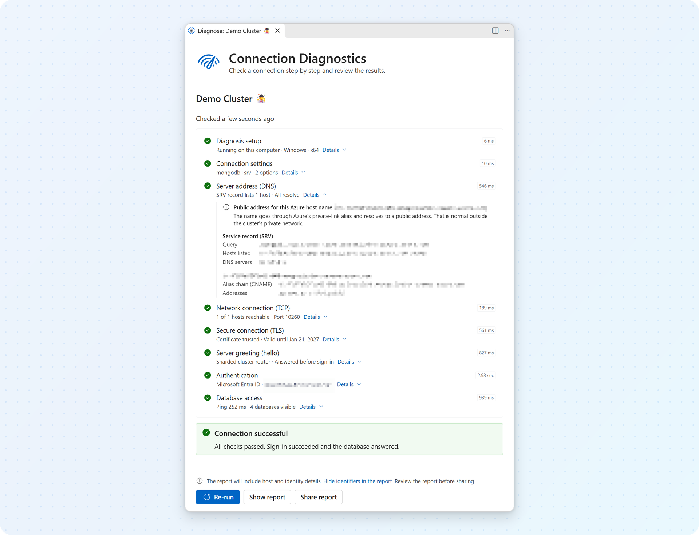
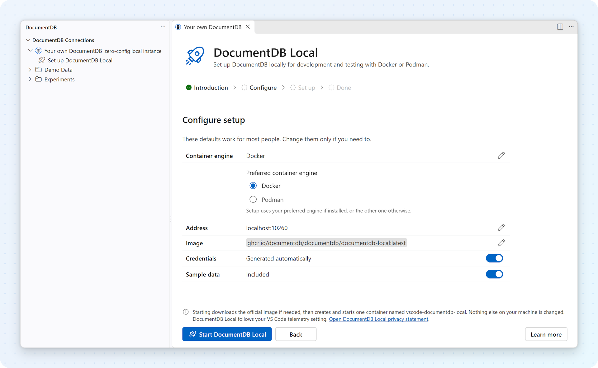

# DocumentDB extension for Visual Studio Code v1.1

**Version 1.1 of the DocumentDB extension for Visual Studio Code** helps you answer a frustrating question: why won't this database connect? New connection diagnostics show what happened at each step and produce a report you can share with support. This release also brings Podman to DocumentDB Local, makes local setup easier to inspect, and lets links open Azure resources directly in VS Code.

## What's New in v1.1

### ⭐ Diagnose a Connection, Not Just an Error

A timeout alone rarely tells you what to fix. **Diagnose Connection…** checks a connection step by step, from its settings and server address through the network, TLS, server greeting, authentication, and database access. Each step shows what was observed, how long it took, and expandable **Details**. The result explains where the connection stopped and what to try next.

<picture><source media="(prefers-color-scheme: dark)" srcset="./images/1.1.0_connection_diagnostics_dark.png"></picture>

Open it by right-clicking a cluster in **Connections**, **Service Discovery**, or the **Azure** view, selecting **Diagnose this connection…** after a failed connection, or running **DocumentDB: Diagnose Connection…** from the Command Palette. You can diagnose a working connection, too.

- **Evidence rather than guesswork.** See DNS results, certificate details, sign-in findings, and the server that answered. A failed network check does not override a successful real connection.
- **Checks from the right machine.** In WSL, SSH, dev containers, or Codespaces, the panel identifies the remote host where the database checks run.
- **No new sign-in prompts.** Diagnosis uses your selected authentication method and available credentials. If sign-in or a password is needed, it says the connection was not tested instead of declaring it unreachable.
- **Reports you control.** Preview the report in VS Code, copy it as Markdown, or save it as Markdown or JSON. Passwords and tokens are excluded. Reports include host and identity details by default; select **Hide identifiers in the report** before sharing outside your organization. The panel itself keeps identifiers visible.

Cancel a running diagnosis or re-run it when something changes. If a diagnostic time limit prevents a complete check, retry with longer timeouts or without diagnostic timeouts for that run, without changing your saved connection.

Learn more in [Diagnose a Connection](https://microsoft.github.io/vscode-documentdb/user-manual/diagnose-connection).

### ⭐ Run DocumentDB Local with Docker or Podman

You no longer need the Docker CLI to use **DocumentDB Local**. On the **Configure** step, choose **Docker** or **Podman** as your preferred container engine. Docker remains the default for a fresh setup. If the preferred CLI is missing, setup can use the other one; a stopped engine does not trigger a switch.

<picture><source media="(prefers-color-scheme: dark)" srcset="./images/1.1.0_local_container_engine_dark.png"></picture>

On macOS and Windows, setup can offer **Start Podman machine** for an eligible stopped machine. Startup requires your click; creating a machine or choosing among ambiguous machines remains manual. Linux and WSL show guidance appropriate to the connection instead.

Existing instances stay with the engine that owns their container and data volume. Start, stop, restart, and recreation do not silently move data between Docker and Podman.

Learn more in [Set up DocumentDB Local](https://microsoft.github.io/vscode-documentdb/user-manual/local-quick-start).

### See What Local Setup Actually Did

The **Set up** and **Done** screens now offer collapsed **Details** for completed or failed stages. Expand a stage to inspect the available facts: the selected engine, image identity, container and volume, port mapping, connection-readiness checks, and sample-data outcome.

While an image downloads, the status line shows activity from the container engine rather than an estimated percentage. If sample data could not be loaded but the database is ready, the success screen calls that out and points you to the setup log. Failure explanations and recovery actions remain visible without opening Details.

Learn more about [setup progress and recovery](https://microsoft.github.io/vscode-documentdb/user-manual/local-quick-start#container-engine-requirement).

### ⭐ Open an Azure Resource Straight into Your Workflow

Links can now identify an **Azure DocumentDB** cluster or an **Azure Cosmos DB for MongoDB (RU)** account by its Azure resource ID, without carrying a connection string. The extension guides Azure sign-in, finds the resource, and reveals it in **Service Discovery**. If discovery filters hide it, a separate confirmation explains the persistent filter changes before applying them.

Both resource-ID links and connection-string links can request the **Cluster Dashboard** or **Interactive Shell**, optionally for a specific database. This lets a team shortcut or documentation link take you directly to the view you need. Shell links open a shell; they never execute a script or command.

Connection-string links also ask fewer repeated questions: one confirmation identifies what will open, and adding a new saved connection always requires approval. If connecting fails or is cancelled, the requested view does not open.

Learn how to build links in [Connect with a URL](https://microsoft.github.io/vscode-documentdb/user-manual/how-to-construct-url).

## Key Fixes and Improvements

- **Safer recreation of local containers.** Recreating a container with existing data reuses its recorded exact image when available, rather than following a floating tag to a newer release that could upgrade the data. Older instances with only a saved tag use the local image; if it is missing, setup stops with guidance instead of automatically downloading a potentially newer one.
- **Stronger Microsoft Entra ID token protection.** Account and managed-identity connections accept recognized Azure DocumentDB service host names or an explicitly trusted, narrow machine-scoped suffix. Destination and certificate checks apply across links, saved connections, the shell, and Query Playground. Connection-string options cannot weaken them or override your chosen authentication method. If an address is not trusted, the authentication picker explains why and offers documentation rather than silently switching methods. Review [Microsoft Entra ID Trusted Servers](https://microsoft.github.io/vscode-documentdb/user-manual/entra-id-trusted-servers) if you use a custom host name.
- **Bundled security update.** Updated a runtime dependency with an upstream security fix for HTTP request parsing.

## Changelog

See the full changelog entry for this release:
[CHANGELOG.md#110](https://github.com/microsoft/vscode-documentdb/blob/main/CHANGELOG.md#110)
