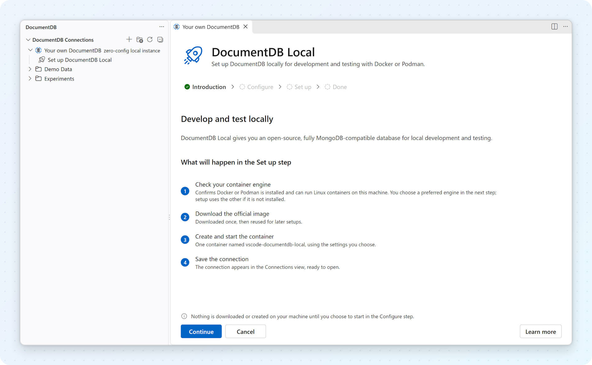
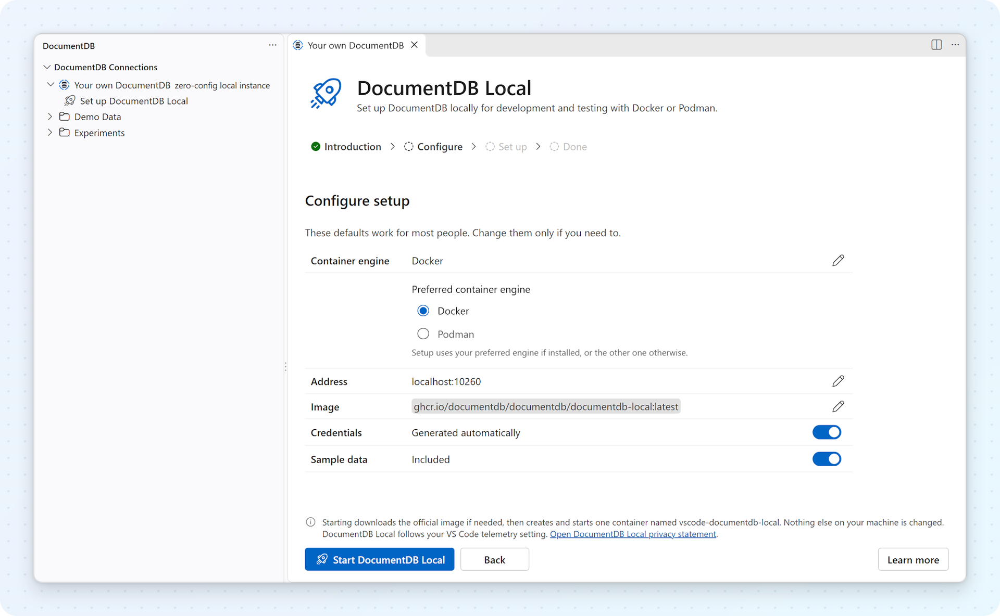

# Set up DocumentDB Local

Set up and manage a DocumentDB Local container from the Connections view. The extension pulls the official image, creates a persistent data volume, waits for DocumentDB to accept connections, and saves the connection in VS Code.

[DocumentDB](https://documentdb.io/) is an open-source, fully MongoDB-compatible database for modern application development. DocumentDB Local lets you run it in a local container for development and testing.

## Happy path

With a supported container engine available to the extension host, setup takes only a few clicks.
A fresh Configure step defaults to Docker; choose Podman there if you prefer it. On macOS and
Windows, setup can offer an explicit button to start an eligible stopped Podman machine. Creating a
machine or choosing among ambiguous machines remains manual.

<p align="center"><picture><source media="(prefers-color-scheme: dark)" srcset="./images/local-quick-start-introduction_dark.png"></picture></p>

1. Open the **Connections** view.
2. Expand **Your own DocumentDB**, then select **Set up DocumentDB Local**.
3. On the **Introduction** step, select **Continue**.
4. On the **Configure** step, keep the Docker default or choose **Podman** under **Container engine**, then select **Start DocumentDB Local**.
5. When **DocumentDB Local is ready** appears, select **Open Connection**.

<p align="center"><picture><source media="(prefers-color-scheme: dark)" srcset="./images/local-quick-start-configure_dark.png"></picture></p>

The extension generates the credentials, includes sample data, and chooses an available port. The new **DocumentDB Local** connection appears under **Your own DocumentDB**, ready to browse.

The note above **Start DocumentDB Local** also says that the container follows your VS Code telemetry setting. See [Usage telemetry](#usage-telemetry) for what that means.

## Container engine requirement

Setting up DocumentDB Local requires:

- A Docker or Podman CLI available to the VS Code extension host. Configure always shows a
  **Container engine** preference first, with Docker selected for a fresh setup. It makes no
  availability checks and does not persist the preference.
- During setup, the extension checks both CLIs and uses the preferred one if its CLI is installed.
  It falls back to the other engine only when the preferred CLI is missing. An installed but
  stopped engine is not treated as missing, so setup does not switch to the other engine in that
  case.
- For a recreate that reuses existing data, Configure shows the instance's recorded engine
  read-only. Start fresh also recreates within that same engine; changing the preference never moves
  an existing instance to another engine.
- Access from the selected CLI to an engine running Linux containers.
- An x64 or arm64 extension host. DocumentDB Local images are published for those architectures.

Both Docker Engine and Docker Desktop are supported. Docker Desktop is not required when Docker
Engine is already available. Each instance records the engine that owns its container and data
volume; lifecycle actions and data-preserving recreation stay on that engine, regardless of the
fresh-setup preference. A legacy instance without a recorded engine is resolved only during
execution, never guessed in Configure.

The extension never installs Docker or Podman, starts an engine automatically, runs `sudo`, changes
group membership, or switches Docker contexts. On macOS and Windows, you can explicitly select
**Start Podman machine** when setup identifies a stopped default machine, or the sole machine when
none is marked default, provided no other machine is running or starting. The extension does not
initialize a machine; if the selection is ambiguous, choose and start the intended machine manually.
Linux and WSL have no machine-start button; setup
uses the address in Podman's error to choose copy-only guidance (see
[Podman on Linux or WSL](#podman-on-linux-or-wsl)).
If that address is on another computer, setup offers no start button on any platform.

The extension host matters: it runs the CLI and must be able to reach both the selected engine and
DocumentDB's published port. The engine can run in a separate environment, such as a Podman machine
or Docker Desktop on Windows reached from WSL. In WSL, SSH, a dev container, or Codespaces,
`localhost:10260` refers to the extension-host environment, not necessarily your local computer.
SSH, dev-container, Codespaces, and other remote sessions do not launch a container engine on your
local computer.

The instance tooltip names an engine only when positive evidence identifies it. When evidence identifies a Podman engine reached through the Docker CLI, the tooltip reports **Podman (through the Docker CLI)**. It shows the server version, not the CLI version. Some host error messages use neutral container-engine wording.

The first setup stage heading reads **Checking container engine**. Its summary identifies the
selected CLI and its version when reported. If setup falls back, it also names the missing preferred
CLI.

The setup view shows pull, create, start, and connection-readiness progress. While pulling, one
status line shows the known image and origin until engine output is available, then shows that
output instead. Long text is ellipsized to prevent layout shifts; hover to see the full line.
This reports activity, not a completion estimate. Container-engine command output is also
written to the **DocumentDB Local Setup** output channel.

Select **Details** on a completed or failed setup stage to see the facts available for that stage.
Details start collapsed and remain available on the success screen; each row with Details has a
short factual summary. Checking shows which Docker and Podman executables are on PATH and probes
only the engine selected for this run. If setup falls back because the preferred CLI is missing,
the details show that result. For shortened image or container IDs, hover or focus the ID to see
the full value. An updated image also shows its previous ID when already available. Failure
explanations and recovery actions stay visible below the stages.

If sample data could not be loaded, the success message and Details call this out. The instance is
still ready to use; select **View setup log** for the reason.

## Port

The **Configure** step pre-fills the **Address** with a host port that is free at that moment, starting at `10260` and moving forward if that port is taken. You can change it, and the value is checked while you are still on the step.

Setup then uses exactly that port. It never moves the instance to a different port after you select **Start DocumentDB Local**. If the port is taken by the time the container is created, setup stops with an explanation so you can go back and choose another one.

## Usage telemetry

Starting with release 1.0-rc2, the DocumentDB Local image sends a small amount of anonymous usage data to the DocumentDB project. It helps the project see which releases and platforms are in use. The [DocumentDB Local privacy statement](https://github.com/documentdb/documentdb/blob/main/documentdb-local/PRIVACY.md) describes it in full. In short:

- **What is sent:** the image's release version, the operating system, the CPU architecture, and a fixed event name. Nothing else.
- **What is never sent:** your documents, queries, database or collection names, user names, or credentials.
- **When:** once when the container starts, then once an hour while it keeps running.
- **Where:** to [Scarf](https://scarf.sh), the analytics service the DocumentDB project uses. As with any web request, Scarf also sees the network address the request comes from.

This is separate from the extension's own telemetry, which VS Code controls in the usual way.

### Which VS Code setting does what

The extension doesn't ask you a second time. When it creates the container, it applies the telemetry level you already chose in VS Code (`telemetry.telemetryLevel`):

| VS Code telemetry level     | What the DocumentDB Local container does |
| --------------------------- | ---------------------------------------- |
| `all` (the VS Code default) | Sends the usage data described above.    |
| `error`                     | Sends nothing.                           |
| `crash`                     | Sends nothing.                           |
| `off`                       | Sends nothing.                           |

For every level except `all`, setup creates the container with `DOCUMENTDB_USAGE_TELEMETRY=false`, the image's own off switch. The same applies when telemetry is turned off by an organization policy or by starting VS Code with `--disable-telemetry`. See [Telemetry in VS Code](https://code.visualstudio.com/docs/configure/telemetry) for how to change the level.

### When a change takes effect

The setting is read once, when the container is created. **Stop**, **Start**, and **Restart** keep the container as it is, so changing the VS Code level later doesn't change an existing container.

To apply a new level and keep your data:

Use the CLI of the instance's recorded engine in the commands below: replace `docker` with
`podman` for a Podman-owned instance.

1. Remove only the container. Its data volume stays:

   ```bash
   docker rm -f vscode-documentdb-local
   ```

2. In the **Connections** view, expand the **DocumentDB Local** instance and select **Recreate container**. If the row doesn't appear yet, refresh the view.
3. In the setup view, select **Continue**, then **Start DocumentDB Local**. The extension creates a new container on the same data volume, with the same credentials and image version, using your current telemetry level.

**Delete Container…** in the extension removes the data volume too, so use it only when you want to start over.

To check what a running container does, run:

```bash
docker exec vscode-documentdb-local printenv DOCUMENTDB_USAGE_TELEMETRY
```

It prints `false` when usage telemetry is turned off. It prints nothing when the image's default (on) applies.

Images older than 1.0-rc2, which you can pick with the image-tag setting on the **Configure** step, send no usage data and ignore this setting.

## Container engine is not ready

Readiness checks identify the selected CLI and, where positive evidence permits, the engine and
platform. Use **View setup log** for command details. Select **Check Docker again** or **Check Podman
again** beside the **Checking container engine** stage to recheck readiness. This does not restart
provisioning; select **Continue setup** when offered to proceed.

### Container engine CLI not found

Install [Docker Engine](https://docs.docker.com/engine/install/), Docker Desktop, or
[Podman](https://podman.io/docs/installation), then open **Set up DocumentDB Local** again. The
extension uses the preferred CLI when it is on `PATH` and falls back only when that CLI is
unavailable; if neither CLI is found, setup reports the preferred engine as missing. If a CLI
works in a terminal but not in VS Code, confirm that the extension host inherited the same `PATH`.
After an installation changes `PATH`, fully quit and restart VS Code; reloading the window may keep
the old environment. For Docker, also check `DOCKER_HOST` and `DOCKER_CONTEXT`. Podman uses its own
connection configuration, not Docker's endpoint settings.

### Docker socket access denied on Linux or WSL

The card may offer this fixed command as copy-only text:

```bash
sudo usermod -aG docker $USER
```

The extension never runs the command. Group changes apply only to new login sessions:

- **Native Linux:** Sign out of the desktop session and sign back in. Reloading the VS Code window is not enough.
- **WSL:** Run `wsl --shutdown` in a Windows terminal, then reopen the folder in WSL. This stops all running WSL distributions.
- **Remote SSH:** Run **Remote-SSH: Kill VS Code Server on Host**, then reconnect.
- **Dev container or Codespaces:** Rebuild the container.

See [Linux post-installation steps for Docker Engine](https://docs.docker.com/engine/install/linux-postinstall/) for details and security considerations.

After following the guidance, select **Check Docker again**.

### Podman on Linux or WSL

For Podman on Linux or WSL, there is no machine-start button. Setup reads the address in Podman's
error to decide what to suggest. When Podman could not reach its user socket, setup can offer this
command as copy-only text:

```bash
systemctl --user start podman.socket
```

In WSL, when Podman uses a Podman machine running on Windows, setup instead offers
`podman machine start <name>` as copy-only text labelled **Run in a Windows terminal**. You can also
start the machine from Podman Desktop. For any other address, setup asks you to check the connection
with `podman system connection list`.

Run the command yourself, then select **Check Podman again**.

### Native Docker Engine is stopped

Start the system service outside the extension, then select **Check Docker again**. Depending on the Linux environment, the card may offer one of these commands as copy-only text:

```bash
sudo systemctl start docker
```

```bash
sudo service docker start
```

Only a positively identified rootless Docker Engine user service can receive an automatic **Start Docker** action. The extension never starts a root-managed service or elevates privileges.

### Docker Desktop and WSL integration

When setup positively identifies Docker Desktop, it may offer **Start Docker Desktop**. In WSL, the Windows application being installed is not enough to identify the active provider because native Docker Engine can coexist with Docker Desktop.

If Docker Desktop is running but unavailable in a WSL distribution:

1. Open Docker Desktop settings.
2. Open **Resources > WSL Integration**.
3. Enable integration for the distribution where VS Code is running.
4. Reopen the WSL folder, open **Set up DocumentDB Local**, and retry setup.

See [Docker Desktop WSL integration](https://docs.docker.com/desktop/features/wsl/).

### Podman machine is not running

On macOS and Windows, Podman uses a machine. If setup identifies a stopped default machine—or the
only machine when none is marked default—it offers **Start Podman machine**. Select the button to
start that machine, then let setup check readiness.

The button is not offered if another machine is already running or starting. If the selected
machine is already starting, setup waits for it without launching it again. **Stop waiting** cancels
only the readiness wait, not machine startup. You can select **Check Podman again** later.

If no machine exists, initialize it manually with `podman machine init`, then start it with
`podman machine start`. If several machines exist and none is marked default, setup offers no
button; choose and start the intended machine manually. The extension never initializes a machine
or starts one without your click.

If Podman's error shows that it tried to reach another computer, setup offers no button and asks you
to check the connection with `podman system connection list`.

### Context or remote endpoint unavailable

Docker setup respects `DOCKER_HOST`, `DOCKER_CONTEXT`, the current Docker context, and then the
platform default endpoint, in that order. It never changes the selected context.

- Repair or select a valid context using the [Docker context guide](https://docs.docker.com/engine/manage-resources/contexts/).
- For `tcp://` or `ssh://` endpoints, make sure the endpoint is reachable from the extension host.
- In SSH, dev-container, and Codespaces sessions, install and configure the selected engine in the
  remote environment. Setup does not launch an application on your local machine.

### Linux containers required

DocumentDB Local requires a Linux-container engine. If a reachable Windows Docker daemon reports
Windows-container mode, switch Docker to Linux containers and select **Check Docker again**.

## Recovery during setup

If the selected container engine becomes unavailable during image pull or container creation, setup returns to its recovery stage. Registry, proxy, image-manifest, and other image-specific failures remain setup errors and are not presented as engine diagnoses.

If a dev-container setup creates the container but times out waiting for DocumentDB, the container engine may be running on the dev-container host. A published `localhost` port is not always reachable from inside the dev container. Use **View setup log** and verify port reachability in the extension-host environment.
