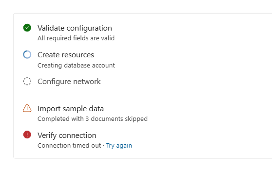

# `StatusList`

A status list shows the stages of a multi-step operation and how each one ended. Each row has a
status icon, a label, and an optional line of detail beneath it.

Detail stays on screen after a stage settles, so a finished list still records what was observed,
and a failure stays readable beside the stage that produced it.

Use a status list when an operation has several stages worth naming. For a single wait with no
stages, use Fluent's `Spinner`, or `ProgressBar` when the progress is measurable.



## Best practices

### Do

- Give the list an `ariaLabel` naming what the stages belong to.
- Say why a `skipped` stage did not run, in its `detail`.
- Pass localized `statusLabels` if your application ships translations. Unlisted statuses keep
  their English default.
- Keep the labels stable for the whole run. The list is most useful when it shows the shape of the
  operation before it starts.
- Own any live narration yourself. A flow that streams progress should have one `role="status"`
  region for the whole flow.

### Don't

- Wrap it in a `Card` for the border. The border belongs to the component.
- Expect an `aria-live` region here. There is none, deliberately; see Accessibility.
- Expect a custom icon slot. The fixed status vocabulary is what makes a list readable at a glance.

## Anatomy

```tsx
<StatusList ariaLabel={l10n.t('Setup progress')}>
    <StatusListItem
        label={l10n.t('Checking Docker')}
        status="done"
        detail={l10n.t('{0} · {1}', 'Docker Engine 27.3', 'Linux')}
        reserveDetailSpace
    />
    <StatusListItem label={l10n.t('Pulling official image')} status="active" />
    <StatusListItem label={l10n.t('Creating container')} status="pending" />
</StatusList>
```

| `status`  | glyph                       | reads as                                      |
| --------- | --------------------------- | --------------------------------------------- |
| `done`    | `CheckmarkCircleFilled`     | finished                                      |
| `error`   | `ErrorCircleFilled`         | failed                                        |
| `warning` | `WarningRegular`            | succeeded, but you may not proceed            |
| `active`  | `Spinner size="extra-tiny"` | in flight                                     |
| `pending` | `CircleHintFilled`          | not started; the label dims to match          |
| `skipped` | `SubtractCircleRegular`     | did not run, and will not; the label dims too |

`warning` earns its place: a credential that authenticates and then returns nothing usable has not
failed, and an error glyph would misreport it. It is the general "succeeded, but you probably cannot
proceed" state.

`skipped` is for a stage that does not apply, or did not run because an earlier stage failed. Say
why in `detail`, for example "Not used: TLS is off for this connection"; the component adds no
text of its own. Use it instead of `pending` once the run has finished: `pending` reads as "about to
run", which is no longer true. The glyph is neutral rather than alarming, because a stage that did
not apply is not a problem.

## `detail` takes anything

One `ReactNode`, not a set of props. Text, a `Link`, a joined sentence, a control:

```tsx
detail={
    <>
        {evidence}
        {' · '}
        <Link onClick={recheck}>{l10n.t('Check again')}</Link>
    </>
}
```

That is deliberate. Separate `meta` and `action` props would have put the "·" joiner, and its
localization, inside a package that ships no strings. Composition puts both back where they belong.

Inline controls are normalised to the detail line's type scale by element (`a`, `button`, `label`),
never by a Fluent class name. `Link` renders a `<button>` when given `onClick` without `href`, which
is why the rule covers both.

## `reserveDetailSpace`

Holds the detail line's height before it has content, so the row does not grow, and shift
everything below it, when the detail lands. Use it on a row whose evidence arrives asynchronously
while the user is looking at something else.

Named after `TabList.reserveSelectedTabSpace`, which solves the same problem in the same shape. It
renders an `aria-hidden` non-breaking space; the `aria-hidden` half is why it is a boolean rather
than "pass a space yourself".

## `disclosure`

Optional details that a row reveals on request, for a row whose single detail line cannot say
everything worth knowing, for example why it shows a warning. The row gets a small toggle right after
its label, on the label's own line, and a region below its detail line:

```tsx
<StatusListItem
    label={l10n.t('Server address (DNS)')}
    status="warning"
    detail={evidence}
    reserveDetailSpace
    disclosure={{
        content: <RowDetails details={details} />,
        toggleText: l10n.t('Details'),
        toggleLabel: l10n.t('Details for {0}', l10n.t('Server address (DNS)')),
        toggleDescription: l10n.t('Warning: {0}', mostSevereFinding),
        expanded,
        onExpandedChange: setExpanded,
    }}
/>
```

- Leave `disclosure` out on a row with nothing more to say. A toggle on every row trains people to
  ignore it.
- The package draws the frame; you provide only the content. What to put in it, in which sizes and
  colours, is in [Details content](#details-content).
- The toggle sits next to the label rather than at the row's trailing edge: at the far edge, in a
  list of rows, it was hard to tell which row a toggle belonged to.
- The toggle is exactly as tall as the label line, so a collapsed row with a toggle is as tall as one
  without; the list keeps its layout. The expanded region, indented under the row's text with a
  subtle left border, pushes the following rows down.
- `toggleLabel` is the accessible name and also names the region. Include `toggleText` in it, so
  voice control users can say what they see, and the row label, so a screen reader user knows which
  row it opens.
- `toggleDescription` becomes the toggle's `aria-describedby`. Use it for the reason the row
  matters, so a screen reader user hears it without expanding.
- The region stays mounted, so `aria-controls` always points at an element. Its contents expand and
  collapse with Fluent's default `Collapse` motion, respecting `prefers-reduced-motion`. The region
  is `inert` as soon as it collapses, keeping its contents out of keyboard navigation and the
  accessibility tree during exit; the contents unmount when exit finishes. The empty region takes
  no space, preserving collapsed row heights. Expanding or collapsing never moves focus.
- A disclosure mounted already expanded opens instantly; later toggles animate. Controlled resets
  to `expanded: false` animate too, unless the consumer removes the disclosure altogether.
- Pass `toggleRef` when the row can lose its disclosure while the toggle has focus, so the consumer
  can move focus somewhere sensible.
- `placement: 'detail'` moves the toggle to the end of the detail line, inline after its text, in the
  detail line's type size and line height. Use it when the labels should read as plain headings. A
  long detail line wraps around the toggle like a word, so it stays on its own row and never covers
  the text, and a row with no detail text still shows the toggle on its second line.

## Details content

What goes **inside** a disclosure, for anyone writing `disclosure.content`, human or coding agent.
Follow it as written: the point is that every details region in every consumer reads the same.

### Who owns what

The package (`StatusListItem`) owns the **frame**:

- the toggle, its placement, `aria-expanded` and `aria-controls` (you pass its text, name and
  description);
- the `role="region"`, named by the toggle, `inert` and emptied while collapsed;
- the gap under the detail line (`spacingVerticalS`);
- the left rule (`strokeWidthThick`, `colorNeutralStroke2`) and the indent (`spacingHorizontalM`);
- the region's vertical padding (`spacingVerticalXXS`), so the rule overhangs the first and last
  lines;
- the motion (`Collapse`, honouring reduced motion) and the unchanged collapsed row height;
- the **base type**: `fontFamilyBase`, `fontSizeBase200`, `lineHeightBase200`,
  `colorNeutralForeground1`, and `code` in `fontFamilyMonospace`.

You own the **content**: which blocks, in which order, every string in them, and the spacing
between your top-level blocks.

Do not add a border, an indent, a top margin or a background of your own. The frame is already
there, and a second one is how two consumers end up looking different.

**Why the region sets base200.** The region continues the detail line, which is base200, so its
content sits one step below the row title (base300) and never competes with it. Setting it on the
region, rather than asking each consumer to, means plain HTML content (`<div>`, `<dl>`, `<ul>`,
`<code>`) gets the right type with no styles of its own. A `<p>` does too, but keeps the browser's
margins; prefer a `<div>`, or reset them, so the spacing below holds. The colour is the primary foreground, not the detail
line's secondary one, because the region is content rather than a caption.

### Type scale

Every line in a details region is **base200**. Hierarchy comes from weight, colour and typeface,
never from size: the details never use a size larger than the row title, and the body never goes
below base200 (no `fontSizeBase100`, not even for footnotes).

| Role                           | Size / line height | Weight   | Colour                    | Use                                                |
| ------------------------------ | ------------------ | -------- | ------------------------- | -------------------------------------------------- |
| Row title (the `label`)        | base300 / base300  | regular  | `colorNeutralForeground1` | the package; not inside details                    |
| Detail line (the `detail`)     | base200 / base200  | regular  | `colorNeutralForeground2` | the package; not inside details                    |
| Details body text              | base200 / base200  | regular  | `colorNeutralForeground1` | plain elements, or `<Text size={200}>`             |
| Section title                  | base200 / base200  | semibold | `colorNeutralForeground1` | `StatusListDetailsSection title`                   |
| Fact term                      | base200 / base200  | regular  | `colorNeutralForeground2` | `StatusListDetailsFacts` (`<dt>`)                  |
| Fact value                     | base200 / base200  | regular  | `colorNeutralForeground1` | `StatusListDetailsFacts` (`<dd>`)                  |
| Code-like value                | inherits (base200) | inherits | inherits                  | `<code>`, or `mono: true` on a fact                |
| Secondary note inside a value  | base200 / base200  | regular  | `colorNeutralForeground2` | a `<span>` with that token, e.g. "(IPv4, public)"  |
| Message title                  | base200 / base200  | semibold | `colorNeutralForeground1` | `StatusListDetailsMessage title`                   |
| Message explanation, next step | base200 / base200  | regular  | `colorNeutralForeground1` | `StatusListDetailsMessage` children and `nextStep` |

In Fluent `Text` props: body is `<Text size={200}>`, a section or message title is
`<Text size={200} weight="semibold">`. **Never a bare `<Text>` inside details**: `Text` defaults to
`size={300}` and sets it explicitly, so it overrides the region's base and renders at the row
title's size. Plain elements inherit the region's base and need nothing.

**Code-like values** (host names, addresses, user names, option names, commands) go in `<code>`.
The region renders `code` in `fontFamilyMonospace` at the surrounding size, weight and colour, and
removes the chip that VS Code's webview default stylesheet gives `code` (its preformat colour,
background, padding and rounded corners); inside details, code is a typeface and nothing else.

### Building blocks

Three presentational components implement the scale, so choosing them is choosing correctly. They
carry no strings of their own (except `StatusListDetailsMessage`'s overridable English severity
word, which is visually hidden) and no product terms.

- **`StatusListDetailsSection`**: an optional `title` over its children, for a group of facts that
  belongs to one thing, such as one host. The title is a visual heading; see Accessibility below.
- **`StatusListDetailsFacts`**: `items: { term, value, mono? }[]` as a semantic `<dl>` in two aligned
  columns. Falsy items are skipped, so `condition && { term, value }` works inline, and an empty list
  renders nothing. Terms are unique within one list.
- **`StatusListDetailsMessage`**: `severity` (`error`, `warning`, `info`), `title`, the explanation as
  children, and an optional `nextStep` line. Pass the whole localized next-step line, including any
  lead-in such as "Next:". `severityLabel` is the hidden word read before the title; pass it
  localized.

Each block also sets the base type itself, so it renders the same outside a disclosure. They are
parts of `StatusList`, not components in their own right: they exist so that a disclosure's content
is chosen from the scale rather than restyled per consumer.

### Layout and spacing

Put your blocks in one vertical stack. Use these tokens and no others:

| Between                                      | Token                                                   | Owner                  |
| -------------------------------------------- | ------------------------------------------------------- | ---------------------- |
| the detail line and the region               | `spacingVerticalS`                                      | package                |
| the rule and the content                     | `spacingHorizontalM`                                    | package                |
| top-level blocks (messages, sections, facts) | `spacingVerticalM`, as a flex column `gap` on your root | you                    |
| two messages in a list                       | `spacingVerticalS`                                      | you (the list's `gap`) |
| a section title and its body; two fact rows  | `spacingVerticalXXS`                                    | blocks                 |
| a fact's term and value columns              | `spacingHorizontalL`                                    | blocks                 |
| a message's glyph and its text; lines in it  | `spacingHorizontalS`; `spacingVerticalXXS`              | blocks                 |

Choose the structure by what the content is:

- **A facts list (`<dl>`)** for observed attributes with short names: versions, addresses, names,
  yes/no answers. Two facts or more; a single fact reads better as a sentence.
- **Prose** for an explanation, a cause or a next step. A message's explanation is prose.
- **A list (`<ul>`)**: several values of one fact, as an unstyled list (`margin: 0`, `padding: 0`,
  `listStyleType: 'none'`) inside the `<dd>`; several messages, as a `<ul>` with an `aria-label`
  ("Findings") and one `<li>` per message.
- **Not a table.** The region is narrow, and a table of hosts by attributes overflows. Use one
  section per item, each with the same facts in the same order.

Order: what is wrong first (messages, most severe first), then the evidence.

### Long values

Values wrap; they are never truncated. A host name or an address is what people read and copy, so
an ellipsis or a tooltip-only full value is wrong. Fact values and titles wrap anywhere
(`overflowWrap: 'anywhere'`), so a long host name breaks instead of widening the panel. The term
column grows to its longest term up to 40% of the width, and longer terms wrap. Apply
`overflowWrap: 'anywhere'` yourself to any other element that can hold a host name.

### Colour

Fluent tokens only: no hex values, no `--vscode-*` variables, no opacity tricks. Text uses the two
foregrounds in the type scale. Severity is carried by the message glyph, coloured with the same
tokens as the row glyphs (`colorPaletteRedForeground1` for error, `colorStatusWarningForeground1`
for warning, `colorNeutralForeground2` for information), and by the hidden severity word. Never
colour the message text by severity; high contrast themes and colour-blind readers depend on the
glyph and the word.

### Accessibility of details content

- **Facts are a real `<dl>`**, each `<dt>`/`<dd>` pair grouped in a `<div>`, so a screen reader
  hears the term with its value.
- **Section and message titles are visual headings, not HTML headings.** The region is already
  named "Details for <row>", and a heading per section in every row's region would flood the page
  outline at a level the package cannot know. If a long details region really needs heading
  navigation, render your own heading at the level your page needs, styled as a section title.
- **Nothing in the region takes focus by itself.** No `autoFocus`, no focus moves on expand. A
  link or a button inside is allowed; it follows the toggle in the natural tab order, and becomes
  unreachable as soon as the region collapses (`inert`).
- **No `aria-live` inside.** Expanding is the user's own action; announcing it would double up.
- Severity glyphs are `aria-hidden`; the visually hidden severity word comes first in the title.

### Do and don't

**Do**

- Use the building blocks, or plain elements that inherit the region's base type.
- Use `<code>` (or `mono: true`) for every host name, address, user name and option.
- Start with what is wrong, then show the evidence.
- Pass every string localized, including `severityLabel` and the next-step line.

**Don't**

- Add a border, indent, margin or background around your content; the frame is the package's.
- Use a bare `<Text>` (base300), any size above base200, or `fontSizeBase100`.
- Truncate a value, or hide it in a tooltip.
- Use HTML headings, a table, custom colours, or severity-coloured text.

### Example

```tsx
import {
    StatusListDetailsFacts,
    StatusListDetailsMessage,
    StatusListDetailsSection,
} from '@microsoft/vscode-ext-webview-fluentui/components';

const useStyles = makeStyles({
    root: { display: 'flex', flexDirection: 'column', gap: tokens.spacingVerticalM },
});

const TlsDetails = ({ host, protocol, issuer, warning }: TlsDetailsProps): JSX.Element => {
    const styles = useStyles();
    return (
        <div className={styles.root}>
            {warning && (
                <StatusListDetailsMessage
                    severity="warning"
                    severityLabel={l10n.t('Warning:')}
                    title={warning.title}
                    nextStep={l10n.t('Next: {0}', warning.nextStep)}
                >
                    {warning.explanation}
                </StatusListDetailsMessage>
            )}
            <StatusListDetailsSection title={<code>{host}</code>}>
                <StatusListDetailsFacts
                    items={[
                        { term: l10n.t('Protocol'), value: protocol },
                        issuer !== undefined && { term: l10n.t('Issued by'), value: issuer },
                    ]}
                />
            </StatusListDetailsSection>
        </div>
    );
};

// disclosure={{ content: <TlsDetails {...tls} />, toggleText: l10n.t('Details'), ... }}
```

For a complete consumer (messages for findings, sections per host, facts with code values, value
lists and secondary notes), see the DocumentDB extension's Diagnose connection panel,
[`TroubleshooterRowDetails.tsx`](https://github.com/microsoft/vscode-documentdb/blob/main/src/webviews/documentdb/connectivityTroubleshooter/TroubleshooterRowDetails.tsx).

## Accessibility

- The list is `role="list"`, each row `role="listitem"`.
- **A row carries no `aria-label`.** The status is a visually-hidden word appended to the label
  instead. A row-level label would make anything interactive inside `detail` unreachable, and
  `detail` takes arbitrary content, so that is a guarantee rather than an observation.
- **A disclosure is a real button.** `aria-expanded`, `aria-controls` and a `role="region"` named by
  the button; Enter and Space work because it is a `<button>`, and Fluent draws its focus ring.
- **No `aria-live`.** A surface that streams progress already owns a `role="status"` region; live
  semantics here would double-announce every change.
- Glyphs are `aria-hidden`. The status word carries the meaning.
- The visually-hidden span is `position: absolute` and needs a positioned ancestor; `Container`
  provides one.

## Props

See [`StatusList.types.ts`](./StatusList.types.ts).
